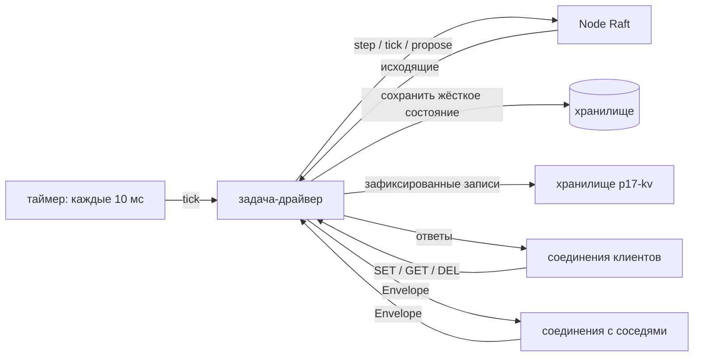

<!-- nav:top -->
[🏠 Начало](../START-HERE.md) · [← 18.13 Распределённые транзакции и саги](13-distributed-transactions-and-sagas.md) · [📋 Этап 18](README.md) · [18.15 Контрольная точка: стадия 4 пройдена →](15-checkpoint-stage-4-complete.md) · [📖 Глоссарий](../GLOSSARY.md) · [🇬🇧 English](../../en/18-distributed-systems/14-project-replicated-key-value-store.md) <!-- nav -->

# Урок 18.14 — Проект: реплицированное хранилище «ключ-значение»

> **Этап 18 — Распределённые системы** · Урок 14 из 15 · ⏱ около 20 часов (10 занятий)

## Что вы узнаете

- Как превратить чистое ядро Raft из Уроков 18.10–18.11 в работающий сервис: цикл тиков, сетевой транспорт и клиентский протокол.
- Как поставить ваше хранилище «ключ-значение» из Урока 17.14 за Raft, чтобы каждый узел применял одни и те же записи в одном и том же порядке.
- Как сохранять состояние Raft, чтобы упавший узел возвращался со своим термом, своим голосом и своим журналом.
- Как отвечать клиенту, только когда его запись зафиксирована, и как клиент находит лидера.
- Как тестировать весь кластер в `turmoil` с разделениями сети, задержками и падениями и проверять, что ни одна подтверждённая запись никогда не теряется.

## Перед началом

- Вы прошли [Урок 18.13 — Распределённые транзакции и саги](13-distributed-transactions-and-sagas.md).
- У вас есть эти пакеты, и все их тесты проходят:
  - `code/p18-raft` из [Урока 18.10](10-raft-leader-election.md) и [Урока 18.11](11-raft-log-replication.md): ядро Raft и его симулированный `Cluster`;
  - ваше хранилище «ключ-значение» из [Урока 17.14 — Проект: собственное хранилище «ключ-значение»](../17-storage-and-databases/14-project-key-value-store.md). В этом уроке его папка называется `code/p17-kv`; используйте настоящее имя своей папки.
- Вы знаете фрейминг с префиксом длины ([Урок 15.7](../15-networking/07-designing-a-protocol.md)), задачи и каналы Tokio ([Урок 14.13](../14-concurrency-and-async/13-tokio-tasks-and-channels.md)), `turmoil` ([Урок 18.12](12-deterministic-simulation-testing.md)) и `fsync` ([Урок 17.2](../17-storage-and-databases/02-durability-and-fsync.md)).
- Запланируйте время: чтение этой страницы займёт одно-два занятия, а сам проект — около двух недель. Это самый большой проект Стадии 4. Работайте веха за вехой, делайте коммит после каждой и держите все прежние тесты зелёными.

## Новые слова

| Слово | Значение |
|---|---|
| **драйвер** (driver) | Код вокруг ядра в стиле sans-IO, который делает настоящую работу: вызывает `tick` по таймеру, доставляет сетевые сообщения в `step`, отправляет исходящие, сохраняет состояние на диск и применяет зафиксированные записи. |
| **жёсткое состояние** (hard state) | Часть узла Raft, которая должна пережить падение: `term`, `voted_for` и журнал. |
| **транспорт** (transport) | Код, который переносит сообщения Raft между узлами, — здесь соединения TCP (Transmission Control Protocol, протокол управления передачей), несущие кадры с префиксом длины. |
| **кадр** (frame) | Одно сообщение в потоке байтов: длина в 4 байта, затем столько же байтов (Урок 15.7). |
| **перенаправление** (redirect) | Ответ последователя «я не лидер; лидер — узел 2», чтобы клиент мог обратиться к нужному узлу. |
| **подтверждённая запись** (acknowledged write) | Запись, на которую клиент получил `OK`. Кластер обещает никогда её не терять. |
| **линеаризуемое чтение** (linearizable read) | Чтение, которое возвращает значение последней подтверждённой записи, как если бы копия данных была только одна (Урок 18.7). |
| **история** (history) | Список операций, которые выполнил тест, вместе с их результатами. Проверяющий код читает его потом и решает, правильно ли вёл себя кластер. |

## Проект

### Что вы создадите

`p18-kv`: хранилище «ключ-значение», реплицированное через Raft на трёх узлах. Клиент может подключиться к любому узлу и отправить `SET`, `GET` и `DEL`. Кластер продолжает работать, пока один из трёх узлов лежит или отрезан, и ни одна запись, на которую ответили `OK`, никогда не теряется.

```text
             client: SET apples 10
                     |
                     v
 +---------+   AppendEntries   +---------+
 | node 1  | ----------------> | node 2  |
 | leader  | <---------------- |follower |
 |         |   AppendReply     |         |
 | Raft    |                   | Raft    |
 |  core   |      +---------+  |  core   |
 |  |      | ---> | node 3  |  |  |      |
 |  v      |      |follower |  |  v      |
 | p17-kv  |      +---------+  | p17-kv  |
 +---------+                   +---------+
   disk: term, vote, log         disk: term, vote, log
```

Каждый узел — один процесс (в тестах — один хост `turmoil`). Внутри одна задача-**драйвер** владеет `Node` Raft из Урока 18.11 и делает всё вокруг него:



Порядок внутри драйвера важен: после каждого `tick`, `step` или `propose` драйвер **сначала сохраняет жёсткое состояние**, затем отправляет исходящие, затем применяет новые зафиксированные записи и отвечает ожидающим клиентам. Сохранение до отправки — требование Raft (Урок 18.9): узел никогда не должен отправлять голос или подтверждение, которые он может забыть при падении.

### Контракт

**Устройство пакета.** Создайте пакет рядом с остальными:

```bash
cd ~/projects/rust
cargo new --lib code/p18-kv
cd code/p18-kv
cargo add --path ../p18-raft
cargo add --path ../p17-kv
cargo add tokio@1 --features full
cargo add serde@1 --features derive
cargo add serde_json@1
cargo add --dev turmoil@0.7
mkdir src/bin
```

`cargo add --path` добавляет *зависимость по пути*: Cargo собирает другой пакет из его папки, поэтому изменения в `p18-raft` подхватываются сразу.

```text
code/p18-kv/
  Cargo.toml
  README.md
  src/lib.rs        pub mod command; pub mod storage; pub mod transport; pub mod node; pub mod client;
  src/command.rs    Command and its text encoding
  src/storage.rs    trait Storage, MemStorage (tests), FileStorage (real runs)
  src/transport.rs  write_frame / read_frame
  src/node.rs       NodeConfig and run_node
  src/client.rs     Client with set / get / delete
  src/sim.rs        #[cfg(test)] turmoil tests
  src/bin/node.rs   runs one node on your machine
  src/bin/kv.rs     a command-line client
```

**Изменения в `p18-raft`** (все его старые тесты должны проходить):

| Изменение | Зачем |
|---|---|
| Добавьте `serde` с фичей `derive`; выведите `Serialize` и `Deserialize` для `Entry`, `Message` и `Envelope`. | Сообщения должны передаваться по сети. |
| `pub fn hard_state(&self) -> HardState` и `Node::restore(id, peers, config, seed, state: HardState) -> Node`, где `HardState { term, voted_for, log }`. | Драйвер сохраняет и снова загружает то, что должно пережить падение. |
| `pub fn take_committed(&mut self) -> Vec<(u64, Entry)>`: пары (индекс, запись), зафиксированные с прошлого вызова, по порядку. Оставьте `applied` для старых тестов или обновите их. | Записи к настоящему хранилищу применяет драйвер, а не ядро. |
| `pub fn leader_hint(&self) -> Option<NodeId>`: узел, от которого этот узел последним слышал как от лидера своего текущего терма. | Последователи перенаправляют клиентов. |

**Команды.** Поле `command: String` записи журнала содержит одно из:

| Текст | Значение |
|---|---|
| `SET <id> <key> <value>` | установить `key` в `value` (без пробелов в ключе и значении) |
| `DEL <id> <key>` | удалить `key` |
| `GET <id> <key>` | чтение, которое проходит через журнал (см. клиентский протокол) |
| (пусто) | пустая запись из Урока 18.11 |

`<id>` — идентификатор запроса, выбранный клиентом (например, `c7-42`). По нему драйвер находит ожидающего клиента, когда запись применена.

**Хранилище.**

```rust
pub trait Storage {
    fn load(&self) -> HardState;
    fn save(&mut self, state: &HardState);
}
```

`MemStorage` хранит состояние в `Rc<RefCell<HardState>>`; клоны делят его между собой, поэтому тест может держать один клон вне хоста `turmoil`, и «диск» переживает `crash` и `bounce`. `FileStorage` записывает состояние в `<data_dir>/node-<id>.json` по безопасной схеме из Урока 17.2: записать временный файл, `sync_all`, переименовать его поверх старого файла, синхронизировать каталог. (Переписывать весь журнал при каждом сохранении медленно, зато просто; одна из дополнительных целей заменяет это вашим журналом упреждающей записи.)

**Сеть.** Каждый узел слушает два адреса: один для трафика Raft, другой для клиентов. Трафик Raft — поток кадров, каждый из которых — длина в 4 байта в порядке big-endian, за которой следует один `Envelope` в JSON (JavaScript Object Notation — текстовый формат данных, который читает и пишет `serde_json`). В симуляции хосты называются `n1`, `n2`, `n3`, порт Raft — `7100`, клиентский порт — `7200`. На вашей машине узел `i` использует `127.0.0.1:710i` и `127.0.0.1:720i`.

**Клиентский протокол** (одна строка запроса, одна строка ответа, как в Уроке 18.12):

| Запрос | Ответ |
|---|---|
| `SET <key> <value>` | `OK`, когда запись зафиксирована и применена |
| `GET <key>` | `VALUE <value>` или `NONE` |
| `DEL <key>` | `OK` |
| любой запрос к последователю | `NOT_LEADER <id>` или `NOT_LEADER ?`, если он не знает лидера |
| запрос, чья запись не применена за 2 секунды | `ERR timeout` |
| строка неверного вида | `ERR bad request` |

`GET` линеаризуем: лидер добавляет в журнал запись `GET` и отвечает, когда эта запись применена, значением на тот момент. (Более быстрый способ без записи в журнал, *read index*, — дополнительная цель.)

**Клиентская библиотека.** `Client::new(nodes: Vec<String>)` принимает клиентские адреса всех узлов. `set`, `get` и `delete` пробуют последнего известного лидера; при `NOT_LEADER <id>` переключаются на этот узел; при тайм-ауте, ошибке соединения или `NOT_LEADER ?` пробуют следующий узел после задержки (Урок 18.3). После 10 неудачных попыток они возвращают ошибку.

**Гарантии, которые проверяют тесты.**

1. *Безопасность:* `GET` никогда не возвращает значение старше последнего `SET` или `DEL` этого ключа, подтверждённого до начала `GET`.
2. *Надёжность:* после любого числа падений и перезапусков отдельных узлов каждая подтверждённая запись по-прежнему на месте.
3. *Доступность:* когда работают и связаны любые два из трёх узлов, записи удаются за несколько секунд.
4. *Детерминированность:* каждый тест симуляции принимает зерно и печатает его в сообщениях о сбое.

**Контроль качества** (как в каждом проекте): `cargo fmt --check`, `cargo clippy --all-targets -- -D warnings` и `cargo test` проходят и в `p18-raft`, и в `p18-kv`; `README.md` объясняет, как запустить три узла и клиент; один коммит Git на каждую веху.

### Пошаговый план

#### M1 — Ядро Raft: serde, жёсткое состояние и зафиксированные записи

**Цель.** Подготовить `p18-raft` к управлению снаружи.

**Как действовать.** Добавьте `serde` в `p18-raft` (`cargo add serde@1 --features derive` внутри `code/p18-raft`) и выводы. Добавьте структуру `HardState` (выведите `Clone`, `Debug`, `Default`, `PartialEq`, `Serialize`, `Deserialize`). `Node::restore` — это `Node::new` плюс три присваивания; восстановленный узел всегда стартует последователем, с `commit_index` и `last_applied` равными 0: индекс фиксации он узнает от следующего лидера. Для `take_committed` измените `apply`, чтобы она также клала `(index, entry.clone())` в новое поле `committed: Vec<(u64, Entry)>`, и возвращайте `std::mem::take(&mut self.committed)`. Запоминайте лидера: когда приходит законное `AppendEntries`, сохраняйте `from` как лидера этого терма; очищайте при смене терма.

Напишите в `p18-raft` два новых теста: восстановленный узел имеет тот же терм, голос и журнал и отказывается голосовать за другого кандидата в терме, в котором уже голосовал; `take_committed` возвращает каждую зафиксированную запись ровно один раз и по порядку.

<details>
<summary>Подсказка</summary>

Второй тест легко написать с `Cluster`: предложите три команды, прогоните тики, вызовите `take_committed()` на каждом узле и сравните команды (пропуская пустые записи); вызовите ещё раз и проверьте, что он ничего не возвращает.

</details>

**Готово, когда:**

```bash
cd ~/projects/rust/code/p18-raft
cargo test
cargo clippy --all-targets -- -D warnings
```

Все тесты Уроков 18.10 и 18.11 и ваши два новых теста проходят без предупреждений. (Пример вывода; имена ваших тестов могут отличаться.)

```text
test restored_node_keeps_term_vote_and_log ... ok
test committed_entries_are_returned_once_in_order ... ok
test result: ok. 2 passed; 0 failed; 0 ignored; 0 measured; 0 filtered out; finished in 0.00s
```

#### M2 — Команды, хранилище и конечный автомат

**Цель.** Всё, чему не нужна сеть: разбор команд, сохранение жёсткого состояния, применение записей к хранилищу из 17.14.

**Как действовать.** В `command.rs` напишите `enum Command { Set { id, key, value }, Del { id, key }, Get { id, key }, Noop }` с `fn encode(&self) -> String` и `fn decode(&str) -> Result<Command, String>`. В `storage.rs` напишите трейт, `MemStorage` и `FileStorage`. Затем маленький `StateMachine`, который владеет вашим хранилищем из 17.14 и имеет `fn apply(&mut self, cmd: &Command) -> String`, возвращающий строку ответа (`OK`, `VALUE …`, `NONE`).

Вот рабочее начало для `MemStorage`, чтобы было видно, как устроено совместное использование:

```rust
use std::cell::RefCell;
use std::rc::Rc;

/// A "disk" for simulation tests. Clones share the same data, so the test
/// can keep one clone outside the host and the data survives `bounce`.
#[derive(Clone, Default)]
pub struct MemStorage(Rc<RefCell<HardState>>);

impl Storage for MemStorage {
    fn load(&self) -> HardState {
        self.0.borrow().clone()
    }
    fn save(&mut self, state: &HardState) {
        *self.0.borrow_mut() = state.clone();
    }
}
```

Какие тесты написать: `decode(encode(c)) == c` для каждого вида команды (сюда хорошо подходит тест на основе свойств с `proptest` из Урока 09.4); строка неверного вида — ошибка, а не паника; `FileStorage`, сохранённое и загруженное снова, даёт тот же `HardState` (используйте временную папку внутри `target/`); применение одного и того же списка команд к двум новым конечным автоматам даёт одинаковые ответы и одинаковое итоговое содержимое.

<details>
<summary>Подсказка</summary>

Ваше хранилище из 17.14 ведёт собственные долговечные файлы (файл данных варианта A или WAL, журнал упреждающей записи, варианта B). Открывайте его в отдельной папке для каждого узла (`data/node-1/kv`) или в режиме «только в памяти», если вы такой сделали. Источник истины теперь — журнал Raft: после перезапуска узел заново проигрывает зафиксированные записи из журнала Raft. Самое простое корректное начало — при каждом запуске строить хранилище с нуля и применять записи по мере того, как они снова становятся зафиксированными. Снимки (дополнительная цель) избавляют от необходимости проигрывать всё.

</details>

**Готово, когда:** `cargo test` в `p18-kv` запускает ваши тесты команд, хранилища и конечного автомата, все проходят, а `cargo clippy --all-targets -- -D warnings` чист.

#### M3 — Один узел в сети

**Цель.** `run_node(config: NodeConfig, storage: impl Storage) -> io::Result<()>` запускает один узел: трафик Raft, таймер тиков и клиентский порт. Симуляция из 3 узлов выбирает лидера и обслуживает одну запись.

**Как действовать.** Используйте переключатель `#[cfg(test)]` из Урока 18.12 между `tokio::net` и `turmoil::net` в `transport.rs` и `node.rs`. Один из способов устроить узел:

- Одна задача-**драйвер** владеет `Node`, хранилищем, конечным автоматом и `HashMap<String, oneshot::Sender<String>>` ожидающих клиентов (идентификатор запроса → куда отправить ответ). Она крутится в `tokio::select!` с тремя ветками: `tokio::time::interval` на 10 мс (вызвать `tick`), канал `mpsc` входящих конвертов (вызвать `step`) и канал `mpsc` клиентских запросов (вызвать `propose` или сразу ответить `NOT_LEADER`).
- Одна задача принимает соединения Raft и для каждого читает кадры и пересылает конверты в канал драйвера.
- Исходящие сообщения: держите по одному соединению на соседа и переподключайтесь, когда оно рвётся. Сообщение, которое не удалось отправить, просто выбрасывается; всё важное Raft отправит снова.
- Одна задача принимает клиентские соединения; каждое соединение читает строку, отправляет драйверу запрос с новым `oneshot` и ждёт ответа с `timeout` на 2 секунды.

После каждого `tick`, `step` или `propose` драйвер делает в таком порядке: `storage.save(&node.hard_state())` (только если оно изменилось), отправляет исходящие, затем `take_committed()`, применяет каждую запись и, если её идентификатор запроса есть в словаре ожидающих, отправляет ответ.

Внутри хоста `turmoil` задачи выполняются в одном потоке в `LocalSet`, поэтому используйте `tokio::task::spawn_local`, если ваши future не `Send` (например, из-за `Rc` в `MemStorage`). В `src/bin/node.rs` запускайте тот же код внутри `tokio::task::LocalSet::new().run_until(...)`.

Кадры пишутся коротко. Рабочая версия на `serde_json` и `write_u32` / `read_u32` из Tokio (оба big-endian):

```rust
use serde::{Serialize, de::DeserializeOwned};
use tokio::io::{AsyncRead, AsyncReadExt, AsyncWrite, AsyncWriteExt};

/// Write one frame: 4-byte big-endian length, then JSON.
pub async fn write_frame<W, T>(w: &mut W, value: &T) -> std::io::Result<()>
where
    W: AsyncWrite + Unpin,
    T: Serialize,
{
    let bytes = serde_json::to_vec(value)?;
    w.write_u32(bytes.len() as u32).await?;
    w.write_all(&bytes).await?;
    Ok(())
}

/// Read one frame written by `write_frame`.
pub async fn read_frame<R, T>(r: &mut R) -> std::io::Result<T>
where
    R: AsyncRead + Unpin,
    T: DeserializeOwned,
{
    let len = r.read_u32().await? as usize;
    if len > 16 * 1024 * 1024 {
        return Err(std::io::Error::other("frame too large"));
    }
    let mut buf = vec![0; len];
    r.read_exact(&mut buf).await?;
    Ok(serde_json::from_slice(&buf)?)
}
```

Проверка размера важна: без неё сломанный или враждебный сосед, приславший длину в 4 миллиарда, заставит узел выделить 4 ГБ (гигабайта) памяти.

<details>
<summary>Подсказка</summary>

Напишите первый тест симуляции до клиентской библиотеки: три хоста `n1`, `n2`, `n3`, каждый запускает `run_node` со своим `MemStorage`, и один клиент, который ждёт 1 секунду, затем по очереди пробует `SET apples 10` на клиентском порту каждого узла простой функцией `request` из Урока 18.12, пока какой-то не ответит `OK`, затем отправляет `GET apples` тому же узлу. Если ни один узел так и не становится лидером, печатайте из драйвера через `println!` роль и терм каждого узла (это видно с `--nocapture`).

</details>

**Готово, когда:**

```bash
cargo test sim::three_nodes_elect_a_leader_and_serve_a_write -- --nocapture
```

проходит, и узел-лидер отвечает `OK`, а затем `VALUE 10`. (Пример вывода; имя вашего теста и строки журнала могут отличаться.)

```text
test sim::three_nodes_elect_a_leader_and_serve_a_write ... ok
```

#### M4 — Лидеры, перенаправления и клиентская библиотека

**Цель.** Последователи перенаправляют, записи подтверждаются только после применения, а `Client` всё это скрывает.

**Как действовать.** На последователе отвечайте `NOT_LEADER <id>` по `leader_hint()`, ничего не предлагая. На лидере `propose` возвращает индекс в журнале; запомните идентификатор запроса. Один тонкий случай: лидер может потерять лидерство после `propose` и до фиксации записи; более поздний лидер может перезаписать запись (Урок 18.11, запись `lost`). Тогда ожидающий клиент так и не получит ответа по пути применения; через 2 секунды тайм-аут ответит `ERR timeout`, и клиентская библиотека повторит попытку на другом узле. Запись, истёкшая по тайм-ауту, могла произойти, а могла и нет. `SET` и `DEL` идемпотентны, поэтому повторять их безопасно.

Напишите `Client`, как описано в контракте, и используйте его во всех дальнейших тестах.

<details>
<summary>Подсказка</summary>

Когда узел перестаёт быть лидером, он может сразу ответить всем своим ожидающим клиентам `NOT_LEADER <id>`, а не заставлять их ждать тайм-аута. Проверяйте `node.role` после каждого `step` и сравнивайте с ролью до него.

</details>

**Готово, когда:** проходят эти тесты симуляции (напишите их; по одному зерну на каждый, напечатанному в сообщениях):

```text
test sim::a_follower_redirects_the_client ... ok
test sim::the_client_finds_the_leader_from_any_node ... ok
test sim::a_new_leader_serves_after_the_leader_crashes ... ok
```

Третий: запишите 10 ключей, уроните лидера через `sim.crash`, запишите ещё 10 ключей через `Client` (они удаются на двух оставшихся узлах), перезапустите старого лидера через `sim.bounce`, подождите и прочитайте все 20 ключей обратно с **каждого** узла по очереди, отправляя `GET`, когда этот узел — лидер, или просто через `Client`.

#### M5 — Надёжность при падениях

**Цель.** Узел, который упал и перезапустился, сохраняет жёсткое состояние, и кластер никогда не теряет подтверждённую запись, даже когда перезапускаются **все** узлы.

**Как действовать.** В тесте создайте три значения `MemStorage` **вне** хостов и переместите клон в замыкание каждого хоста, чтобы `bounce` перезапускал `run_node` с тем же «диском». `run_node` при старте вызывает `storage.load()` и `Node::restore`. Затем напишите тест, который поймал бы ошибку из Урока 18.12: подтвердить записи, уронить все три узла, перезапустить их и прочитать всё обратно.

<details>
<summary>Подсказка</summary>

Замыкание хоста в `turmoil` — это `Fn`, оно вызывается снова при каждом `bounce`. Внутри него клонируйте хранилище до перемещения в блок `async`: `let disk = disk.clone(); move || { let disk = disk.clone(); async move { run_node(config.clone(), disk).await?; Ok(()) } }`.

</details>

**Готово, когда:**

```text
test sim::a_restarted_node_keeps_its_term_vote_and_log ... ok
test sim::acknowledged_writes_survive_a_full_cluster_restart ... ok
```

Затем сломайте это намеренно: пусть драйвер отправляет исходящие **до** сохранения. Удастся ли найти зерно, на котором тест полного перезапуска падает? Запишите, что нашли, в README (даже «не нашёл за 200 зёрен» — полезный результат и повод постараться сильнее в M6).

#### M6 — Хаос и проверка истории

**Цель.** Много зёрен, случайные разделения, случайные задержки, случайные падения и автоматическая проверка гарантий.

**Как действовать.** Напишите одну тестовую функцию, которая принимает зерно и:

1. строит симуляцию `turmoil` с `rng_seed(seed)`, задержками от 1 до 50 мс и `simulation_duration` в 60 секунд;
2. запускает трёх клиентов, каждый из которых делает 30 случайных операций над 5 ключами (`SET` с уникальным значением вроде `c2-17`, `GET`, `DEL`), и записывает **историю**: для каждой операции время начала, время конца (`turmoil::elapsed()`), запрос и ответ;
3. из цикла шагов каждые несколько сотен миллисекунд выбирает (собственным генератором с зерном): отрезать один узел, восстановить его, уронить один узел или перезапустить упавший, но никогда не выводит из строя больше одного узла одновременно;
4. в конце всё восстанавливает и проверяет историю.

Проверка гарантии 1 может быть простой и всё равно полезной: для каждого `GET`, вернувшего значение `v`, должен существовать `SET` значения `v`, который **начался** до окончания `GET`, и никакая другая подтверждённая запись этого ключа не должна была **закончиться** после окончания того `SET` и до начала `GET`. (Полная проверка линеаризуемости — дополнительная цель.) Прогоняйте 100 зёрен в обычном наборе тестов и 1000 с `--release`, прежде чем считать проект готовым.

<details>
<summary>Подсказка</summary>

Положите историю в `Rc<RefCell<Vec<Op>>>`, общий для клиентов, как `count_visits` в Уроке 18.12 делил свой результат. Начните с гораздо более слабой проверки: «каждое значение, которое вернул `GET`, было записано каким-то `SET`». Когда она пройдёт, добавляйте правила о времени по одному. Когда зерно падает, перезапустите только его с `--nocapture` и напечатайте историю вокруг проблемного ключа.

</details>

**Готово, когда:**

```bash
cargo test --release sim::chaos -- --nocapture
```

проходит для 1000 зёрен (в режиме release это может занять минуты), а `cargo test` (100 зёрен) проходит в обычной сборке. Затем запустите три настоящих узла на своей машине в трёх терминалах и используйте клиент из четвёртого (пример вывода; у вас он будет похожим):

```bash
cargo run --bin node -- --id 1 --data data
cargo run --bin node -- --id 2 --data data
cargo run --bin node -- --id 3 --data data
cargo run --bin kv -- set apples 10
cargo run --bin kv -- get apples
```

```text
OK
VALUE 10
```

Остановите лидера через Ctrl+C, снова запустите `cargo run --bin kv -- get apples` (он всё ещё должен печатать `VALUE 10`), снова запустите остановленный узел и проверьте, что он догоняет.

### Дополнительные цели

- **Хранилище на журнале упреждающей записи.** Замените полную перезапись в `FileStorage` журналом записей, в который только дописывают, плюс маленьким файлом для `term` и `voted_for`, на основе вашего WAL из Урока 17.4. Обрабатывайте обрезку (конфликтующие записи последователя) записью «обрезать до индекса».
- **Снимки.** Когда журнал длиннее 1000 записей, сохраняйте снимок хранилища и удаляйте старые записи; добавьте `InstallSnapshot` для последователей, которые слишком отстали.
- **Read index.** Обслуживайте `GET` без записи в журнал: лидер запоминает свой индекс фиксации, одним кругом пульса подтверждает, что он всё ещё лидер, ждёт, пока этот индекс применится, и только потом читает.
- **Pre-Vote.** Реализуйте исправление для мешающего сервера из последнего упражнения Урока 18.10 и напишите тест симуляции, который показывает разницу.
- **Проверка модели ядра.** Опишите правила выборов как модель `stateright` (`stateright` 0.31) и проверьте «не больше одного лидера на терм» для 3 узлов и 3 термов.
- **Изменение состава кластера.** Добавляйте и удаляйте узлы по одному (диссертация Ongaro, глава 4).
- **Метрики.** Экспортируйте терм, роль, индекс фиксации и отставание репликации для каждого последователя как метрики Prometheus (Урок 16.12).

## Частые ошибки

> ⚠️ **Частая ошибка:** отвечать `OK`, когда лидер добавил запись, а не когда она применена. Лидер может через мгновение потерять лидерство, и запись может быть заменена (Урок 18.11). Отвечайте только из пути применения.

> ⚠️ **Частая ошибка:** отправлять сообщения до сохранения жёсткого состояния. Узел, который проголосовал, упал до того, как голос оказался на диске, перезапустился и проголосовал за другого, нарушает «один голос на терм», и в одном терме могут выбрать двух лидеров.

> ⚠️ **Частая ошибка:** применять зафиксированные записи к хранилищу из 17.14 **и** без осторожности позволять хранилищу сохранять собственное надёжное состояние между перезапусками. После перезапуска узел заново проигрывает зафиксированные записи из журнала Raft, и они применяются второй раз. Либо стройте хранилище заново из журнала, либо храните последний применённый индекс вместе с данными хранилища.

> ⚠️ **Частая ошибка:** настоящее время или настоящая случайность внутри узла (`SystemTime::now()`, `rand::rng()`). Тогда симуляция перестаёт быть детерминированной, и упавшее зерно больше не падает. Передавайте зерно в `Node::new` и используйте только `tokio::time`.

## Вопросы для самопроверки

1. В каком порядке драйвер сохраняет, отправляет и применяет после каждого `step` и почему?

<details>
<summary>Ответ</summary>

Сохранить жёсткое состояние, затем отправить исходящие, затем применить зафиксированные записи и ответить клиентам. Сохранение первым гарантирует, что узел никогда не отправит голос или подтверждение, которые может забыть при падении.

</details>

2. Почему в этом проекте `GET` проходит через журнал?

<details>
<summary>Ответ</summary>

Чтобы быть линеаризуемым. Лидер, отвечающий из своего локального хранилища, может уже не быть лидером (более новый лидер мог зафиксировать записи, которых он не видел). Чтение в журнале упорядочено после каждой записи, зафиксированной до него.

</details>

3. Клиент получил `ERR timeout` на `SET apples 10`. Произошла ли запись?

<details>
<summary>Ответ</summary>

Могла произойти, а могла и нет: запись может быть зафиксирована позже или заменена новым лидером. Клиент повторяет попытку; это безопасно, потому что `SET` идемпотентен.

</details>

4. Зачем тест держит клон `MemStorage` вне хоста `turmoil`?

<details>
<summary>Ответ</summary>

`bounce` перезапускает программу хоста с пустой памятью. Клон, который держит тест, делит тот же `Rc<RefCell<HardState>>`, поэтому перезапущенный узел может через `load` получить то, что сохранил до падения, как с настоящего диска.

</details>

5. Какой результат `GET` проверка из M6 принимает как правильный?

<details>
<summary>Ответ</summary>

Значение, записанное `SET`, который начался до окончания `GET`, при условии, что никакая другая подтверждённая запись этого ключа не закончилась после этого `SET` и до начала `GET`.

</details>

## Итоги

- Ядро Raft в стиле sans-IO становится сервисом благодаря драйверу, который тикает, вызывает `step`, сохраняет, отправляет и применяет — именно в таком порядке.
- Хранилище из 17.14 — это конечный автомат: до него доходят только зафиксированные записи, в порядке журнала, на каждом узле.
- Жёсткое состояние (`term`, `voted_for`, журнал) нужно сохранить до того, как любое сообщение покинет узел; `MemStorage`, общий с тестом, делает падения тестируемыми.
- Клиентам отвечают только после применения их записи; последователи перенаправляют; тайм-ауты означают «неизвестно», поэтому записи должны быть идемпотентными.
- Тесты `turmoil` с разделениями, задержками и падениями плюс проверка истории на множестве зёрен дают сильное свидетельство того, что ни одна подтверждённая запись не теряется.

## Источники и что почитать

- [In Search of an Understandable Consensus Algorithm (статья о Raft)](https://raft.github.io/raft.pdf) — рисунок 2 — ваш контрольный список; раздел 8 описывает взаимодействие с клиентами и линеаризуемые чтения.
- [Consensus: Bridging Theory and Practice (диссертация Ongaro)](https://web.stanford.edu/~ouster/cgi-bin/papers/OngaroPhD.pdf) — глава 6 (взаимодействие с клиентами, read index), глава 5 (снимки), глава 4 (изменение состава кластера).
- [Документация turmoil](https://docs.rs/turmoil) — `Sim::crash`, `Sim::bounce`, `partition`, `repair` и настройки построителя, используемые в M5 и M6.
- [Jepsen: etcd 3.4.3](https://jepsen.io/analyses/etcd-3.4.3) — настоящий разбор хранилища «ключ-значение» на Raft при разделениях сети, с той проверкой истории, которую вы строите в M6.
- [Stateright](https://www.stateright.rs/) — для дополнительной цели с проверкой моделей; среди его примеров есть линеаризуемый регистр.
- [MIT 6.5840 Distributed Systems](https://pdos.csail.mit.edu/6.824/) — его лабораторные работы по Raft и хранилищу «ключ-значение» идут по тому же плану, что и этот проект.

---

[🏠 Начало](../START-HERE.md) · [← 18.13 Распределённые транзакции и саги](13-distributed-transactions-and-sagas.md) · [📋 Этап 18](README.md) · [18.15 Контрольная точка: стадия 4 пройдена →](15-checkpoint-stage-4-complete.md) · [📖 Глоссарий](../GLOSSARY.md) <!-- nav -->
<!-- nav:bottom -->
