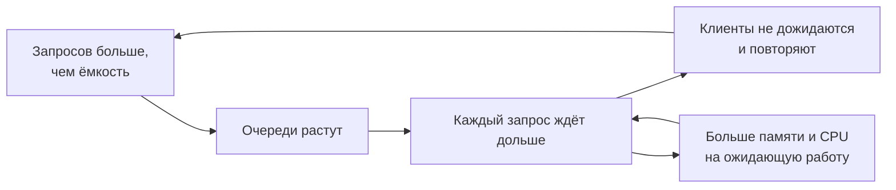

<!-- nav:top -->
[🏠 Начало](../START-HERE.md) · [← 20.7 Безопасность цепочки поставок подробно](07-supply-chain-security-in-depth.md) · [📋 Этап 20](README.md) · [20.9 Чек-лист готовности к продакшену →](09-production-readiness-checklist.md) · [📖 Глоссарий](../GLOSSARY.md) · [🇬🇧 English](../../en/20-reliability-and-hardening/08-overload-limits-and-backpressure.md) <!-- nav -->

# Урок 20.8 — Перегрузка, лимиты и обратное давление

> **Этап 20 — Надёжность и защита** · Урок 8 из 11 · ⏱ около 120 минут

## Что вы узнаете

- Почему сервис, который получает больше работы, чем успевает сделать, становится медленным для **всех**, и как это посчитать (закон Литтла).
- Три вещи, которые может сделать полная очередь: расти, заставить отправителя ждать (обратное давление) или отказать (сброс нагрузки).
- Как дать сервису на axum лимит конкурентности, сброс нагрузки и тайм-аут с помощью слоёв tower и как увидеть разницу под нагрузкой.
- Как token bucket ограничивает каждого клиента и когда отвечать `429` вместо `503`.
- Почему лимиты и тайм-ауты нужны и на вызывающей стороне и почему повторные попытки могут усилить перегрузку.

## Перед началом

- Вы прошли [Урок 20.7 — Безопасность цепочки поставок подробно](07-supply-chain-security-in-depth.md).
- Вы знаете middleware в axum и слои tower ([Урок 16.4 — Ошибки, проверка ввода и middleware](../16-backend-services/04-errors-validation-and-middleware.md)), каналы Tokio ([Урок 14.13](../14-concurrency-and-async/13-tokio-tasks-and-channels.md)), тайм-ауты и остановленные часы в тестах ([Урок 14.14](../14-concurrency-and-async/14-cancellation-timeouts-and-graceful-shutdown.md)), перцентили и генератор нагрузки `oha` ([Урок 19.1](../19-performance-and-profiling/01-latency-throughput-and-percentiles.md) и [Урок 19.2](../19-performance-and-profiling/02-load-testing.md)), а также повторные попытки ([Урок 18.3](../18-distributed-systems/03-retries-backoff-and-idempotency.md)).
- Если `oha` не установлен: `cargo install --locked oha`.
- Создайте пакет для этого урока:

```bash
cd ~/projects/rust
cargo new --lib code/p20-overload
cd code/p20-overload
mkdir src/bin
cargo add tokio@1 --features full
cargo add axum@0.8
cargo add tower@0.5 --features limit,load-shed,timeout,util
cargo add --dev tokio@1 --features test-util
```

## Новые слова

| Слово | Значение |
|---|---|
| **перегрузка** (overload) | Работы приходит больше, чем система успевает сделать за то же время. |
| **ёмкость** (capacity) | Наибольший объём работы, который система успевает в секунду, например 100 запросов в секунду. |
| **в работе** (in flight) | Начато, но ещё не закончено: запрос, который обрабатывается или ждёт в очереди. |
| **закон Литтла** (Little's law) | Простое правило для любой устойчивой очереди: *в работе = скорость поступления × время в системе*. |
| **ограниченная очередь** (bounded queue) | Очередь с максимальным размером. У **неограниченной** (unbounded) его нет, и она растёт, пока не кончится память. |
| **обратное давление** (backpressure) | Замедление отправителя: он ждёт, когда получатель заполнен. |
| **сброс нагрузки** (load shedding) | Немедленный отказ от лишней работы с дешёвой ошибкой, чтобы принятая работа оставалась быстрой. |
| **лимит конкурентности** (concurrency limit) | Наибольшее число запросов, которые могут обрабатываться одновременно. |
| **ограничение частоты** (rate limit) | Наибольшее число запросов, которые один клиент может отправить за единицу времени, например 10 в секунду. |
| **token bucket** (ведро токенов) | Алгоритм ограничения частоты: в ведре лежат токены, каждый запрос забирает один, новые токены капают с постоянной скоростью. |
| **полезная пропускная способность** (goodput) | Полезная часть пропускной способности: ответы, которые приходят вовремя и верны. |
| **шторм повторов** (retry storm) | Много клиентов одновременно повторяют неудачные запросы и умножают нагрузку на уже перегруженный сервис. |
| **автоматический выключатель** (circuit breaker) | Защита на вызывающей стороне: после многих сбоев она на время перестаёт вызывать другой сервис и сразу возвращает ошибку. |

## 1. Каждый сервис — это очередь

Сервис похож на магазин с несколькими кассирами. Покупатели приходят, ждут в очереди, их обслуживают, они уходят. Пока покупатели приходят медленнее, чем кассиры их обслуживают, очередь остаётся короткой. Когда они приходят быстрее, очередь растёт **без конца**, и каждый новый покупатель ждёт дольше предыдущего.

**Закон Литтла** связывает эти числа. Для любой системы, которая не растёт:

```text
in flight  =  arrival rate  ×  time in the system
   L       =      λ         ×        W
```

Допустим, ваш сервис получает 200 запросов в секунду и каждый занимает 50 мс (0,05 с). В среднем в работе 200 × 0,05 = **10** запросов. Теперь база данных стала медленной, и каждый запрос занимает 2 с. При тех же 200 запросах в секунду в работе 200 × 2 = **400** запросов: в 40 раз больше открытых соединений, памяти, задач.

| Скорость поступления | Время на запрос | В работе |
|---|---|---|
| 200 / с | 0,05 с | 10 |
| 200 / с | 0,5 с | 100 |
| 200 / с | 2 с | 400 |

И дальше хуже: чем больше работы в процессе, тем сильнее борьба за CPU (Central Processing Unit, центральный процессор), память и соединения с базой данных, поэтому каждый запрос становится ещё медленнее. Клиенты не дожидаются ответа и повторяют запросы, так что скорость поступления растёт. Вот так сервис, который «немного тормозит», становится сервисом, который не отвечает **никому**:



Лекарство всегда одно: **заранее решить, сколько работы вы принимаете**, и осознанно поступать с остальной.

## 2. Ограниченные очереди: ждать или отказать

Внутри программы очереди — это каналы. Неограниченный канал (`mpsc::unbounded_channel`) никогда не говорит «нет»: при перегрузке он растёт, пока у процесса не кончится память. У **ограниченного** канала есть размер, и когда он полон, отправитель должен выбрать. Создайте `src/bin/queue.rs`:

```rust
use std::time::Duration;
use tokio::sync::mpsc::{self, error::TrySendError};
use tokio::time::timeout;

/// Choice 2, wait: `send().await` waits for free room, but at most 50 ms.
async fn send_waiting(tx: &mpsc::Sender<u32>, job: u32) {
    match timeout(Duration::from_millis(50), tx.send(job)).await {
        Ok(Ok(())) => println!("job {job}: queued"),
        Ok(Err(_)) => println!("job {job}: the worker is gone"),
        Err(_) => println!("job {job}: waited 50 ms, still no room, giving up"),
    }
}

#[tokio::main]
async fn main() {
    // A queue with room for 3 jobs. Nobody takes jobs out yet: the worker is busy.
    let (tx, mut rx) = mpsc::channel::<u32>(3);

    // Choice 1, reject: `try_send` never waits.
    for job in 1..=5 {
        match tx.try_send(job) {
            Ok(()) => println!("job {job}: queued"),
            Err(TrySendError::Full(job)) => println!("job {job}: rejected, the queue is full"),
            Err(TrySendError::Closed(_)) => println!("job {job}: the worker is gone"),
        }
    }

    send_waiting(&tx, 6).await;

    // The worker takes one job, so there is room again.
    let first = rx.recv().await.unwrap();
    println!("worker: took job {first}");
    send_waiting(&tx, 7).await;

    let waiting = tx.max_capacity() - tx.capacity();
    println!("jobs in the queue: {waiting} of {}", tx.max_capacity());
}
```

`cargo run --bin queue`:

```text
job 1: queued
job 2: queued
job 3: queued
job 4: rejected, the queue is full
job 5: rejected, the queue is full
job 6: waited 50 ms, still no room, giving up
worker: took job 1
job 7: queued
jobs in the queue: 3 of 3
```

**Что происходит:**

1. `mpsc::channel(3)` создаёт очередь на три задания. Исполнитель заданий (здесь — получатель `rx`) пока ничего не забирает, как будто он занят.
2. **Отказать:** `try_send` кладёт задание, если есть место, и сразу возвращает `Err(TrySendError::Full(job))`, если места нет. Задания 4 и 5 отвергнуты, а ошибка возвращает задание обратно, так что вызывающий может ответить «занято, попробуйте позже».
3. **Ждать:** `send(job).await` ждёт, пока появится место. Это **обратное давление**: быстрого отправителя замедляют до скорости получателя. Ожидание без ограничения просто перенесло бы очередь в другое место, поэтому `timeout` сдаётся через 50 мс (задание 6).
4. После того как исполнитель забрал задание 1, место появилось, и задание 7 попадает в очередь без ожидания.
5. `capacity()` — свободное место сейчас, `max_capacity()` — размер очереди; разница — число ожидающих заданий.

Какой выбор правильный? **Ждать** — когда отправитель является частью вашей программы и может замедлиться (чтение файла, которое кормит парсер). **Отказать** — когда отправитель — пользователь или другой сервис, который не перестанет отправлять: ожидание только заполнило бы память запросами, чьи клиенты давно сдались.

> ⚠️ **Частая ошибка:** «Я использую неограниченный канал, значит, он никогда не переполнится». В этом и проблема: он скрывает перегрузку, пока процесс не убьют за слишком большой расход памяти. Выберите размер и решите, что происходит, когда он достигнут.

## 3. Лимиты для всего сервиса

У HTTP-сервиса (HyperText Transfer Protocol, протокол передачи гипертекста) тоже есть скрытая очередь: каждое принятое соединение с запросом в нём. В tower есть готовые слои, чтобы ею управлять:

| Слой | Что он делает |
|---|---|
| `ConcurrencyLimitLayer` (`.concurrency_limit(n)`) | Внутри одновременно выполняется не больше `n` запросов; остальные ждут свободного места. |
| `LoadShedLayer` (`.load_shed()`) | Если нижний сервис не готов (все места заняты), **сразу** вернуть ошибку `Overloaded` вместо ожидания. |
| `TimeoutLayer` (`.timeout(d)`) | Вернуть ошибку `Elapsed`, если внутренний сервис работает дольше `d`. |

Слои возвращают ошибки, а маршрутизатору axum нужен ответ на каждый запрос, поэтому `HandleErrorLayer` превращает каждую ошибку в ответ. Поместите сервис в `src/lib.rs`:

```rust
//! Limits that protect a service from overload.

use std::time::Duration;

use axum::error_handling::HandleErrorLayer;
use axum::http::{StatusCode, header};
use axum::response::IntoResponse;
use axum::routing::get;
use axum::{BoxError, Router};
use tower::ServiceBuilder;

/// Pretends to do 100 ms of real work, for example a database query.
async fn work() -> &'static str {
    tokio::time::sleep(Duration::from_millis(100)).await;
    "done\n"
}

/// Turns the errors of the tower layers into HTTP responses.
async fn overloaded(err: BoxError) -> impl IntoResponse {
    let (status, text) = if err.is::<tower::load_shed::error::Overloaded>() {
        (StatusCode::SERVICE_UNAVAILABLE, "overloaded, try again later\n")
    } else if err.is::<tower::timeout::error::Elapsed>() {
        (StatusCode::SERVICE_UNAVAILABLE, "took too long\n")
    } else {
        (StatusCode::INTERNAL_SERVER_ERROR, "unexpected error\n")
    };
    (status, [(header::RETRY_AFTER, "1")], text)
}

/// The router. With `shed = false`, extra requests wait in a queue;
/// with `shed = true`, they are refused at once.
pub fn app(shed: bool, max_in_flight: usize) -> Router {
    let limits = ServiceBuilder::new()
        .layer(HandleErrorLayer::new(overloaded))
        .option_layer(shed.then(tower::load_shed::LoadShedLayer::new))
        .concurrency_limit(max_in_flight)
        .timeout(Duration::from_secs(1));
    Router::new()
        .route("/work", get(work))
        .layer(limits)
        .with_state(()) // build the layers once, not once per request
}
```

И маленький `src/bin/server.rs`:

```rust
#[tokio::main]
async fn main() {
    let shed = std::env::args().nth(1).as_deref() == Some("shed");
    let listener = tokio::net::TcpListener::bind("127.0.0.1:3000")
        .await
        .unwrap();
    println!("listening on http://127.0.0.1:3000, load shedding: {shed}");
    axum::serve(listener, p20_overload::app(shed, 10))
        .await
        .unwrap();
}
```

**Что происходит:**

1. `ServiceBuilder` складывает слои стопкой; **первый** записанный — **внешний**. Запрос проходит `HandleErrorLayer`, затем (если `shed`) `LoadShedLayer`, затем лимит конкурентности, затем тайм-аут, затем обработчик маршрутизатора.
2. `.option_layer(shed.then(…))` добавляет слой сброса нагрузки, только когда `shed` истинно (`bool::then` даёт `Some(layer)` или `None`), так что одна программа показывает оба поведения.
3. При 10 местах и 100 мс на запрос **ёмкость** — примерно 10 / 0,1 с = 100 запросов в секунду.
4. `overloaded` с помощью `err.is::<T>()` выясняет, какой слой вернул ошибку. И перегрузка, и тайм-аут отвечают `503 Service Unavailable` с заголовком `Retry-After: 1`: «проблема на нашей стороне, попробуйте через секунду».
5. `.with_state(())` в конце важен. Без него axum заново строит слои обработчика **для каждого запроса**, так что каждый запрос получает новый, пустой лимит конкурентности, и лимит ничего не делает (см. «Частые ошибки»).

Соберите и запустите версию со сбросом: `cargo build --release --bin server`, затем `./target/release/server shed`. Во втором терминале отправьте 20 запросов одновременно и посчитайте коды ответа:

```bash
for i in $(seq 1 20); do curl -s -o /dev/null -w "%{http_code}\n" http://127.0.0.1:3000/work & done | sort | uniq -c
```

```text
  10 200
  10 503
```

Десять запросов получили место, десять были отвергнуты гораздо быстрее, чем за миллисекунду. Один отвергнутый ответ целиком (`curl -si`, пока работают десять других):

```text
HTTP/1.1 503 Service Unavailable
content-type: text/plain; charset=utf-8
retry-after: 1
content-length: 28
date: Wed, 18 Nov 2026 08:04:17 GMT

overloaded, try again later
```

**Теперь настоящая проверка: устойчивая перегрузка.** Отправляйте 200 запросов в секунду, вдвое больше ёмкости, в течение 5 секунд — сначала на `./target/release/server` (очередь), потом на `./target/release/server shed`. `-q 200` задаёт скорость поступления, а `-c 1000` разрешает до 1000 открытых соединений, как у множества независимых пользователей:

```bash
oha -z 5s -c 1000 -q 200 --no-tui http://127.0.0.1:3000/work
```

Важные строки двух запусков (сокращено):

```text
=== queue
  Slowest:	2.5750 sec
  Average:	1.3311 sec
  50.00% in 1.3325 sec
  99.00% in 2.5647 sec
  [200] 489 responses
  [516] aborted due to deadline

=== shed
  Slowest:	133.7649 ms
  Average:	49.1239 ms
  50.00% in 2.6124 ms
  99.00% in 112.0734 ms
  [503] 520 responses
  [200] 472 responses
  [14] aborted due to deadline
```

**Что происходит:**

1. Обе версии завершают около 480 запросов за 5 секунд: ёмкость (100 в секунду) одинакова. Лимиты не делают сервис быстрее.
2. **Очередь:** каждый лишний запрос ждёт места. Очередь растёт примерно на 100 запросов каждую секунду, поэтому задержка растёт всё время: медиана — 1,3 с, самый медленный ответ — 2,6 с, а 516 запросов всё ещё ждали, когда тест закончился («aborted due to deadline»). В настоящем сервисе так продолжается, пока клиенты не сдадутся, и тогда сверху приходят их повторы.
3. **Сброс:** лишние запросы получают `503` примерно за миллисекунду. Принятые по-прежнему занимают около 100 мс (перцентили с 75-го по 99-й — 101–112 мс). Низкая медиана получается из-за быстрых ответов `503`. Половина пользователей получила быстрое «да», половина — быстрое «нет, попробуйте позже»: гораздо лучше, чем медленное «да» для всех, которое приходит, когда они уже сдались. Это и есть **полезная пропускная способность** (goodput).

> ⚡ **Производительность:** сброс должен быть **дешёвым**. Отвергнутый запрос должен почти ничего не стоить: никакого запроса к базе, никакого большого выделения памяти, никакой строки лога на каждый запрос (вместо этого считайте их в метрике). Если отказ дорогой, перегрузка всё равно убьёт сервис.

> 🧪 **Тестирование:** лимит, который никогда не тестировали, скорее всего не работает. Упражнение 3 тестирует сброс двумя запросами и остановленными часами, без сети.

## 4. Ограничение частоты для каждого клиента

Лимит конкурентности защищает **сервис**. Он не мешает одному жадному клиенту занять все десять мест, пока остальные получают `503`. **Ограничение частоты** даёт каждому клиенту собственный бюджет.

Обычный алгоритм — **token bucket**. Представьте ведро, в котором помещается не больше `capacity` токенов. Каждый запрос забирает один токен. Новые токены капают со скоростью `per_second`, но в ведре никогда не бывает больше `capacity`. Значит, клиент может отправить короткую серию из `capacity` запросов, а после этого — не больше `per_second` запросов в секунду.

```text
capacity 3, 1 token per second

time 0.0 s   [● ● ●]   3 requests → all allowed   [     ]
time 0.0 s   [     ]   4th request → refused (429)
time 1.0 s   [●    ]   1 token dripped in → 1 request allowed
```

Добавьте его в `src/lib.rs`. Замените первую строку `use` на `use std::time::{Duration, Instant};` и допишите:

```rust
/// A token bucket: holds at most `capacity` tokens and gets `per_second` new ones every second.
/// Every request takes one token; with no token left, the request is refused.
pub struct TokenBucket {
    capacity: f64,
    per_second: f64,
    tokens: f64,
    last: Instant,
}

impl TokenBucket {
    /// A full bucket.
    pub fn new(capacity: u32, per_second: f64, now: Instant) -> Self {
        let capacity = f64::from(capacity);
        TokenBucket {
            capacity,
            per_second,
            tokens: capacity,
            last: now,
        }
    }

    /// Takes one token if there is one. `now` is passed in, so tests control the time.
    pub fn try_take(&mut self, now: Instant) -> bool {
        let elapsed = now.saturating_duration_since(self.last).as_secs_f64();
        self.tokens = (self.tokens + elapsed * self.per_second).min(self.capacity);
        self.last = now;
        if self.tokens >= 1.0 {
            self.tokens -= 1.0;
            true
        } else {
            false
        }
    }
}

#[cfg(test)]
mod tests {
    use super::*;

    #[test]
    fn allows_a_burst_up_to_the_capacity() {
        let t0 = Instant::now();
        let mut bucket = TokenBucket::new(3, 1.0, t0);
        let results: Vec<bool> = (0..4).map(|_| bucket.try_take(t0)).collect();
        assert_eq!(results, [true, true, true, false]);
    }

    #[test]
    fn refills_over_time() {
        let t0 = Instant::now();
        let mut bucket = TokenBucket::new(1, 2.0, t0); // 2 tokens per second
        assert!(bucket.try_take(t0));
        assert!(!bucket.try_take(t0 + Duration::from_millis(100))); // only 0.2 tokens
        assert!(bucket.try_take(t0 + Duration::from_millis(500))); // 1.0 token again
    }
}
```

`cargo test --lib`:

```text
test result: ok. 2 passed; 0 failed; 0 ignored; 0 measured; 0 filtered out; finished in 0.00s
```

**Что происходит:**

1. Ведру не нужен таймер. При каждом вызове оно вычисляет, сколько токенов накапало с прошлого вызова (`elapsed × per_second`), добавляет их и ограничивает результат значением `capacity` через `.min(...)`.
2. `saturating_duration_since` возвращает ноль вместо паники, если `now` раньше `last`.
3. Токены — `f64`, поэтому 100 мс при 2 токенах в секунду правильно дают 0,2 токена, а не ноль.
4. Вызывающий передаёт `now`. В продакшене это `Instant::now()`, в тестах — `t0 + Duration::from_millis(…)`, поэтому тесты точны и не занимают реального времени.

**Какой код ответа?** Клиент, превысивший **свой собственный** лимит, получает `429 Too Many Requests` («вы отправляете слишком много»). Сервис, перегруженный **целиком**, отвечает `503 Service Unavailable` («у нас проблема»). Оба ответа должны содержать `Retry-After`, чтобы вежливые клиенты знали, когда вернуться.

> 💡 **Совет:** в продакшене ведро не обязательно писать самому: крейт `governor` реализует ту же идею (вариант под названием GCRA, Generic Cell Rate Algorithm, обобщённый алгоритм скорости ячеек) без блокировок и с готовыми ограничителями по ключам. Ведро в одном процессе ограничивает только этот процесс; если за балансировщиком нагрузки работает несколько копий сервиса, храните счётчики в общем хранилище, например в Redis ([Урок 16.10](../16-backend-services/10-caching-with-redis.md) построил там ограничитель с фиксированным окном).

> 🔒 **Безопасность:** ограничение частоты — ещё и защита от подбора паролей и массового скачивания данных (scraping). Ключ выбирайте внимательно: по IP-адресу (Internet Protocol, межсетевой протокол) просто, но один адрес могут делить многие пользователи, а у одного атакующего может быть много адресов. По ключу API (Application Programming Interface, программный интерфейс) или по учётной записи честнее, когда клиенты входят в систему.

## 5. Лимиты везде, и когда вызываете других

Защита от перегрузки касается не только **входящих** запросов. Проверьте каждое место, где может скопиться работа:

| Место | Лимит |
|---|---|
| Тела запросов | Максимальный размер (`RequestBodyLimitLayer`, Урок 16.4): загрузку на 2 ГБ (гигабайта) нельзя читать в память. |
| Соединения | Максимальное число открытых соединений и ограничения времени для медленных клиентов, которые шлют по байту в секунду. |
| Внутренние очереди | Ограниченные каналы, как в разделе 2. |
| База данных | Пул фиксированного размера (Урок 16.6) и тайм-аут на получение соединения из него. |
| Вызовы других сервисов | Тайм-аут на **каждый** вызов (Урок 18.2). Вызов без тайм-аута может зависнуть навсегда и навсегда занять место. |

**Повторы умножают нагрузку.** Клиент, который повторяет три раза, отправляет до четырёх запросов на одно действие пользователя. Когда сервис перегружен и повторяют **все** клиенты, его нагрузка подскакивает в четыре раза в самый неподходящий момент: это **шторм повторов**. Защиты из Урока 18.3 (экспоненциальная задержка с джиттером, повтор только идемпотентных запросов) и ещё две:

- **Бюджет повторов:** повторы могут составлять не больше, скажем, 10 % всех запросов. Если неудач больше, клиент перестаёт повторять, потому что проблема явно не случайная.
- **Автоматический выключатель (circuit breaker):** после многих сбоев подряд клиент на время перестаёт вызывать сервис («цепь разомкнута», open) и сразу возвращает ошибку; позже он пропускает один пробный запрос («полуразомкнута», half-open), и если тот проходит, снова вызывает как обычно («замкнута», closed). Перегруженный сервис получает время восстановиться.

> 📏 **Соглашение:** тайм-аут у вызывающего должен быть **длиннее** времени, которое нужно вызываемому в хорошем случае, а собственный дедлайн вызываемого — **короче**, чем у вызывающего. Иначе вызываемый продолжает работать над ответами, которые никто не прочитает.

## Частые ошибки

**1. Слой, который строится заново для каждого запроса.** Без `.with_state(())` в конце `app` тот же тест `oha`, что выше, с 50 соединениями показал около 490 запросов в секунду, все `200`, с задержкой 100 мс: в пять раз больше «ёмкости». Лимит конкурентности вообще не работал, потому что у каждого запроса был свой новый лимит с десятью свободными местами. Тест из упражнения 3 ловит эту ошибку: без `.with_state(())` он падает с `left: [200, 200]`.

**2. Тайм-аут внутри лимита.** В нашем `ServiceBuilder` тайм-аут стоит **ниже** лимита конкурентности, поэтому время ожидания места он не учитывает; вот почему в версии с очередью запросы ждали 2,6 с, хотя тайм-аут — 1 с. Если ожидание должно учитываться, поставьте тайм-аут ещё и **выше** лимита.

**3. Сброс нагрузки с дорогой обработкой ошибки.** Запись в лог каждого отвергнутого запроса или построение большой страницы ошибки может стоить дороже самой работы.

**4. Лимиты только на входе в сервис.** Запросы ограничены, но каждый вызывает другой сервис без тайм-аута, поэтому места занимаются навсегда, когда тот сервис зависает.

**5. Клиенты, которые повторяют сразу и бесконечно.** Каждая перегрузка превращается в шторм повторов. Делайте задержку, добавляйте джиттер, задавайте бюджет.

## Попробуйте сами

1. Запустите `./target/release/server` (версию с очередью) и выполните команду `oha` на 15 секунд вместо 5 (`-z 15s`). Насколько медленный теперь самый медленный ответ? Он растёт, пока длится перегрузка.
2. Запустите версию со сбросом с `-q 80` (ниже ёмкости). Видите ли вы хоть один `503`? Лимит не должен мешать, когда перегрузки нет.
3. Измените `max_in_flight` с 10 на 20 в `server.rs`, пересоберите и повторите тест с 200 запросами в секунду. Сколько запросов в секунду теперь проходит успешно?

## Упражнения

### Упражнение 1 — Закон Литтла (легко)

Сервис получает 300 запросов в секунду, каждый занимает 40 мс. (a) Сколько запросов в среднем в работе? (b) Зависимость стала медленной, и теперь каждый запрос занимает 400 мс. Сколько запросов в работе теперь? (c) У сервиса лимит конкурентности 50. Какова его ёмкость в случае (b) и что происходит с остальными запросами?

<details>
<summary>Подсказка</summary>

В работе = скорость поступления × время. Ёмкость = места ÷ время на запрос.

</details>

<details>
<summary>Ответ</summary>

(a) 300 × 0,04 = **12**. (b) 300 × 0,4 = **120**. (c) Ёмкость = 50 ÷ 0,4 с = **125 запросов в секунду**. Примерно 300 − 125 = 175 запросов в секунду обслужить нельзя: без сброса нагрузки они ждут, и очередь растёт на 175 каждую секунду; со сбросом они получают быстрый `503`.

Почему это работает: закон Литтла верен для любой устойчивой системы, поэтому это быстрый способ подобрать размеры лимитов, пулов и очередей. Заметьте, что лимита 50 с запасом хватало в случае (a) и было слишком мало в случае (b): медленная зависимость уменьшает вашу ёмкость.

</details>

### Упражнение 2 — По ведру на клиента (средне)

Напишите в `src/lib.rs` тип `RateLimiter`, который хранит по одному `TokenBucket` на имя клиента (`String`) и имеет метод `allow(&mut self, client: &str, now: Instant) -> bool`. Напишите тест, который показывает, что у двух клиентов отдельные бюджеты.

<details>
<summary>Подсказка</summary>

Храните `capacity`, `per_second` и `HashMap<String, TokenBucket>`. `entry(client.to_string()).or_insert_with(|| TokenBucket::new(…))` создаёт полное ведро, когда клиент встречается впервые.

</details>

<details>
<summary>Ответ</summary>

```rust
/// One token bucket per client, for example per IP address or per API key.
pub struct RateLimiter {
    capacity: u32,
    per_second: f64,
    buckets: std::collections::HashMap<String, TokenBucket>,
}

impl RateLimiter {
    pub fn new(capacity: u32, per_second: f64) -> Self {
        RateLimiter {
            capacity,
            per_second,
            buckets: std::collections::HashMap::new(),
        }
    }

    /// Is this client allowed one more request now?
    pub fn allow(&mut self, client: &str, now: Instant) -> bool {
        self.buckets
            .entry(client.to_string())
            .or_insert_with(|| TokenBucket::new(self.capacity, self.per_second, now))
            .try_take(now)
    }
}

#[cfg(test)]
mod rate_limiter_tests {
    use super::*;

    #[test]
    fn clients_have_separate_budgets() {
        let now = Instant::now();
        let mut limiter = RateLimiter::new(2, 1.0);
        assert!(limiter.allow("alice", now));
        assert!(limiter.allow("alice", now));
        assert!(!limiter.allow("alice", now)); // alice used her two tokens
        assert!(limiter.allow("bob", now)); // bob has his own bucket
    }
}
```

`cargo test --lib` теперь показывает `3 passed`.

Почему это работает: каждому имени клиента соответствует своё ведро. Замыкание в `or_insert_with` может читать `self.capacity`, пока заимствовано `self.buckets`, потому что замыкание заимствует только те поля, которые использует. Для продакшена остаётся одна проблема: карта растёт с каждым новым клиентом, и атакующий с множеством адресов может заполнить вашу память. Настоящие ограничители удаляют вёдра, которые долго были полными (неиспользуемыми).

</details>

### Упражнение 3 — Протестировать сброс (сложно)

Напишите интеграционный тест `tests/limits.rs`, который строит `app(true, 1)` (сброс нагрузки, одно место), отправляет два запроса **одновременно** без сети и проверяет, что один получает `200`, а другой — `503`. Используйте остановленные часы, чтобы тест не занимал реального времени. Затем удалите `.with_state(())` из `app` и снова запустите тест.

<details>
<summary>Подсказка</summary>

`tower::ServiceExt::oneshot` отправляет один запрос клону маршрутизатора (Урок 16.3). `tokio::join!` выполняет два future одновременно. `#[tokio::test(start_paused = true)]` требует фичу `test-util`, которую вы добавили как dev-зависимость. Отсортируйте два кода ответа перед сравнением, потому что вы не знаете, какой запрос победит.

</details>

<details>
<summary>Ответ</summary>

```rust
use axum::body::Body;
use axum::http::{Request, StatusCode};
use tower::ServiceExt;

#[tokio::test(start_paused = true)]
async fn a_second_request_is_shed_while_the_first_runs() {
    let app = p20_overload::app(true, 1);
    let request = || Request::get("/work").body(Body::empty()).unwrap();

    let (first, second) = tokio::join!(
        app.clone().oneshot(request()),
        app.clone().oneshot(request()),
    );

    let mut codes = [first.unwrap().status(), second.unwrap().status()];
    codes.sort();
    assert_eq!(codes, [StatusCode::OK, StatusCode::SERVICE_UNAVAILABLE]);
}
```

`cargo test --test limits` проходит за `0.00s`. Без `.with_state(())`:

```text
thread 'a_second_request_is_shed_while_the_first_runs' (6122931) panicked at tests/limits.rs:17:5:
assertion `left == right` failed
  left: [200, 200]
 right: [200, 503]
```

Почему это работает: первый запрос занимает единственное место и затем спит в обработчике; пока он спит, второй запрос не находит свободного места, и слой сброса нагрузки сразу его отвергает. Остановленные часы перепрыгивают через сон в 100 мс. Клоны маршрутизатора делят один лимит, только если слои построены один раз; именно это и проверяет тест. Верните `.with_state(())` на место.

</details>

## Вопросы для самопроверки

1. Сервис обрабатывает не больше 100 запросов в секунду. В течение минуты приходит 150 в секунду, лимита нет. Что происходит с задержкой?

<details>
<summary>Ответ</summary>

Она растёт всю минуту. Каждую секунду ожидающих становится на 50 больше, так что каждый новый запрос ждёт дольше предыдущего. Через минуту ждут около 3000 запросов. Обычно клиенты задолго до этого не дожидаются ответа и повторяют, что делает всё ещё хуже.

</details>

2. Чем обратное давление отличается от сброса нагрузки?

<details>
<summary>Ответ</summary>

Обратное давление заставляет отправителя **ждать**, пока появится место, так что отправитель замедляется. Сброс нагрузки сразу **отвергает** лишнюю работу дешёвой ошибкой. Обратное давление подходит для отправителей внутри вашей программы; сброс — для пользователей и других сервисов, которые не замедлятся.

</details>

3. Почему лимит конкурентности не делает сервис быстрее?

<details>
<summary>Ответ</summary>

Ёмкость та же: то же число мест, то же время на запрос. Лимит лишь решает, что происходит с лишней работой: ждать (и сделать медленными всех) или получить отказ (и сохранить принятую работу быстрой).

</details>

4. Когда сервис должен отвечать `429`, а когда `503`?

<details>
<summary>Ответ</summary>

`429 Too Many Requests` — когда один клиент превышает свой лимит частоты. `503 Service Unavailable` — когда перегружен весь сервис или недоступна зависимость. Оба ответа должны содержать `Retry-After`.

</details>

5. У token bucket ёмкость 5, и он получает 2 токена в секунду. Клиент израсходовал все токены. Сколько запросов он может отправить через 1,5 секунды?

<details>
<summary>Ответ</summary>

Накапало 3 токена (1,5 × 2), значит, 3 запроса.

</details>

6. Почему повторы могут превратить короткую перегрузку в долгий отказ?

<details>
<summary>Ответ</summary>

Каждый неудачный запрос возвращается ещё до N раз, так что нагрузка на уже перегруженный сервис умножается (шторм повторов). Задержка с джиттером, бюджет повторов и автоматический выключатель у вызывающих сохраняют лишнюю нагрузку небольшой, и сервис может восстановиться.

</details>

## Итоги

- Закон Литтла: в работе = скорость поступления × время. Медленная зависимость умножает работу в процессе и уменьшает вашу ёмкость.
- Без лимитов перегрузка делает медленным каждый запрос, затем клиенты повторяют, и сервис не отвечает никому.
- У каждой очереди должен быть размер. Когда она полна, либо пусть отправитель ждёт (обратное давление), либо сразу откажите (сброс нагрузки).
- В axum `ConcurrencyLimitLayer`, `LoadShedLayer` и `TimeoutLayer` вместе с `HandleErrorLayer` сохраняют принятые запросы быстрыми, а остальным отвечают `503` с `Retry-After`; стройте слои один раз (`.with_state(())`).
- Token bucket ограничивает каждого клиента: серия до ёмкости, затем постоянная скорость; превышение лимита означает `429`.
- Ограничивайте всё, что может накапливаться (тела, соединения, очереди, пулы), и давайте тайм-аут каждому исходящему вызову; держите повторы небольшими с помощью задержки, джиттера, бюджетов и автоматических выключателей.

## Источники и что почитать

- [tower: модуль `limit`](https://docs.rs/tower/latest/tower/limit/index.html) и [модуль `load_shed`](https://docs.rs/tower/latest/tower/load_shed/index.html) — слои лимита конкурентности, ограничения частоты и сброса нагрузки.
- [axum: обработка ошибок](https://docs.rs/axum/latest/axum/error_handling/index.html) — `HandleErrorLayer` и превращение ошибок middleware в ответы.
- [tokio: каналы `mpsc`](https://docs.rs/tokio/latest/tokio/sync/mpsc/index.html) — ограниченные и неограниченные каналы, `try_send` и `send`.
- [governor](https://docs.rs/governor/latest/governor/) — ограничитель частоты для продакшена.
- SRE (Site Reliability Engineering, инженерия надёжности сайтов): [Google SRE book: Handling Overload](https://sre.google/sre-book/handling-overload/) и [Addressing Cascading Failures](https://sre.google/sre-book/addressing-cascading-failures/) — как большие сервисы сбрасывают нагрузку и избегают штормов повторов.
- [Amazon Builders' Library: Using load shedding to avoid overload](https://aws.amazon.com/builders-library/using-load-shedding-to-avoid-overload/) — goodput, дешёвые отказы и тестирование лимитов.
- [MDN: 429 Too Many Requests](https://developer.mozilla.org/en-US/docs/Web/HTTP/Reference/Status/429) и [Retry-After](https://developer.mozilla.org/en-US/docs/Web/HTTP/Reference/Headers/Retry-After) — код ответа и заголовок, из MDN (Mozilla Developer Network, веб-справочник проекта Mozilla).

---

[🏠 Начало](../START-HERE.md) · [← 20.7 Безопасность цепочки поставок подробно](07-supply-chain-security-in-depth.md) · [📋 Этап 20](README.md) · [20.9 Чек-лист готовности к продакшену →](09-production-readiness-checklist.md) · [📖 Глоссарий](../GLOSSARY.md) <!-- nav -->
<!-- nav:bottom -->
