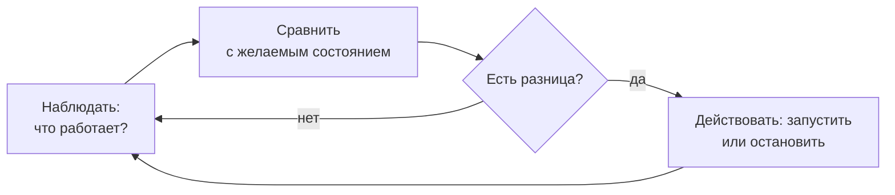

<!-- nav:top -->
[🏠 Начало](../START-HERE.md) · [← Этап 21 — Облачная (cloud-native) инфраструктура](README.md) · [📋 Этап 21](README.md) · [21.2 Понятия Kubernetes: поды, Deployment и Service →](02-kubernetes-concepts.md) · [📖 Глоссарий](../GLOSSARY.md) · [🇬🇧 English](../../en/21-cloud-native-infrastructure/01-what-cloud-native-means.md) <!-- nav -->

# Урок 21.1 — Что значит cloud native

> **Этап 21 — Облачная (cloud-native) инфраструктура** · Урок 1 из 14 · ⏱ около 135 минут

## Что вы узнаете

- Какие проблемы появляются, когда вы запускаете много копий многих сервисов, и что значит «cloud native» как ответ на них.
- Чем отличаются *питомцы* и *стадо* (pets и cattle), а также *императивная* и *декларативная* работа.
- Главную идею Kubernetes: *желаемое состояние* и *цикл согласования*, который держит реальный мир равным ему. Вы напишете маленький такой цикл на Rust.
- Что должен делать сервис, чтобы подходить для этого мира (конфигурация, логи, состояние, запуск и остановка, работоспособность).
- Как устроен этот этап, какие инструменты он использует и куда класть ваш код.

## Перед началом

- Вы умеете собирать Docker-образ для программы на Rust и запускать несколько контейнеров через Docker Compose ([Урок 11.13 — Dockerfile для программ на Rust](../11-linux-shell-and-containers/13-dockerfiles-for-rust.md), [Урок 11.14 — Docker Compose](../11-linux-shell-and-containers/14-docker-compose.md)), и вы развернули сервис в [Уроке 11.15](../11-linux-shell-and-containers/15-project-deploy-a-rust-service.md).
- Вы знаете сигналы, например `SIGTERM` ([Урок 11.5 — Процессы и сигналы](../11-linux-shell-and-containers/05-processes-and-signals.md)), и корректное завершение (graceful shutdown) ([Урок 14.14](../14-concurrency-and-async/14-cancellation-timeouts-and-graceful-shutdown.md)).
- Вы знаете конфигурацию через переменные окружения и проверки работоспособности ([Урок 16.13 — Конфигурация, проверки работоспособности и контейнеры](../16-backend-services/13-configuration-health-checks-and-containers.md)) и чек-лист готовности к продакшену ([Урок 20.9](../20-reliability-and-hardening/09-production-readiness-checklist.md)).
- Для этого урока нужен только Rust. Инструменты для кластера появятся в Уроке 21.3.

## Новые слова

| Слово | Значение |
|---|---|
| **cloud native** | Способ создавать и запускать сервисы так, чтобы машины, а не люди, запускали их, размножали, заменяли при поломке и выкатывали новые версии. |
| **CNCF** (Cloud Native Computing Foundation, фонд облачных вычислений) | Некоммерческий фонд, в котором живут открытые проекты: Kubernetes, Prometheus, Helm, OpenTelemetry и другие. |
| **оркестратор** (orchestrator) | Программа, которая решает, на какой машине из группы запускать контейнеры, и следит, чтобы они работали. Самый известный — Kubernetes. |
| **Kubernetes** (k8s) | Открытый оркестратор. «k8s» — сокращение: k, потом 8 букв, потом s. |
| **кластер** (cluster) | Группа машин, которые работают вместе и управляются как одна система. |
| **реплика** (replica) | Одна работающая копия сервиса. Три реплики = три одинаковые копии. |
| **питомцы и стадо** (pets and cattle) | Два подхода к серверам: *питомец* уникален, его чинят руками; *стадо* — одинаковые копии, сломанную просто заменяют. |
| **неизменяемая инфраструктура** (immutable infrastructure) | Работающий сервер или контейнер никогда не меняют; собирают новую версию и заменяют старую. |
| **императивный** (imperative) | Говорить *как*: список команд, которые выполняются одна за другой («запусти контейнер, потом ещё один»). |
| **декларативный** (declarative) | Говорить *что*: описание конечного результата («должно быть 3 копии»), а шаги находит программа. |
| **желаемое состояние** (desired state) | Описание того, как система должна выглядеть. |
| **фактическое состояние** (actual state) | То, что реально работает прямо сейчас. |
| **цикл согласования** (reconciliation loop, control loop) | Цикл, который повторяется: посмотреть на фактическое состояние, сравнить с желаемым, действовать, чтобы убрать разницу. |
| **контроллер** (controller) | Программа, которая выполняет цикл согласования для одного вида объектов. |
| **идемпотентный** (idempotent) | Операция, которая даёт тот же результат, выполните ли вы её один раз или много. |
| **YAML** (YAML Ain't Markup Language, «YAML — не язык разметки») | Текстовый формат для конфигурации: отступы, пары `ключ: значение` и `-` для элементов списка. Вы встречали его в файлах Docker Compose. |
| **CI/CD** (Continuous Integration / Continuous Delivery, непрерывная интеграция / непрерывная доставка) | CI автоматически проверяет каждое изменение (Урок 09.12); CD ещё и автоматически доставляет каждое удачное изменение на серверы. |
| **IaC** (Infrastructure as Code, инфраструктура как код) | Описание серверов, сетей и кластеров в файлах в Git и создание их инструментом, а не руками. |

## 1. От одного сервера ко многим

В Уроке 11.15 вы развернули один сервис на Rust: один образ, один сервер, несколько команд `docker` или `docker compose`. Это хорошее начало. Теперь представьте ту же компанию через два года:

- в ней **20 сервисов**, у каждого **от 3 до 10 копий**;
- они работают на **15 машинах**;
- каждый сервис выпускает **новую версию несколько раз в неделю**;
- где-то **ломается** машина примерно раз в неделю.

Вопросы, которые были простыми с одним сервером, становятся ежедневной работой:

| Вопрос | С одним сервером | С 15 машинами и 20 сервисами |
|---|---|---|
| Где работает этот контейнер? | На *том самом* сервере. | На какой машине прямо сейчас есть свободная память и CPU (Central Processing Unit, центральный процессор)? |
| Контейнер упал. | Вы замечаете и перезапускаете. | Это случилось в 3 часа ночи; кто его перезапустит? |
| Машина умерла. | Сайт не работает. | Её контейнеры должны автоматически переехать на другие машины. |
| Как другие находят сервис? | Постоянный адрес. | Копии появляются и исчезают, их адреса всё время меняются. |
| Новая версия. | Остановить старую, запустить новую; короткий простой. | Заменять копии по одной без простоя; вернуться назад, если версия сломана. |
| Трафик вырос втрое. | Купить сервер побольше. | Запустить больше копий за минуту. |

**Cloud native** — название набора идей и инструментов, которые отвечают на эти вопросы автоматизацией. CNCF (Cloud Native Computing Foundation, дом Kubernetes и многих связанных проектов) описывает cloud-native системы так: они собраны из контейнеров, управляются оркестратором, описаны декларативно, наблюдаемы и меняются часто и безопасно благодаря автоматизации.

«Облако» здесь не означает какую-то конкретную компанию. Те же идеи работают на арендованных серверах, на ваших собственных серверах в здании и на вашем Mac. На этом этапе всё работает **на вашем Mac**, внутри Docker, бесплатно.

Программа, которая отвечает на вопросы из таблицы, — это **оркестратор**. Вы даёте ему группу машин (**кластер**) и описание того, что должно работать. Он размещает контейнеры, перезапускает их, уводит с поломанных машин, даёт им постоянные имена и заменяет при обновлении. Оркестратор этого этапа — **Kubernetes**.

> ⚠️ **Частая ошибка:** думать, что каждому сервису нужен Kubernetes. Кластер — большая система со своими сбоями, обновлениями и ценой изучения. Одному небольшому сервису на одном сервере часто лучше подходят Docker Compose и systemd (Этап 11). Kubernetes окупается, когда у вас много сервисов, много копий или много команд. Вы изучаете его здесь, потому что большинство компаний со множеством сервисов используют его и потому что его идеи полезны везде.

## 2. Питомцы и стадо

Есть известный способ описать эту смену мышления.

Сервер-**питомец** (pet) носит имя («zeus»), его годами настраивали руками, и никто не решается его переустановить. Когда он болеет, человек заходит по SSH (Secure Shell, защищённая оболочка, Урок 11.10) и чинит его. Если он умирает — это кризис.

**Стадо** (cattle) пронумеровано (`web-7f9c-1`, `web-7f9c-2`, …), все копии одинаковые и созданы программой из одного образа. Когда одна болеет, её не чинят: её удаляют, и на её место встаёт новая. Если одна умирает, этого не замечает никто, кроме логов.

```text
  pets                                  cattle
  ┌────────┐                            ┌──────┐ ┌──────┐ ┌──────┐
  │ "zeus" │  ← repaired by hand        │ web-1│ │ web-2│ │ web-3│  ← identical copies
  └────────┘                            └──────┘ └──────┘ └──────┘
  unique, precious, changed in place    web-2 breaks → delete it → web-4 appears
```

Правило, которое делает стадо возможным, — **неизменяемая инфраструктура**: вы никогда не меняете то, что уже работает. Вы не заходите в контейнер, чтобы поправить файл. Вы меняете код или конфигурацию в Git, собираете **новый образ** с **новым тегом**, и платформа заменяет старые копии новыми. Первую половину этого вы узнали на Этапе 11: образ — шаблон только для чтения, а контейнер — одноразовый экземпляр этого шаблона.

> 🔒 **Безопасность:** контейнер, который можно «починить руками», может руками изменить и атакующий, и никто не заметит разницы. При неизменяемой инфраструктуре каждая работающая копия создана из образа, собранного в CI из проверенного коммита, поэтому вы всегда знаете, что работает.

## 3. Императивно и декларативно

Есть два способа сказать компьютеру, чего вы хотите.

**Императивно** — значит дать шаги:

```bash
docker run -d --name web-1 course-web:1.0
docker run -d --name web-2 course-web:1.0
docker run -d --name web-3 course-web:1.0
```

Это сработает один раз. А если `web-2` уже существует? Вторая команда упадёт. А если `web-3` упал через час? Никто не запустит команду снова. Команды описывают *изменение*, а не *результат*.

**Декларативно** — значит описать результат и дать программе самой найти шаги. Вы уже делали так с Docker Compose: `compose.yaml` говорит, какие сервисы должны существовать, а `docker compose up` создаёт только то, чего не хватает. Kubernetes развивает эту идею дальше. Файл Kubernetes (он называется **манифест**) для примера выше говорит на YAML:

```yaml
kind: Deployment
metadata:
  name: web
spec:
  replicas: 3
  template:
    spec:
      containers:
        - name: web
          image: course-web:1.0
```

(Это сокращённый набросок; Урок 21.2 объясняет каждое поле, а в Уроке 21.4 вы развернёте полный манифест.) Он говорит: «должно быть 3 копии `course-web:1.0` с именем `web`». Он не говорит, *как* этого добиться. Можно отправлять один и тот же файл снова и снова: если 3 копии уже работают, ничего не происходит. Операция **идемпотентна**.

У декларативных файлов три больших преимущества:

1. **Они живут в Git.** Изменение на `replicas: 5` проходит ревью, как любое изменение кода, и видно, кто и когда что поменял.
2. **Они — истина.** Чтобы узнать, что должно работать, вы читаете файлы, а не чью-то историю команд.
3. **Система может чинить себя сама.** Раз желание записано, программа может в любой момент сравнить желание с реальностью, а не только когда вы набираете команду.

Третий пункт — сердце Kubernetes.

## 4. Желаемое состояние и цикл согласования

Kubernetes собран из множества **контроллеров**. Каждый контроллер вечно выполняет один и тот же простой цикл:



- **Желаемое состояние** — то, что вы объявили: «3 здоровые копии».
- **Фактическое состояние** — то, что реально работает: может быть, 2, потому что одна упала.
- Контроллер вычисляет **разницу** и действует: «запустить 1».
- Потом смотрит снова. Если запуск не удался, он попробует ещё раз на следующем круге.

Это **цикл согласования** (reconciliation loop, его также называют **control loop**, цикл управления). Классический бытовой пример — термостат: вы ставите 21 °C (желаемое), он измеряет 19 °C (фактическое), включает отопление (действие) и продолжает измерять.

Два свойства делают такой подход надёжным:

- Контроллер не помнит события вроде «контейнер упал в 10:31». Он на каждом круге только сравнивает два состояния. Если он пропустит событие, следующий круг всё равно увидит разницу. (Инженеры называют это *level-triggered*, «по уровню»: реагировать на текущий уровень, а не на фронт изменения.)
- Каждый круг идемпотентен. Если всё уже правильно, контроллер ничего не делает.

### Цикл согласования на Rust

Давайте напишем крошечный цикл, чтобы увидеть идею в коде. На этом этапе ваш код лежит в `~/projects/rust/code/p21-<тема>`; каждый урок называет папку. Создайте проект:

```bash
cd ~/projects/rust
cargo new code/p21-reconcile
cd code/p21-reconcile
```

Замените `src/main.rs` на:

```rust
/// One running copy of our service, as the platform sees it.
#[derive(Debug, Clone)]
struct Replica {
    id: u32,
    healthy: bool,
}

/// A change the controller asks the platform to make.
#[derive(Debug, Clone, PartialEq)]
enum Action {
    Start,
    Stop(u32),
}

/// Compares the desired number of healthy replicas with what is running
/// and returns the actions that close the gap. It changes nothing itself.
fn reconcile(desired: usize, actual: &[Replica]) -> Vec<Action> {
    let mut actions = Vec::new();

    // 1. Broken replicas are never repaired: they are replaced.
    for r in actual.iter().filter(|r| !r.healthy) {
        actions.push(Action::Stop(r.id));
    }

    // 2. Compare the healthy ones with the wish.
    let healthy: Vec<&Replica> = actual.iter().filter(|r| r.healthy).collect();
    if healthy.len() < desired {
        for _ in healthy.len()..desired {
            actions.push(Action::Start);
        }
    } else {
        // Too many: stop the newest ones (highest id) first.
        for r in healthy.iter().rev().take(healthy.len() - desired) {
            actions.push(Action::Stop(r.id));
        }
    }
    actions
}

/// A tiny fake "platform" that can start and stop replicas.
struct Platform {
    replicas: Vec<Replica>,
    next_id: u32,
}

impl Platform {
    fn apply(&mut self, actions: &[Action]) {
        for action in actions {
            match action {
                Action::Start => {
                    self.replicas.push(Replica {
                        id: self.next_id,
                        healthy: true,
                    });
                    self.next_id += 1;
                }
                Action::Stop(id) => self.replicas.retain(|r| r.id != *id),
            }
        }
    }

    fn ids(&self) -> Vec<u32> {
        self.replicas.iter().map(|r| r.id).collect()
    }
}

fn main() {
    let mut desired = 3;
    let mut platform = Platform {
        replicas: Vec::new(),
        next_id: 1,
    };

    for tick in 1..=5 {
        // Things that happen in the world, outside the controller.
        if tick == 3 {
            platform.replicas[1].healthy = false; // replica 2 crashes
        }
        if tick == 5 {
            desired = 2; // a person edits the desired state
        }

        let actions = reconcile(desired, &platform.replicas);
        println!(
            "tick {tick}: desired={desired} running={:?} actions={actions:?}",
            platform.ids()
        );
        platform.apply(&actions);
    }
    println!("final: running={:?}", platform.ids());
}

#[cfg(test)]
mod tests {
    use super::*;

    fn healthy(ids: &[u32]) -> Vec<Replica> {
        ids.iter()
            .map(|&id| Replica { id, healthy: true })
            .collect()
    }

    #[test]
    fn starts_missing_replicas() {
        assert_eq!(reconcile(2, &[]), vec![Action::Start, Action::Start]);
    }

    #[test]
    fn does_nothing_when_actual_equals_desired() {
        assert!(reconcile(2, &healthy(&[1, 2])).is_empty());
    }

    #[test]
    fn replaces_an_unhealthy_replica() {
        let mut actual = healthy(&[1, 2]);
        actual[0].healthy = false;
        assert_eq!(reconcile(2, &actual), vec![Action::Stop(1), Action::Start]);
    }

    #[test]
    fn stops_the_newest_extra_replicas() {
        assert_eq!(
            reconcile(1, &healthy(&[1, 2, 3])),
            vec![Action::Stop(3), Action::Stop(2)]
        );
    }
}
```

**Что происходит:**

1. `Replica` — то, что контроллер может *наблюдать* об одной копии: id и признак здоровья.
2. `Action` — то, что контроллер может *попросить*: запустить новую копию или остановить копию с данным id. Обратите внимание: действия «починить» нет. Это правило стада из раздела 2.
3. `reconcile` — **чистая функция**: она принимает желаемое и фактическое состояние и возвращает список действий. Сама она ничего не запускает и не останавливает. Поэтому её легко тестировать, и так же устроены настоящие контроллеры: сначала решить, потом действовать.
4. Сначала она просит остановить каждую нездоровую реплику. Потом считает здоровые. Если их мало, она добавляет по одному `Start` на каждую недостающую копию; если много, `.rev().take(n)` берёт `n` самых новых (вектор идёт в порядке запуска) и останавливает их.
5. `Platform` играет роль реального мира. `apply` выполняет действия; `retain` оставляет только реплики, чей id не совпадает с остановленным.
6. `main` выполняет пять кругов («тиков»). На тике 3 мир что-то ломает; на тике 5 человек меняет желаемое состояние. Контроллер обрабатывает оба случая одинаково: сравнивая состояния.
7. Тесты проверяют четыре базовых случая. Так как `reconcile` чистая, тестам вообще не нужна платформа.

Запустите:

```bash
cargo run
```

```text
tick 1: desired=3 running=[] actions=[Start, Start, Start]
tick 2: desired=3 running=[1, 2, 3] actions=[]
tick 3: desired=3 running=[1, 2, 3] actions=[Stop(2), Start]
tick 4: desired=3 running=[1, 3, 4] actions=[]
tick 5: desired=2 running=[1, 3, 4] actions=[Stop(4)]
final: running=[1, 3]
```

Читайте это как историю. Тик 1: ничего не работает, три запуска. Тик 2: всё хорошо, действий нет, цикл идемпотентен. Тик 3: реплика 2 нездорова, поэтому её заменяет новая реплика номер 4 (её не «чинят»). Тик 5: желание меняется на 2, и самая новая копия останавливается.

```bash
cargo test
```

```text
running 4 tests
test tests::does_nothing_when_actual_equals_desired ... ok
test tests::replaces_an_unhealthy_replica ... ok
test tests::starts_missing_replicas ... ok
test tests::stops_the_newest_extra_replicas ... ok

test result: ok. 4 passed; 0 failed; 0 ignored; 0 measured; 0 filtered out; finished in 0.00s
```

Kubernetes делает ровно это, только в гораздо большем масштабе. *Контроллер Deployment* следит за вашими объектами Deployment, *контроллер ReplicaSet* поддерживает нужное число копий, *планировщик* (scheduler) решает, на какой машине запустить каждую новую копию, а программа на каждой машине (*kubelet*) запускает и останавливает контейнеры. Урок 21.2 знакомит с каждым из них. В Уроке 21.3 вы удалите копию руками и увидите, как контроллер заменит её за несколько секунд.

> 🧪 **Тестирование:** разделение «решить» (чистая функция) и «действовать» (код, который трогает мир) — самая полезная привычка из этого урока. Вы применяли её на Этапе 08 для ядра и адаптеров и на Этапе 18 для детерминированной симуляции. Контроллеры Kubernetes, написанные на Rust (с крейтом `kube`), тестируют так же.

## 5. Чего платформа ждёт от вашего сервиса

Оркестратор может помочь только сервису, который играет по его правилам. Правила ниже часто называют принципами *Twelve-Factor App* («приложение двенадцати факторов», короткий сайт, ссылка в конце). Большинство из них вы уже знаете с прошлых этапов; здесь они собираются вместе.

| Правило | Зачем это платформе | Где вы это изучали |
|---|---|---|
| **Читайте конфигурацию из окружения** (переменные окружения или смонтированные файлы), никогда не зашивайте её в код. | Один и тот же образ работает в тесте и в продакшене с разными настройками. | Урок 16.13 |
| **Пишите логи в стандартный вывод**, одно событие на строку, а не в файлы внутри контейнера. | Платформа собирает стандартный вывод (stdout) каждой копии; файлы в контейнере исчезают, когда его заменяют. | Уроки 09.10, 16.12 |
| **Не храните важное состояние внутри контейнера.** Храните его в базе данных или в томе. | Любую копию могут остановить в любой момент и заменить свежей. | Уроки 16.5–16.7 |
| **Запускайтесь быстро и останавливайтесь корректно.** Получив `SIGTERM`, перестаньте принимать новые запросы, завершите текущие и выйдите. | Платформа останавливает и запускает копии при каждом обновлении и каждом уменьшении числа копий. | Уроки 11.5, 14.14 |
| **Предоставляйте эндпоинты здоровья**, например `/healthz` (жив ли я?) и `/readyz` (могу ли принимать трафик?). | Платформа перезапускает мёртвые копии и отправляет трафик только готовым. | Урок 16.13 |
| **Один главный процесс на контейнер**, а тег образа называет точную версию (`1.4.2` или хеш коммита Git, а не `latest`). | Платформа следит за одним процессом; точный тег делает все копии одинаковыми и позволяет откатиться. | Уроки 11.12, 11.13 |
| **Отдавайте метрики** и передавайте контекст трассировки. | Когда копий много, нельзя зайти и посмотреть; нужны числа и трассы. | Урок 16.12 |

Эти правила есть и в вашем чек-листе готовности к продакшену из Урока 20.9. В Уроках 21.4 и 21.5 вы увидите, как Kubernetes использует каждое из них: `SIGTERM` при обновлении, переменные окружения из *ConfigMap* и пробы, которые вызывают ваши эндпоинты здоровья.

> ⚡ **Производительность:** «быстро запускаться» в кластере важнее, чем на одном сервере. Когда трафик растёт, новые копии бесполезны, пока не готовы. Сервис на Rust в маленьком образе обычно запускается гораздо быстрее секунды, и это одна из причин популярности Rust для облачных сервисов. Сохраняйте это: не делайте медленную работу (например, загрузку большого кэша) до открытия порта или сообщайте «не готов», пока она не закончится.

## 6. Карта этого этапа

Этап прослеживает одно изменение на пути от вашего редактора до работающего сервиса, за которым наблюдают:

```text
 your commit ──► CI: fmt, clippy, test ──► build image ──► registry
                     (Lesson 21.7)                          │
                                                            ▼
          ┌──────────────── Kubernetes cluster (kind) ────────────────┐
          │  Deployment ─► Pods (your containers) ◄── Service (21.2)  │
          │  ConfigMap, Secret, probes (21.5)  Helm, Kustomize (21.6) │
          └───────────────┬───────────────────────────────────────────┘
                          │ metrics, logs, traces (21.9, 21.10)
                          ▼
             Prometheus, Grafana, collector ──► SLOs and error budgets (21.11)
```

**SLO** (Service Level Objective, цель уровня обслуживания) в конце картинки — это цель вроде «99,9% запросов успешны»; её объясняет Урок 21.11.

Инструменты, все бесплатные и все работают на вашем Mac:

| Инструмент | Что делает | Урок |
|---|---|---|
| **kind** | Создаёт целый кластер Kubernetes внутри контейнеров Docker. | 21.3 |
| **kubectl** | Клиент командной строки, который общается с любым кластером Kubernetes. | 21.3 |
| **Helm** и **Kustomize** | Упаковывают и настраивают наборы манифестов. | 21.6 |
| **OpenTofu** | Инструмент IaC (Infrastructure as Code, инфраструктура как код): описывает инфраструктуру в файлах и создаёт её. | 21.8 |
| **Prometheus** и **Grafana** | Собирают метрики и рисуют дашборды. | 21.9 |
| **OpenTelemetry Collector** | Принимает логи и трассы от ваших сервисов (вы встречали его в Уроке 16.12). | 21.10 |

Три практических замечания для всего этапа:

1. **Один кластер на урок.** Каждый урок создаёт свежий кластер с именем `course-21-NN` (например, `course-21-03`) и удаляет его в конце. Кластеры — тоже стадо: создание занимает около минуты.
2. **Ресурсы.** Кластеру kind с вашим сервисом нужно около 2 ГБ RAM (Random Access Memory, оперативная память). Проверьте, что у Docker Desktop есть хотя бы 4 ГБ в *Settings → Resources*. Держите запущенным только один кластер.
3. **Безопасность.** Всё остаётся на вашем компьютере. Для этого этапа никогда не нужны облачный аккаунт или банковская карта.

## Частые ошибки

**Вычитание без проверки, какое число больше.** Укороченный `reconcile` без `if`/`else`:

```rust
    for _ in healthy.len()..desired {
        actions.push(Action::Start);
    }
    for r in healthy.iter().rev().take(healthy.len() - desired) {
        actions.push(Action::Stop(r.id));
    }
```

Первый цикл в порядке: диапазон, у которого начало больше конца, просто пуст. Вторая строка — нет. Когда здоровых реплик меньше, чем нужно (тик 1: `0 - 3`), вычитание двух значений `usize` уходит ниже нуля, и отладочная сборка паникует:

```text
thread 'main' (5864161) panicked at src/main.rs:30:40:
attempt to subtract with overflow
note: run with `RUST_BACKTRACE=1` environment variable to display a backtrace
```

(Число после `'main'` — id потока; у вас оно будет другим.) Исправление: сначала сравнить, как в коде урока, или использовать `healthy.len().saturating_sub(desired)`, которое останавливается на нуле. Контроллеры работают вечно, поэтому паника в контроллере — настоящий сбой.

**Чинить стадо руками.** Зайти через `docker exec` (а позже — `kubectl exec`) в контейнер и поправить файл «только один раз». Следующая замена вернёт старый файл, и копии перестанут быть одинаковыми. Меняйте исходники, собирайте новый образ, выкатывайте его.

**Тег `latest`.** `latest` — просто имя, которое указывает на то, что отправили последним. Две копии, запущенные с разницей в час, могут выполнять разный код, и откатиться на «предыдущий latest» нельзя. Используйте точные версии.

**Хранить состояние в контейнере.** Загрузка, сохранённая в `/app/uploads` внутри контейнера, пропадёт, когда копию заменят, а другие копии её никогда не увидят. Используйте базу данных, объектное хранилище или том.

## Попробуйте сами

1. В `main` сделайте так, чтобы на одном тике упали две реплики (`platform.replicas[0]` и `platform.replicas[2]` на тике 3). Предскажите действия до запуска. Затем запустите и сравните.
2. Поменяйте желание на тике 5 на `desired = 6`. Сколько появится действий `Start`?
3. Добавьте шестой тик, на котором ничего не происходит. Проверьте, что его список действий пуст. Этот пустой список и есть идемпотентность цикла.

## Упражнения

### Упражнение 1 — Императивно или декларативно? (легко)

Для каждого пункта скажите, императивный он или декларативный, и почему.

1. `docker run -d --name db postgres:18`
2. Файл `compose.yaml` с тремя сервисами.
3. Скрипт оболочки, который выполняет `useradd alice`, а затем `mkdir /home/alice/projects`.
4. Строка `replicas: 4` в манифесте Kubernetes.
5. `kubectl scale deployment web --replicas=4` (команда, которую вы будете использовать в Уроке 21.3).

<details>
<summary>Подсказка</summary>

Спросите себя: описывает ли это *результат* (и можно ли безопасно отправить это ещё раз) или *шаг*, который нужно выполнить сейчас?

</details>

<details>
<summary>Ответ</summary>

1. Императивно: шаг («создай этот контейнер сейчас»). Запустите дважды — второй запуск упадёт, потому что имя уже занято.
2. Декларативно: описывает, какие сервисы должны существовать; `docker compose up` создаёт только недостающее.
3. Императивно: два шага по порядку; второй запуск упадёт на `useradd`, потому что пользователь уже есть.
4. Декларативно: формулирует желание, а контроллер поддерживает его истинным.
5. По форме императивно (это команда), но она *меняет желаемое состояние*, а не запускает контейнеры сама; работу затем делает контроллер. Многие команды `kubectl` такие. Декларативный путь — изменить `replicas:` в файле в Git и применить файл.

</details>

### Упражнение 2 — Тест на идемпотентность (средне)

Напишите тест `second_run_changes_nothing`: начните с пустой платформы, вызовите `reconcile` с `desired = 3`, примените действия, затем снова вызовите `reconcile`. Второй список должен быть пустым.

<details>
<summary>Подсказка</summary>

Создайте `Platform` в тесте так же, как это делает `main`. Модуль тестов видит приватные элементы `main.rs` через `use super::*;`.

</details>

<details>
<summary>Ответ</summary>

Добавьте в модуль `tests`:

```rust
    #[test]
    fn second_run_changes_nothing() {
        let mut platform = Platform {
            replicas: Vec::new(),
            next_id: 1,
        };
        let first = reconcile(3, &platform.replicas);
        platform.apply(&first);
        let second = reconcile(3, &platform.replicas);
        assert!(second.is_empty(), "second run wanted {second:?}");
    }
```

```text
test tests::second_run_changes_nothing ... ok
test result: ok. 5 passed; 0 failed; 0 ignored; 0 measured; 0 filtered out; finished in 0.00s
```

Почему это работает: после первого круга фактическое состояние равно желаемому, поэтому правильному контроллеру нечего делать. Если тест падает, контроллер действовал бы вечно, например запускал бы новую копию на каждом круге.

</details>

### Упражнение 3 — Не запускать всё сразу (сложно)

Если не хватает 100 копий, настоящая платформа не должна запускать все 100 в один момент (машины и база данных будут перегружены). Добавьте в `reconcile` параметр `max_start: usize`: один круг запускает не больше `max_start` копий. В `main` используйте `2`. Напишите два теста: один круг с `desired = 5` на пустой платформе возвращает ровно два `Start`; а три круга приводят к репликам `[1, 2, 3, 4, 5]`.

<details>
<summary>Подсказка</summary>

Вычислите `let missing = desired - healthy.len();` внутри `if` (там вычитание не может уйти ниже нуля) и сделайте цикл по `0..missing.min(max_start)`. Обновите каждый вызов `reconcile`, включая старые тесты (дайте им большой лимит, например `10`).

</details>

<details>
<summary>Ответ</summary>

Две изменённые части `reconcile` (остальное остаётся как было):

```rust
fn reconcile(desired: usize, actual: &[Replica], max_start: usize) -> Vec<Action> {
```

```rust
    if healthy.len() < desired {
        let missing = desired - healthy.len();
        for _ in 0..missing.min(max_start) {
            actions.push(Action::Start);
        }
    } else {
```

В `main`: `let actions = reconcile(desired, &platform.replicas, 2);`. Новые тесты:

```rust
    #[test]
    fn starts_at_most_max_start_per_run() {
        assert_eq!(reconcile(5, &[], 2), vec![Action::Start, Action::Start]);
    }

    #[test]
    fn reaches_desired_state_over_several_runs() {
        let mut platform = Platform {
            replicas: Vec::new(),
            next_id: 1,
        };
        for _ in 0..3 {
            let actions = reconcile(5, &platform.replicas, 2);
            platform.apply(&actions);
        }
        assert_eq!(platform.ids(), vec![1, 2, 3, 4, 5]);
    }
```

`cargo run` теперь показывает более медленный старт:

```text
tick 1: desired=3 running=[] actions=[Start, Start]
tick 2: desired=3 running=[1, 2] actions=[Start]
tick 3: desired=3 running=[1, 2, 3] actions=[Stop(2), Start]
tick 4: desired=3 running=[1, 3, 4] actions=[]
tick 5: desired=2 running=[1, 3, 4] actions=[Stop(4)]
final: running=[1, 3]
```

Почему это работает: циклу не нужно достигать цели за один круг; ему нужно лишь на каждом круге двигаться *к* ней. Kubernetes использует ту же идею при постепенных (rolling) обновлениях (`maxSurge`, Урок 21.4): он заменяет по несколько копий за раз.

</details>

## Вопросы для самопроверки

1. Назовите три вопроса, которые становятся трудными, когда вы запускаете много копий многих сервисов на многих машинах.

<details>
<summary>Ответ</summary>

Любые три из: где разместить каждый контейнер; кто перезапустит упавшие контейнеры; как увести работу с мёртвой машины; как клиентам находить копии, у которых меняются адреса; как выкатить новую версию без простоя и откатиться; как быстро добавить копии, когда растёт трафик.

</details>

2. Чем питомец отличается от стада и какое правило делает стадо возможным?

<details>
<summary>Ответ</summary>

Питомец уникален, его чинят руками; стадо — одинаковые копии, которые заменяют, а не чинят. Это возможно благодаря неизменяемой инфраструктуре: каждая копия создана из одного и того же образа, а изменения делаются сборкой нового образа и заменой копий.

</details>

3. Почему декларативный файл безопаснее отправить дважды, чем императивную команду?

<details>
<summary>Ответ</summary>

Он описывает конечный результат, поэтому повторное применение, когда результат уже есть, ничего не делает (он идемпотентен). Императивная команда описывает шаг, а повтор шага может упасть или создать дубликаты.

</details>

4. Опишите цикл согласования одним предложением.

<details>
<summary>Ответ</summary>

Вечно повторять: наблюдать фактическое состояние, сравнивать его с желаемым и действовать, чтобы приблизить фактическое состояние к желаемому.

</details>

5. Почему функция `reconcile` в этом уроке возвращает действия, а не запускает реплики сама?

<details>
<summary>Ответ</summary>

Чтобы решение было чистой функцией: её легко тестировать без настоящей платформы, и один и тот же код решения можно использовать с фейковой платформой в тестах и с настоящей в продакшене.

</details>

6. Сервис пишет логи в `/var/log/app.log` внутри контейнера и хранит пользовательские сессии в памяти. Какие два правила платформы он нарушает и что пойдёт не так?

<details>
<summary>Ответ</summary>

Он должен писать логи в стандартный вывод (файл исчезнет, когда копию заменят, и платформа не сможет его собрать), и он не должен хранить важное состояние внутри контейнера (сессии пропадут при замене копии, а другие копии о них не знают; храните их в базе данных или в Redis).

</details>

7. Что платформа отправляет вашему процессу перед остановкой копии и что должен сделать ваш сервис?

<details>
<summary>Ответ</summary>

Сигнал `SIGTERM`. Сервис должен перестать принимать новые запросы, завершить текущие и выйти (корректное завершение). Если он не выйдет за отведённое время (grace period), платформа отправит `SIGKILL`; вы увидите это в Уроке 21.4.

</details>

## Итоги

- Cloud native — значит создавать и запускать сервисы так, чтобы их размещала, перезапускала, размножала и обновляла автоматизация, а не люди. Эту работу в кластере делает оркестратор, например Kubernetes.
- Относитесь к серверам и контейнерам как к стаду, а не к питомцам: одинаковые, заменяемые, никогда не меняются на месте (неизменяемая инфраструктура).
- Императивно = шаги; декларативно = конечный результат. Декларативные файлы живут в Git, являются источником истины и идемпотентны.
- Kubernetes — набор контроллеров, выполняющих циклы согласования: наблюдать, сравнивать с желаемым состоянием, действовать, повторять.
- Отделяйте решение (чистую, тестируемую функцию) от действия.
- Ваш сервис должен подходить платформе: конфигурация из окружения, логи в stdout, никакого локального состояния, быстрый старт, корректная остановка по `SIGTERM`, эндпоинты здоровья, точные теги образов, метрики.
- На этом этапе всё работает локально с kind, kubectl, Helm, Kustomize, OpenTofu, Prometheus, Grafana и OpenTelemetry Collector.

## Источники и что почитать

- [CNCF Cloud Native Definition](https://github.com/cncf/toc/blob/main/DEFINITION.md) — короткое официальное определение, на многих языках.
- [Документация Kubernetes — Overview](https://kubernetes.io/docs/concepts/overview/) — что такое Kubernetes и чем он не является.
- [Документация Kubernetes — Controllers](https://kubernetes.io/docs/concepts/architecture/controller/) — цикл управления, объяснённый самим проектом.
- [The Twelve-Factor App](https://12factor.net/) — принципы из раздела 5, по короткой странице на каждый.
- [Документация Kubernetes — Pod Lifecycle](https://kubernetes.io/docs/concepts/workloads/pods/pod-lifecycle/) — как поды запускаются и останавливаются (пригодится в Уроке 21.4).

---

[🏠 Начало](../START-HERE.md) · [← Этап 21 — Облачная (cloud-native) инфраструктура](README.md) · [📋 Этап 21](README.md) · [21.2 Понятия Kubernetes: поды, Deployment и Service →](02-kubernetes-concepts.md) · [📖 Глоссарий](../GLOSSARY.md) <!-- nav -->
<!-- nav:bottom -->
