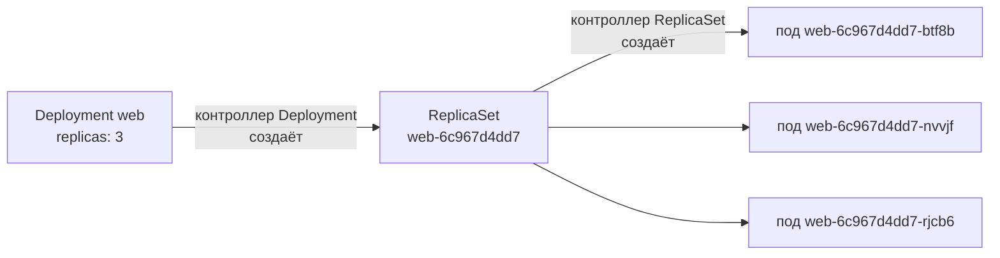

<!-- nav:top -->
[🏠 Начало](../START-HERE.md) · [← 21.1 Что значит cloud native](01-what-cloud-native-means.md) · [📋 Этап 21](README.md) · [21.3 Локальный кластер с kind и kubectl →](03-a-local-cluster-with-kind.md) · [📖 Глоссарий](../GLOSSARY.md) · [🇬🇧 English](../../en/21-cloud-native-infrastructure/02-kubernetes-concepts.md) <!-- nav -->

# Урок 21.2 — Понятия Kubernetes: поды, Deployment и Service

> **Этап 21 — Облачная (cloud-native) инфраструктура** · Урок 2 из 14 · ⏱ около 2,5 часа (2 занятия)

## Что вы узнаете

- Из чего состоит кластер Kubernetes: плоскость управления (API-сервер, etcd, планировщик, менеджер контроллеров) и узлы (kubelet, среда выполнения контейнеров, kube-proxy).
- Что такое объект Kubernetes и манифест: `apiVersion`, `kind`, `metadata`, `spec` и `status`.
- Что такое под и почему вы почти никогда не создаёте поды сами.
- Как Deployment создаёт ReplicaSet, а ReplicaSet создаёт поды.
- Как метки и селекторы связывают объекты и как Service даёт группе подов одно постоянное имя. Вы напишете на Rust проверку селекторов.

## Перед началом

- Вы прошли [Урок 21.1 — Что значит cloud native](01-what-cloud-native-means.md): желаемое состояние, контроллеры и цикл согласования.
- Вы знаете IP-адреса (IP, Internet Protocol, межсетевой протокол) и порты ([Урок 15.2](../15-networking/02-ip-addresses-and-routing.md)), DNS (Domain Name System, система доменных имён) ([Урок 15.10](../15-networking/10-dns-how-names-become-addresses.md)) и балансировщики нагрузки ([Урок 15.14](../15-networking/14-proxies-and-load-balancers.md)).
- Вы знаете пространства имён (namespaces) Linux и cgroups, на которых построены контейнеры ([Урок 11.12 — Контейнеры и основы Docker](../11-linux-shell-and-containers/12-containers-and-docker-basics.md)).
- Этот урок про идеи. Кластер вы пока не запускаете; показанный вывод получен в локальном кластере kind, таком же, какой вы создадите в Уроке 21.3.

## Новые слова

| Слово | Значение |
|---|---|
| **плоскость управления** (control plane) | «Мозг» кластера: программы, которые хранят желаемое состояние и принимают решения. |
| **узел** (node) | Одна машина (настоящая или виртуальная) в кластере, на которой работают ваши контейнеры. |
| **API-сервер** (kube-apiserver) | Входная дверь кластера. Каждый инструмент и каждый компонент читает и пишет объекты только через него. API = Application Programming Interface, программный интерфейс. |
| **etcd** | Небольшая надёжная база данных «ключ-значение», в которой хранятся все объекты кластера. Использует алгоритм консенсуса Raft (Урок 18.9). |
| **планировщик** (scheduler, kube-scheduler) | Компонент, который выбирает узел для каждого нового пода. |
| **менеджер контроллеров** (controller manager, kube-controller-manager) | Одна программа, в которой работает много встроенных контроллеров (Deployment, ReplicaSet, …). |
| **kubelet** | Агент на каждом узле. Запускает и останавливает контейнеры подов, назначенных на его узел, и сообщает об их состоянии. |
| **среда выполнения контейнеров** (container runtime) | Программа, которая на самом деле запускает контейнеры на узле; kind использует **containerd**. |
| **kube-proxy** | Компонент на каждом узле, который заставляет адреса Service работать, настраивая сетевые правила. |
| **объект** (object, resource) | Одна запись в кластере, например один Deployment или один Service, с желаемым состоянием (`spec`) и наблюдаемым состоянием (`status`). |
| **манифест** (manifest) | Файл YAML (YAML Ain't Markup Language, «YAML — не язык разметки») или JSON (JavaScript Object Notation, формат записи объектов JavaScript), описывающий один или несколько объектов. |
| **пространство имён** (namespace, Kubernetes) | Именованная группа объектов внутри кластера, например `default` или `kube-system`. Это не то же самое, что пространство имён Linux. |
| **под** (pod) | Самое маленькое, что запускает Kubernetes: один или несколько контейнеров с общим сетевым адресом, которые могут делить и файлы. |
| **ReplicaSet** | Объект, который поддерживает заданное число одинаковых подов. |
| **Deployment** | Объект, который управляет ReplicaSet так, чтобы поды можно было пошагово обновить до новой версии и откатить. |
| **метка** (label) | Пара `ключ: значение` на объекте, например `app: web`. |
| **селектор** (selector) | Правило, которое выбирает объекты по меткам, например «все поды с `app=web`». |
| **Service** | Объект, который даёт группе подов один постоянный виртуальный IP-адрес и DNS-имя и распределяет соединения между ними. |
| **ClusterIP** | Тип Service по умолчанию: виртуальный IP-адрес, доступный только внутри кластера. |
| **EndpointSlice** | Объект со списком текущих адресов подов за Service. Kubernetes сам поддерживает его в актуальном виде. |
| **CNI** (Container Network Interface, сетевой интерфейс контейнеров) | Стандарт для плагинов, которые дают подам сеть; kind устанавливает плагин kindnet. |

## 1. Из чего состоит кластер

У кластера Kubernetes два вида частей: **плоскость управления**, которая хранит то, что вы хотите, и принимает решения, и **узлы**, на которых работают ваши контейнеры.

```text
                 kubectl (you)           other tools (CI, Helm)
                        │                      │
                        ▼                      ▼
  ┌───────────────────────── control plane ──────────────────────────┐
  │   ┌──────────────┐        ┌──────┐                               │
  │   │  API server  │◄──────►│ etcd │  all objects are stored here  │
  │   └──────┬───────┘        └──────┘                               │
  │          ▲   ▲                                                   │
  │          │   └──────── scheduler: "pod X goes to node 2"         │
  │          └──────────── controller manager: reconciliation loops  │
  └──────────┼───────────────────────────────────────────────────────┘
             │ watch and report
   ┌─────────┴─────────┐   ┌───────────────────┐
   │ node 1            │   │ node 2            │
   │ kubelet           │   │ kubelet           │
   │ containerd        │   │ containerd        │
   │ kube-proxy        │   │ kube-proxy        │
   │ [pod] [pod]       │   │ [pod] [pod] [pod] │
   └───────────────────┘   └───────────────────┘
```

Читайте картинку сверху:

1. Вы (через `kubectl`) и другие инструменты (конвейер CI, Continuous Integration — непрерывная интеграция, или Helm) общаетесь только с **API-сервером**. Он проверяет, кто вы, можно ли вам это делать и корректен ли объект. Затем сохраняет объект в **etcd**.
2. **etcd** хранит все объекты кластера. Он реплицируется алгоритмом Raft с Этапа 18, поэтому в настоящем кластере работает три или пять его копий.
3. **Менеджер контроллеров** запускает контроллеры вроде того, что вы написали в Уроке 21.1. Они *следят* (watch) за объектами через API-сервер и создают или удаляют другие объекты, чтобы убрать разницу.
4. **Планировщик** следит за новыми подами без узла, выбирает узел с достаточным запасом CPU (Central Processing Unit, центральный процессор) и памяти и записывает имя узла в под.
5. На каждом узле **kubelet** следит за подами, назначенными на его узел, и просит **среду выполнения контейнеров** (containerd) запустить их контейнеры. Он сообщает обратно, работают ли они.
6. **kube-proxy** на каждом узле заставляет работать адреса Service (раздел 6).

Обратите внимание на общий принцип: ни один компонент не вызывает другой напрямую, чтобы «что-то сделать». Все читают и пишут объекты через API-сервер, и каждый согласовывает свою часть. Поэтому Kubernetes продолжает работать, когда один компонент перезапускается: тот просто снова читает состояние.

В кластере kind на вашем Mac плоскость управления и узел — это один и тот же контейнер Docker, а сами программы плоскости управления работают как поды в пространстве имён `kube-system`. Это настоящий вывод из свежего кластера kind (вы выполните эту команду в Уроке 21.3):

```bash
kubectl get pods -n kube-system
```

```text
NAME                                                 READY   STATUS    RESTARTS   AGE
coredns-559f6c778d-lfmjm                             1/1     Running   0          33s
coredns-559f6c778d-pwcbg                             1/1     Running   0          33s
etcd-course-21-02-control-plane                      1/1     Running   0          43s
kindnet-v862w                                        1/1     Running   0          33s
kube-apiserver-course-21-02-control-plane            1/1     Running   0          43s
kube-controller-manager-course-21-02-control-plane   1/1     Running   0          43s
kube-proxy-qpcqt                                     1/1     Running   0          33s
kube-scheduler-course-21-02-control-plane            1/1     Running   0          43s
```

Здесь видна каждая часть картинки: `etcd`, `kube-apiserver`, `kube-controller-manager`, `kube-scheduler`, `kube-proxy`. `coredns` — DNS-сервер кластера (раздел 6), а `kindnet` — плагин CNI (Container Network Interface), который даёт каждому поду IP-адрес.

## 2. Объекты и манифесты

Всё в Kubernetes — **объекты**: Deployment, под, Service, пространство имён. У каждого объекта одни и те же четыре части верхнего уровня. Вот манифест для Service — файл, который пишете вы:

```yaml
apiVersion: v1          # какая версия API определяет этот вид
kind: Service           # какой это вид объекта
metadata:               # кто это
  name: web
  namespace: default
spec:                   # чего вы хотите (желаемое состояние)
  selector:
    app: web
  ports:
    - port: 80
      targetPort: 80
```

1. **`apiVersion`** называет группу API и версию. Базовые объекты (поды, Service) используют `v1`; Deployment и ReplicaSet живут в группе `apps`, поэтому у них `apps/v1`.
2. **`kind`** говорит, какой это вид объекта.
3. **`metadata`** идентифицирует объект: его `name`, `namespace`, метки. В одном пространстве имён пара (вид, имя) уникальна.
4. **`spec`** — **желаемое состояние**, его пишете вы.
5. **`status`** — **фактическое состояние**, его пишет кластер. Вы никогда его не пишете; оно появляется, когда вы читаете объект обратно.

Например, когда вы читаете Deployment обратно (`kubectl get deployment web -o yaml`), его `status` содержит числа, записанные контроллерами, например `readyReplicas: 3`. `spec` и `status` рядом — это «желаемое» и «фактическое» из Урока 21.1, хранящиеся в одном объекте.

Запоминать каждое поле не нужно. `kubectl explain` печатает документацию любого поля прямо из кластера:

```bash
kubectl explain deployment.spec.replicas
```

```text
GROUP:      apps
KIND:       Deployment
VERSION:    v1

FIELD: replicas <integer>


DESCRIPTION:
    Number of desired pods. This is a pointer to distinguish between explicit
    zero and not specified. Defaults to 1.
```

**Пространства имён** группируют объекты внутри одного кластера, как папки. В свежем кластере их несколько: `default` (туда попадают ваши объекты, если не сказано иное), `kube-system` (собственные части кластера) и несколько поменьше. Командам часто выдают по пространству имён. Пространство имён Kubernetes — это только граница имён и прав доступа; это не пространство имён Linux с Этапа 11, которое изолирует процесс.

## 3. Поды: самая маленькая единица

Kubernetes никогда не запускает голый контейнер. Он запускает **под**: небольшую обёртку вокруг одного или нескольких контейнеров, которые всегда живут на одном узле и делят:

- **один сетевой адрес.** Каждый под получает свой IP-адрес внутри кластера. Контейнеры одного пода общаются друг с другом через `localhost` и не могут оба слушать один и тот же порт.
- **тома**, если вы их объявили: папку, которую могут смонтировать несколько контейнеров пода.

```text
   pod web-6c967d4dd7-btf8b   (IP 10.244.0.7)
  ┌──────────────────────────────────────────┐
  │  container "nginx"   listens on :80      │
  │  (optional) helper container             │
  │  shared: network (localhost), volumes    │
  └──────────────────────────────────────────┘
```

У большинства подов ровно один контейнер: ваш сервис. Второй контейнер, если он есть, — помощник (например, тот, что отправляет логи); такого помощника часто называют *sidecar* («коляска»).

Поды **смертны**. Под создаётся, работает и заканчивается; его никогда не перемещают и не чинят. Если его узел умер, пода больше нет, и где-то в другом месте создаётся *новый* под с *новым* именем и *новым* IP-адресом. Это правило «стада» из Урока 21.1, встроенное в систему.

Поэтому вы почти никогда не создаёте под напрямую: никто не заменит его, когда он умрёт. Вместо этого вы создаёте **Deployment**, а поды для вас создают контроллеры.

## 4. Deployment и ReplicaSet

Deployment — объект, который вы будете использовать для каждого сервиса без состояния. Вот полный Deployment этого урока, в котором официальный образ веб-сервера `nginx` замещает ваш сервис (в Уроке 21.4 его место займёт ваш сервис на Rust):

```yaml
apiVersion: apps/v1
kind: Deployment
metadata:
  name: web
  labels:
    app: web
spec:
  replicas: 3
  selector:
    matchLabels:
      app: web
  template:
    metadata:
      labels:
        app: web
    spec:
      containers:
        - name: nginx
          image: nginx:1.30-alpine
          ports:
            - containerPort: 80
```

**Что происходит:**

1. `replicas: 3` — желаемое число подов.
2. `template` — **шаблон пода**: полное описание подов, которые нужно создать, со своими `metadata` (метками) и `spec` (контейнерами). Каждый под этого Deployment сделан по этому шаблону.
3. `selector.matchLabels` говорит, какие поды принадлежат этому Deployment: с меткой `app: web`. Он должен совпадать с метками в шаблоне, иначе API-сервер отклонит объект (см. «Частые ошибки»).
4. `containers` перечисляет контейнеры каждого пода: имя, образ с точным тегом и порт, который слушает программа. `containerPort` — в основном документация; настоящий порт выбирает программа.

Когда вы отправляете этот Deployment в кластер, начинает работать цепочка контроллеров:



1. **Контроллер Deployment** видит новый Deployment и создаёт **ReplicaSet** для текущего шаблона. Имя ReplicaSet — имя Deployment плюс хеш шаблона (`6c967d4dd7`).
2. **Контроллер ReplicaSet** видит ReplicaSet, которому нужно 3 пода, а есть 0, и создаёт 3 пода. Их имена — имя ReplicaSet плюс случайный суффикс.
3. **Планировщик** назначает каждому поду узел; **kubelet** на этом узле запускает контейнеры.

Вот что кластер показывает после этого:

```bash
kubectl get deployments,replicasets,pods -l app=web
```

```text
NAME                  READY   UP-TO-DATE   AVAILABLE   AGE
deployment.apps/web   3/3     3            3           17s

NAME                             DESIRED   CURRENT   READY   AGE
replicaset.apps/web-6c967d4dd7   3         3         3       17s

NAME                       READY   STATUS    RESTARTS   AGE
pod/web-6c967d4dd7-btf8b   1/1     Running   0          17s
pod/web-6c967d4dd7-nvvjf   1/1     Running   0          17s
pod/web-6c967d4dd7-rjcb6   1/1     Running   0          17s
```

Зачем два уровня? Из-за обновлений. Когда вы меняете шаблон (например, новый тег образа), контроллер Deployment создаёт **второй** ReplicaSet для нового шаблона и затем пошагово переносит количество: новый вверх, старый вниз. Если новая версия плохая, он может вернуться, снова увеличив старый ReplicaSet. Именно это вы сделаете в Уроке 21.4. ReplicaSet вы никогда не редактируете сами; вы редактируете Deployment.

Каждый под помнит, кто его создал, в поле `ownerReferences`. Владелец подов выше — `ReplicaSet/web-6c967d4dd7`, а владелец ReplicaSet — `Deployment/web`. Когда вы удаляете Deployment, Kubernetes удаляет и его ReplicaSet, и их поды (это называется *сборкой мусора*, garbage collection).

## 5. Метки и селекторы

Как ReplicaSet узнаёт, какие поды «его»? Как Service узнаёт, куда отправлять трафик? Не по имени: имена подов случайны. По **меткам**.

**Метка** — пара `ключ: значение` в `metadata.labels` объекта. **Селектор** — правило вроде «`app` должно быть `web`». Объект подходит, когда *каждое* правило селектора выполняется для его меток. Лишние метки не мешают. ReplicaSet даже добавляет своим подам собственную метку `pod-template-hash`:

```bash
kubectl get pods -l app=web --show-labels
```

```text
NAME                   READY   STATUS    RESTARTS   AGE   LABELS
web-6c967d4dd7-btf8b   1/1     Running   0          42s   app=web,pod-template-hash=6c967d4dd7
web-6c967d4dd7-nvvjf   1/1     Running   0          42s   app=web,pod-template-hash=6c967d4dd7
web-6c967d4dd7-rjcb6   1/1     Running   0          42s   app=web,pod-template-hash=6c967d4dd7
```

Параметр `-l app=web` сам по себе — селектор. Правило достаточно простое, чтобы записать его в нескольких строках Rust, а записав его, вы поймёте его точный смысл. Создайте проект:

```bash
cd ~/projects/rust
cargo new code/p21-selectors
cd code/p21-selectors
```

Замените `src/main.rs` на:

```rust
use std::collections::BTreeMap;

/// Labels are key-value pairs, like `app=web`.
type Labels = BTreeMap<String, String>;

/// Parses text such as `app=web,tier=frontend` into labels.
fn parse_labels(text: &str) -> Result<Labels, String> {
    let mut labels = Labels::new();
    for pair in text.split(',').filter(|p| !p.is_empty()) {
        let (key, value) = pair
            .split_once('=')
            .ok_or_else(|| format!("`{pair}` is not key=value"))?;
        labels.insert(key.trim().to_string(), value.trim().to_string());
    }
    Ok(labels)
}

/// A selector matches when every key=value of the selector is in the labels.
/// Extra labels on the object do not matter.
fn matches(selector: &Labels, labels: &Labels) -> bool {
    selector
        .iter()
        .all(|(key, value)| labels.get(key) == Some(value))
}

fn main() {
    let selector = parse_labels("app=web").unwrap();
    let pods = [
        ("web-1", "app=web,pod-template-hash=6c967d4dd7"),
        ("web-2", "app=web,pod-template-hash=6c967d4dd7"),
        ("db-1", "app=db"),
        ("debug", "app=web-debug"),
    ];
    for (name, text) in pods {
        let labels = parse_labels(text).unwrap();
        println!(
            "{name:<6} {text:<38} selected={}",
            matches(&selector, &labels)
        );
    }
}

#[cfg(test)]
mod tests {
    use super::*;

    #[test]
    fn extra_labels_do_not_matter() {
        let selector = parse_labels("app=web").unwrap();
        let labels = parse_labels("app=web,version=1.2").unwrap();
        assert!(matches(&selector, &labels));
    }

    #[test]
    fn values_must_be_equal_not_just_similar() {
        let selector = parse_labels("app=web").unwrap();
        assert!(!matches(&selector, &parse_labels("app=web-debug").unwrap()));
    }

    #[test]
    fn text_without_equals_sign_is_an_error() {
        assert_eq!(
            parse_labels("app"),
            Err("`app` is not key=value".to_string())
        );
    }
}
```

**Что происходит:**

1. `Labels` — псевдоним типа для `BTreeMap<String, String>`: отсортированного словаря «ключ → значение». Отсортированные ключи делают вывод стабильным.
2. `parse_labels` делит текст по запятым, а каждую часть — по первому `=` с помощью `split_once`. Часть без `=` превращается в сообщение об ошибке; `?` сразу возвращает его. `filter(|p| !p.is_empty())` позволяет пустому тексту означать «нет меток».
3. `matches` — всё правило в одной строке: `all` правила селектора должны выполняться, а правило выполняется, когда у объекта то же значение для этого ключа (`labels.get(key) == Some(value)`). Отсутствующий ключ даёт `None`, а он не равен `Some(...)`.
4. `main` проверяет селектор `app=web` на четырёх подах. `{name:<6}` дополняет текст до 6 символов, чтобы столбцы выровнялись.
5. Тесты закрепляют два неожиданных случая: лишние метки допустимы, а `web-debug` — это не `web` (значения сравниваются точно, а не как префиксы).

```bash
cargo run
```

```text
web-1  app=web,pod-template-hash=6c967d4dd7   selected=true
web-2  app=web,pod-template-hash=6c967d4dd7   selected=true
db-1   app=db                                 selected=false
debug  app=web-debug                          selected=false
```

```bash
cargo test
```

```text
running 3 tests
test tests::extra_labels_do_not_matter ... ok
test tests::values_must_be_equal_not_just_similar ... ok
test tests::text_without_equals_sign_is_an_error ... ok

test result: ok. 3 passed; 0 failed; 0 ignored; 0 measured; 0 filtered out; finished in 0.00s
```

> 📏 **Соглашение:** Kubernetes рекомендует общий набор ключей меток, например `app.kubernetes.io/name: web` и `app.kubernetes.io/version: "1.30"`, чтобы инструменты понимали ваши объекты. Короткое `app: web` подходит для учёбы; чарты Helm в Уроке 21.6 используют рекомендуемые ключи.

## 6. Service: одно постоянное имя для многих подов

Поды появляются и исчезают, и у каждого нового пода новый IP-адрес. Клиент не может хранить список адресов подов. Эту задачу решает **Service**: это один объект с **постоянным виртуальным IP-адресом** и **DNS-именем**, который передаёт каждое соединение одному из подов, подходящих под его селектор. Это маленький балансировщик нагрузки, встроенный в кластер (один такой вы написали сами в Уроке 15.15).

Service для нашего Deployment:

```yaml
apiVersion: v1
kind: Service
metadata:
  name: web
spec:
  selector:
    app: web
  ports:
    - port: 80
      targetPort: 80
```

**Что происходит:**

1. `selector: app: web` выбирает поды. Service вообще ничего не знает о Deployment; он смотрит только на метки подов.
2. `port: 80` — порт собственного адреса Service. `targetPort: 80` — порт на подах, куда передавать. Они могут различаться: Service на порту 80 может передавать соединения программе на Rust, которая слушает 8080.
3. `type` не указан, поэтому тип — **ClusterIP**: адрес работает только внутри кластера.

Что кластер с ним делает:

```bash
kubectl get service web
kubectl get endpointslices -l kubernetes.io/service-name=web
```

```text
NAME   TYPE        CLUSTER-IP      EXTERNAL-IP   PORT(S)   AGE
web    ClusterIP   10.96.160.137   <none>        80/TCP    17s
NAME        ADDRESSTYPE   PORTS   ENDPOINTS                          AGE
web-pdm5f   IPv4          80      10.244.0.4,10.244.0.2,10.244.0.7   17s
```

1. Service получил виртуальный адрес `10.96.160.137`. Он не меняется, пока существует Service, сколько бы подов ни заменили.
2. Контроллер поддерживает **EndpointSlice** с текущими IP-адресами подходящих *готовых* подов: трёх подов нашего Deployment. Когда под заменяют, список меняется меньше чем за секунду.
3. **kube-proxy** на каждом узле превращает это в сетевые правила: соединение с `10.96.160.137:80` перенаправляется на один из трёх адресов подов.
4. **CoreDNS** даёт Service имя: `web.default.svc.cluster.local` (сервис, пространство имён, `svc`, домен кластера). Поды в том же пространстве имён могут писать просто `web`.

Из временного пода внутри кластера (команду `kubectl run` вы изучите в Уроке 21.3) имя превращается в адрес Service, и запрос доходит до nginx:

```text
Server:		10.96.0.10
Address:	10.96.0.10:53

Name:	web.default.svc.cluster.local
Address: 10.96.160.137


<!DOCTYPE html>
<html>
<head>
<title>Welcome to nginx!</title>
```

Весь путь одного запроса:

```text
 client pod ── "web" ──► CoreDNS ──► 10.96.160.137:80 (Service)
                                         │ kube-proxy rules
                     ┌───────────────────┼───────────────────┐
                     ▼                   ▼                   ▼
              10.244.0.2:80       10.244.0.4:80       10.244.0.7:80
              pod ...-nvvjf       pod ...-rjcb6       pod ...-btf8b
```

Другие типы Service строятся поверх ClusterIP:

| Тип | Откуда доступен | Типичное применение |
|---|---|---|
| `ClusterIP` (по умолчанию) | Только изнутри кластера | Трафик между сервисами, базы данных |
| `NodePort` | Ещё и через фиксированный порт (30000–32767) на адресе каждого узла | Простой доступ снаружи, тесты |
| `LoadBalancer` | Ещё и через внешний балансировщик, который выдаёт облачный провайдер | Публичные сервисы в облачном кластере |

На вашем Mac вы будете обращаться к Service типа ClusterIP через `kubectl port-forward` (Урок 21.3), которому не нужна дополнительная настройка.

> 🔒 **Безопасность:** Service типа ClusterIP недоступен снаружи кластера, но по умолчанию **каждый под может обратиться к любому другому поду** внутри него. В Kubernetes есть объекты *NetworkPolicy*, чтобы это ограничить («только поды с `app=api` могут обращаться к базе данных»); это тема на потом, но помните: сеть кластера по умолчанию не закрыта.

## Частые ошибки

**Селектор не совпадает с метками шаблона.** Если в Deployment написано `matchLabels: app: web`, а в шаблоне `app: website`, API-сервер отклоняет объект:

```text
The Deployment "web" is invalid: spec.template.metadata.labels: Invalid value: {"app":"website"}: `selector` does not match template `labels`
```

Исправление: метки из `spec.selector.matchLabels` должны быть и в `spec.template.metadata.labels`.

**Селектор Service не находит ни одного пода.** Эта ошибка не даёт сообщения, и это хуже. Service с `selector: app: api` перед подами с меткой `app: web` спокойно создаётся, но его EndpointSlice пуст, и каждое соединение падает:

```text
NAME        ADDRESSTYPE   PORTS     ENDPOINTS   AGE
web-tgd8z   IPv4          <unset>   <unset>     23s
```

```text
wget: can't connect to remote host (10.96.116.77): Connection refused
```

(Адрес Service отличается от адреса в разделе 6, потому что этот вывод получен в другом, свежем кластере.)

Исправление: если Service не отвечает, первым делом посмотрите на его EndpointSlice. `<unset>` значит, что селектор не находит ни одного готового пода.

**Табуляция в YAML.** YAML разрешает для отступов только пробелы. Файл `tab.yaml`, у которого строка 6 начинается с символа табуляции, даёт:

```text
error: error parsing tab.yaml: error converting YAML to JSON: yaml: line 6: found character that cannot start any token
```

Исправление: настройте редактор вставлять пробелы в файлах `.yaml` (RustRover делает так по умолчанию) и используйте два пробела на уровень.

**Опечатка в имени поля.** `selectr:` вместо `selector:` API-сервер отклоняет с `strict decoding error: unknown field "spec.selectr"`. Прочитайте имя поля в сообщении и сравните его с `kubectl explain`.

**Создавать поды для сервиса напрямую.** Под, созданный сам по себе, не будет заменён, когда умрёт или когда его узел освобождают. Используйте Deployment даже для одной копии (`replicas: 1`).

## Попробуйте сами

1. Поменяйте селектор в `main` на `app=db` и предскажите вывод до запуска.
2. Добавьте пятый под с метками `app=web,track=canary`. Выбирает ли его `app=web`? Что это говорит о добавлении меток к существующей группе подов?

## Упражнения

### Упражнение 1 — Найдите ошибку в манифесте (легко)

Коллега запускает Deployment `shop` с 3 подами. У шаблона пода метка `app: shop`, а программа в контейнере слушает порт 8080. Все три пода работают, но никто не может достучаться до этого Service на порту 80. Найдите две ошибки.

```yaml
apiVersion: v1
kind: Service
metadata:
  name: shop
spec:
  selector:
    app: shop-api
  ports:
    - port: 80
      targetPort: 80
```

<details>
<summary>Подсказка</summary>

Сравните селектор Service с метками подов, а `targetPort` — с портом, который слушает программа.

</details>

<details>
<summary>Ответ</summary>

1. Service выбирает `app: shop-api`, а у подов `app: shop`. EndpointSlice пуст. Исправление: `selector: app: shop`.
2. `targetPort: 80`, а программа слушает 8080. Даже с правильным селектором соединения отклонялись бы. Исправление: `targetPort: 8080` (а `port: 80` оставьте, если клиенты должны использовать порт 80).

</details>

### Упражнение 2 — Пустой селектор (средне)

Напишите тест `empty_selector_matches_everything`: пустой селектор (`Labels::new()`) должен подходить к объекту с метками `app=db`. Затем одним предложением объясните, почему пустой селектор опасен в настоящем кластере.

<details>
<summary>Подсказка</summary>

`all` на пустом итераторе возвращает `true`: «каждое правило выполняется» истинно, когда правил нет.

</details>

<details>
<summary>Ответ</summary>

```rust
    #[test]
    fn empty_selector_matches_everything() {
        let labels = parse_labels("app=db").unwrap();
        assert!(matches(&Labels::new(), &labels));
    }
```

```text
test tests::empty_selector_matches_everything ... ok
```

Почему это опасно: правило без условий выбирает *каждый* объект, поэтому команда или политика с пустым селектором может подействовать на все поды пространства имён (например, NetworkPolicy с пустым селектором подов применяется к каждому поду). Всегда проверяйте, что в селекторе есть хотя бы одно правило.

</details>

### Упражнение 3 — Правила «не равно» (сложно)

Селекторы Kubernetes принимают и `key!=value`: у объекта не должно быть этого значения (объект вообще без этого ключа тоже подходит). Добавьте перечисление `Requirement` с вариантами `Equals(String, String)` и `NotEquals(String, String)`, функцию `parse_selector(text: &str) -> Result<Vec<Requirement>, String>` и функцию `matches_all(rules: &[Requirement], labels: &Labels) -> bool`. Напишите тест `app=web,track!=canary` на четырёх объектах: `app=web,track=stable` (да), `app=web` (да), `app=web,track=canary` (нет), `app=db` (нет). В `main` выведите результат для canary-пода.

<details>
<summary>Подсказка</summary>

Проверяйте `"!="` через `split_once("!=")` *до* проверки `'='`, потому что `track!=canary` тоже содержит `=`. Для `NotEquals` условие такое: `labels.get(k) != Some(v)`.

</details>

<details>
<summary>Ответ</summary>

Добавьте над `main`:

```rust
/// One rule of a selector.
#[derive(Debug, PartialEq)]
enum Requirement {
    Equals(String, String),
    NotEquals(String, String),
}

/// Parses `app=web,tier!=cache`. `!=` must be checked before `=`.
fn parse_selector(text: &str) -> Result<Vec<Requirement>, String> {
    let mut rules = Vec::new();
    for part in text.split(',').filter(|p| !p.is_empty()) {
        if let Some((key, value)) = part.split_once("!=") {
            rules.push(Requirement::NotEquals(
                key.trim().into(),
                value.trim().into(),
            ));
        } else if let Some((key, value)) = part.split_once('=') {
            rules.push(Requirement::Equals(key.trim().into(), value.trim().into()));
        } else {
            return Err(format!("`{part}` is not a requirement"));
        }
    }
    Ok(rules)
}

fn matches_all(rules: &[Requirement], labels: &Labels) -> bool {
    rules.iter().all(|rule| match rule {
        Requirement::Equals(k, v) => labels.get(k) == Some(v),
        // A missing key also counts as "not equal".
        Requirement::NotEquals(k, v) => labels.get(k) != Some(v),
    })
}
```

В конец `main`:

```rust
    let rules = parse_selector("app=web,track!=canary").unwrap();
    let canary = parse_labels("app=web,track=canary").unwrap();
    println!("canary selected={}", matches_all(&rules, &canary));
```

Тесты:

```rust
    #[test]
    fn not_equals_excludes_only_that_value() {
        let rules = parse_selector("app=web,track!=canary").unwrap();
        assert!(matches_all(
            &rules,
            &parse_labels("app=web,track=stable").unwrap()
        ));
        assert!(matches_all(&rules, &parse_labels("app=web").unwrap()));
        assert!(!matches_all(
            &rules,
            &parse_labels("app=web,track=canary").unwrap()
        ));
        assert!(!matches_all(&rules, &parse_labels("app=db").unwrap()));
    }
```

Последняя строка `cargo run` теперь `canary selected=false`, а `cargo test` сообщает `5 passed` (вместе с тестом из Упражнения 2).

Почему это работает: каждое правило проверяется отдельно, а `all` объединяет их через «и». `get` возвращает `None` для отсутствующего ключа, а `None != Some(v)` — это `true`, что даёт смысл Kubernetes: «под без метки `track` — не canary».

</details>

## Вопросы для самопроверки

1. С каким компонентом общаются `kubectl` и все остальные компоненты и где он хранит объекты?

<details>
<summary>Ответ</summary>

С API-сервером (kube-apiserver). Все объекты он хранит в etcd.

</details>

2. Что делают планировщик и kubelet, когда создаётся новый под?

<details>
<summary>Ответ</summary>

Планировщик выбирает узел для пода и записывает в него имя узла. kubelet на этом узле видит под, просит среду выполнения контейнеров запустить его контейнеры и затем сообщает об их состоянии.

</details>

3. Чем `spec` отличается от `status`?

<details>
<summary>Ответ</summary>

`spec` — желаемое состояние, его пишете вы. `status` — фактическое состояние, его пишут компоненты кластера.

</details>

4. Почему Deployment использует ReplicaSet, а не создаёт поды напрямую?

<details>
<summary>Ответ</summary>

Чтобы обновлять пошагово: он создаёт новый ReplicaSet для нового шаблона, увеличивает его, уменьшая старый, и может откатиться, снова увеличив старый.

</details>

5. У пода метки `app=web,tier=frontend,version=2`. Подходит ли к нему селектор `app=web,version=2`? А `app=web,version=3`?

<details>
<summary>Ответ</summary>

Первый подходит (каждое правило выполняется; `tier` — лишняя метка и не мешает). Второй не подходит (`version` равно `2`, а не `3`).

</details>

6. Service не отвечает. На что посмотреть в первую очередь и что значит там `<unset>`?

<details>
<summary>Ответ</summary>

На его EndpointSlice (`kubectl get endpointslices -l kubernetes.io/service-name=<имя>`). `<unset>` значит, что ни один готовый под не подходит под селектор Service.

</details>

7. Какое DNS-имя у Service `api` в пространстве имён `shop` и каким коротким именем могут пользоваться поды в `shop`?

<details>
<summary>Ответ</summary>

`api.shop.svc.cluster.local`. Поды в том же пространстве имён могут писать просто `api`.

</details>

## Итоги

- Кластер = плоскость управления (API-сервер, etcd, планировщик, менеджер контроллеров) + узлы (kubelet, среда выполнения контейнеров, kube-proxy). Все компоненты общаются через API-сервер, и каждый согласовывает свою часть.
- У каждого объекта есть `apiVersion`, `kind`, `metadata`, `spec` (желаемое, ваше) и `status` (фактическое, кластера). `kubectl explain` документирует каждое поле.
- Под — один или несколько контейнеров с общим сетевым адресом; поды смертны, их заменяют, а не перемещают.
- Deployment → ReplicaSet → поды. Вы редактируете Deployment; ReplicaSet делают возможными обновления и откаты.
- Метки помечают объекты; селекторы выбирают объекты по меткам. Каждое правило должно выполняться; лишние метки не мешают.
- Service даёт подходящим подам один постоянный виртуальный IP и DNS-имя; его EndpointSlice перечисляет готовые поды за ним.

## Источники и что почитать

- [Документация Kubernetes — Cluster Architecture](https://kubernetes.io/docs/concepts/architecture/) — компоненты плоскости управления и узлов.
- [Документация Kubernetes — Pods](https://kubernetes.io/docs/concepts/workloads/pods/) — что такое под и как он живёт.
- [Документация Kubernetes — Deployments](https://kubernetes.io/docs/concepts/workloads/controllers/deployment/) — Deployment, ReplicaSet, обновления и откаты.
- [Документация Kubernetes — Labels and Selectors](https://kubernetes.io/docs/concepts/overview/working-with-objects/labels/) — точные правила, включая `!=` и селекторы на основе множеств.
- [Документация Kubernetes — Service](https://kubernetes.io/docs/concepts/services-networking/service/) — типы Service, порты и EndpointSlice.
- [Документация Kubernetes — Recommended Labels](https://kubernetes.io/docs/concepts/overview/working-with-objects/common-labels/) — ключи `app.kubernetes.io/*`.

---

[🏠 Начало](../START-HERE.md) · [← 21.1 Что значит cloud native](01-what-cloud-native-means.md) · [📋 Этап 21](README.md) · [21.3 Локальный кластер с kind и kubectl →](03-a-local-cluster-with-kind.md) · [📖 Глоссарий](../GLOSSARY.md) <!-- nav -->
<!-- nav:bottom -->
