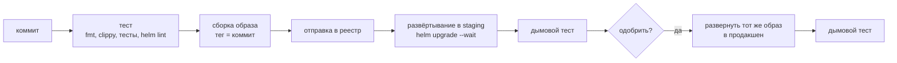

<!-- nav:top -->
[🏠 Начало](../START-HERE.md) · [← 21.6 Упаковка с Helm и Kustomize](06-helm-and-kustomize.md) · [📋 Этап 21](README.md) · [21.8 Инфраструктура как код с OpenTofu →](08-infrastructure-as-code-with-opentofu.md) · [📖 Глоссарий](../GLOSSARY.md) · [🇬🇧 English](../../en/21-cloud-native-infrastructure/07-ci-cd-from-commit-to-production.md) <!-- nav -->

# Урок 21.7 — CI/CD: от коммита до продакшена

> **Этап 21 — Облачная (cloud-native) инфраструктура** · Урок 7 из 14 · ⏱ около 2,5 часа (2 занятия)

## Что вы узнаете

- Чем отличаются непрерывная интеграция, непрерывная доставка и непрерывное развёртывание и из каких стадий состоит конвейер доставки.
- Почему образ собирают **один раз** на коммит, помечают его коммитом и продвигают один и тот же образ из окружения в окружение.
- Как выполнить весь конвейер на Mac одним скриптом: тест, сборка, публикация, развёртывание, дымовой тест — и как неудачный релиз сам откатывается.
- Как тот же конвейер выглядит в GitHub Actions: с реестром, кластером kind в CI и защищённым продакшен-окружением.
- Развёртывание по модели push и pull (GitOps) и основные стратегии релиза: постепенная, blue-green и canary.

## Перед началом

- Вы прошли [Урок 21.6 — Упаковка с Helm и Kustomize](06-helm-and-kustomize.md). Вам нужен чарт `chart/hello` **с тестом Helm** из его Упражнения 2 (файл повторён в разделе 3).
- Вы знаете CI на GitHub Actions и `actionlint` ([Урок 09.12 — Непрерывная интеграция](../09-testing-debugging-benchmarking/12-continuous-integration.md)) и безопасность цепочки поставок ([Урок 20.7](../20-reliability-and-hardening/07-supply-chain-security-in-depth.md)).
- `code/p21-hello` закоммичен в репозитории вашего курса (`~/projects/rust`), а `admin-token.txt` и `dev-token.txt` есть в `.gitignore`.

## Новые слова

| Слово | Значение |
|---|---|
| **CI** (Continuous Integration, непрерывная интеграция) | Каждое изменение часто сливается и автоматически проверяется: сборка, линтер, тесты. |
| **непрерывная доставка** (continuous delivery) | Каждое изменение, прошедшее CI, превращается в релиз, который *может* уйти в продакшен в любой момент; когда — решает человек. |
| **непрерывное развёртывание** (continuous deployment) | Как непрерывная доставка, но каждое удачное изменение уходит в продакшен автоматически, без человека посередине. |
| **CD** | Сокращение для continuous delivery или continuous deployment; что именно имеется в виду, зависит от команды. |
| **конвейер** (pipeline) | Упорядоченные стадии, которые проходит изменение от коммита до продакшена. |
| **артефакт** (artifact) | Результат сборки, который развёртывают; у нас это образ контейнера. |
| **продвижение** (promotion) | Перенос того же артефакта из одного окружения в следующее (тест → staging → продакшен) без пересборки. |
| **staging** | Окружение, максимально похожее на продакшен, для последних проверок. |
| **дайджест образа** (image digest) | Хеш SHA-256 (Secure Hash Algorithm, безопасный алгоритм хеширования) содержимого образа, например `sha256:aad5…`. В отличие от тега, он никогда не может указывать на другое содержимое. |
| **GHCR** (GitHub Container Registry, реестр контейнеров GitHub) | Реестр образов GitHub по адресу `ghcr.io`. |
| **e2e** (end-to-end, сквозной тест) | Тест всей работающей системы целиком: от образа и кластера до ответа через Service. Так называется одно из заданий workflow в разделе 5. |
| **GitOps** | Способ развёртывания, при котором программа внутри кластера забирает желаемое состояние из репозитория Git и согласует кластер с ним. |
| **сине-зелёное развёртывание** (blue-green deployment) | Новая версия запускается рядом со старой, и весь трафик переключается сразу. |
| **канареечный релиз** (canary release) | Сначала на новую версию отправляется небольшая часть трафика, и больше — только если она ведёт себя хорошо. |
| **флаг функциональности** (feature flag) | Переключатель в конфигурации, который включает или выключает возможность без нового развёртывания. |

## 1. CI, непрерывная доставка, непрерывное развёртывание

В Уроке 09.12 вы построили **CI** (Continuous Integration, непрерывная интеграция): каждая отправка запускает форматирование, линтер и тесты, поэтому `main` всегда в хорошем состоянии. CI отвечает на вопрос «правильно ли это изменение?». Он ничего не кладёт на сервер.

**CD** идёт дальше и бывает двух степеней:

- **Непрерывная доставка:** каждое изменение, прошедшее конвейер, становится релизом, который *мог бы* уйти в продакшен прямо сейчас. Последний шаг — кнопка, которую нажимает человек.
- **Непрерывное развёртывание:** кнопки нет. Каждое удачное изменение уходит в продакшен само, часто много раз в день.

Обеим нужен один и тот же конвейер:



Каждая стадия — это шлагбаум: если она не проходит, изменение останавливается там, и чем раньше, тем лучше. Упавший модульный тест стоит секунды; упавший дымовой тест в staging — минуты; сбой в продакшене стоит пользователей.

## 2. Собрать один раз, развернуть много раз

Самое важное правило конвейера доставки: **собрать артефакт один раз, а затем продвигать тот же артефакт.** Если staging и продакшен каждый пересобирают образ из одного и того же коммита, вы получаете два образа, которые *скорее всего* одинаковы: между сборками могли измениться зависимость, базовый образ или компилятор. Тогда «в staging работало» ничего не доказывает.

Поэтому конвейер:

1. собирает образ один раз, сразу после тестов;
2. помечает его тем, что точно называет код: **хешем коммита** (например, `d6750d2d90f0`), никогда не `latest`;
3. отправляет его в реестр;
4. развёртывает ровно этот тег в staging, а позже ровно этот тег в продакшен. Между окружениями отличается только **конфигурация** (Уроки 21.5, 21.6).

Тег — всё же имя, которое *кто-то* может перевесить на другое содержимое. Для самой сильной гарантии развёртывайте по **дайджесту**: `ghcr.io/you/p21-hello@sha256:…`. Дайджест вычисляется из самого содержимого, поэтому измениться не может. Подпись образов и проверка подписей перед развёртыванием (Урок 20.7) строятся на той же идее.

> 🔒 **Безопасность:** у конвейера ключи от продакшена. Любой, кто может изменить файл конвейера или зависимость, которую он запускает, может развернуть что угодно. Защищайте конвейер как продакшен: проводите ревью изменений файлов workflow, давайте каждому заданию только нужные права и храните учётные данные продакшена в защищённом окружении (раздел 5).

## 3. Конвейер на вашем Mac

Прежде чем писать конвейер для сервиса CI, напишите его как скрипт, который можете запустить сами. Тогда файл CI просто вызывает те же шаги, а отлаживать конвейер можно локально.

Если вы пропустили Упражнение 2 Урока 21.6, добавьте тест Helm сейчас, как `chart/hello/templates/tests/test-connection.yaml`:

```yaml
apiVersion: v1
kind: Pod
metadata:
  name: {{ .Release.Name }}-test
  labels:
    # Not the selector labels: the Service must not send traffic to this pod.
    app.kubernetes.io/instance: {{ .Release.Name }}
    app.kubernetes.io/component: test
  annotations:
    "helm.sh/hook": test
    "helm.sh/hook-delete-policy": before-hook-creation
spec:
  restartPolicy: Never
  containers:
    - name: wget
      image: busybox:1.37
      command:
        - sh
        - -c
        - wget -qO- -T 5 http://{{ .Release.Name }} | grep '{{ .Values.greeting }} from'
```

Затем создайте `code/p21-hello/deploy.sh` и сделайте его исполняемым (`chmod +x deploy.sh`):

```bash
#!/usr/bin/env bash
# deploy.sh: the pipeline of Lesson 21.7, run against a local kind cluster.
set -euo pipefail

CLUSTER=${CLUSTER:-course-21-07}
IMAGE=course-p21-hello

# The image tag names the exact commit, so the code must be committed.
if ! git diff --quiet HEAD -- .; then
  echo "deploy: commit your changes first" >&2
  exit 1
fi
TAG=$(git rev-parse --short=12 HEAD)

echo "==> 1/5 test"
cargo fmt --check
cargo clippy --quiet --all-targets -- -D warnings
cargo test --quiet
helm lint --quiet chart/hello

echo "==> 2/5 build $IMAGE:$TAG"
docker build --quiet -t "$IMAGE:$TAG" . >/dev/null

echo "==> 3/5 publish (here: load into kind)"
kind load docker-image "$IMAGE:$TAG" --name "$CLUSTER"

echo "==> 4/5 deploy"
helm upgrade --install hello chart/hello \
  --set image.tag="$TAG" \
  --wait --timeout 2m --rollback-on-failure

echo "==> 5/5 smoke test"
helm test hello --logs
```

**Что происходит:**

1. `set -euo pipefail` (Урок 11.9) останавливает скрипт на первой упавшей команде, поэтому упавшая стадия останавливает конвейер.
2. Первая проверка отказывается развёртывать незакоммиченные изменения: `git diff --quiet HEAD -- .` завершается с ненулевым кодом, когда отслеживаемые файлы в этой папке отличаются от последнего коммита. Без неё тег называл бы коммит, в котором нет развёртываемого кода.
3. `git rev-parse --short=12 HEAD` даёт первые 12 символов хеша текущего коммита — тег образа.
4. Стадия 1 — это шлагбаум CI из Урока 09.12 плюс `helm lint` для чарта.
5. Стадия 2 собирает образ один раз. Стадия 3 его *публикует*; для kind «публикация» означает `kind load`, а в CI это будет `docker push` в реестр.
6. Стадия 4 развёртывает ровно этот тег. `--wait` ждёт, пока новые поды не станут готовыми; `--timeout 2m` ограничивает ожидание; `--rollback-on-failure` заставляет Helm самостоятельно вернуться к предыдущей ревизии, если релиз не стал готовым вовремя (раздел 4).
7. Стадия 5 запускает тест Helm: настоящий запрос через Service, сверенный с ожидаемым приветствием.

> 🧪 **Тестирование:** дымовой тест — последний тест в цепочке и единственный, который проверяет *работающую* систему: образ, конфигурацию, Secret, Service и сеть вместе. Делайте его быстрым и простым («отвечает ли правильно?»), а подробные тесты держите раньше в конвейере, где неудачи дёшевы.

Создайте кластер и Secret, закоммитьте скрипт и запустите его:

```bash
kind create cluster --name course-21-07
kubectl create secret generic hello-admin --from-file=admin-token=admin-token.txt
git add deploy.sh chart && git commit -m "p21-hello: local deploy pipeline"
./deploy.sh
```

```text
==> 1/5 test

running 3 tests
...
test result: ok. 3 passed; 0 failed; 0 ignored; 0 measured; 0 filtered out; finished in 0.00s

==> 2/5 build course-p21-hello:1a3df93110ca
==> 3/5 publish (here: load into kind)
Image: "course-p21-hello:1a3df93110ca" with ID "sha256:aad5978d15471781280ee1c0aac2b83bde56134a2fa509407bc957f7e888ce79" not yet present on node "course-21-07-control-plane", loading...
==> 4/5 deploy
Release "hello" does not exist. Installing it now.
NAME: hello
LAST DEPLOYED: Wed Nov 18 14:12:41 2026
NAMESPACE: default
STATUS: deployed
REVISION: 1
DESCRIPTION: Install complete
==> 5/5 smoke test
NAME: hello
LAST DEPLOYED: Wed Nov 18 14:12:41 2026
NAMESPACE: default
STATUS: deployed
REVISION: 1
DESCRIPTION: Install complete
TEST SUITE:     hello-test
Last Started:   Wed Nov 18 14:12:47 2026
Last Completed: Wed Nov 18 14:12:54 2026
Phase:          Succeeded

POD LOGS: hello-test (wget)
salam from hello-599f54bf95-v4gkl (version 0.3.0)
```

Ваш хеш коммита и время будут другими. Теперь внесите изменение: поставьте `greeting: privet` в `chart/hello/values.yaml` и запустите скрипт, **не** коммитя:

```text
deploy: commit your changes first
```

Закоммитьте (`git commit -am "p21-hello: greet with privet"`) и снова запустите `./deploy.sh`. Выполняются те же пять стадий; образ получает новый тег, а стадия 4 теперь пишет `Release "hello" has been upgraded. Happy Helming!` и `REVISION: 2`. Дымовой тест печатает `privet from hello-6b8c74c99d-f7j48 (version 0.3.0)`. Теперь каждый под выполняет образ нового коммита:

```bash
kubectl get pods -l app.kubernetes.io/name=hello -o custom-columns=NAME:.metadata.name,IMAGE:.spec.containers[0].image
```

```text
NAME                     IMAGE
hello-6b8c74c99d-f7j48   course-p21-hello:d6750d2d90f0
hello-6b8c74c99d-nhcl9   course-p21-hello:d6750d2d90f0
hello-6b8c74c99d-qgx6j   course-p21-hello:d6750d2d90f0
```

От любого пода можно вернуться к точному коммиту командой `git show d6750d2d90f0`. Эту прослеживаемость и даёт тег из коммита.

## 4. Неудачный релиз откатывается сам

Сымитируйте сломанный релиз: тег образа, которого не существует (как будто сборка ничего не отправила). Возьмите тайм-аут покороче, чтобы не ждать долго:

```bash
helm upgrade hello chart/hello --set image.tag=0.0.0-missing --wait --timeout 60s --rollback-on-failure
helm history hello
```

```text
level=WARN msg="upgrade failed" name=hello error="resource Deployment/default/hello not ready. status: InProgress, message: Updated: 1/3\ncontext deadline exceeded"
Error: UPGRADE FAILED: release hello failed, and has been rolled back due to rollback-on-failure being set: resource Deployment/default/hello not ready. status: InProgress, message: Updated: 1/3
context deadline exceeded
REVISION	UPDATED                 	STATUS    	CHART      	APP VERSION	DESCRIPTION                                                                                                   
1       	Wed Nov 18 14:12:41 2026	superseded	hello-0.1.0	0.3.0      	Install complete                                                                                              
2       	Wed Nov 18 14:12:56 2026	superseded	hello-0.1.0	0.3.0      	Upgrade complete                                                                                              
3       	Wed Nov 18 14:13:13 2026	failed    	hello-0.1.0	0.3.0      	Upgrade "hello" failed: resource Deployment/default/hello not ready. status: InProgress, message: Updated: ...
4       	Wed Nov 18 14:14:13 2026	deployed  	hello-0.1.0	0.3.0      	Rollback to 2                                                                                                 
```

**Что происходит:**

1. Helm применил ревизию 3. Deployment создал один новый под, который не смог скачать свой образ (Урок 21.4), поэтому выкатка застряла на `Updated: 1/3`.
2. Благодаря `maxUnavailable: 0` три старых пода всё это время продолжали обслуживать запросы.
3. Через 60 секунд Helm сдался, пометил ревизию 3 как `failed` и автоматически откатился: ревизия 4 — «Rollback to 2». Сломанный под удаляется.
4. `helm upgrade` завершился с ошибкой, поэтому в `deploy.sh` (из-за `set -e`) конвейер остановился бы здесь и не запустил бы дымовой тест: красный конвейер при работающем сервисе.

Это та страховочная сетка, которая нужна: пробы готовности (Урок 21.5) решают, хорош ли новый под, постепенное обновление держит старые поды до этого момента, а конвейер превращает «не готов вовремя» в автоматический откат и упавший запуск, на который кто-нибудь посмотрит.

## 5. Тот же конвейер в GitHub Actions

На GitHub конвейер становится workflow. В нём четыре задания: `test` при каждой отправке и каждом pull request; `image`, `e2e` и `production` — только после отправки в репозиторий. Создайте `.github/workflows/p21-hello.yml` в корне репозитория:

```yaml
name: p21-hello CD

on:
  push:
    branches: [main]
    paths: ["code/p21-hello/**", ".github/workflows/p21-hello.yml"]
  pull_request:
    paths: ["code/p21-hello/**", ".github/workflows/p21-hello.yml"]

# The smallest rights by default; jobs ask for more only when they need it.
permissions:
  contents: read

env:
  CARGO_TERM_COLOR: always

jobs:
  test:
    runs-on: ubuntu-latest
    defaults:
      run:
        working-directory: code/p21-hello
    steps:
      - uses: actions/checkout@v7
      - run: rustup toolchain install stable --profile minimal --component rustfmt,clippy
      - uses: Swatinem/rust-cache@v2
        with:
          workspaces: code/p21-hello
      - run: cargo fmt --check
      - run: cargo clippy --all-targets -- -D warnings
      - run: cargo test
      - uses: azure/setup-helm@v5
      - run: helm lint chart/hello

  image:
    needs: test
    if: github.event_name == 'push'
    runs-on: ubuntu-latest
    permissions:
      contents: read
      packages: write
    outputs:
      repo: ${{ steps.names.outputs.repo }}
      tag: ${{ steps.names.outputs.tag }}
    steps:
      - uses: actions/checkout@v7
      - id: names
        name: Image name and tag
        run: |
          echo "repo=ghcr.io/${GITHUB_REPOSITORY_OWNER,,}/p21-hello" >> "$GITHUB_OUTPUT"
          echo "tag=sha-${GITHUB_SHA::12}" >> "$GITHUB_OUTPUT"
      - uses: docker/login-action@v4
        with:
          registry: ghcr.io
          username: ${{ github.actor }}
          password: ${{ secrets.GITHUB_TOKEN }}
      - uses: docker/setup-buildx-action@v4
      - uses: docker/build-push-action@v7
        with:
          context: code/p21-hello
          push: true
          tags: ${{ steps.names.outputs.repo }}:${{ steps.names.outputs.tag }}

  e2e:
    needs: image
    runs-on: ubuntu-latest
    permissions:
      contents: read
      packages: read
    env:
      IMAGE_REPO: ${{ needs.image.outputs.repo }}
      IMAGE_TAG: ${{ needs.image.outputs.tag }}
    defaults:
      run:
        working-directory: code/p21-hello
    steps:
      - uses: actions/checkout@v7
      - uses: azure/setup-helm@v5
      - uses: helm/kind-action@v1
        with:
          cluster_name: e2e
      - uses: docker/login-action@v4
        with:
          registry: ghcr.io
          username: ${{ github.actor }}
          password: ${{ secrets.GITHUB_TOKEN }}
      - name: Load the pushed image into kind
        run: |
          docker pull "$IMAGE_REPO:$IMAGE_TAG"
          kind load docker-image "$IMAGE_REPO:$IMAGE_TAG" --name e2e
      - name: Create the Secret
        run: kubectl create secret generic hello-admin --from-literal=admin-token="$(openssl rand -hex 16)"
      - name: Deploy
        run: >
          helm upgrade --install hello chart/hello
          --set image.repository="$IMAGE_REPO"
          --set image.tag="$IMAGE_TAG"
          --wait --timeout 3m --rollback-on-failure
      - name: Smoke test
        run: helm test hello --logs

  production:
    needs: [image, e2e]
    if: github.ref == 'refs/heads/main'
    runs-on: ubuntu-latest
    # Rules for this environment (required reviewers, allowed branches)
    # are set in the repository settings on GitHub.
    environment: production
    env:
      IMAGE_REPO: ${{ needs.image.outputs.repo }}
      IMAGE_TAG: ${{ needs.image.outputs.tag }}
    defaults:
      run:
        working-directory: code/p21-hello
    steps:
      - uses: actions/checkout@v7
      - uses: azure/setup-helm@v5
      - name: Deploy the same image to production
        env:
          KUBECONFIG_DATA: ${{ secrets.PRODUCTION_KUBECONFIG }}
        run: |
          export KUBECONFIG="$RUNNER_TEMP/kubeconfig"
          printf '%s' "$KUBECONFIG_DATA" > "$KUBECONFIG"
          helm upgrade --install hello chart/hello \
            --set image.repository="$IMAGE_REPO" \
            --set image.tag="$IMAGE_TAG" \
            --wait --timeout 5m --rollback-on-failure
          helm test hello --logs
```

**Что происходит:**

1. `paths` запускает workflow только когда меняются файлы этого сервиса (или сам workflow); другой код в репозитории курса его не запускает.
2. `test` — это шлагбаум из Урока 09.12 плюс `helm lint`. `azure/setup-helm` устанавливает Helm на раннер.
3. `image` выполняется только при отправке (`if: github.event_name == 'push'`) и никогда для pull request: код из pull request не должен иметь возможности публиковать образы. Задание просит одно дополнительное право, `packages: write`, чтобы отправлять образы в GHCR (GitHub Container Registry, реестр контейнеров GitHub). Пароль — встроенный `GITHUB_TOKEN`; долгоживущего секрета, который можно украсть, нет.
4. Шаг `names` вычисляет имя и тег образа на bash: `${GITHUB_REPOSITORY_OWNER,,}` — владелец в нижнем регистре (имена в реестре должны быть в нижнем регистре), а `${GITHUB_SHA::12}` — первые 12 символов коммита. Они становятся **выходами задания**, которые следующие задания читают как `needs.image.outputs.repo` и `.tag`.
5. `e2e` создаёт на раннере свежий кластер kind через `helm/kind-action`, скачивает **отправленный** образ (а не собирает новый), загружает его в kind, создаёт Secret со случайным токеном, развёртывает тем же `helm upgrade`, что и `deploy.sh`, и запускает тест Helm. Это staging в миниатюре: настоящий артефакт в настоящем кластере.
6. `production` выполняется только на `main` и использует **окружение** (environment) `production`. В настройках репозитория на GitHub вы задаёте этому окружению правила защиты, например «один ревьюер должен одобрить» и «только из `main`»; тогда задание ждёт этого одобрения (непрерывная доставка). kubeconfig настоящего кластера — *секрет окружения*, его могут читать только задания этого окружения. Задание развёртывает тот же `repo:tag`, что и `e2e`.
7. Значения извне (имена образов, теги) попадают в команды оболочки через переменные `env:`, а не через `${{ ... }}` внутри `run:`. Это избавляет от проблемы внедрения в скрипт из Урока 09.12.

Раннеры GitHub на вашем Mac не запустить, поэтому вывод запуска здесь не показан. Проверьте файл через `actionlint`, как в Уроке 09.12; для этого workflow он ничего не напечатал и завершился с кодом `0`. В этом курсе у вас нет продакшен-кластера: задание `production` упало бы из-за отсутствия секрета, поэтому остановитесь после `e2e` (удалите задание или оставьте его как шаблон на будущее).

## 6. Push или pull: GitOps

И `deploy.sh`, и workflow работают по модели **push**: программа вне кластера выполняет против него `helm upgrade`. Есть и вторая модель:

```text
  push (this lesson)                      pull (GitOps)

  CI ──helm upgrade──► cluster            CI ──commit "tag: d6750d2"──► Git repo
  (CI needs cluster credentials)                                          ▲
                                          cluster: Argo CD / Flux ────────┘
                                          watches the repo and reconciles
                                          (no credentials leave the cluster)
```

В **GitOps** желаемое состояние каждого окружения живёт в репозитории Git (манифесты, значения Helm, оверлеи Kustomize). Агент внутри кластера, например Argo CD или Flux, регулярно сравнивает кластер с Git и применяет разницу. Это снова цикл согласования из Урока 21.1, только желаемое состояние — Git. Последний шаг CI — всего лишь коммит, меняющий тег образа в этом репозитории.

| | Push (развёртывает CI) | Pull (GitOps) |
|---|---|---|
| Кто меняет кластер | Задание CI | Агент внутри кластера |
| Учётные данные кластера | Хранятся в CI | Не покидают кластер |
| Дрейф (ручные изменения) | Остаётся до следующего развёртывания | Обнаруживается и отменяется автоматически |
| След для аудита | Логи CI | История Git репозитория окружения |
| Затраты | Просто, ничего не нужно устанавливать | Ещё одна система, которую надо поддерживать |

Для одного сервиса и одного кластера push вполне подходит. При многих сервисах и кластерах распространён GitOps, потому что Git становится единым проверенным источником истины о том, что где работает.

## 7. Стратегии релиза

Постепенное обновление (Урок 21.4) — лишь один из способов выпуска:

| Стратегия | Как работает | Плюсы | Цена |
|---|---|---|---|
| **Постепенная** (rolling) | Заменять поды по несколько штук | Встроена в Deployment, не нужна дополнительная мощность | Какое-то время обслуживают и старая, и новая версии |
| **Blue-green** | Запустить всю новую версию («зелёную») рядом со старой («синей»); разом переключить селектор Service на зелёную | Мгновенное переключение и мгновенный возврат | Двойная мощность во время релиза |
| **Canary** | Отправить небольшую долю (скажем, 5%) трафика на новую версию, следить за долей ошибок и задержкой, затем увеличивать | Проблемы достаются немногим пользователям | Нужны разделение трафика и хорошие метрики (Уроки 21.9–21.11) |

В обычном Kubernetes blue-green можно собрать из двух Deployment и одного Service, селектор которого вы меняете (идея меток из Урока 21.2). Канарейкам с точными процентами нужен компонент, понимающий трафик: Ingress-контроллер, service mesh или инструмент вроде Argo Rollouts. **Флаги функциональности** дополняют все три: новый код развёрнут, но выключен, и вы включаете его в конфигурации — сначала для части пользователей.

> ⚠️ **Частая ошибка:** во время постепенного, blue-green или canary релиза старая и новая версии работают **одновременно**. Миграция базы данных, с которой старая версия не справляется (например, переименование столбца), ломает старые поды посреди релиза. Делайте изменения обратно совместимыми: сначала добавьте новый столбец, выпустите код, который пишет в оба, а старый столбец удалите в одном из следующих релизов (Урок 16.7).

## 8. Уборка

```bash
kind delete cluster --name course-21-07
docker image ls --filter reference=course-p21-hello
```

Удалите перечисленные образы через `docker image rm course-p21-hello:<тег>` (по одному на каждый развёрнутый коммит). Сохраните `deploy.sh` и workflow: конвейер CI проекта этапа в Уроке 21.13 устроен по тому же образцу.

## Частые ошибки

**Пересобирать образ для каждого окружения.** «Мы собираем в staging и ещё раз в продакшене» означает, что в продакшене работает непротестированный артефакт. Соберите один раз, отправьте один раз, развёртывайте везде один и тот же тег (или дайджест).

**Зелёный конвейер при сломанном сервисе.** Шаг развёртывания, который только выполняет `kubectl apply`, проходит, как только сервер API (Application Programming Interface, программный интерфейс) примет объекты, даже если ни один новый под так и не станет готовым. Всегда ждите выкатку (`helm upgrade --wait`, `kubectl rollout status`) и запускайте дымовой тест.

**Развёртывать незакоммиченный код.** Тег из хеша коммита лжёт, если в рабочей папке были изменения. `deploy.sh` отказывается (`deploy: commit your changes first`); в CI рабочая копия всегда чистая.

**Одни всемогущие учётные данные.** kubeconfig с правами cluster-admin, хранимый как обычный секрет репозитория, может использовать любой workflow, а неосторожный шаг может выдать его в логи. Давайте развёртывающей учётной записи права только в её пространстве имён, храните их как секрет окружения за одобрением или используйте GitOps либо короткоживущие учётные данные (OIDC от GitHub, OpenID Connect, позволяет заданию получить временный токен у облачного провайдера без хранимого секрета).

## Попробуйте сами

1. Запустите `./deploy.sh` дважды, ничего не меняя. Создаёт ли стадия 4 новую ревизию? (Посмотрите `helm history hello`.) Почему это безвредно?
2. Специально сломайте модульный тест, закоммитьте и запустите `./deploy.sh`. На какой стадии он остановится и развернётся ли что-нибудь?
3. Уберите за собой, как в разделе 8.

## Упражнения

### Упражнение 1 — Назовите практику (легко)

Для каждой команды скажите, что у неё: только CI, непрерывная доставка или непрерывное развёртывание, — и найдите ту единственную команду, которая нарушает правило «собрать один раз, развернуть много раз».

1. Каждая отправка запускает тесты; релизы раз в месяц собираются вручную на ноутбуке разработчика.
2. Каждое слияние в `main` собирается, тестируется, развёртывается в staging и проходит дымовой тест; релиз-менеджер нажимает «одобрить», чтобы отправить этот образ в продакшен.
3. Каждое слияние в `main`, прошедшее все стадии, автоматически уходит в продакшен.
4. Каждое слияние тестируется; задание для staging и задание для продакшена каждое выполняет `docker build` из одного и того же коммита.

<details>
<summary>Подсказка</summary>

Задайте два вопроса: *готово* ли каждое удачное изменение к продакшену (доставка)? *Уходит* ли оно туда без человека (развёртывание)? Затем посмотрите, сколько раз собирается образ.

</details>

<details>
<summary>Ответ</summary>

1. Только CI: изменения проверяются, но релизы ручные и редкие (а сборка на ноутбуке невоспроизводима).
2. Непрерывная доставка: каждое изменение становится развёртываемым проверенным релизом; когда — решает человек.
3. Непрерывное развёртывание: на последнем шаге нет человека.
4. CI плюс отчасти доставка, но нарушено «собрать один раз, развернуть много раз»: в продакшене работает образ, который никогда не тестировался. Соберите один раз в отдельном задании и передайте тег обоим заданиям развёртывания, как делает workflow из раздела 5.

</details>

### Упражнение 2 — Дымовой тест на Rust (средне)

Напишите файл интеграционных тестов `tests/smoke.rs`, который проверяет **работающий** сервис: `/healthz` отвечает `200` с `ok\n`, `/readyz` отвечает `200`, а `/admin` без токена отвечает `401`. Адрес берётся из переменной окружения `BASE_URL`. Обычный `cargo test` не должен запускать эти тесты (им нужен работающий сервис). Используйте только стандартную библиотеку: `TcpStream` и написанный вручную запрос HTTP/1.1 (HyperText Transfer Protocol, протокол передачи гипертекста) (Урок 15.8). Запустите их против кластера через проброс порта.

<details>
<summary>Подсказка</summary>

Пометьте тесты `#[ignore = "причина"]` и запускайте через `cargo test --test smoke -- --ignored`. Отправьте `GET /path HTTP/1.1`, заголовок `Host` и `Connection: close`, чтобы сервер закрыл соединение после ответа и `read_to_string` завершился. Код статуса — второе слово первой строки; тело начинается после первой пустой строки (`\r\n\r\n`).

</details>

<details>
<summary>Ответ</summary>

```rust
//! Smoke tests against a running service. They are ignored by a normal
//! `cargo test`. Run them with:
//! BASE_URL=http://127.0.0.1:8088 cargo test --test smoke -- --ignored

use std::io::{Read, Write};
use std::net::TcpStream;
use std::time::Duration;

/// Sends `GET path` over HTTP/1.1 and returns the status code and the body.
fn get(base: &str, path: &str) -> (u16, String) {
    let host = base.trim_start_matches("http://").trim_end_matches('/');
    let mut stream = TcpStream::connect(host).expect("cannot connect to the service");
    stream
        .set_read_timeout(Some(Duration::from_secs(5)))
        .unwrap();
    write!(
        stream,
        "GET {path} HTTP/1.1\r\nHost: {host}\r\nConnection: close\r\n\r\n"
    )
    .unwrap();

    let mut response = String::new();
    stream.read_to_string(&mut response).unwrap();
    let status = response
        .split_whitespace()
        .nth(1)
        .and_then(|code| code.parse().ok())
        .unwrap_or(0);
    let body = match response.split_once("\r\n\r\n") {
        Some((_headers, body)) => body.to_string(),
        None => String::new(),
    };
    (status, body)
}

fn base_url() -> String {
    std::env::var("BASE_URL").expect("set BASE_URL, for example http://127.0.0.1:8088")
}

#[test]
#[ignore = "needs a running service; set BASE_URL"]
fn health_and_readiness_are_ok() {
    let base = base_url();
    assert_eq!(get(&base, "/healthz"), (200, "ok\n".to_string()));
    assert_eq!(get(&base, "/readyz").0, 200);
}

#[test]
#[ignore = "needs a running service; set BASE_URL"]
fn admin_requires_a_token() {
    assert_eq!(get(&base_url(), "/admin").0, 401);
}
```

Обычный `cargo test` теперь показывает два теста как пропущенные:

```text
running 2 tests
test admin_requires_a_token ... ignored, needs a running service; set BASE_URL
test health_and_readiness_are_ok ... ignored, needs a running service; set BASE_URL
```

Когда в другой вкладке работает `kubectl port-forward service/hello 8088:80`:

```bash
BASE_URL=http://127.0.0.1:8088 cargo test --test smoke -- --ignored
```

```text
running 2 tests
test admin_requires_a_token ... ok
test health_and_readiness_are_ok ... ok

test result: ok. 2 passed; 0 failed; 0 ignored; 0 measured; 0 filtered out; finished in 2.01s
```

Без проброса порта оба падают с понятным сообщением:

```text
thread 'admin_requires_a_token' (6625025) panicked at tests/smoke.rs:12:47:
cannot connect to the service: Os { code: 61, kind: ConnectionRefused, message: "Connection refused" }
```

Почему это работает: файлы в `tests/` — интеграционные тесты, компилируемые как отдельные программы. `#[ignore]` не пускает их в обычный запуск тестов, поэтому стадия 1 `deploy.sh` остаётся быстрой и не требует кластера. `Connection: close` заставляет сервер закрыть соединение, а это завершает `read_to_string`. В отличие от теста Helm, эти тесты живут рядом с кодом на Rust и могут расти вместе с сервисом.

</details>

### Упражнение 3 — Дымовые тесты на Rust в CI (сложно)

Расширьте задание `e2e` в workflow: после теста Helm установите тулчейн Rust и запустите тесты из Упражнения 2 против кластера kind на раннере. Проверьте файл через `actionlint`.

<details>
<summary>Подсказка</summary>

Раннер — обычная машина с Linux и `kubectl` (от `helm/kind-action`). Запустите проброс порта в фоне через `&`, дайте ему несколько секунд, затем выполните `cargo test` с `BASE_URL`. `defaults.run.working-directory` задания уже равен `code/p21-hello`.

</details>

<details>
<summary>Ответ</summary>

Добавьте два шага в конец задания `e2e`:

```yaml
      - run: rustup toolchain install stable --profile minimal
      - name: Rust smoke tests through a port-forward
        run: |
          kubectl port-forward service/hello 8088:80 &
          sleep 3
          BASE_URL=http://127.0.0.1:8088 cargo test --test smoke -- --ignored
```

`actionlint` (в том числе со встроенным shellcheck, в официальном образе `rhysd/actionlint`) не находит проблем в изменённом файле. Те же три команды, выполненные на Mac против `course-21-07`, дали проходящий вывод из Упражнения 2.

Почему это работает: фоновый проброс порта работает, пока он нужен тестам; оставшиеся фоновые процессы раннер убирает в конце задания. `sleep 3` — простой способ дождаться туннеля; более надёжный скрипт повторяет первый запрос несколько раз. Задание ещё раз компилирует тесты, и это стоит времени: добавьте `Swatinem/rust-cache@v2`, как в задании `test`, если станет медленно.

</details>

## Вопросы для самопроверки

1. Чем непрерывная доставка отличается от непрерывного развёртывания?

<details>
<summary>Ответ</summary>

При непрерывной доставке каждое удачное изменение становится релизом, который может уйти в продакшен, а когда — решает человек. При непрерывном развёртывании каждое удачное изменение уходит в продакшен автоматически.

</details>

2. Почему образ нужно собирать только один раз на коммит?

<details>
<summary>Ответ</summary>

Чтобы артефакт, проверенный в предыдущих окружениях, был ровно тем, что работает в продакшене. Пересборка может отличаться (новая зависимость, базовый образ или компилятор), и тогда прежние тесты ничего не доказывают.

</details>

3. Почему хеш коммита — хороший тег образа и что ещё надёжнее?

<details>
<summary>Ответ</summary>

Он точно называет код, поэтому каждый работающий под можно проследить до коммита, и его никогда не нужно переиспользовать. Ещё надёжнее дайджест (`@sha256:…`), вычисленный из содержимого: он не может указывать ни на что другое.

</details>

4. Почему в разделе 4 пользователи не заметили сломанного релиза?

<details>
<summary>Ответ</summary>

Новый под так и не стал готовым, а при `maxUnavailable: 0` старые поды продолжали работать. По истечении тайм-аута `--rollback-on-failure` вернул релиз к предыдущей ревизии.

</details>

5. Почему задание `image` выполняется только при отправке, а не для pull request?

<details>
<summary>Ответ</summary>

Код в pull request ещё не прошёл ревью (и может прийти из форка). Он не должен иметь возможности публиковать образы или пользоваться правами на запись.

</details>

6. Что такое GitOps и какую идею из Урока 21.1 он переиспользует?

<details>
<summary>Ответ</summary>

Желаемое состояние каждого окружения хранится в Git, а агент внутри кластера (Argo CD, Flux) забирает его и согласует с ним кластер. Это цикл согласования, где желаемое состояние — Git.

</details>

7. Назовите одно преимущество и одну цену канареечного релиза.

<details>
<summary>Ответ</summary>

Преимущество: плохая версия достаётся лишь небольшой доле пользователей. Цена: нужны разделение трафика и хорошие метрики, чтобы решить, продолжать ли.

</details>

## Итоги

- CI проверяет каждое изменение; непрерывная доставка делает каждое удачное изменение готовым к выпуску; непрерывное развёртывание выпускает его автоматически.
- Конвейер доставки — цепочка шлагбаумов: тест → сборка образа → публикация → развёртывание в staging → дымовой тест → (одобрение) → продакшен → дымовой тест.
- Собирайте один раз, помечайте коммитом (или развёртывайте по дайджесту) и продвигайте тот же артефакт; между окружениями отличается только конфигурация.
- `helm upgrade --install --wait --rollback-on-failure` вместе с пробами готовности и `maxUnavailable: 0` превращают плохой релиз в автоматический откат и красный конвейер, а не в простой.
- В GitHub Actions: соберите и отправьте образ один раз с `GITHUB_TOKEN` и `packages: write`, проверьте отправленный образ в кластере kind и развёртывайте в защищённое окружение `production`.
- Развёртывание по модели push простое; GitOps держит учётные данные внутри кластера и отменяет дрейф.
- Постепенная, blue-green и canary стратегии по-разному обменивают мощность, скорость и риск; при всех одновременно работают две версии, поэтому изменения должны быть обратно совместимыми.

## Источники и что почитать

- [Martin Fowler — Continuous Delivery](https://martinfowler.com/bliki/ContinuousDelivery.html) — короткое классическое определение и отличие от непрерывного развёртывания.
- [GitHub Docs — Working with the Container registry](https://docs.github.com/en/packages/working-with-a-github-packages-registry/working-with-the-container-registry) — отправка образов в `ghcr.io` с `GITHUB_TOKEN`.
- [GitHub Docs — Managing environments for deployment](https://docs.github.com/en/actions/managing-workflow-runs-and-deployments/managing-deployments/managing-environments-for-deployment) — правила защиты и секреты окружений.
- [GitHub Docs — Automatic token authentication](https://docs.github.com/en/actions/security-for-github-actions/security-guides/automatic-token-authentication) — что может `GITHUB_TOKEN` и как `permissions` его ограничивают.
- [GitHub Docs — OpenID Connect](https://docs.github.com/en/actions/concepts/security/openid-connect) — короткоживущие облачные учётные данные без хранимых секретов.
- [helm/kind-action](https://github.com/helm/kind-action) — action, который создаёт кластер kind в workflow.
- [OpenGitOps](https://opengitops.dev/) — четыре принципа GitOps; см. также [Argo CD](https://argo-cd.readthedocs.io/en/stable/) и [Flux](https://fluxcd.io/).

---

[🏠 Начало](../START-HERE.md) · [← 21.6 Упаковка с Helm и Kustomize](06-helm-and-kustomize.md) · [📋 Этап 21](README.md) · [21.8 Инфраструктура как код с OpenTofu →](08-infrastructure-as-code-with-opentofu.md) · [📖 Глоссарий](../GLOSSARY.md) <!-- nav -->
<!-- nav:bottom -->
