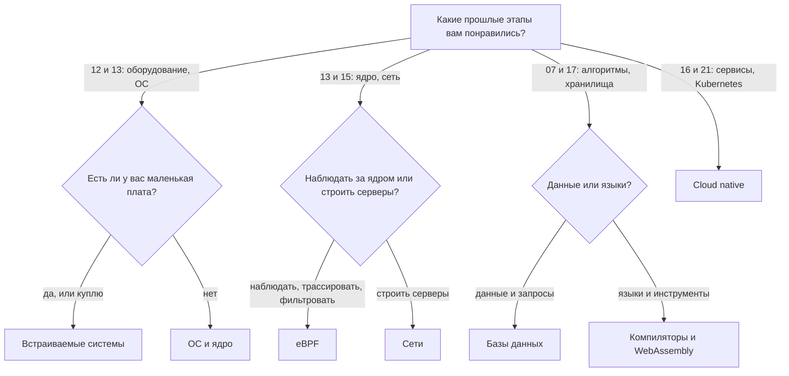

<!-- nav:top -->
[🏠 Начало](../START-HERE.md) · [← Этап 22 — Специализации](README.md) · [📋 Этап 22](README.md) · [22.2 Трек ОС: программа на Rust без операционной системы →](02-os-track-a-freestanding-binary.md) · [📖 Глоссарий](../GLOSSARY.md) · [🇬🇧 English](../../en/22-specializations/01-choosing-a-specialization.md) <!-- nav -->

# Урок 22.1 — Выбор специализации

> **Этап 22 — Специализации** · Урок 1 из 30 · ⏱ около 105 минут

## Что вы узнаете

- Что такое специализация и зачем системному инженеру одна глубокая область рядом с широкой базой.
- Семь направлений этого этапа: что вы создаёте в каждом и на какие прошлые этапы оно опирается.
- Как выбрать одно направление с помощью нескольких честных вопросов и как проходить этап.
- Как проверить, что на вашем Mac есть инструменты для вашего направления, — маленькой программой на Rust с тестами.

## Перед началом

- Вы прошли [Этап 21 — Облачная (cloud-native) инфраструктура](../21-cloud-native-infrastructure/README.md) и
  все этапы до него. Этот этап опирается на них все.
- Вы ведёте журнал обучения ([Урок 00.8](../00-getting-started/08-study-routine-notes-and-checkpoint.md)).
  В него вы запишете свой выбор.
- Вы знаете `std::process::Command` из [Урока 13.5](../13-operating-systems/05-fork-exec-and-wait.md).

## Новые слова

| Слово | Значение |
|---|---|
| **специализация** (specialization) | Одна область инженерии, которую вы знаете гораздо глубже остальных, например ядра или базы данных. |
| **направление, трек** (track) | На этом этапе — группа из четырёх уроков об одной специализации. Вы изучаете одно направление, а не все семь. |
| **T-образный инженер** (T-shaped engineer) | Инженер с широкой базой (верхняя перекладина буквы T) и одной глубокой областью (вертикальная черта). |
| **ОС** (OS, Operating System, операционная система) | Программа, которая управляет оборудованием и запускает другие программы, например Linux или macOS (Этап 13). |
| **ядро** (kernel) | Сердцевина операционной системы, которая работает с полным контролем над оборудованием. |
| **eBPF** (extended Berkeley Packet Filter, расширенный пакетный фильтр Беркли) | Способ запускать маленькие проверенные программы внутри ядра Linux, не меняя само ядро. Название историческое; сегодня eBPF используют далеко не только для пакетов. |
| **встраиваемая система** (embedded system) | Маленький компьютер внутри устройства (термостата, дрона), который выполняет одну программу, обычно без операционной системы. |
| **микроконтроллер** (microcontroller) | Целый маленький компьютер на одном чипе: CPU (Central Processing Unit, центральный процессор), память и выводы для связи с внешним миром. |
| **движок запросов** (query engine) | Часть базы данных, которая превращает запрос вроде `SELECT …` в шаги и выполняет их над данными. |
| **компилятор** (compiler) | Программа, которая переводит исходный код в другую форму, например Rust в машинный код. |
| **интерпретатор** (interpreter) | Программа, которая выполняет исходный код напрямую, шаг за шагом, не создавая сначала машинный код. |
| **WebAssembly** (Wasm) | Переносимый двоичный формат программ. Работает в браузерах и в отдельных средах выполнения на серверах. |
| **оператор** (operator, Kubernetes) | Программа, которая работает в кластере и автоматически управляет одним видом приложений (Этап 21). |
| **nightly** | Тулчейн Rust, который собирается каждую ночь. В нём есть нестабильные возможности, нужные некоторым направлениям. |
| **QEMU** (Quick Emulator, быстрый эмулятор) | Бесплатная программа, которая изображает целый компьютер, чтобы вы могли безопасно загрузить своё ядро. |

**Другие сокращения в этом уроке:** CSV (Comma-Separated Values, значения, разделённые запятыми, — текстовый формат
таблиц), HTTP (Hypertext Transfer Protocol, протокол передачи гипертекста — протокол веба), USB (Universal Serial Bus,
универсальная последовательная шина — обычный кабель и разъём для устройств) и ВМ (виртуальная машина, virtual
machine: целый компьютер, который изображает программа; ВМ курса `dev` появилась в Уроке 11.1).

## 1. Зачем специализироваться

Этапы 00–21 дали вам широкую перекладину буквы T: язык Rust, Git, алгоритмы, тестирование, безопасность,
Linux, устройство компьютера и операционной системы, сети, сервисы, хранилища, распределённые системы,
производительность, надёжность и Kubernetes. Почти любая работа в системной разработке ожидает эту базу.

Но работа, open-source-проекты и интересные задачи обычно требуют ещё и **глубины в одной области**. Команде,
которая пишет базу данных, нужен человек, понимающий выполнение запросов. Команде с большой сетью нужен
человек, который напишет быстрый прокси. Глубина — это ещё и то, что делает работу интересной: вы перестаёте
следовать инструкциям и начинаете понимать, *почему* всё устроено именно так.

Этот этап — первый шаг в одну глубокую область. Четыре урока не сделают вас экспертом. Они дают рабочую
среду, основные идеи, настоящий проект и понятный список того, что изучать дальше и куда вносить вклад.
Многие инженеры потом добавляют вторую специализацию; для этого можно вернуться сюда.

## 2. Семь направлений

У каждого направления одинаковая форма: урок 1 объясняет область, почему там используют Rust и как всё
настроить; уроки 2 и 3 учат основным навыкам на маленьких примерах; урок 4 — проект с вехами и список
следующих шагов (книги, документация, open-source-проекты, сообщества).

| Направление | Уроки | Что вы создаёте | Больше всего опирается на |
|---|---|---|---|
| ОС и ядро | [22.2](02-os-track-a-freestanding-binary.md)–22.5 | Крошечное ядро, которое загружается в QEMU, печатает текст, обрабатывает прерывания и использует страничную память | Этапы 12, 13 |
| eBPF | [22.6](06-ebpf-track-what-ebpf-is.md)–22.9 | Программы, которые работают внутри ядра Linux и отслеживают системные вызовы или считают сетевые пакеты | Этапы 13, 15 |
| Встраиваемые системы | [22.10](10-embedded-track-microcontrollers-and-no-std.md)–22.13 | Прошивку для маленькой дешёвой платы: мигать светодиодом, читать кнопку, асинхронные задачи | Этапы 12, 14 |
| Базы данных | [22.14](14-databases-track-how-query-engines-work.md)–22.17 | Крошечный движок запросов, выполняющий `SELECT` над CSV-файлами, затем Apache DataFusion | Этапы 07, 17 |
| Сети | [22.18](18-networking-track-high-performance-servers.md)–22.21 | Быстрые серверы на Tokio, разбор без копирования и HTTP-прокси | Этапы 14, 15, 19 |
| Компиляторы и WebAssembly | [22.22](22-compilers-track-lexing-and-parsing.md)–22.25 | Лексер, парсер и интерпретатор маленького языка, затем WebAssembly | Этапы 07, 08 |
| Cloud native | [22.26](26-cloud-native-track-kubernetes-operators.md)–22.29 | Оператор Kubernetes на Rust, проверенный на локальном кластере kind | Этапы 16, 21 |

После своего направления переходите к [Уроку 22.30 — Контрольная точка](30-checkpoint-your-specialization.md). В нём
есть по одному набору вопросов на каждое направление; вы отвечаете только на набор своего направления.

Как выглядит работа в каждой области, по одному предложению:

- **ОС и ядро.** Вы пишете код, под которым нет операционной системы: код загрузки, драйверы, управление
  памятью. Rust сейчас используется в ядре Linux, в Android и в новых исследовательских ядрах.
- **eBPF.** Вы подключаете маленькие программы к событиям в работающем ядре Linux, чтобы наблюдать за ним или
  фильтровать, без перезагрузки. Так устроены инструменты наблюдаемости и безопасности и облачные сети.
- **Встраиваемые системы.** Вы пишете прошивку для чипов с несколькими сотнями килобайт памяти. Проверки Rust
  ловят многие ошибки, которые иначе проявились бы только на устройстве.
- **Базы данных.** Вы работаете над движком внутри базы данных: разбор, планирование и выполнение запросов
  над столбцами данных. Несколько новых аналитических баз данных написаны на Rust.
- **Сети.** Вы строите серверы и прокси, которые обслуживают огромное число соединений с малой задержкой.
  Крупные интернет-компании используют прокси на Rust в продакшене.
- **Компиляторы и WebAssembly.** Вы превращаете текст в структуру, а структуру — в работающий код. Те же
  навыки нужны в линтерах, языках запросов, языках конфигурации и инструментах для кода.
- **Cloud native.** Вы пишете контроллеры, которые держат кластер в описанном вами состоянии, — «слой
  автоматизации» Kubernetes, с библиотеками kube-rs.

## 3. Как выбрать

Неправильного выбора нет: все направления используют тот же Rust и те же инженерные привычки. Честно ответьте
на эти вопросы и запишите ответы в журнал обучения:

1. **Какой прошлый этап понравился вам больше всего?** Понравившийся этап — лучшая подсказка. Таблица выше
   показывает, на какие этапы опирается каждое направление.
2. **Какую работу вы хотите через два года?** Ядра и встраиваемые системы близки к оборудованию. Базы данных и
   компиляторы — про структуры данных и алгоритмы. Сети, eBPF и cloud native близки к продакшен-системам и
   эксплуатации.
3. **Что у вас уже есть?** Направлению встраиваемых систем нужна маленькая плата (несколько долларов) и
   USB-кабель. Направлению eBPF нужна Linux-ВМ `dev` из [Урока 11.1](../11-linux-shell-and-containers/01-linux-and-a-virtual-machine.md).
   Направление сетей использует ту же ВМ для измерений, которые возможны только в Linux. Остальным направлениям
   нужны только ваш Mac и Docker.
4. **В какой open-source-проект вы хотели бы вносить вклад?** Каждое направление заканчивается списком таких
   проектов. Если посмотреть на них сейчас, выбрать будет проще.



Схема — только отправная точка. Если два направления кажутся одинаково хорошими, выберите то, чей проект
(урок 4 направления) вам больше хочется кому-нибудь показать.

> 💡 **Совет:** дайте направлению около двух недель, прежде чем судить о нём. Первый урок каждого направления
> самый трудный, потому что всё новое. Становится легче, как только ваша среда заработает.

## 4. Как проходить этот этап

Уроки пронумерованы подряд, от 22.1 до 22.30, но вы **не** читаете их все. Вы читаете этот урок, затем четыре
урока своего направления, затем контрольную точку:

```text
22.1 ──> your track (4 lessons) ──> 22.30 checkpoint ──> Phase 23
```

Ссылка «Далее» внизу урока всегда ведёт к следующему файлу в списке. Первый урок каждого направления начинается
с заметки, куда идти, если это не ваше направление, а последний урок каждого направления советует продолжить
с 22.30.

**Как устроен код.** Каждое направление хранит код в своей папке с именем `code/p22-<name>`, например
`code/p22-kernel` для направления ОС. Первый урок вашего направления называет точное имя и объясняет, как
устроены его примеры. Маленькая программа этого урока живёт в `code/p22-setup-check`.

> 📏 **Соглашение:** фиксируйте работу по направлению в отдельной ветке, как на прошлых этапах, по одному
> коммиту на шаг урока или веху проекта. Чистая история — часть того, что вы покажете на Этапах 23 и 24.

## 5. Проверяем инструменты с помощью Rust

Прежде чем начать направление, проверьте, что инструменты на месте. Вместо того чтобы набирать шесть команд
вручную, напишите маленькую программу, которая запускает их и печатает таблицу. Создайте пакет:

```bash
cd ~/projects/rust
cargo new code/p22-setup-check
cd code/p22-setup-check
```

Замените `src/main.rs` на:

```rust
use std::process::Command;

/// Finds the first word that looks like a version number, such as "1.100.0".
fn first_version(text: &str) -> Option<&str> {
    text.split_whitespace()
        .map(|word| word.trim_start_matches('v').trim_end_matches(','))
        .find(|word| word.contains('.') && word.chars().all(|c| c.is_ascii_digit() || c == '.'))
}

/// Runs `<tool> <arg>` and returns the version it prints, if the tool exists.
fn tool_version(tool: &str, arg: &str) -> Option<String> {
    let output = Command::new(tool).arg(arg).output().ok()?;
    let text = String::from_utf8_lossy(&output.stdout);
    first_version(&text).map(String::from)
}

fn main() {
    let tools = [
        ("rustc", "--version", "every track"),
        ("cargo", "--version", "every track"),
        ("docker", "--version", "OS, eBPF, networking, cloud-native"),
        ("limactl", "--version", "eBPF, networking (the VM `dev`)"),
        ("kind", "--version", "cloud-native"),
        ("kubectl", "version", "cloud-native"),
    ];
    for (tool, arg, used_by) in tools {
        match tool_version(tool, arg) {
            Some(version) => println!("[ok]      {tool:<8} {version:<10} {used_by}"),
            None => println!("[missing] {tool:<8} {:<10} {used_by}", "-"),
        }
    }
}

#[cfg(test)]
mod tests {
    use super::*;

    #[test]
    fn finds_the_version_in_rustc_output() {
        let text = "rustc 1.100.0 (0ef1bc386 2026-11-09)";
        assert_eq!(first_version(text), Some("1.100.0"));
    }

    #[test]
    fn removes_a_leading_v_and_a_comma() {
        assert_eq!(
            first_version("Docker version 29.1.2, build abc"),
            Some("29.1.2")
        );
        assert_eq!(first_version("kind v0.31.0 go1.25"), Some("0.31.0"));
    }

    #[test]
    fn returns_none_without_a_version() {
        assert_eq!(first_version("command not found"), None);
    }
}
```

**Что происходит:**

1. `first_version` делит текст на слова, убирает ведущую `v` (как в `v0.31.0`) и запятую в конце и возвращает
   первое слово из одних цифр и точек, в котором есть хотя бы одна точка. Она возвращает `Option<&str>`:
   срез входного текста или `None`.
2. `tool_version` запускает инструмент как дочерний процесс через `Command::new(tool).arg(arg).output()`
   (Урок 13.5). Если программы нет, `output()` возвращает ошибку; `.ok()?` превращает её в `None` и сразу
   выходит из функции.
3. `String::from_utf8_lossy` превращает байты стандартного вывода в текст, заменяя неправильные байты, так что
   странный вывод инструмента не уронит программу.
4. `main` проходит по массиву кортежей `(tool, argument, used by)`. `{tool:<8}` дополняет имя до 8 символов,
   чтобы столбцы стояли ровно.
5. Три теста проверяют `first_version` на выводе, похожем на настоящий. Функция чистая (никаких процессов и
   файлов), поэтому её легко тестировать.

Запустите тесты, затем программу:

```bash
cargo test
cargo run
```

```text
running 3 tests
test tests::finds_the_version_in_rustc_output ... ok
test tests::returns_none_without_a_version ... ok
test tests::removes_a_leading_v_and_a_comma ... ok

test result: ok. 3 passed; 0 failed; 0 ignored; 0 measured; 0 filtered out; finished in 0.00s
```

```text
[ok]      rustc    1.100.0    every track
[ok]      cargo    1.100.0    every track
[ok]      docker   29.9.3     OS, eBPF, networking, cloud-native
[missing] limactl  -          eBPF, networking (the VM `dev`)
[ok]      kind     0.33.0     cloud-native
[ok]      kubectl  1.36.1     cloud-native
```

Этот вывод получен на машине без Lima. Ваши версии и ваши строки `[missing]` будут другими. Отсутствующий
инструмент — проблема, только если он нужен вашему направлению; первый урок каждого направления показывает,
как установить нужное.

> 🧪 **Тестирование:** обратите внимание на разделение: часть, которая общается с внешним миром
> (`tool_version`), тонкая, а логика (`first_version`) — чистая функция с тестами. Вы будете использовать то же
> разделение в каждом направлении: код ядра, программы eBPF и прошивку трудно тестировать на Mac, поэтому их
> чистая логика уходит в функции, которые проверяются обычным `cargo test`.

> 🔒 **Безопасность:** программа запускает только фиксированные имена инструментов из массива. Никогда не
> собирайте команду из текста, который ввёл пользователь, без проверки ([Урок 10.5](../10-security-fundamentals/05-injection-attacks.md)).

## Частые ошибки

> ⚠️ **Частая ошибка:** изучать два направления одновременно. Оба остаются поверхностными, и ни один проект
> не доводится до конца. Сначала закончите одно направление и его контрольную точку; потом, если хотите,
> начните второе.

> ⚠️ **Частая ошибка:** выбирать по моде, а не по интересу. Направление, которое вам не нравится, трудно
> закончить. Используйте вопросы из раздела 3.

> ⚠️ **Частая ошибка:** ставить эксперименты уровня ядра прямо на Mac. На этом этапе ядра загружаются внутри
> QEMU, программы eBPF работают в ВМ `dev`, а кластеры — в kind. Ваш Mac остаётся в безопасности.

> ⚠️ **Частая ошибка:** ожидать, что сработает `Command::new("docker --version")`. Первый аргумент — только имя
> программы. Аргументы передаются через `.arg()`; иначе программа `docker --version` (с пробелом в имени) не
> находится, и вы получаете `None`.

## Попробуйте сами

1. Создайте `code/p22-setup-check`, как в разделе 5, запустите `cargo test` и `cargo run`.
2. Прочитайте первый урок двух направлений, которые нравятся вам больше всего (только разделы 1 и 2 каждого).
3. Ответьте на четыре вопроса из раздела 3 в журнале обучения и запишите одну строку:
   `My track: ...  Started: 2026-..-..`.
4. Зафиксируйте программу: `git add code/p22-setup-check && git commit -m "Add p22 setup check"`.

## Упражнения

### Упражнение 1 — Проверяем и Git (легко)

Добавьте Git в список инструментов. `git --version` печатает `git version 2.54.0` (ваш номер может отличаться).
Новая строка должна говорить, что Git нужен каждому направлению.

<details>
<summary>Подсказка</summary>

Добавьте ещё один кортеж в массив `tools`. `first_version` уже понимает такой вывод.

</details>

<details>
<summary>Ответ</summary>

```rust
        ("git", "--version", "every track"),
```

Добавьте эту строку внутрь массива `tools`, например после строки `cargo`. В выводе появится новая строка вроде
`[ok]      git      2.54.0     every track`.

Почему это работает: цикл обрабатывает каждый кортеж одинаково, поэтому добавить инструмент — значит только
изменить данные.

</details>

### Упражнение 2 — Тестируем другие выводы (средне)

Напишите новый тест `ignores_words_that_are_not_versions`, который проверяет два случая: `"git version 2.50.1"`
даёт `Some("2.50.1")`, а `"version abc.def"` даёт `None`. Запустите `cargo test` и убедитесь, что проходят
четыре теста.

<details>
<summary>Подсказка</summary>

Скопируйте один из существующих тестов внутри `mod tests` и поменяйте имя и две строки `assert_eq!`.

</details>

<details>
<summary>Ответ</summary>

```rust
    #[test]
    fn ignores_words_that_are_not_versions() {
        assert_eq!(first_version("git version 2.50.1"), Some("2.50.1"));
        assert_eq!(first_version("version abc.def"), None);
    }
```

```text
test result: ok. 4 passed; 0 failed; 0 ignored; 0 measured; 0 filtered out; finished in 0.00s
```

Почему это работает: в `abc.def` есть точка, но остальные символы — не цифры, поэтому `.all(...)` ложно, и
слово пропускается.

</details>

### Упражнение 3 — Только моё направление и понятный код возврата (сложно)

Измените программу так, чтобы `cargo run -- eBPF` показывала только инструменты, нужные направлению eBPF (плюс
инструменты «every track»), и чтобы программа завершалась с кодом 1, если хотя бы одного показанного
инструмента нет. Напишите фильтр как маленькую функцию, чтобы её можно было протестировать.

<details>
<summary>Подсказка</summary>

`std::env::args().nth(1)` даёт первый аргумент как `Option<String>`; `.as_deref()` превращает его в
`Option<&str>`. `std::process::exit(1)` завершает программу с кодом 1. Считайте отсутствующие инструменты в
`let mut missing = 0;`.

</details>

<details>
<summary>Ответ</summary>

```rust
/// Is a tool with this `used_by` text needed for `track` (or for all tracks)?
fn wanted(used_by: &str, track: Option<&str>) -> bool {
    match track {
        None => true,
        Some(track) => used_by == "every track" || used_by.contains(track),
    }
}

fn main() {
    let tools = [
        ("rustc", "--version", "every track"),
        ("cargo", "--version", "every track"),
        ("docker", "--version", "OS, eBPF, networking, cloud-native"),
        ("limactl", "--version", "eBPF, networking (the VM `dev`)"),
        ("kind", "--version", "cloud-native"),
        ("kubectl", "version", "cloud-native"),
    ];
    // `cargo run -- eBPF` keeps only the tools that the eBPF track needs.
    let track = std::env::args().nth(1);
    let mut missing = 0;
    for (tool, arg, used_by) in tools {
        if !wanted(used_by, track.as_deref()) {
            continue;
        }
        match tool_version(tool, arg) {
            Some(version) => println!("[ok]      {tool:<8} {version:<10} {used_by}"),
            None => {
                println!("[missing] {tool:<8} {:<10} {used_by}", "-");
                missing += 1;
            }
        }
    }
    if missing > 0 {
        eprintln!("{missing} tool(s) missing");
        std::process::exit(1);
    }
}
```

`first_version`, `tool_version` и тесты остаются прежними. Запустите так: `cargo run -q -- eBPF; echo "exit $?"`:

```text
[ok]      rustc    1.100.0    every track
[ok]      cargo    1.100.0    every track
[ok]      docker   29.9.3     OS, eBPF, networking, cloud-native
[missing] limactl  -          eBPF, networking (the VM `dev`)
1 tool(s) missing
exit 1
```

Почему это работает: `wanted` — чистая функция, поэтому тест вроде
`assert!(!wanted("cloud-native", Some("eBPF")))` может её проверить. Код возврата позволяет скрипту (или вам,
через `echo $?`) сразу увидеть, полная ли среда.

</details>

## Вопросы для самопроверки

1. Что значит «T-образный инженер»?

<details>
<summary>Ответ</summary>

Широкая база во многих областях (верхняя перекладина T) плюс одна глубокая область (вертикальная черта). Этапы
00–21 построили перекладину; этот этап начинает глубокую часть.

</details>

2. Сколько уроков этого этапа вы читаете и в каком порядке?

<details>
<summary>Ответ</summary>

Шесть: этот урок, четыре урока своего направления и контрольную точку 22.30. Затем вы переходите к Этапу 23.

</details>

3. Какому направлению нужно оборудование, которое, возможно, придётся купить, а какому — Linux-ВМ?

<details>
<summary>Ответ</summary>

Направлению встраиваемых систем нужна маленькая плата с микроконтроллером и USB-кабель. Направлению eBPF нужно
ядро Linux, поэтому оно работает в ВМ `dev` (направление сетей тоже использует ВМ для измерений, возможных только
в Linux).

</details>

4. Почему `first_version` легко тестировать, а `tool_version` — нет?

<details>
<summary>Ответ</summary>

`first_version` — чистая функция: один и тот же входной текст всегда даёт один и тот же результат.
`tool_version` запускает настоящие программы, поэтому её результат зависит от того, что установлено на машине.

</details>

5. Вам нравятся и направление баз данных, и направление компиляторов. Как решить?

<details>
<summary>Ответ</summary>

Посмотрите на проект в уроке 4 каждого направления и выберите тот, который вам больше хочется создать и
показать. Оба выбора хороши; второе направление можно изучить позже.

</details>

## Итоги

- Специализация — одна глубокая область поверх широкой базы Этапов 00–21.
- На этом этапе семь направлений по четыре урока: ОС, eBPF, встраиваемые системы, базы данных, сети,
  компиляторы и WebAssembly, cloud native.
- Каждое направление: область и настройка, два урока основных навыков, затем проект и следующие шаги.
- Читайте этот урок, четыре урока своего направления и контрольную точку 22.30; остальные направления
  пропускайте.
- Выбирайте по тому, что вам понравилось, какую работу вы хотите, какое оборудование у вас есть и какие
  проекты вам нравятся.
- Держите логику чистой и протестированной, а код, который касается внешнего мира, — тонким.

## Источники и что почитать

- [Rust for Linux](https://rust-for-linux.com/) — проект, который приносит Rust в ядро Linux; хороший взгляд на мир
  направления ОС.
- [Aya documentation](https://aya-rs.dev/) — библиотека Rust для eBPF, используемая в направлении eBPF.
- [The Embedded Rust Book](https://docs.rust-embedded.org/book/) — официальная отправная точка встраиваемого Rust.
- [Apache DataFusion](https://datafusion.apache.org/) — движок запросов на Rust, используемый в направлении баз данных.
- [Crafting Interpreters](https://craftinginterpreters.com/) — бесплатная книга о создании языков, используемая в
  направлении компиляторов.
- [kube-rs](https://kube.rs/) — клиент Kubernetes и среда для контроллеров на Rust в направлении cloud native.

---

[🏠 Начало](../START-HERE.md) · [← Этап 22 — Специализации](README.md) · [📋 Этап 22](README.md) · [22.2 Трек ОС: программа на Rust без операционной системы →](02-os-track-a-freestanding-binary.md) · [📖 Глоссарий](../GLOSSARY.md) <!-- nav -->
<!-- nav:bottom -->
