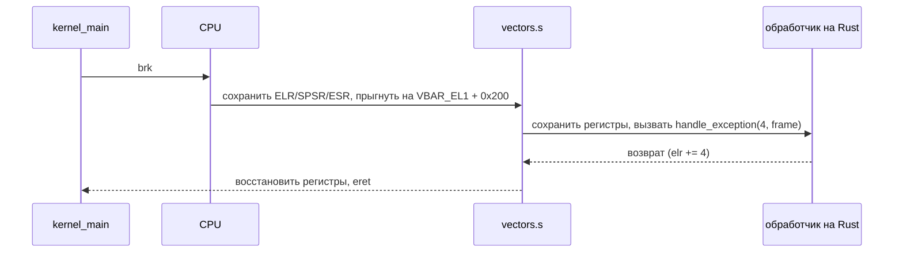

<!-- nav:top -->
[🏠 Начало](../START-HERE.md) · [← 22.3 Трек ОС: загрузка ядра в QEMU](03-os-track-booting-a-kernel-in-qemu.md) · [📋 Этап 22](README.md) · [22.5 Трек ОС: проект и следующие шаги →](05-os-track-project-and-next-steps.md) · [📖 Глоссарий](../GLOSSARY.md) · [🇬🇧 English](../../en/22-specializations/04-os-track-interrupts-and-paging.md) <!-- nav -->

# Урок 22.4 — Трек ОС: прерывания и страничная память

> **Этап 22 — Специализации** · Урок 4 из 30 · ⏱ около 3 часов (2 занятия)

## Что вы узнаете

- Что такое исключения и прерывания в arm64 и что делает процессор, когда они происходят.
- Как написать таблицу векторов исключений, которая сохраняет регистры и вызывает Rust.
- Как построить таблицу страниц, включить MMU и отобразить одну и ту же память по двум адресам.
- Как получать прерывания таймера через контроллер прерываний GIC.
- Как читать страничный сбой: класс исключения, код состояния сбоя и адрес, вызвавший сбой.

## Перед началом

- Вы прошли [Урок 22.3 — Трек ОС: загрузка ядра в QEMU](03-os-track-booting-a-kernel-in-qemu.md); ваше ядро
  загружается через `cargo run` и печатает через `println!`.
- Вы знаете страницы, кадры, таблицы страниц и TLB из [Урока 13.10 — Виртуальная память](../13-operating-systems/10-virtual-memory.md).
  В этом уроке таблица страниц строится вручную.
- Вы знаете атомарные операции ([Урок 14.5](../14-concurrency-and-async/05-atomics.md)) и битовые операции
  ([Урок 12.4](../12-computer-systems/04-bitwise-operations.md)).

## Новые слова

| Слово | Значение |
|---|---|
| **исключение** (exception) | Событие, которое заставляет процессор остановить текущий код и перейти к обработчику: сбой, особая инструкция или прерывание. |
| **прерывание** (interrupt) | Исключение, вызванное устройством («таймер истёк», «нажата клавиша»), а не текущей инструкцией. |
| **IRQ** (Interrupt Request, запрос прерывания) | Обычный вид прерывания в arm64. |
| **уровень исключений** (exception level, EL) | Уровень привилегий процессора: EL0 для программ, EL1 для ядра, EL2 для гипервизора, EL3 для прошивки. |
| **таблица векторов** (vector table) | Таблица маленьких блоков кода; процессор прыгает в неё, когда происходит исключение. Её адрес хранится в `VBAR_EL1`. |
| **системный регистр** (system register) | Регистр процессора для управления и состояния, например `ESR_EL1`; читается через `mrs`, пишется через `msr`. |
| **ESR** (Exception Syndrome Register, регистр синдрома исключения) | Говорит, почему произошло исключение: класс исключения и подробности. |
| **FAR** (Fault Address Register, регистр адреса сбоя) | Адрес, который пыталось использовать обращение к памяти, вызвавшее сбой. |
| **ELR** (Exception Link Register, регистр возврата из исключения) | Адрес, с которого прерванный код продолжит работу после `eret`. |
| **MMU** (Memory Management Unit, блок управления памятью) | Часть процессора, которая переводит виртуальные адреса в физические по таблицам страниц. |
| **блочная запись** (block entry) | Запись таблицы страниц, которая напрямую отображает целую большую область (здесь 1 ГиБ) без таблицы следующего уровня. |
| **тождественное отображение** (identity mapping) | Отображение, при котором виртуальный адрес равен физическому. |
| **страничный сбой** (page fault) | Исключение, которое возникает, когда адрес не отображён или доступ не разрешён. |
| **GIC** (Generic Interrupt Controller, универсальный контроллер прерываний) | Чип Arm, который собирает прерывания от устройств и отправляет их ядрам процессора. |
| **INTID** (interrupt ID, номер прерывания) | Номер, который GIC даёт каждому источнику прерываний; таймер этого урока — 30. |

**Сокращения из прошлых уроков:** ОС (операционная система), CPU (Central Processing Unit, центральный процессор),
QEMU (Quick Emulator, быстрый эмулятор), BSS (Block Started by Symbol, секция данных, заполненных нулями, Урок 22.3)
и TLB (Translation Lookaside Buffer, буфер ассоциативной трансляции: кэш процессора для недавних переводов адресов,
Урок 13.10). В Разделе 1 появляются ещё два вида исключений: FIQ (Fast Interrupt Request, быстрый запрос прерывания)
и SError (System Error, системная ошибка).

**Системные регистры этого урока.** Суффикс `_EL1` означает «копия регистра для уровня исключений 1», уровня ядра.
`VBAR` — Vector Base Address Register (регистр базового адреса векторов), `SPSR` — Saved Program Status Register
(сохранённое состояние программы), `MAIR` — Memory Attribute Indirection Register (регистр косвенных атрибутов
памяти), `TCR` — Translation Control Register (регистр управления трансляцией), `TTBR0` — Translation Table Base
Register 0 (регистр базового адреса таблицы трансляции 0), `SCTLR` — System Control Register (регистр управления
системой). В GIC `PMR` — Priority Mask Register (регистр маски приоритетов), `IAR` — Interrupt Acknowledge Register
(регистр подтверждения прерывания), `EOIR` — End Of Interrupt Register (регистр конца прерывания).

## 1. Что происходит, когда приходит исключение

До сих пор ядро выполнялось сверху вниз. Настоящие ядра должны реагировать на события: программа делит на ноль,
обращение к памяти попадает в неотображённую страницу, таймер говорит «время вышло». В arm64 всё это —
**исключения**:

| Вид | Чем вызвано | Пример |
|---|---|---|
| синхронное | только что выполненной инструкцией | `brk`, `svc` (системный вызов), страничный сбой |
| IRQ | устройством | таймер, сетевая карта |
| FIQ | устройством, «быстрый» вариант | обычные ядра используют редко |
| SError | системой памяти | сломанная передача по шине |

У процессора есть и **уровни исключений**: на EL0 работают пользовательские программы, на EL1 — ядро, на EL2 —
гипервизор, на EL3 — прошивка. QEMU запускает наше ядро на EL1, и мы там остаёмся.

Когда на EL1 происходит исключение, процессор сам, аппаратно, делает следующее — ещё до того, как выполнится наш
код:

```text
1. ELR_EL1  <- the address of the interrupted (or faulting) instruction
2. SPSR_EL1 <- the saved processor state (flags, interrupt masks)
3. ESR_EL1  <- why: exception class and details   (FAR_EL1 <- address, for memory faults)
4. mask interrupts
5. jump to  VBAR_EL1 + offset of the right slot
   ...handler runs...
6. `eret`: restore the state from SPSR_EL1 and continue at ELR_EL1
```

В **таблице векторов** по адресу `VBAR_EL1` 16 ячеек по `0x80` байтов: четыре вида (синхронное, IRQ, FIQ, SError)
для каждой из четырёх ситуаций. Наше ядро всегда работает на EL1 со своим стеком — это вторая ситуация, поэтому мы
используем только **ячейку 4** (синхронное) и **ячейку 5** (IRQ). Таблица должна быть выровнена по 2 КиБ.

## 2. Таблица векторов

Обработчиком будет обычная функция на Rust. По соглашению о вызовах функция Rust может свободно менять регистры
`x0`–`x18` и `x30`. Но прерванный код ничего не вызывал; когда он продолжит работу, каждый регистр должен хранить
старое значение. Поэтому ассемблерный код сначала сохраняет эти регистры. Создайте `src/vectors.s`:

```text
// The exception vector table: 16 slots of 0x80 bytes each.
// Every slot saves x0 and x1, puts its own number into x0 and jumps
// to the shared code below.
.macro SLOT number
.balign 0x80
    sub     sp, sp, #176
    stp     x0, x1, [sp, #0]
    mov     x0, #\number
    b       save_and_handle
.endm

.section .text
.balign 0x800
.global exception_vectors
exception_vectors:
.irp number, 0,1,2,3,4,5,6,7,8,9,10,11,12,13,14,15
    SLOT \number
.endr

save_and_handle:
    stp     x2, x3, [sp, #16]
    stp     x4, x5, [sp, #32]
    stp     x6, x7, [sp, #48]
    stp     x8, x9, [sp, #64]
    stp     x10, x11, [sp, #80]
    stp     x12, x13, [sp, #96]
    stp     x14, x15, [sp, #112]
    stp     x16, x17, [sp, #128]
    stp     x18, x30, [sp, #144]
    mrs     x9, elr_el1
    mrs     x10, spsr_el1
    stp     x9, x10, [sp, #160]

    mov     x1, sp              // second argument: the saved registers
    bl      handle_exception    // first argument (x0): the slot number

    ldp     x9, x10, [sp, #160]
    msr     elr_el1, x9
    msr     spsr_el1, x10
    ldp     x0, x1, [sp, #0]
    ldp     x2, x3, [sp, #16]
    ldp     x4, x5, [sp, #32]
    ldp     x6, x7, [sp, #48]
    ldp     x8, x9, [sp, #64]
    ldp     x10, x11, [sp, #80]
    ldp     x12, x13, [sp, #96]
    ldp     x14, x15, [sp, #112]
    ldp     x16, x17, [sp, #128]
    ldp     x18, x30, [sp, #144]
    add     sp, sp, #176
    eret
```

**Что происходит:**

1. `.macro SLOT` описывает одну ячейку: освободить 176 байтов в стеке, сохранить `x0` и `x1`, положить номер ячейки
   в `x0`, прыгнуть в общий код. `.balign 0x80` начинает каждую ячейку точно по её смещению.
2. `.irp` повторяет `SLOT` для чисел от 0 до 15, так что в таблице все 16 ячеек. `.balign 0x800` выравнивает её по
   2 КиБ.
3. `save_and_handle` сохраняет остальные регистры, а также `ELR_EL1` и `SPSR_EL1`: 22 значения по 8 байтов, всего
   176 байтов (кратно 16, как требует стек).
4. `mov x1, sp` передаёт адрес сохранённых регистров вторым аргументом; в `x0` уже лежит номер ячейки.
5. Когда `handle_exception` возвращается, всё восстанавливается в обратном порядке, и `eret` продолжает прерванный
   код. Так как ELR восстанавливается *из стека*, обработчик на Rust может изменить место, где продолжится
   выполнение.

Теперь сторона Rust. Создайте `src/exceptions.rs`:

```rust
//! Exceptions: the vector table and the Rust code that handles them.

use core::arch::{asm, global_asm};

global_asm!(include_str!("vectors.s"));

/// The registers that `vectors.s` saved on the stack, in the same order.
#[repr(C)]
pub struct Frame {
    pub x: [u64; 19], // x0 ..= x18
    pub x30: u64,     // the link register
    pub elr: u64,     // where the interrupted code continues
    pub spsr: u64,    // the saved processor state
}

const SYNC: u64 = 4; // slot 4: synchronous exception, current level
const IRQ: u64 = 5; // slot 5: interrupt request, current level

/// Tells the CPU where the vector table is.
pub fn init() {
    unsafe extern "C" {
        static exception_vectors: u8;
    }
    // SAFETY: `exception_vectors` is the 2 KiB aligned table from vectors.s.
    unsafe {
        let table = &raw const exception_vectors as u64;
        asm!("msr vbar_el1, {t}", "isb", t = in(reg) table);
    }
}

#[unsafe(no_mangle)]
extern "C" fn handle_exception(slot: u64, frame: &mut Frame) {
    match slot {
        SYNC => handle_sync(frame),
        IRQ => crate::timer::handle_irq(),
        _ => panic!("unexpected exception in slot {slot}"),
    }
}

fn handle_sync(frame: &mut Frame) {
    let esr: u64;
    let far: u64;
    // SAFETY: reading these two system registers has no side effects.
    unsafe {
        asm!("mrs {}, esr_el1", out(reg) esr);
        asm!("mrs {}, far_el1", out(reg) far);
    }
    let class = esr >> 26; // "exception class": what kind of exception
    match class {
        0x3c => {
            let number = esr & 0xffff;
            crate::println!("breakpoint #{number} at {:#x}", frame.elr);
            frame.elr += 4; // continue after the 4-byte `brk` instruction
        }
        0x25 => panic!(
            "page fault: data access at {far:#x} (status {:#04x}, code at {:#x})",
            esr & 0x3f,
            frame.elr
        ),
        _ => panic!(
            "synchronous exception, class {class:#x}, at {:#x}",
            frame.elr
        ),
    }
}
```

**Что происходит:**

1. `Frame` описывает 176 байтов в стеке; `#[repr(C)]` сохраняет поля ровно в этом порядке (Урок 12.11). Ассемблерный
   код передаёт `sp` как `&mut Frame`.
2. `init` записывает адрес таблицы в `VBAR_EL1`. `isb` (instruction synchronization barrier, барьер синхронизации
   инструкций) гарантирует, что процессор использует новое значение начиная со следующей инструкции.
3. У `handle_exception` фиксированное имя и соглашение о вызовах C, потому что её вызывает ассемблерный код.
4. Старшие 6 битов `ESR_EL1` — это **класс исключения**: `0x3c` — инструкция `brk`, `0x25` — data abort (неудачное
   обращение к памяти) на текущем уровне. Для точки останова младшие 16 битов — номер, записанный в инструкции, и мы
   прибавляем 4 к `elr`, чтобы продолжить после неё.
5. Data abort здесь не исправить, поэтому мы паникуем с адресом из `FAR_EL1` и 6-битным **кодом состояния сбоя**
   (младшие биты `ESR_EL1`).

## 3. Таблицы страниц в arm64

Из Урока 13.10 вы знаете, что MMU переводит виртуальные адреса по таблицам страниц. В arm64 со страницами по 4 КиБ
таблица — это одна страница: 512 записей по 8 байтов. Каждый уровень таблиц использует 9 битов виртуального адреса.
Мы говорим MMU (настройкой `T0SZ = 25`), что у виртуальных адресов 39 битов; тогда перевод начинается с **уровня 1**,
и каждая запись уровня 1 покрывает 1 ГиБ:

```text
 virtual address: only bits 38..0 are used
  38        30 29                              0
 +------------+---------------------------------+
 | L1 index   |  offset inside the 1 GiB block   |
 +------------+---------------------------------+
      |
      v
 level-1 table (512 entries)        entry = a 1 GiB "block"
   [0] 0 GiB .. 1 GiB  -> device memory: UART, GIC
   [1] 1 GiB .. 2 GiB  -> RAM (our kernel)          identity mapping
   [2] 2 GiB .. 3 GiB  -> the same RAM again        an alias
   [3] ...             -> 0: not mapped, access = page fault
```

Запись может указывать на таблицу следующего уровня (для страниц по 2 МиБ и 4 КиБ) или быть **блоком**, который
отображает весь 1 ГиБ сразу. Блоки делают нашу таблицу крошечной. Биты блочной записи, которые мы используем:

| Биты | Название | Наше значение |
|---|---|---|
| 1..0 | тип | `0b01`: действительный блок |
| 4..2 | индекс типа памяти | 0 = устройство, 1 = обычная память (типы задаются в `MAIR_EL1`) |
| 9..8 | разделяемость | `0b11` для памяти: общая для ядер процессора |
| 10 | AF (access flag, флаг доступа) | должен быть 1, иначе первое обращение вызывает сбой |
| 47..30 | выходной адрес | физический адрес блока |
| 53, 54 | запрет выполнения | 1 для устройств: никогда не выполнять оттуда код |

Важны два типа памяти. **Обычная** память (оперативная) может кэшироваться, и процессор может переставлять обращения.
Память **устройств** никогда не кэшируется и не переставляется — именно это нужно регистрам устройств.

Первые два гигабайта мы отображаем **тождественно** (виртуальный адрес = физический). Именно этот приём позволяет
включить MMU прямо во время работы: инструкция после «MMU включён» находится по тому же адресу в обоих мирах.

Добавьте вспомогательную функцию в `src/lib.rs` (над `#[cfg(test)]`) и тест внутрь `mod tests`:

```rust
/// The index in a level-1 page table for a virtual address:
/// bits 38..30 of the address, so each entry covers 1 GiB.
pub fn l1_index(virt: u64) -> usize {
    ((virt >> 30) & 0x1ff) as usize
}
```

```rust
    #[test]
    fn level1_index_counts_gibibytes() {
        assert_eq!(l1_index(0x0900_0000), 0); // the UART
        assert_eq!(l1_index(0x4008_0000), 1); // the kernel
        assert_eq!(l1_index(0x8000_0000), 2); // the RAM alias
        assert_eq!(l1_index(0xC000_0000), 3); // not mapped
    }
```

Затем создайте `src/mmu.rs`:

```rust
//! Paging: one level-1 table that maps memory in 1 GiB blocks.

use core::arch::asm;
use p22_kernel::l1_index;

const GIB: u64 = 1 << 30;

// Bits of a level-1 "block" entry.
const VALID_BLOCK: u64 = 0b01; // bits 1..0: a valid entry that maps a block
const ATTR_DEVICE: u64 = 0 << 2; // use memory type 0 from MAIR (device)
const ATTR_NORMAL: u64 = 1 << 2; // use memory type 1 from MAIR (normal RAM)
const INNER_SHAREABLE: u64 = 0b11 << 8;
const ACCESSED: u64 = 1 << 10; // without this bit the first access faults
const NO_EXECUTE: u64 = (1 << 54) | (1 << 53);

const DEVICE: u64 = VALID_BLOCK | ATTR_DEVICE | ACCESSED | NO_EXECUTE;
const NORMAL: u64 = VALID_BLOCK | ATTR_NORMAL | INNER_SHAREABLE | ACCESSED;

#[repr(C, align(4096))]
struct Table([u64; 512]);

static mut LEVEL1: Table = Table([0; 512]);

/// Add this to a RAM address to reach the same memory a second time.
pub const ALIAS_OFFSET: u64 = GIB;

pub fn init() {
    let table = (&raw mut LEVEL1).cast::<u64>();
    // SAFETY: one core, MMU still off, and nothing else uses LEVEL1;
    // every index is below 512.
    unsafe {
        table.add(l1_index(0)).write(DEVICE); // 0..1 GiB: UART, GIC
        table.add(l1_index(GIB)).write(GIB | NORMAL); // 1..2 GiB: RAM, our kernel
        table.add(l1_index(GIB + ALIAS_OFFSET)).write(GIB | NORMAL); // 2..3 GiB: the SAME RAM
    }
    // all other entries stay 0: not mapped, any access is a page fault

    let mair: u64 = 0xff << 8; // type 0 (bits 7..0) = 0x00: device; type 1 = 0xff: normal
    let tcr: u64 = 25            // T0SZ: 2^(64-25) = 512 GiB of virtual space
        | (0b01 << 8)            // inner cache: write-back
        | (0b01 << 10)           // outer cache: write-back
        | (0b11 << 12)           // inner shareable
        | (1 << 23)              // EPD1: do not use the second table (TTBR1)
        | (0b001 << 32); // IPS: 36-bit physical addresses
    let ttbr0 = table as u64;

    // SAFETY: the table maps all code and data at the same address,
    // so the next instruction is still found after the MMU turns on.
    unsafe {
        asm!(
            "msr mair_el1, {mair}",
            "msr tcr_el1, {tcr}",
            "msr ttbr0_el1, {ttbr0}",
            "dsb ish",
            "isb",
            "tlbi vmalle1",
            "dsb ish",
            "isb",
            "mrs {tmp}, sctlr_el1",
            "orr {tmp}, {tmp}, #1",         // M: turn the MMU on
            "orr {tmp}, {tmp}, #(1 << 2)",  // C: data cache on
            "orr {tmp}, {tmp}, #(1 << 12)", // I: instruction cache on
            "msr sctlr_el1, {tmp}",
            "isb",
            mair = in(reg) mair,
            tcr = in(reg) tcr,
            ttbr0 = in(reg) ttbr0,
            tmp = out(reg) _,
        );
    }
}
```

**Что происходит:**

1. `Table` выровнена по 4096 байтов (`align(4096)`), как требует MMU. Она живёт в BSS, поэтому код загрузки уже
   заполнил её нулями, а ноль означает «не отображено».
2. `(&raw mut LEVEL1).cast::<u64>()` получает сырой указатель на первую запись, не создавая ссылку на `static mut`
   (Урок 06.6). Записываются три записи: память устройств, оперативная память и та же память ещё раз на +1 ГиБ.
3. `MAIR_EL1` задаёт типы памяти, на которые записи ссылаются по индексу: `0x00` — память устройств, `0xff` — обычная
   память с кэшами.
4. `TCR_EL1` описывает перевод адресов: 39-битные виртуальные адреса, страницы по 4 КиБ (биты 15..14 остаются 0),
   настройки кэша для обхода таблиц и «не использовать второй регистр таблиц» (`TTBR1`, который настоящие ядра
   используют для половины адресного пространства, принадлежащей ядру).
5. `TTBR0_EL1` получает физический адрес нашей таблицы.
6. Барьеры делают порядок безопасным: `dsb ish` ждёт, пока закончатся все записи в память (наша таблица), `isb`
   заставляет процессор использовать новые значения регистров, `tlbi vmalle1` выбрасывает старые закэшированные
   переводы из TLB.
7. Наконец, три бита `SCTLR_EL1` включают MMU и кэши. Начиная со следующей инструкции каждый адрес проходит через
   нашу таблицу.

## 4. Прерывания таймера через GIC

У каждого ядра arm64 есть **универсальный таймер** (generic timer). Мы используем его физический таймер EL1: записать
число тактов в `CNTP_TVAL_EL0`, включить его в `CNTP_CTL_EL0`, и когда счёт дойдёт до нуля, он вызовет прерывание.
Прерывание сначала попадает в **GIC**. У GIC на `virt` две части: **распределитель** (distributor) по адресу
`0x0800_0000` решает, какие прерывания включены, а **интерфейс процессора** (CPU interface) по адресу `0x0801_0000`
доставляет их ядру. Таймер — INTID 30.

Обработка одного прерывания — это обмен сигналами: прочитать регистр интерфейса процессора `IAR` (interrupt
acknowledge, подтверждение прерывания), чтобы узнать INTID и пометить его «обрабатывается», сделать работу, затем
записать тот же INTID в `EOIR` (end of interrupt, конец прерывания). Создайте `src/timer.rs`:

```rust
//! The interrupt controller (GICv2) and the CPU timer.

use core::arch::asm;
use core::ptr::{read_volatile, write_volatile};
use core::sync::atomic::{AtomicU64, Ordering};

const GICD: usize = 0x0800_0000; // distributor: decides which interrupts go on
const GICC: usize = 0x0801_0000; // CPU interface: what one core sees
const TIMER_IRQ: u32 = 30; // interrupt number of the EL1 physical timer

pub static TICKS: AtomicU64 = AtomicU64::new(0);

fn reg(addr: usize) -> *mut u32 {
    addr as *mut u32
}

/// Asks the timer to fire once after `ms` milliseconds.
fn arm(ms: u64) {
    let freq: u64;
    // SAFETY: reading the timer frequency and setting the countdown is harmless.
    unsafe {
        asm!("mrs {}, cntfrq_el0", out(reg) freq);
        asm!("msr cntp_tval_el0, {}", in(reg) freq * ms / 1000);
    }
}

pub fn init() {
    // SAFETY: these are the GICv2 registers of the QEMU `virt` machine,
    // which is mapped as device memory.
    unsafe {
        write_volatile(reg(GICD), 1); // distributor on
        write_volatile(reg(GICD + 0x100), 1 << TIMER_IRQ); // enable interrupt 30
        write_volatile(reg(GICC + 0x004), 0xff); // accept every priority
        write_volatile(reg(GICC), 1); // CPU interface on
    }
    arm(200);
    // SAFETY: enable the timer, then clear the "I" mask bit so IRQs arrive.
    unsafe {
        asm!("msr cntp_ctl_el0, {}", in(reg) 1u64);
        asm!("msr daifclr, #2");
    }
}

/// Called from the vector table for every IRQ.
pub fn handle_irq() {
    // SAFETY: reading IAR tells the GIC that we started to handle the interrupt.
    let id = unsafe { read_volatile(reg(GICC + 0x00c)) };
    if id == TIMER_IRQ {
        TICKS.fetch_add(1, Ordering::Relaxed);
        arm(200);
    }
    // SAFETY: writing EOIR says "finished" for this interrupt number.
    unsafe { write_volatile(reg(GICC + 0x010), id) };
}
```

**Что происходит:**

1. `arm` переводит миллисекунды в такты таймера по частоте из `CNTFRQ_EL0` (62,5 МГц в QEMU) и запускает обратный
   отсчёт. Таймер срабатывает один раз; обработчик запускает его снова для следующего тика.
2. `init` включает распределитель, разрешает INTID 30 (бит 30 регистра включения по смещению `0x100`), пропускает
   любой приоритет (`PMR` по смещению `0x004`) и включает интерфейс процессора.
3. `msr daifclr, #2` сбрасывает бит маски IRQ в `DAIF` — регистре с четырьмя битами масок (Debug, SError, IRQ, FIQ).
   До этого момента прерывания были замаскированы, как и после сброса.
4. `TICKS` — атомарная переменная, потому что её используют два «потока выполнения»: обработчик прерывания и
   `kernel_main`. Для простого счётчика на одном ядре достаточно `Relaxed` (Урок 14.6).

## 5. Собираем всё вместе

Замените `src/main.rs`:

```rust
#![no_std]
#![no_main]

mod exceptions;
mod mmu;
mod power;
mod timer;
mod uart;

use core::panic::PanicInfo;
use core::ptr::{read_volatile, write_volatile};

core::arch::global_asm!(include_str!("boot.s"));

static mut SECRET: u64 = 0;

#[unsafe(no_mangle)]
pub extern "C" fn kernel_main() -> ! {
    println!("Hello from p22-kernel!");
    exceptions::init();
    // SAFETY: `brk` only raises a breakpoint exception, which we handle.
    unsafe { core::arch::asm!("brk #7") };
    println!("back in kernel_main");

    mmu::init();
    println!("MMU is on");

    let real = &raw mut SECRET;
    let alias = (real as u64 + mmu::ALIAS_OFFSET) as *mut u64;
    // SAFETY: both addresses are mapped to the same physical memory.
    unsafe {
        write_volatile(alias, 42);
        println!("{:#x} -> {}", alias as u64, read_volatile(alias));
        println!("{:#x} -> {}", real as u64, read_volatile(real));
    }

    timer::init();
    let mut seen = 0;
    while seen < 3 {
        let now = timer::TICKS.load(core::sync::atomic::Ordering::Relaxed);
        if now != seen {
            seen = now;
            println!("tick {seen}");
        }
        // SAFETY: `wfi` just sleeps until the next interrupt.
        unsafe { core::arch::asm!("wfi") };
    }

    let unmapped = 0xC000_0000 as *const u64;
    // SAFETY: not safe at all: this address is not mapped. We want the fault.
    let value = unsafe { read_volatile(unmapped) };
    println!("never printed: {value}");
    power::shutdown();
}

#[panic_handler]
fn panic(info: &PanicInfo) -> ! {
    println!("KERNEL PANIC: {info}");
    power::shutdown();
}
```

Запустите `cargo host-test` (проходят три теста), а затем `cargo run`:

```text
Hello from p22-kernel!
breakpoint #7 at 0x40081cbc
back in kernel_main
MMU is on
0x80087000 -> 42
0x40087000 -> 42
tick 1
tick 2
tick 3
KERNEL PANIC: panicked at src/exceptions.rs:55:17:
page fault: data access at 0xc0000000 (status 0x05, code at 0x40081fbc)
```

**Что происходит:**

1. `brk #7` вызвала синхронное исключение. Процессор прыгнул в ячейку 4, ассемблерный код сохранил регистры, Rust
   напечатал строку и сдвинул `elr` за инструкцию, а `eret` продолжил `kernel_main`.
2. После `mmu::init` каждый адрес проходит через нашу таблицу, и ядро продолжает работать: тождественное
   отображение действует.
3. `SECRET` лежит по физическому адресу `0x4008_7000`. Мы записали `42` через `0x8008_7000` и прочитали обратно
   через оба адреса: две виртуальные страницы, один физический кадр. Именно так два процесса разделяют память.
4. Пришли три прерывания таймера с интервалом 200 мс. Между ними процессор спал в `wfi` («wait for interrupt», «жди
   прерывания»).
5. Чтение `0xC000_0000` попало в запись 3 таблицы, а она равна 0. MMU вызвал data abort; в `FAR_EL1` лежит адрес, а
   код `0x05` означает «ошибка перевода на уровне 1» (translation fault): отображения нет вообще.



> 🔒 **Безопасность:** биты запрета выполнения у блока устройств означают, что даже ошибка, которая прыгает в
> память устройств, не сможет выполнить там код. Настоящие ядра идут гораздо дальше: пользовательские страницы ядро
> не может выполнять, а страницы ядра программы не могут читать. Таблицы страниц — основа почти всей защиты памяти.

> 🧪 **Тестирование:** арифметика адресов вроде `l1_index` — место, где прячутся ошибки ядра, и она чистая:
> проверяйте её на Mac через `cargo host-test`. Вывод QEMU выше — ваш сквозной тест.

## Частые ошибки

> ⚠️ **Частая ошибка:** забыть флаг доступа (бит 10) в записи для оперативной памяти. Вывод обрывается сразу после
> `back in kernel_main`, а QEMU продолжает работать, пока вы не нажмёте Ctrl-A X. Самая первая выборка инструкции
> после «MMU включён» вызывает сбой, и выборка обработчика исключения тоже: ядро застревает в сбоях, которые не может
> напечатать.

> ⚠️ **Частая ошибка:** не записать `EOIR` в конце прерывания. GIC считает, что INTID 30 всё ещё обрабатывается, и
> больше его не доставляет: вы видите `tick 1`, а потом ничего.

> ⚠️ **Частая ошибка:** забыть `frame.elr += 4` для `brk`. `eret` возвращается на ту же `brk`, которая снова
> вызывает то же исключение, бесконечно: экран заполняется строками `breakpoint #7`.

> ⚠️ **Частая ошибка:** изменить порядок или размер `Frame`, не изменив `vectors.s` (или наоборот). Тогда обработчик
> читает и пишет не те ячейки стека. Держите их согласованными; `#[repr(C)]` обязателен.

## Попробуйте сами

1. Создайте `src/vectors.s`, `src/exceptions.rs`, `src/mmu.rs`, `src/timer.rs`, добавьте `l1_index` и его тест и
   замените `src/main.rs`. Запустите `cargo host-test` и `cargo run`.
2. Замените `brk #7` на `brk #100` и проверьте напечатанный номер.
3. Уберите строку `mmu::init()` и запустите снова. Запись через псевдоним теперь падает с кодом `0x10` («external
   abort», внешний сбой): без MMU `0x8008_...` — *физический* адрес, а оперативной памяти там нет. Верните строку.
4. Сделайте коммит: `git add -A && git commit -m "p22-kernel: exceptions, paging, timer"`.

## Упражнения

### Упражнение 1 — Тики почаще (легко)

Сделайте так, чтобы таймер срабатывал каждые 100 мс, а `kernel_main` ждал пять тиков вместо трёх.

<details>
<summary>Подсказка</summary>

В `src/timer.rs` два вызова `arm(200)`, а в `src/main.rs` одно условие цикла.

</details>

<details>
<summary>Ответ</summary>

Замените оба `arm(200)` на `arm(100)` в `src/timer.rs`, а `while seen < 3` на `while seen < 5` в `src/main.rs`.

```text
tick 1
tick 2
tick 3
tick 4
tick 5
```

Почему это работает: обработчик каждый раз заново запускает обратный отсчёт, поэтому значение в `arm` — расстояние
между тиками.

</details>

### Упражнение 2 — Расшифровываем регистр синдрома, с тестом (средне)

Напишите `pub fn decode_esr(esr: u64) -> (u64, u64)` в `src/lib.rs`, которая возвращает (класс исключения, код
состояния сбоя), и тест с тремя настоящими значениями: `0xf200_0007` (от `brk #7`), `0x9600_0005` (страничный сбой
выше) и `0x9600_004d` (запись в страницу только для чтения). Затем используйте её в `handle_sync`.

<details>
<summary>Подсказка</summary>

Класс — биты 31..26 (`esr >> 26` достаточно, старшие биты равны 0); код состояния — биты 5..0.

</details>

<details>
<summary>Ответ</summary>

```rust
/// Splits the exception syndrome register into
/// (exception class, fault status code).
pub fn decode_esr(esr: u64) -> (u64, u64) {
    (esr >> 26, esr & 0x3f)
}
```

```rust
    #[test]
    fn decodes_a_breakpoint_and_page_faults() {
        assert_eq!(decode_esr(0xf200_0007), (0x3c, 0x07)); // brk #7
        assert_eq!(decode_esr(0x9600_0005), (0x25, 0x05)); // read, not mapped
        assert_eq!(decode_esr(0x9600_004d), (0x25, 0x0d)); // write, read-only
    }
```

```text
test tests::decodes_a_breakpoint_and_page_faults ... ok
test result: ok. 4 passed; 0 failed; 0 ignored; 0 measured; 0 filtered out; finished in 0.00s
```

В `handle_sync` напишите `let (class, status) = p22_kernel::decode_esr(esr);` и используйте `status` в сообщении о
страничном сбое. Почему это работает: расшифровка — чистая битовая логика, поэтому она проверяется на Mac, а ядро
использует проверенную функцию.

</details>

### Упражнение 3 — Псевдоним только для чтения (сложно)

Сделайте блок-псевдоним (запись 2) **только для чтения** для ядра. Биты 7..6 записи — права доступа; `0b10` означает
«только чтение на EL1». Запустите ядро. Что происходит и что говорят код состояния и `FAR`? Затем измените
`kernel_main`, чтобы он писал через настоящий адрес, а через псевдоним только читал.

<details>
<summary>Подсказка</summary>

Добавьте `const READ_ONLY: u64 = 0b10 << 6;` и добавьте его через ИЛИ только в запись псевдонима. Коды `0x0c`–`0x0f` —
«ошибки прав доступа» (permission faults) на уровнях 0–3.

</details>

<details>
<summary>Ответ</summary>

В `src/mmu.rs`:

```rust
const READ_ONLY: u64 = 0b10 << 6; // AP bits 7..6: read-only for the kernel
```

```rust
        table.add(l1_index(GIB + ALIAS_OFFSET)).write(GIB | NORMAL | READ_ONLY); // 2..3 GiB: the SAME RAM
```

Теперь запуск заканчивается раньше:

```text
MMU is on
KERNEL PANIC: panicked at src/exceptions.rs:55:17:
page fault: data access at 0x80087000 (status 0x0d, code at 0x40081dd0)
```

`FAR` — адрес псевдонима, а `0x0d` — ошибка прав доступа на уровне 1: адрес *отображён*, но писать нельзя. После того
как вы замените `write_volatile(alias, 42)` на `write_volatile(real, 42)`, оба чтения снова печатают `42`. Почему это
работает: одна и та же физическая память может иметь разные права по разным виртуальным адресам; операционные системы
используют это, например, чтобы разделять код между процессами только для чтения.

</details>

## Вопросы для самопроверки

1. Что процессор делает сам, когда на EL1 происходит исключение?

<details>
<summary>Ответ</summary>

Он сохраняет адрес возврата в `ELR_EL1` и состояние процессора в `SPSR_EL1`, записывает причину в `ESR_EL1` (и адрес
в `FAR_EL1` при сбоях памяти), маскирует прерывания и прыгает на `VBAR_EL1` плюс смещение ячейки.

</details>

2. Зачем `vectors.s` сохраняет `x0`–`x18` и `x30` перед вызовом Rust?

<details>
<summary>Ответ</summary>

Функция на Rust может менять эти регистры (соглашение о вызовах это разрешает), но прерванный код ничего не вызывал и
ожидает, что все регистры не изменятся, когда он продолжит работу.

</details>

3. Почему ядро может продолжать работу в момент включения MMU?

<details>
<summary>Ответ</summary>

Код и данные отображены тождественно: их виртуальные адреса равны физическим, поэтому следующая инструкция находится
по тому же адресу и после начала перевода адресов.

</details>

4. Чем память устройств отличается от обычной памяти в таблице страниц?

<details>
<summary>Ответ</summary>

Обычная память может кэшироваться, а обращения к ней могут переставляться или объединяться. Память устройств не
кэшируется, и обращения идут ровно в порядке программы, что и нужно регистрам устройств. Тип берётся из `MAIR_EL1` по
индексу в битах 4..2.

</details>

5. Что делают `IAR` и `EOIR` у GIC?

<details>
<summary>Ответ</summary>

Чтение `IAR` возвращает INTID ожидающего прерывания и помечает его активным. Запись INTID в `EOIR` помечает его
завершённым, чтобы GIC мог доставить его снова.

</details>

6. Страничный сбой показывает код `0x05` и `FAR = 0xc0000000`. Что это значит?

<details>
<summary>Ответ</summary>

Ошибка перевода на уровне 1: запись уровня 1 для `0xC000_0000` (индекс 3) пуста, то есть адрес не отображён вообще.

</details>

## Итоги

- Исключения (синхронные, IRQ, FIQ, SError) заставляют процессор сохранить `ELR`/`SPSR`, записать причину в `ESR` и
  прыгнуть в таблицу векторов по `VBAR_EL1`; `eret` возвращает обратно.
- Таблица векторов сохраняет регистры, которые может менять вызываемая функция, вызывает обработчик на Rust с `Frame`
  и всё восстанавливает.
- Таблица уровня 1 с блочными записями по 1 ГиБ, `MAIR`, `TCR`, `TTBR0` и три бита `SCTLR` включают страничную
  память; тождественное отображение не даёт ядру остановиться.
- Два виртуальных адреса могут отображаться на один физический кадр; пустая запись даёт ошибку перевода, запись только
  для чтения — ошибку прав доступа.
- Прерывание таймера идёт через GIC: разрешить INTID 30, снять маску IRQ через `daifclr` и подтверждать через `IAR` /
  `EOIR`.

## Источники и что почитать

- [Arm — Learn the architecture: AArch64 Exception Model](https://developer.arm.com/documentation/102412/latest/) —
  уровни исключений, таблицы векторов и `eret` в объяснении Arm.
- [Arm — Learn the architecture: AArch64 memory management](https://developer.arm.com/documentation/101811/latest/) —
  таблицы перевода, `TCR`, `MAIR` и TLB.
- [Arm — Learn the architecture: Generic Timer](https://developer.arm.com/documentation/102379/latest/) — регистры
  таймера из этого урока.
- [Arm Generic Interrupt Controller Architecture Specification (GICv2)](https://developer.arm.com/documentation/ihi0048/latest/) —
  распределитель, интерфейс процессора, `IAR` и `EOIR`.
- [`core::sync::atomic`](https://doc.rust-lang.org/core/sync/atomic/index.html) — атомарные операции без `std`.
- [Writing an OS in Rust — CPU Exceptions](https://os.phil-opp.com/cpu-exceptions/) — те же идеи на x86-64.

---

[🏠 Начало](../START-HERE.md) · [← 22.3 Трек ОС: загрузка ядра в QEMU](03-os-track-booting-a-kernel-in-qemu.md) · [📋 Этап 22](README.md) · [22.5 Трек ОС: проект и следующие шаги →](05-os-track-project-and-next-steps.md) · [📖 Глоссарий](../GLOSSARY.md) <!-- nav -->
<!-- nav:bottom -->
