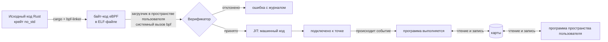

<!-- nav:top -->
[🏠 Начало](../START-HERE.md) · [← 22.5 Трек ОС: проект и следующие шаги](05-os-track-project-and-next-steps.md) · [📋 Этап 22](README.md) · [22.7 Трек eBPF: первая программа на Aya →](07-ebpf-track-a-first-program-with-aya.md) · [📖 Глоссарий](../GLOSSARY.md) · [🇬🇧 English](../../en/22-specializations/06-ebpf-track-what-ebpf-is.md) <!-- nav -->

# Урок 22.6 — Трек eBPF: что такое eBPF

> **Этап 22 — Специализации** · Урок 6 из 30 · ⏱ около 105 минут

> **Не ваше направление?** Этот урок открывает направление eBPF (Уроки 22.6–22.9). Если вы выбрали другое
> направление, переходите к [Уроку 22.10 — Трек встраиваемых систем: микроконтроллеры и no_std](10-embedded-track-microcontrollers-and-no-std.md)
> или сразу к [Уроку 22.30 — Контрольная точка: ваша специализация](30-checkpoint-your-specialization.md).

## Что вы узнаете

- Что такое eBPF, что с его помощью строят и почему Rust (с библиотекой Aya) хорошо для этого подходит.
- Как программа eBPF попадает в ядро: байт-код, верификатор, JIT-компилятор и карты (maps).
- Главные места подключения программ: tracepoint, kprobe и XDP.
- Как за минуту увидеть eBPF в действии с `bpftrace` и `bpftool`, ещё до того, как вы напишете хоть строку на Rust.
- Как подготовить ВМ `dev` к следующим урокам: nightly Rust, `rust-src` и `bpf-linker`.

## Перед началом

- Вы прошли [Урок 22.1 — Выбор специализации](01-choosing-a-specialization.md) и выбрали это направление.
- Вы знаете, что такое ядро и системные вызовы ([Урок 13.1](../13-operating-systems/01-what-an-operating-system-does.md),
  [Урок 13.3](../13-operating-systems/03-system-calls.md)).
- У вас есть Linux-ВМ `dev` ([Урок 11.1](../11-linux-shell-and-containers/01-linux-and-a-virtual-machine.md)), и вы
  копировали в неё код, как в [Уроке 13.1](../13-operating-systems/01-what-an-operating-system-does.md).
- Вы знаете пакеты и сетевые интерфейсы из [Этапа 15](../15-networking/README.md) (понадобится в Уроке 22.9).

## Новые слова

| Слово | Значение |
|---|---|
| **eBPF** (extended Berkeley Packet Filter, расширенный пакетный фильтр Беркли) | Маленькая виртуальная машина внутри ядра Linux, которая выполняет проверенные программы, когда происходят события. |
| **программа eBPF** (eBPF program) | Маленькая функция, скомпилированная в байт-код eBPF, которую ядро выполняет в точке подключения. |
| **байт-код** (bytecode) | Инструкции для виртуальной машины, а не для настоящего CPU (Central Processing Unit, центральный процессор). |
| **точка подключения** (hook) | Место в ядре, к которому можно подключить программу: «когда вызвана эта функция», «когда пришёл пакет». |
| **верификатор** (verifier) | Часть ядра, которая проверяет каждую программу eBPF перед запуском: никаких падений, бесконечных циклов и плохих обращений к памяти. |
| **JIT** (Just-In-Time, «точно в срок») компилятор | Часть ядра, которая превращает проверенный байт-код в настоящий машинный код, чтобы он работал быстро. |
| **карта** (map) | Структура данных (хеш-таблица, массив, кольцевой буфер), общая для программ eBPF и программ пространства пользователя. |
| **вспомогательная функция** (helper function) | Функция, которую ядро предлагает программам eBPF, например «прочитать ID текущего процесса». |
| **tracepoint** (точка трассировки) | Фиксированная, документированная точка подключения, которую разработчики ядра поставили в код; стабильна между версиями ядра. |
| **kprobe** (kernel probe, зонд ядра) | Точка подключения в начале (почти) любой функции ядра; мощная, но нестабильная между версиями. |
| **XDP** (eXpress Data Path, экспресс-путь данных) | Точка подключения в сетевом драйвере, которая видит каждый принятый пакет раньше остального ядра. |
| **BTF** (BPF Type Format, формат типов BPF) | Сведения о типах собственных структур ядра, в `/sys/kernel/btf/vmlinux`. |
| **пространство пользователя** (user space) | Обычные программы, вне ядра. Программа, которая загружает код eBPF, работает здесь. |
| **tracefs** | Особая файловая система (обычно в `/sys/kernel/tracing`), в которой перечислены tracepoint и их форматы. |
| **Aya** | Библиотека Rust для eBPF: один крейт для стороны ядра, один для стороны пользователя, без C. |

**Другие сокращения в этом уроке:** BPF (Berkeley Packet Filter, пакетный фильтр Беркли — более старая и маленькая
технология, из которой вырос eBPF; ядро до сих пор использует это имя, например в системном вызове `bpf`), ОС
(операционная система), ВМ (виртуальная машина; здесь Linux-ВМ `dev`), ELF (Executable and Linkable Format, формат
файлов программ и объектных файлов) и LLVM (набор средств компилятора, на котором построен `rustc`; сейчас это
название уже ничего не сокращает).

## 1. Область и почему Rust

Обычно, чтобы изменить поведение ядра, нужно изменить его исходный код, собрать и перезагрузиться или загрузить
модуль ядра, который может уронить машину. eBPF даёт третий путь: вы передаёте ядру **маленькую программу**, ядро
**проверяет**, что она безопасна, а потом выполняет её каждый раз, когда происходит выбранное событие. Без
перезагрузки и без риска падения.

Это используют для трёх больших задач:

- **Наблюдаемость:** какие файлы открывает этот процесс? Какая функция в ядре медленная? На eBPF построены
  инструменты вроде `bpftrace` и многие профилировщики.
- **Сети:** считать, фильтровать, балансировать или переписывать пакеты в самой ранней точке. eBPF используют
  сетевые плагины Kubernetes, например Cilium.
- **Безопасность:** следить за подозрительными действиями или блокировать их (процесс запускает командную оболочку,
  запись в `/etc`).

Раньше большая часть кода eBPF писалась на C, с библиотекой на C для загрузки. **Aya** позволяет писать обе стороны
на Rust: программу, которая работает в ядре (крейт `aya-ebpf`, `no_std`, как ядро из направления ОС), и программу,
которая её загружает и читает результаты (крейт `aya`, обычный асинхронный Rust с Tokio). Обе стороны могут
использовать общие типы из общего крейта, а собирается всё через Cargo.

**Как устроен код направления.** Вы редактируете код на Mac, а собираете и запускаете в ВМ `dev`, точно как на
Этапе 13: `rsync` копирует папку в ВМ, затем там выполняется `cargo run`. Уроки 22.7 и 22.8 строят одно рабочее
пространство Cargo, `code/p22-tracer`; проект Урока 22.9 — `code/p22-netwatch`.

## 2. Как программа eBPF попадает в ядро



1. Вы компилируете программу для особой платформы, `bpfel-unknown-none` (eBPF, little-endian, без ОС). Результат —
   байт-код внутри ELF-файла. Для компоновки нужен особый компоновщик, `bpf-linker`.
2. Обычная программа (**загрузчик**) читает этот файл и передаёт его ядру системным вызовом `bpf`. Делать это может
   только привилегированный пользователь (root).
3. **Верификатор** проходит по каждому возможному пути программы. Он отклоняет программу, если какой-то путь может
   прочитать память, которую нельзя читать, зациклиться навсегда, использовать больше 512 байтов стека или вызвать
   функцию, которая не является разрешённой вспомогательной. Поэтому программы eBPF не могут уронить ядро.
4. **JIT**-компилятор превращает байт-код в машинный код для настоящего процессора.
5. Загрузчик **подключает** программу к точке подключения. С этого момента она выполняется на каждое событие, пока
   загрузчик её не отключит или не завершится.
6. Программа не может печатать в ваш терминал или напрямую возвращать данные. Она пишет в **карты**, а программа
   пространства пользователя их читает.

> 🔒 **Безопасность:** для загрузки программ eBPF нужен root (или привилегия `CAP_BPF`), потому что программа
> трассировки может видеть данные любого процесса на машине. Относитесь к инструментам eBPF как к любым другим
> инструментам root: запускайте их только в своей ВМ и никогда не запускайте программу eBPF, которую не понимаете.

## 3. Куда подключаются программы

| Точка подключения | Когда выполняется | Стабильность | Где используется |
|---|---|---|---|
| tracepoint | в фиксированных точках, которые отметили разработчики ядра, например «процесс вызвал `openat`» | стабильна | Уроки 22.7, 22.8 |
| kprobe | когда вызвана выбранная функция ядра (имя может меняться между версиями) | нестабильна | Урок 22.8 |
| uprobe | когда вызвана функция в программе пространства пользователя | зависит от программы | — |
| XDP | когда сетевой драйвер принимает пакет | стабильна | Урок 22.9 |
| tc (traffic control, управление трафиком) | когда пакет проходит через сетевой стек, туда или обратно | стабильна | — |
| LSM (Linux Security Modules, модули безопасности Linux) | на проверках безопасности, например «может ли этот процесс открыть этот файл?» | стабильна | — |

Предпочитайте tracepoint, когда для вашего вопроса он есть: тогда программа продолжит работать на новых ядрах.
Используйте kprobe, когда нужно место, где tracepoint нет.

## 4. Смотрим в действии с bpftrace

`bpftrace` — маленький язык трассировки, который сам компилируется в eBPF. Это самый быстрый способ *почувствовать*,
что умеет eBPF. Войдите в ВМ и установите его вместе с `bpftool` — официальным инструментом для просмотра
загруженных программ и карт:

```bash
limactl shell dev
sudo apt-get update
sudo apt-get install -y bpftrace bpftool
bpftrace --version
```

```text
bpftrace v0.25.0
```

Какие файлы открывает `cat`, пока печатает один маленький файл? Спросите ядро:

```bash
sudo bpftrace -e 'tracepoint:syscalls:sys_enter_openat /pid == cpid/ { printf("%s opened %s\n", comm, str(args.filename)); }' -c "/usr/bin/cat /etc/debian_version"
```

```text
Attached 1 probe
cat opened /etc/ld.so.cache
cat opened /usr/lib/aarch64-linux-gnu/libsystemd.so.0
cat opened /usr/lib/aarch64-linux-gnu/libselinux.so.1
cat opened /usr/lib/aarch64-linux-gnu/libgcc_s.so.1
cat opened /usr/lib/aarch64-linux-gnu/libm.so.6
cat opened /usr/lib/aarch64-linux-gnu/libc.so.6
cat opened /usr/lib/aarch64-linux-gnu/libpcre2-8.so.0
cat opened /proc/filesystems
cat opened /proc/self/maps
cat opened /usr/share/coreutils/locales/uucore/en-US.ftl
cat opened /usr/share/coreutils/locales/cat/en-US.ftl
cat opened /etc/debian_version
forky/sid
```

**Что происходит:**

1. `tracepoint:syscalls:sys_enter_openat` — точка подключения: «процесс входит в системный вызов `openat`». Этот
   один tracepoint срабатывает для **каждого** процесса на машине.
2. `/pid == cpid/` — фильтр: считаются только события дочернего процесса, который запустил `-c` (`cpid`).
3. `{ printf(...) }` — действие. `comm` — имя команды текущего процесса; `args.filename` — поле tracepoint,
   указатель в память `cat`; `str(...)` копирует оттуда текст.
4. `-c "..."` запускает команду, сначала подключившись, и прекращает трассировку, когда она заканчивается.
5. Посмотрите на результат: прежде чем открыть единственный файл, который вы попросили, `cat` открывает ещё 11 файлов
   (разделяемые библиотеки, файлы локализации). Это может показать и `strace` (Урок 13.3), но eBPF сделал это
   **внутри ядра**, не останавливая `cat` на каждом системном вызове. (Файлы `uucore` — признак того, что `cat` в
   Ubuntu 26.04 — это переписанные на Rust coreutils.)

У каждого tracepoint есть список полей. Покажите их через `-lv`:

```bash
sudo bpftrace -lv tracepoint:syscalls:sys_enter_openat
```

```text
tracepoint:syscalls:sys_enter_openat
    int __syscall_nr
    int dfd
    const char * filename
    int flags
    umode_t mode
    __data_loc char[] __filename_val
```

Те же сведения, с точными **смещениями в байтах** каждого поля, есть в файле tracefs. Вашей программе на Rust в Уроке
22.8 понадобятся эти смещения:

```bash
sudo cat /sys/kernel/tracing/events/syscalls/sys_enter_openat/format
```

```text
name: sys_enter_openat
ID: 584
format:
	field:unsigned short common_type;	offset:0;	size:2;	signed:0;
	field:unsigned char common_flags;	offset:2;	size:1;	signed:0;
	field:unsigned char common_preempt_count;	offset:3;	size:1;	signed:0;
	field:int common_pid;	offset:4;	size:4;	signed:1;

	field:int __syscall_nr;	offset:8;	size:4;	signed:1;
	field:int dfd;	offset:16;	size:8;	signed:0;
	field:const char * filename;	offset:24;	size:8;	signed:0;
	field:int flags;	offset:32;	size:8;	signed:0;
	field:umode_t mode;	offset:40;	size:8;	signed:0;
	field:__data_loc char[] __filename_val;	offset:48;	size:4;	signed:0;
...
```

(Последняя строка, `print fmt: ...`, длинная и здесь обрезана. `ID` в вашем ядре может отличаться.)

Наконец, проверьте две вещи: сведения BTF о ядре, которые использует Aya, и список уже загруженных программ (часть
загружает сама система, например для сетевых правил контейнеров):

```bash
ls -l /sys/kernel/btf/vmlinux
sudo bpftool prog list | head -1
```

Пример вывода (у вас будет другой):

```text
-r--r--r-- 1 root root 6716903 Nov 18 07:40 /sys/kernel/btf/vmlinux
2: cgroup_skb  name egress  tag 3629986f5d8e9bc6  gpl
```

> 💡 **Совет:** `sudo bpftrace -l 'tracepoint:syscalls:*'` перечисляет все tracepoint системных вызовов, а
> `sudo bpftrace -l 'tracepoint:*' | wc -l` показывает, сколько tracepoint в вашем ядре (тысячи). Просматривайте их,
> когда ищете точку подключения.

## 5. Готовим ВМ для Aya

Сторона eBPF в проекте Aya собирается **nightly**-тулчейном, потому что Cargo должен собрать `core` для платформы
`bpfel-unknown-none` из исходников (`-Z build-std=core` — параметр только для nightly). Для этого нужен компонент
`rust-src`. Сторона пользователя использует ваш обычный стабильный Rust. Внутри ВМ:

```bash
rustup toolchain install nightly --profile minimal --component rust-src
rustup toolchain list
```

Пример вывода (у вас будет похожий):

```text
stable-aarch64-unknown-linux-gnu (active, default)
nightly-aarch64-unknown-linux-gnu
```

Дальше `bpf-linker`. Его авторы публикуют готовые двоичные файлы; скачайте файл для Linux на arm64, распакуйте его в
`~/.cargo/bin` (эта папка уже есть в вашем `PATH`) и проверьте:

```bash
sudo apt-get install -y zstd
cd /tmp
curl -LO https://github.com/aya-rs/bpf-linker/releases/download/v0.13.0/bpf-linker-aarch64-unknown-linux-musl.tar.zst
tar -xpf bpf-linker-aarch64-unknown-linux-musl.tar.zst -C ~/.cargo/bin
bpf-linker --version
```

```text
bpf-linker 0.13.0
```

`.tar.zst` — архив, сжатый Zstandard, поэтому сначала устанавливается `zstd`. Собрать `bpf-linker` из исходников через
`cargo install` можно, но для этого нужна подходящая установка LLVM; официальные двоичные файлы этого избегают.

> ⚠️ **Частая ошибка:** скачать архив `x86_64`. ВМ `dev` на вашем Mac — arm64 (`uname -m` печатает `aarch64`);
> двоичный файл x86-64 падает с «cannot execute binary file: Exec format error».

## Частые ошибки

> ⚠️ **Частая ошибка:** забыть `sudo`. Для загрузки программ eBPF нужен root; без него вы получите
> `Operation not permitted (os error 1)`.

> ⚠️ **Частая ошибка:** пробовать eBPF в macOS. В ядре Mac нет eBPF. Всё в этом направлении работает в ВМ `dev` (или
> в привилегированном контейнере Linux).

> ⚠️ **Частая ошибка:** забыть фильтр. Без `/pid == cpid/` однострочник выше печатает каждый `openat` каждого
> процесса на машине, а это могут быть тысячи строк в секунду.

> ⚠️ **Частая ошибка:** использовать kprobe на имени функции, которой нет в вашем ядре (функции переименовывают между
> версиями). Сначала проверьте через `sudo bpftrace -l 'kprobe:vfs_*'`.

## Попробуйте сами

1. Установите `bpftrace` и `bpftool` в ВМ и запустите однострочник с `openat`.
2. Замените команду после `-c` на `/usr/bin/ls /tmp` и сравните список открытых файлов.
3. Установите nightly с `rust-src` и `bpf-linker` и проверьте `bpf-linker --version`.
4. Запишите в журнал обучения, что проверяет верификатор и чем tracepoint отличается от kprobe.

## Упражнения

### Упражнение 1 — Какие системные вызовы делает `cat`? (легко)

Посчитайте все системные вызовы, которые делает `cat /etc/debian_version`, по имени tracepoint. Используйте шаблон
`tracepoint:syscalls:sys_enter_*` и карту bpftrace `@[probe] = count();`. Какой системный вызов самый частый?

<details>
<summary>Подсказка</summary>

`probe` — полное имя сработавшей точки подключения. Карта, которая ещё заполнена, когда bpftrace завершается,
печатается автоматически, отсортированной по значению.

</details>

<details>
<summary>Ответ</summary>

```bash
sudo bpftrace -e 'tracepoint:syscalls:sys_enter_* /pid == cpid/ { @[probe] = count(); }' -c "/usr/bin/cat /etc/debian_version"
```

Последние строки вывода (отсортированы по количеству):

```text
@[tracepoint:syscalls:sys_enter_close]: 11
@[tracepoint:syscalls:sys_enter_newfstat]: 11
@[tracepoint:syscalls:sys_enter_openat]: 12
@[tracepoint:syscalls:sys_enter_munmap]: 14
@[tracepoint:syscalls:sys_enter_read]: 15
@[tracepoint:syscalls:sys_enter_mprotect]: 15
@[tracepoint:syscalls:sys_enter_mmap]: 32
```

Побеждает `mmap`: при загрузке разделяемых библиотек они отображаются в память (Урок 13.11). Почему это работает:
`@[probe]` — хеш-таблица с ключом по имени точки подключения, а `count()` прибавляет единицу на каждое событие — ровно
такую карту вы создадите на Rust в Уроке 22.8.

</details>

### Упражнение 2 — Трассируем запуск программы (средне)

Найдите поля tracepoint `sched:sched_process_exec` (он срабатывает, когда процесс запустил новую программу). Затем
напишите однострочник, который печатает `pid <number> runs <filename>` для команды `/usr/bin/ls /dev/null`.

<details>
<summary>Подсказка</summary>

Чтобы увидеть поля, используйте `-lv`. У поля `filename` тип `__data_loc char[]`; bpftrace читает такие поля тоже
через `str(args.filename)`.

</details>

<details>
<summary>Ответ</summary>

```bash
sudo bpftrace -lv tracepoint:sched:sched_process_exec
sudo bpftrace -e 'tracepoint:sched:sched_process_exec /pid == cpid/ { printf("pid %d runs %s\n", pid, str(args.filename)); }' -c "/usr/bin/ls /dev/null"
```

```text
tracepoint:sched:sched_process_exec
    __data_loc char[] filename
    pid_t pid
    pid_t old_pid
```

```text
pid 90507 runs /usr/bin/ls
/dev/null
```

Вторая строка — вывод самого `ls`. Почему это работает: tracepoint срабатывает после того, как ядро заменило старую
программу новой (Урок 13.5), поэтому имя файла — это новая программа. Урок 22.7 подключит программу на Rust к этому же
tracepoint.

</details>

### Упражнение 3 — Читаем смещения полей на Rust, с тестами (сложно)

Напишите библиотечную функцию `field_offset(format: &str, field: &str) -> Option<usize>`, которая находит смещение
поля в тексте файла `format` у tracepoint, и два теста: в формате `sys_enter_openat` выше `filename` находится по
смещению 24, а `dfd` — по смещению 16, а неизвестное поле даёт `None`. Эта чистая функция работает на вашем Mac
(`cargo new --lib code/p22-tp-format`).

<details>
<summary>Подсказка</summary>

Строки полей начинаются с `field:` после табуляции. Разделите такую строку по первой `;`: левая часть — объявление,
последнее слово которого — имя поля (оно может начинаться с `*`). Правая часть начинается с `offset:<number>;`. Всю
работу делают `strip_prefix`, `split_once` и `split_whitespace`.

</details>

<details>
<summary>Ответ</summary>

```rust
/// Finds the byte offset of `field` in a tracepoint format file
/// (the text of /sys/kernel/tracing/events/<category>/<name>/format).
pub fn field_offset(format: &str, field: &str) -> Option<usize> {
    for line in format.lines() {
        // A field line looks like: "field:const char * filename;\toffset:24;\tsize:8;..."
        let Some(rest) = line.trim().strip_prefix("field:") else {
            continue;
        };
        let (declaration, rest) = rest.split_once(';')?;
        let name = declaration
            .split_whitespace()
            .last()?
            .trim_start_matches('*');
        if name != field {
            continue;
        }
        let offset = rest.trim().strip_prefix("offset:")?.split(';').next()?;
        return offset.parse().ok();
    }
    None
}

#[cfg(test)]
mod tests {
    use super::*;

    const OPENAT: &str = "name: sys_enter_openat
ID: 584
format:
\tfield:unsigned short common_type;\toffset:0;\tsize:2;\tsigned:0;
\tfield:int __syscall_nr;\toffset:8;\tsize:4;\tsigned:1;
\tfield:int dfd;\toffset:16;\tsize:8;\tsigned:0;
\tfield:const char * filename;\toffset:24;\tsize:8;\tsigned:0;
\tfield:int flags;\toffset:32;\tsize:8;\tsigned:0;
";

    #[test]
    fn finds_the_filename_pointer() {
        assert_eq!(field_offset(OPENAT, "filename"), Some(24));
        assert_eq!(field_offset(OPENAT, "dfd"), Some(16));
    }

    #[test]
    fn unknown_field_gives_none() {
        assert_eq!(field_offset(OPENAT, "mode"), None);
    }
}
```

```text
test tests::finds_the_filename_pointer ... ok
test tests::unknown_field_gives_none ... ok
test result: ok. 2 passed; 0 failed; 0 ignored; 0 measured; 0 filtered out; finished in 0.00s
```

Почему это работает: тест копирует настоящий файл формата (сокращённый), поэтому функция проверяется на том, что
действительно пишет ядро. `mode` в сокращённом тексте нет, поэтому `None` правильно. В Уроке 22.8 смещение 24
появится как константа в программе eBPF; эта функция — способ проверять такие константы автоматически.

</details>

## Вопросы для самопроверки

1. Что проверяет верификатор и почему это важно?

<details>
<summary>Ответ</summary>

Что каждый путь программы читает только разрешённую память, заканчивается (нет бесконечных циклов), укладывается в
лимит стека и вызывает только разрешённые вспомогательные функции. Благодаря этому программа eBPF не может уронить
или подвесить ядро.

</details>

2. Как программа eBPF передаёт результаты программе пространства пользователя?

<details>
<summary>Ответ</summary>

Через карты: программа пишет в хеш-таблицу, массив или кольцевой буфер, а программа пространства пользователя читает
ту же карту системным вызовом `bpf` (Aya делает это за вас).

</details>

3. Когда выбирать tracepoint, а когда kprobe?

<details>
<summary>Ответ</summary>

Tracepoint — всегда, когда он есть для вашего вопроса, потому что tracepoint стабильны между версиями ядра. Kprobe —
когда нужна функция ядра без tracepoint, понимая, что на другом ядре это может сломаться.

</details>

4. Почему стороне eBPF в проекте Aya нужны nightly Rust и `rust-src`?

<details>
<summary>Ответ</summary>

Для `bpfel-unknown-none` нет готового `core`, поэтому Cargo собирает его из исходников через `-Z build-std=core`, что
поддерживает только nightly; `rust-src` даёт этот исходный код.

</details>

5. Что такое XDP и почему он быстрый?

<details>
<summary>Ответ</summary>

eXpress Data Path — точка подключения в сетевом драйвере, которая выполняется для каждого принятого пакета раньше
остального сетевого стека. Она может отбросить или пропустить пакет до того, как ядро потратит на него какую-либо
работу.

</details>

## Итоги

- eBPF выполняет маленькие проверенные программы внутри ядра Linux в точках подключения, без перезагрузок и модулей
  ядра.
- Путь: байт-код → системный вызов `bpf` → верификатор → JIT → подключение → выполнение на событиях → карты ↔
  пространство пользователя.
- Точки подключения: tracepoint (стабильные), kprobe (любая функция, нестабильные), XDP (пакеты в драйвере), а также
  uprobe, tc, LSM.
- `bpftrace` и `bpftool` показывают eBPF в работе одной строкой; tracefs перечисляет tracepoint и смещения их полей.
- Aya позволяет писать на Rust и сторону ядра (`aya-ebpf`, `no_std`, nightly), и сторону пользователя (`aya`,
  стабильный Rust, Tokio).
- В ВМ нужны nightly с `rust-src` и `bpf-linker` 0.13; всё работает от root в ВМ, никогда на Mac.

## Источники и что почитать

- [ebpf.io — What is eBPF?](https://ebpf.io/what-is-ebpf/) — понятный обзор от сообщества eBPF.
- [The Linux kernel documentation — BPF](https://docs.kernel.org/bpf/index.html) — официальный справочник, включая
  [верификатор](https://docs.kernel.org/bpf/verifier.html).
- [The Aya book](https://aya-rs.dev/book/) — руководство по eBPF на Rust, используемое в этом направлении.
- [bpftrace](https://bpftrace.org/) — язык однострочников для трассировки, со справочником.
- [bpf-linker](https://github.com/aya-rs/bpf-linker) — компоновщик для программ eBPF на Rust.
- [Linux kernel documentation — Kernel Probes](https://docs.kernel.org/trace/kprobes.html) — как устроены kprobe.

---

[🏠 Начало](../START-HERE.md) · [← 22.5 Трек ОС: проект и следующие шаги](05-os-track-project-and-next-steps.md) · [📋 Этап 22](README.md) · [22.7 Трек eBPF: первая программа на Aya →](07-ebpf-track-a-first-program-with-aya.md) · [📖 Глоссарий](../GLOSSARY.md) <!-- nav -->
<!-- nav:bottom -->
