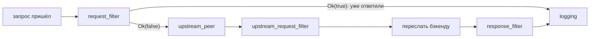

<!-- nav:top -->
[🏠 Начало](../START-HERE.md) · [← 22.19 Трек сетей: разбор протоколов без копирования](19-networking-track-zero-copy-parsing.md) · [📋 Этап 22](README.md) · [22.21 Трек сетей: проект и следующие шаги →](21-networking-track-project-and-next-steps.md) · [📖 Глоссарий](../GLOSSARY.md) · [🇬🇧 English](../../en/22-specializations/20-networking-track-production-proxies.md) <!-- nav -->

# Урок 22.20 — Трек сетей: прокси для продакшена

> **Этап 22 — Специализации** · Урок 20 из 30 · ⏱ около 2,5 часа (2 занятия)

## Что вы узнаете

- Какие задачи должен решать прокси в продакшене, кроме «скопировать байты отсюда туда».
- Что такое Pingora и как устроены её части: сервер, сервисы, трейт `ProxyHttp` и его хуки.
- Как построить небольшой обратный прокси на Pingora: балансировка нагрузки, проверки работоспособности, блокировка путей, добавление заголовков, логирование.
- Как Pingora перезапускается, не теряя соединений, и как она настраивается.
- Как сохранить логику прокси тестируемой, вынося решения в обычные функции.

## Перед началом

- Вы прошли [Урок 22.19 — Трек сетей: разбор протоколов без копирования](19-networking-track-zero-copy-parsing.md).
- Вы знаете, что делают прокси и балансировщики нагрузки, из [Урока 15.14 — Прокси и балансировщики нагрузки](../15-networking/14-proxies-and-load-balancers.md),
  и HTTP (Hypertext Transfer Protocol, протокол передачи гипертекста) с hyper из [Урока 15.9](../15-networking/09-http-with-hyper-and-reqwest.md).
- Pingora собирают и запускают в Linux, поэтому работайте в вашей ВМ `dev`. Pingora компилирует
  библиотеку сжатия с помощью CMake (инструмента, который управляет сборкой кода на C и C++), поэтому
  один раз установите его там:

```bash
sudo apt install -y cmake build-essential curl
cd ~/projects/rust
cargo new code/p22-proxy
cd code/p22-proxy
cargo add pingora@0.9 --features proxy,lb
cargo add async-trait@0.1
cargo add tokio@1 --features full
```

Прокси — это `src/main.rs`; маленький тестовый бэкенд кладётся в `src/bin/backend.rs`. Первая сборка
компилирует несколько сотен крейтов и занимает несколько минут.

## Новые слова

| Слово | Значение |
|---|---|
| **обратный прокси** (reverse proxy) | Сервер, который принимает запросы от клиентов и пересылает их одному из нескольких бэкенд-серверов, а затем отправляет ответ обратно. Клиенты видят только прокси. |
| **вышестоящий / нижестоящий** (upstream / downstream) | С точки зрения прокси: *вышестоящий* — бэкенд, которому он пересылает запрос, *нижестоящий* — клиент, отправивший запрос. |
| **бэкенд** (backend) | Один из серверов за прокси, который выполняет настоящую работу. |
| **проверка работоспособности** (health check) | Регулярная проверка каждого бэкенда («могу ли я подключиться?»); бэкенды, которые её не проходят, исключаются из ротации. |
| **пул соединений** (connection pool) | Набор открытых соединений с вышестоящими серверами, которые хранятся и переиспользуются, чтобы не каждый запрос платил за новое TCP-рукопожатие (TCP — Transmission Control Protocol, протокол управления передачей). |
| **Pingora** | Фреймворк на Rust для построения прокси и других сетевых сервисов, опубликованный Cloudflare как open source. |
| **хук** (hook, filter) | Метод, который фреймворк вызывает в определённый момент обработки запроса, чтобы ваш код мог его просмотреть или изменить. |
| **контекст запроса** (request context, `CTX`) | Значение, которое создаётся для каждого запроса и передаётся в каждый хук этого запроса, чтобы хуки могли делиться данными. |
| **плавное обновление** (graceful upgrade) | Замена работающего серверного процесса новой версией без закрытия его слушающих сокетов и без потери запросов. |
| **липкая маршрутизация** (sticky routing) | Отправка всех запросов одного пользователя на один и тот же бэкенд, выбранный по хешу ключа, например идентификатора пользователя. |
| **согласованное хеширование** (consistent hashing) | Способ сопоставлять ключи бэкендам так, что добавление или удаление одного бэкенда перемещает лишь небольшую долю ключей. |

**Другие сокращения в этом уроке:** ВМ (виртуальная машина; Linux-ВМ `dev` из Этапа 11), API (Application Programming
Interface, программный интерфейс: функции и типы, которые предлагает библиотека) и IP (Internet Protocol, межсетевой
протокол; IP-адрес обозначает машину в сети).

## 1. Что делает прокси в продакшене

> **Проект вашего направления (Урок 22.21) строит небольшой прокси вручную. Этот урок показывает, что
> уже умеет зрелый фреймворк, чтобы вы знали, что добавляет «продакшен».**

Ядро обратного прокси короткое: принять соединение, прочитать запрос, выбрать бэкенд, переслать
запрос, скопировать ответ обратно. Прокси, который стоит перед настоящим трафиком, должен делать ещё и
всё это:

| Задача | Почему это важно |
|---|---|
| Балансировка нагрузки | Распределять запросы по бэкендам (по кругу, по наименьшему числу соединений, по хешу). |
| Проверки работоспособности | Никогда не отправлять трафик на мёртвый бэкенд. |
| Пул соединений | Переиспользовать соединения с вышестоящими серверами; новые рукопожатия TCP (и TLS, Transport Layer Security, протокол защиты транспортного уровня) медленные. |
| Тайм-ауты и повторные попытки | Медленный бэкенд не должен блокировать клиентов вечно; неудачное подключение можно повторить на другом бэкенде. |
| Ограничения | Размер заголовков, размер тела, число соединений (Уроки 22.18 и 22.19). |
| Правила для заголовков | Добавлять `X-Forwarded-For`, удалять внутренние заголовки, блокировать пути. |
| Плавный перезапуск | Развернуть новую версию, не потеряв ни одного запроса. |
| Наблюдаемость | Журналы доступа, метрики, трассировки для каждого запроса (Этап 16). |
| Протоколы | HTTP/1.1, HTTP/2, TLS, WebSocket, gRPC (фреймворк удалённого вызова процедур, впервые созданный в Google; RPC — Remote Procedure Call, удалённый вызов процедур). |

Правильно написать всё это — годы работы. Pingora — фреймворк, который реализует эти задачи и
оставляет вам **политику**: какой бэкенд, какие заголовки, что блокировать. Cloudflare создала его на
замену старому прокси и пропускает через него большую долю своего трафика; другие компании используют
его для шлюзов и балансировщиков нагрузки.

## 2. Как устроена Pingora

У программы на Pingora три уровня:

```text
 Server                      one process: threads, configuration, signals, graceful upgrade
  ├── Service "proxy"        listens on 127.0.0.1:6188, runs your ProxyHttp for every request
  └── Service "health check" a background task that tests the backends every second
```

Вы пишете тип, который реализует трейт `ProxyHttp`. Pingora вызывает его методы (хуки) в
фиксированном порядке для каждого запроса:



| Хук | Когда вызывается | Типичное применение |
|---|---|---|
| `new_ctx` | начинается запрос | создать контекст запроса |
| `request_filter` | пришла заголовочная часть запроса | аутентификация, блокировка, ответ напрямую |
| `upstream_peer` (обязательный) | перед подключением | выбрать бэкенд |
| `upstream_request_filter` | перед отправкой запроса вышестоящему серверу | добавить или удалить заголовки запроса |
| `response_filter` | от вышестоящего сервера пришла заголовочная часть ответа | добавить или удалить заголовки ответа |
| `logging` | запрос завершён (в том числе после ошибок) | журнал доступа, метрики |

Писать обязательно нужно только `new_ctx` и `upstream_peer`; у остальных хуков есть тела по
умолчанию, которые ничего не делают. Хуков гораздо больше (для тел, ошибок, повторных попыток,
кэширования); в документации перечислены все.

Методы трейта асинхронные (`async`), и Pingora использует для них крейт `async-trait`: атрибут
`#[async_trait]` на блоке `impl` превращает каждую `async fn` в обычный метод, который возвращает
future в куче (boxed future), — именно этого ждёт трейт Pingora.

## 3. Тестовый бэкенд

Чтобы увидеть работу прокси, нужны бэкенды. Этот крошечный сервер отвечает на каждый запрос своим
портом и полученным заголовком `X-Forwarded-For`, чтобы было видно, куда ушёл каждый запрос. Он
использует только то, что вы знаете из Уроков 15.6 и 22.19. Сохраните как `src/bin/backend.rs`:

```rust
use tokio::io::{AsyncReadExt, AsyncWriteExt};
use tokio::net::{TcpListener, TcpStream};

/// A tiny HTTP/1.1 server for testing: answers every request with its own port.
async fn serve(mut stream: TcpStream, port: u16) -> std::io::Result<()> {
    let mut buf = Vec::new();
    let mut chunk = [0u8; 4096];
    loop {
        // Answer every complete request head in the buffer (keep-alive).
        while let Some(end) = buf.windows(4).position(|w| w == b"\r\n\r\n") {
            let head = String::from_utf8_lossy(&buf[..end]).to_string();
            buf.drain(..end + 4);
            let forwarded = head
                .lines()
                .find_map(|l| l.strip_prefix("X-Forwarded-For: "))
                .unwrap_or("-")
                .to_string();
            let body = format!("hello from backend {port} (client {forwarded})\n");
            let response = format!(
                "HTTP/1.1 200 OK\r\nContent-Length: {}\r\nContent-Type: text/plain\r\n\r\n{body}",
                body.len()
            );
            stream.write_all(response.as_bytes()).await?;
        }
        let n = stream.read(&mut chunk).await?;
        if n == 0 {
            return Ok(());
        }
        buf.extend_from_slice(&chunk[..n]);
    }
}

#[tokio::main]
async fn main() -> std::io::Result<()> {
    let port: u16 = std::env::args()
        .nth(1)
        .and_then(|p| p.parse().ok())
        .unwrap_or(8001);
    let listener = TcpListener::bind(("127.0.0.1", port)).await?;
    println!("backend listening on 127.0.0.1:{port}");
    loop {
        let (stream, _) = listener.accept().await?;
        tokio::spawn(async move {
            let _ = serve(stream, port).await;
        });
    }
}
```

**Что происходит:**

1. Порт берётся из первого аргумента командной строки, поэтому можно запустить несколько копий:
   `cargo run --bin backend -- 8001`.
2. Цикл соединения отвечает на каждую полную заголовочную часть запроса в буфере, затем читает ещё. Он
   оставляет соединение открытым после каждого ответа (keep-alive в HTTP/1.1), что позволяет прокси
   переиспользовать его.
3. `Content-Length` точно сообщает клиенту, где заканчивается тело, поэтому по соединению может прийти
   следующий ответ.

Этот бэкенд игнорирует тела запросов и не имеет ограничений: это инструмент для тестов, а не сервер
для развёртывания.

## 4. Обратный прокси на Pingora

Наш прокси будет: распределять запросы по трём бэкендам по кругу (round robin), проверять их
работоспособность каждую секунду, отвечать `403 Forbidden` для путей под `/admin`, сообщать бэкенду
IP-адрес (Internet Protocol, межсетевой протокол) клиента в `X-Forwarded-For`, добавлять к ответам
заголовок `X-Proxy` и печатать одну строку журнала на запрос. Сохраните как `src/main.rs`:

```rust
use async_trait::async_trait;
use pingora::prelude::*;
use std::sync::Arc;
use std::time::Duration;

struct Proxy {
    backends: Arc<LoadBalancer<RoundRobin>>,
}

/// Data that lives for one request, shared by all hooks of that request.
#[derive(Default)]
struct RequestCtx {
    backend: Option<String>,
}

#[async_trait]
impl ProxyHttp for Proxy {
    type CTX = RequestCtx;

    fn new_ctx(&self) -> Self::CTX {
        RequestCtx::default()
    }

    async fn request_filter(&self, session: &mut Session, _ctx: &mut Self::CTX) -> Result<bool> {
        if session.req_header().uri.path().starts_with("/admin") {
            session.respond_error(403).await?;
            return Ok(true); // true = "I answered, stop here"
        }
        Ok(false)
    }

    async fn upstream_peer(
        &self,
        _session: &mut Session,
        ctx: &mut Self::CTX,
    ) -> Result<Box<HttpPeer>> {
        let backend = self
            .backends
            .select(b"", 256)
            .ok_or_else(|| Error::explain(HTTPStatus(502), "no healthy backend"))?;
        ctx.backend = Some(backend.addr.to_string());
        Ok(Box::new(HttpPeer::new(backend, false, String::new())))
    }

    async fn upstream_request_filter(
        &self,
        session: &mut Session,
        upstream_request: &mut RequestHeader,
        _ctx: &mut Self::CTX,
    ) -> Result<()> {
        if let Some(client) = session.client_addr().and_then(|a| a.as_inet()) {
            upstream_request.insert_header("X-Forwarded-For", client.ip().to_string())?;
        }
        Ok(())
    }

    async fn response_filter(
        &self,
        _session: &mut Session,
        upstream_response: &mut ResponseHeader,
        _ctx: &mut Self::CTX,
    ) -> Result<()> {
        upstream_response.insert_header("X-Proxy", "p22-proxy")?;
        Ok(())
    }

    async fn logging(&self, session: &mut Session, _e: Option<&Error>, ctx: &mut Self::CTX) {
        let status = session.response_written().map_or(0, |r| r.status.as_u16());
        println!(
            "{} {} -> {status} via {}",
            session.req_header().method,
            session.req_header().uri,
            ctx.backend.as_deref().unwrap_or("-")
        );
    }
}

fn main() {
    let mut server = Server::new(Some(Opt::parse_args())).unwrap();
    server.bootstrap();

    let mut upstreams =
        LoadBalancer::try_from_iter(["127.0.0.1:8001", "127.0.0.1:8002", "127.0.0.1:8003"])
            .unwrap();
    upstreams.set_health_check(TcpHealthCheck::new());
    upstreams.health_check_frequency = Some(Duration::from_secs(1));
    let health_checks = background_service("health check", upstreams);

    let mut proxy = http_proxy_service(
        &server.configuration,
        Proxy {
            backends: health_checks.task(),
        },
    );
    proxy.add_tcp("127.0.0.1:6188");

    server.add_service(proxy);
    server.add_service(health_checks);
    server.run_forever();
}
```

**Что происходит:**

1. `use pingora::prelude::*` подключает частые имена: `Server`, `Opt`, `ProxyHttp`, `Session`,
   `HttpPeer`, `LoadBalancer`, `RoundRobin`, `TcpHealthCheck`, `RequestHeader`, `ResponseHeader`,
   собственные `Error` и `Result` Pingora и другие.
2. `Proxy` хранит балансировщик нагрузки в `Arc`, потому что его разделяют задача проверок и каждый
   запрос.
3. `type CTX = RequestCtx` объявляет наш контекст запроса. `new_ctx` создаёт пустой контекст для каждого
   запроса; `upstream_peer` сохраняет в нём выбранный бэкенд, а `logging` позже читает его.
4. `request_filter` первым видит заголовочную часть запроса. Для `/admin...` он сам отправляет `403` и
   возвращает `Ok(true)`, что говорит Pingora: «запрос обработан, не пересылай его».
5. `upstream_peer` просит у балансировщика бэкенд. `select(key, 256)` принимает ключ (round robin его
   игнорирует) и максимальное число попыток найти работоспособный бэкенд. Если таких нет, мы возвращаем
   ошибку со статусом `502 Bad Gateway`. `HttpPeer::new(addr, false, String::new())` значит «обычный TCP,
   без TLS, без имени сервера для TLS».
6. `upstream_request_filter` меняет копию запроса, которая уходит вышестоящему серверу: добавляет
   IP-адрес клиента. `client_addr()` возвращает собственный тип адреса Pingora, который может быть и
   Unix-сокетом, поэтому `as_inet()` даёт интернет-адрес, если он есть.
7. `response_filter` добавляет заголовок к ответу, прежде чем тот уйдёт клиенту.
8. `logging` выполняется один раз в конце каждого запроса, в том числе для `403` и для ошибок.
9. В `main` `Opt::parse_args()` читает стандартные флаги командной строки Pingora, `Server::new` создаёт
   сервер уровня процесса, а `bootstrap` готовит его (например, забирает сокеты во время обновления).
10. `background_service` оборачивает балансировщик в сервис, который выполняет проверки
    работоспособности; `task()` даёт прокси `Arc` на тот же балансировщик. Оба сервиса добавляются в
    сервер, и `run_forever` запускает потоки и никогда не возвращается.

Запустите два бэкенда (8003 специально остаётся выключенным), затем прокси, каждый в своём терминале
ВМ:

```bash
cargo run --bin backend -- 8001
cargo run --bin backend -- 8002
cargo run --bin p22-proxy
```

В четвёртом терминале отправьте запросы:

```bash
for i in 1 2 3 4; do curl -s http://127.0.0.1:6188/hello; done
curl -si http://127.0.0.1:6188/admin/users | head -5
curl -si http://127.0.0.1:6188/ | head -8
```

```text
hello from backend 8001 (client 127.0.0.1)
hello from backend 8002 (client 127.0.0.1)
hello from backend 8001 (client 127.0.0.1)
hello from backend 8002 (client 127.0.0.1)
HTTP/1.1 403 Forbidden
Server: Pingora
Date: Wed, 18 Nov 2026 08:09:01 GMT
Content-Length: 0
Cache-Control: private, no-store
HTTP/1.1 200 OK
Content-Length: 43
Content-Type: text/plain
X-Proxy: p22-proxy
Date: Wed, 18 Nov 2026 08:09:01 GMT
Connection: keep-alive

hello from backend 8001 (client 127.0.0.1)
```

Round robin чередует 8001 и 8002. Бэкенд 8003 никогда не выбирается: проверка работоспособности не
смогла к нему подключиться, поэтому он помечен как неработоспособный. Теперь остановите бэкенд 8002
через Ctrl+C, подождите две секунды и снова запустите цикл: все запросы идут на 8001, и ни один клиент
не видит ошибки. В терминале прокси видны строки журнала:

```text
GET /hello -> 200 via 127.0.0.1:8001
GET /hello -> 200 via 127.0.0.1:8002
GET /hello -> 200 via 127.0.0.1:8001
GET /hello -> 200 via 127.0.0.1:8002
GET /admin/users -> 403 via -
GET / -> 200 via 127.0.0.1:8001
GET /after -> 200 via 127.0.0.1:8001
GET /after -> 200 via 127.0.0.1:8001
GET /after -> 200 via 127.0.0.1:8001
```

(Последние три строки получены циклом после остановки 8002, с путём, изменённым на `/after`.)

> ⚡ **Производительность:** Pingora не открывает новое соединение с вышестоящим сервером для каждого
> запроса. Она держит такие соединения в **пуле соединений** и переиспользует их (поэтому наш бэкенд
> оставляет соединения открытыми), что экономит на каждом запросе TCP-рукопожатие, а также
> TLS-рукопожатие, если вышестоящий сервер использует TLS.

## 5. Работа в продакшене: конфигурация и плавное обновление

`Opt::parse_args()` даёт каждой программе на Pingora одинаковые флаги:

```bash
cargo run --bin p22-proxy -- --help
```

```text
Command-line options

Usage: p22-proxy [OPTIONS]

Options:
  -u, --upgrade      This is the base set of command line arguments for a pingora-based service
  -d, --daemon       Whether this server should run in the background
  -t, --test         This flag is useful for upgrading service where the user wants to make sure the new service can start before shutting down the old server process.
  -c, --conf <CONF>  The path to the configuration file.
  -h, --help         Print help
```

Файл конфигурации записан в YAML (текстовый формат для конфигурации, «YAML Ain't Markup Language» —
«YAML — не язык разметки»). Сохраните как `conf.yaml`:

```yaml
---
version: 1
threads: 2
grace_period_seconds: 5
graceful_shutdown_timeout_seconds: 5
```

`threads` — число рабочих потоков на сервис (Урок 22.18), а два тайм-аута управляют тем, сколько
останавливающийся процесс продолжает обслуживать уже принятые запросы.
`cargo run --bin p22-proxy -- -c conf.yaml -t` только проверяет файл и завершается с кодом 0, если он
правильный.

**Плавное обновление** — это способ, которым Pingora разворачивает новую версию, не теряя запросов:

1. Старый процесс работает и владеет слушающими сокетами.
2. Вы запускаете новый бинарный файл с `-u` (upgrade). Он не начинает слушать сам; он ждёт, когда ему
   передадут слушающие сокеты через Unix-сокет, путь к которому знают оба процесса (настройка
   `upgrade_sock`).
3. Вы отправляете старому процессу `SIGQUIT` (Урок 13.7). Он передаёт свои слушающие сокеты новому
   процессу через Unix-сокет (передача файловых дескрипторов — возможность Unix-сокетов), перестаёт
   принимать соединения и завершает открытые запросы в течение `grace_period_seconds`.
4. Новый процесс принимает соединения на *тех же* сокетах, поэтому очередь приёма ядра никогда не
   закрывается, и ни один клиент не получает «connection refused».

> 🔒 **Безопасность:** прокси — входная дверь для каждого сервиса за ним. Держите версию Pingora
> свежей (проверяйте бюллетени безопасности через `cargo audit`, Урок 10.13), ограничивайте размер
> заголовков и тел и никогда не пересылайте заголовки, которым доверяют бэкенды (например, внутренний
> заголовок `X-User`), не удалив значение, присланное клиентом.

## 6. Сохраняйте решения тестируемыми

Хукам Pingora нужен работающий сервер, поэтому их неудобно покрывать модульными тестами. Решение —
правило проектирования из Этапа 08: держите **решения** в обычных функциях, а хуки делайте тонкими.
Например, какие пути блокировать — это чистая функция от пути; хук только вызывает её. Упражнение 2
делает именно это, и его тест находит настоящую ошибку в нашем правиле `starts_with("/admin")`.

> 🧪 **Тестирование:** тестируйте функции политики модульными тестами, а весь прокси — сквозными:
> запустите бэкенды и прокси, отправьте запросы HTTP-клиентом, например `reqwest` (Урок 15.9) или `curl`
> в скрипте, и проверьте коды статусов и заголовки. Проект в Уроке 22.21 делает и то и другое.

## Частые ошибки

**Забыть добавить сервис проверок работоспособности.** Если удалить строку
`server.add_service(health_checks);`, программа всё равно скомпилируется и запустится, но проверки не
выполняются, поэтому каждый бэкенд считается работоспособным:

```text
HTTP/1.1 200 OK
HTTP/1.1 200 OK
HTTP/1.1 502 Bad Gateway
```

Каждый третий запрос уходит на мёртвый бэкенд 8003 и завершается ошибкой, а журнал прокси показывает
`GET /hello -> 502 via 127.0.0.1:8003`. Исправление: добавьте в сервер оба сервиса.

**Сборка в macOS без CMake.** Первая сборка падает с
`failed to run custom build command for libz-ng-sys`, потому что нет CMake. Собирайте в ВМ, где вы
установили `cmake` в разделе «Перед началом».

**Доверять `X-Forwarded-For` от клиента.** Клиент может прислать собственный заголовок
`X-Forwarded-For` с любым адресом. `insert_header` заменяет существующее значение, а это то, что нужно
на границе сети. Прокси, который стоит за другим доверенным прокси, должен вместо этого *дописывать*
адрес и доверять только той части, которую добавили его собственные доверенные прокси.

**Блокировка по префиксу через `starts_with`.** `"/administrator".starts_with("/admin")` истинно,
поэтому наш прокси блокирует и `/administrator`, а это, скорее всего, другая страница. Сравнивайте
целые сегменты пути (упражнение 2).

## Попробуйте сами

1. Запустите и бэкенд 8003. Примерно за секунду проверка пометит его работоспособным, и round robin
   будет использовать все три бэкенда.
2. Запустите прокси с `-c conf.yaml` и `threads: 1`. Всё по-прежнему работает; на одном потоке прокси
   медленнее под нагрузкой, что можно измерить генератором нагрузки из Этапа 19.
3. Отправьте запрос `curl -s -H "X-Forwarded-For: 6.6.6.6" http://127.0.0.1:6188/`. Бэкенд всё равно
   сообщает `client 127.0.0.1`, потому что `insert_header` заменил значение клиента.

## Упражнения

### Упражнение 1 — Какой бэкенд ответил? (легко)

Добавьте заголовок ответа `X-Backend` с адресом бэкенда, который обслужил запрос. Проверьте его через
`curl -si http://127.0.0.1:6188/ | grep -i x-backend`.

<details>
<summary>Подсказка</summary>

Выбранный бэкенд уже сохраняется в `ctx.backend` в `upstream_peer`. В `response_filter` переименуйте
`_ctx` в `ctx` и прочитайте его.

</details>

<details>
<summary>Ответ</summary>

В `response_filter`:

```rust
upstream_response.insert_header("X-Proxy", "p22-proxy")?;
if let Some(backend) = &ctx.backend {
    upstream_response.insert_header("X-Backend", backend.as_str())?;
}
```

```text
X-Backend: 127.0.0.1:8001
```

Почему это работает: контекст — одно и то же значение для всех хуков одного запроса, поэтому данные,
найденные в раннем хуке (`upstream_peer`), доступны в позднем (`response_filter`).

</details>

### Упражнение 2 — Тестируемый список блокировки (средне)

Создайте `src/lib.rs` с `pub const BLOCKED: [&str; 2] = ["/admin", "/internal"];` и
`pub fn is_blocked(path: &str) -> bool`. Путь заблокирован, если он *равен* одному из префиксов или
лежит под ним (`/admin`, `/admin/users`), но `/administrator` и `/shop/admin` не заблокированы.
Сначала напишите модульные тесты, затем используйте функцию в `request_filter`.

<details>
<summary>Подсказка</summary>

Для каждого префикса: путь равен ему, или `path.strip_prefix(prefix)` возвращает остаток, который
начинается с `/`. В `main.rs` библиотечный крейт называется `p22_proxy`.

</details>

<details>
<summary>Ответ</summary>

```rust
/// Path prefixes that the proxy never forwards.
pub const BLOCKED: [&str; 2] = ["/admin", "/internal"];

/// True if `path` is one of the blocked prefixes or lies below one of them.
pub fn is_blocked(path: &str) -> bool {
    BLOCKED.iter().any(|prefix| {
        path == *prefix
            || path
                .strip_prefix(prefix)
                .is_some_and(|rest| rest.starts_with('/'))
    })
}

#[cfg(test)]
mod tests {
    use super::*;

    #[test]
    fn blocks_prefixes_and_everything_below_them() {
        assert!(is_blocked("/admin"));
        assert!(is_blocked("/admin/users"));
        assert!(is_blocked("/internal/metrics"));
    }

    #[test]
    fn does_not_block_lookalike_paths() {
        assert!(!is_blocked("/"));
        assert!(!is_blocked("/administrator"));
        assert!(!is_blocked("/shop/admin"));
    }
}
```

В `main.rs` добавьте `use p22_proxy::is_blocked;` и напишите
`if is_blocked(session.req_header().uri.path()) {` в `request_filter`.

```text
test tests::blocks_prefixes_and_everything_below_them ... ok
test tests::does_not_block_lookalike_paths ... ok
```

С запущенным прокси: `/admin` и `/admin/x` дают `403`, `/administrator` даёт `200`, `/internal` даёт
`403`.

Почему это работает: сравнение целых сегментов убирает ошибку с похожими путями, а поскольку правило —
обычная функция, оно проверяется за миллисекунды без запуска сервера.

</details>

### Упражнение 3 — Липкая маршрутизация (сложно)

Запустите все три бэкенда. Измените прокси так, чтобы все запросы с одинаковым заголовком `X-User`
шли на один и тот же бэкенд, а разные пользователи распределялись по бэкендам. Покажите это командой
`for u in alice bob carol alice bob carol; do echo "$u: $(curl -s -H "X-User: $u" http://127.0.0.1:6188/cart)"; done`.

<details>
<summary>Подсказка</summary>

Замените `RoundRobin` на `pingora::lb::selection::Consistent` (согласованное хеширование, его ещё
называют хешированием Ketama). Тогда бэкенд определяет ключ, который вы передаёте в `select`:
используйте байты заголовка `X-User`, прочитанного через `session.req_header().headers.get("X-User")`.

</details>

<details>
<summary>Ответ</summary>

Добавьте `use pingora::lb::selection::Consistent;`, измените поле на
`backends: Arc<LoadBalancer<Consistent>>` и напишите `upstream_peer` так:

```rust
async fn upstream_peer(&self, session: &mut Session, ctx: &mut Self::CTX) -> Result<Box<HttpPeer>> {
    let key = session
        .req_header()
        .headers
        .get("X-User")
        .map(|v| v.as_bytes().to_vec())
        .unwrap_or_default();
    let backend = self
        .backends
        .select(&key, 256)
        .ok_or_else(|| Error::explain(HTTPStatus(502), "no healthy backend"))?;
    ctx.backend = Some(backend.addr.to_string());
    Ok(Box::new(HttpPeer::new(backend, false, String::new())))
}
```

`main` не меняется: `LoadBalancer::try_from_iter` строит `LoadBalancer<Consistent>`, потому что так
сказано в типе поля `backends`.

```text
alice: hello from backend 8002 (client 127.0.0.1)
bob: hello from backend 8003 (client 127.0.0.1)
carol: hello from backend 8001 (client 127.0.0.1)
alice: hello from backend 8002 (client 127.0.0.1)
bob: hello from backend 8003 (client 127.0.0.1)
carol: hello from backend 8001 (client 127.0.0.1)
```

Почему это работает: согласованное хеширование отображает каждый ключ на точку кольца бэкендов, поэтому
один и тот же ключ всегда даёт один и тот же бэкенд, пока тот работоспособен. Если бэкенд умирает,
на другие бэкенды переходят только его пользователи; остальные сохраняют свой бэкенд, и кэши бэкендов
остаются «тёплыми». Какой пользователь попадёт на какой бэкенд, зависит от хеша, поэтому у вас
сопоставление может быть другим.

</details>

## Вопросы для самопроверки

1. Назовите четыре задачи прокси в продакшене, кроме пересылки байтов.

<details>
<summary>Ответ</summary>

Любые четыре из: балансировка нагрузки, проверки работоспособности, пул соединений, тайм-ауты и
повторные попытки, ограничения размеров и числа соединений, правила для заголовков, плавный
перезапуск, журналы и метрики, поддержка TLS и HTTP/2.

</details>

2. В каком порядке Pingora вызывает `request_filter`, `upstream_peer`, `response_filter` и `logging`?
   Какой из них может остановить пересылку запроса?

<details>
<summary>Ответ</summary>

`request_filter`, затем `upstream_peer`, затем (после `upstream_request_filter` и обращения к
вышестоящему серверу) `response_filter` и в конце `logging`. `request_filter` может остановить
пересылку, ответив сам и вернув `Ok(true)`.

</details>

3. Зачем нужен контекст запроса (`CTX`)?

<details>
<summary>Ответ</summary>

Это одно значение на запрос, которое получает каждый хук этого запроса, поэтому хуки могут делиться
данными, например выбранным бэкендом для строки журнала.

</details>

4. Почему в нашем прокси мёртвый бэкенд перестаёт получать трафик и что ломается, если забыть
   `server.add_service(health_checks)`?

<details>
<summary>Ответ</summary>

Фоновый сервис проверок каждую секунду пытается подключиться к каждому бэкенду и помечает неудачные
как неработоспособные; `select` пропускает неработоспособные бэкенды. Без этого сервиса проверки не
выполняются, каждый бэкенд остаётся «работоспособным», и запросы, попавшие на мёртвый, завершаются
`502`.

</details>

5. Как Pingora может перезапуститься с новой версией, не отказывая в соединениях?

<details>
<summary>Ответ</summary>

Через плавное обновление: новый процесс запускается с `-u`, старый получает `SIGQUIT` и передаёт новому
свои слушающие сокеты через Unix-сокет, а затем завершает открытые запросы. Слушающие сокеты никогда
не закрываются, поэтому ядро продолжает принимать соединения.

</details>

6. Почему для липкой маршрутизации используют согласованное хеширование, а не
   `hash(key) % number_of_backends`?

<details>
<summary>Ответ</summary>

С `% n` изменение числа бэкендов переносит почти каждый ключ на другой бэкенд. Согласованное
хеширование переносит только ключи того бэкенда, который был добавлен или удалён.

</details>

## Итоги

- Прокси в продакшене добавляет к простому ядру «переслать запрос» балансировку нагрузки, проверки
  работоспособности, пул соединений, тайм-ауты, ограничения, правила для заголовков, плавные
  перезапуски и наблюдаемость.
- Pingora даёт вам всё это; вы пишете тип, который реализует `ProxyHttp`, а Pingora вызывает его хуки в
  фиксированном порядке для каждого запроса.
- `upstream_peer` выбирает бэкенд; `request_filter` может ответить напрямую; хуки `*_filter` меняют
  заголовки; `logging` выполняется в конце каждого запроса; `CTX` переносит данные между хуками.
- `LoadBalancer` с фоновым сервисом проверок уводит трафик от мёртвых бэкендов; `RoundRobin`
  распределяет нагрузку, `Consistent` даёт липкую маршрутизацию.
- Программы на Pingora имеют одинаковые флаги и YAML-конфигурацию и могут плавно обновляться, не теряя
  соединений.
- Держите политику в обычных функциях с модульными тестами, а весь прокси тестируйте сквозными
  тестами.

## Источники и что почитать

- [Pingora on GitHub](https://github.com/cloudflare/pingora) — исходный код, примеры и руководство пользователя в `docs/`.
- [Pingora user guide](https://github.com/cloudflare/pingora/blob/main/docs/user_guide/index.md) — фазы (хуки), конфигурация, плавное обновление, пул соединений.
- [pingora on docs.rs](https://docs.rs/pingora/0.9/pingora/) — API всех крейтов Pingora, включая `ProxyHttp` и `LoadBalancer`.
- [Cloudflare blog: How we built Pingora](https://blog.cloudflare.com/how-we-built-pingora-the-proxy-that-connects-cloudflare-to-the-internet/) — зачем её создали и что она изменила в продакшене.
- [MDN: X-Forwarded-For](https://developer.mozilla.org/en-US/docs/Web/HTTP/Reference/Headers/X-Forwarded-For) — сам заголовок и правила безопасности для доверия к нему (MDN, MDN Web Docs, — веб-документация, которую ведёт Mozilla).

---

[🏠 Начало](../START-HERE.md) · [← 22.19 Трек сетей: разбор протоколов без копирования](19-networking-track-zero-copy-parsing.md) · [📋 Этап 22](README.md) · [22.21 Трек сетей: проект и следующие шаги →](21-networking-track-project-and-next-steps.md) · [📖 Глоссарий](../GLOSSARY.md) <!-- nav -->
<!-- nav:bottom -->
