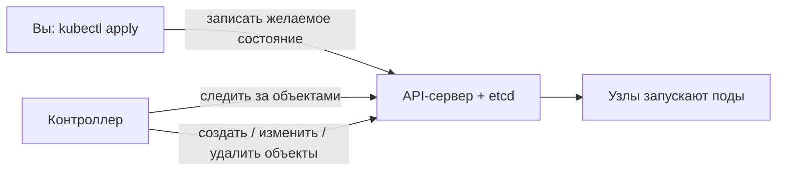

<!-- nav:top -->
[🏠 Начало](../START-HERE.md) · [← 22.25 Трек компиляторов: проект и следующие шаги](25-compilers-track-project-and-next-steps.md) · [📋 Этап 22](README.md) · [22.27 Трек cloud native: оператор на kube-rs →](27-cloud-native-track-an-operator-with-kube-rs.md) · [📖 Глоссарий](../GLOSSARY.md) · [🇬🇧 English](../../en/22-specializations/26-cloud-native-track-kubernetes-operators.md) <!-- nav -->

# Урок 22.26 — Трек cloud native: операторы Kubernetes

> **Этап 22 — Специализации** · Урок 26 из 30 · ⏱ около 135 минут

## Что вы узнаете

- Что создают инженеры направления cloud native и почему Rust подходит для программ, работающих внутри Kubernetes.
- Идею, на которой построен любой контроллер Kubernetes: желаемое состояние, фактическое состояние и цикл согласования.
- Почему хороший цикл согласования *срабатывает по уровню* и *идемпотентен* — на примере маленькой симуляции на Rust.
- Как CRD (CustomResourceDefinition) добавляет ваш собственный тип объектов в API Kubernetes и как попробовать это в
  локальном кластере `kind`.
- Что такое оператор и какие крейты Rust используются в остальной части направления.

## Перед началом

- Вы прочитали [Урок 22.1 — Выбор специализации](01-choosing-a-specialization.md) и выбрали направление
  cloud native. **Не ваше направление?** Это последнее направление этапа, поэтому переходите сразу к
  [Уроку 22.30 — Контрольная точка: ваша специализация](30-checkpoint-your-specialization.md).
- Вы прошли Этап 21, особенно [Урок 21.2 — Понятия Kubernetes](../21-cloud-native-infrastructure/02-kubernetes-concepts.md),
  [Урок 21.3 — Локальный кластер с kind и kubectl](../21-cloud-native-infrastructure/03-a-local-cluster-with-kind.md) и
  [Урок 21.5 — ConfigMap, Secret и пробы работоспособности](../21-cloud-native-infrastructure/05-configmaps-secrets-and-probes.md).
- Docker Desktop запущен, а `kind` и `kubectl` работают в терминале (`kind version`, `kubectl version --client`).
- Вы знаете задачи Tokio и асинхронные функции ([Урок 14.13](../14-concurrency-and-async/13-tokio-tasks-and-channels.md)) и
  идемпотентность ([Урок 18.3](../18-distributed-systems/03-retries-backoff-and-idempotency.md)).

## Новые слова

| Слово | Значение |
|---|---|
| **API-сервер** (API server) | Центральная программа Kubernetes. Каждый инструмент (kubectl, контроллеры, ваш оператор) читает и записывает объекты кластера только через его HTTP (HyperText Transfer Protocol, протокол передачи гипертекста) API (Application Programming Interface, программный интерфейс: запросы, которые программа принимает от других программ). |
| **etcd** | Хранилище «ключ — значение», в котором API-сервер держит все объекты. Больше никто не обращается к нему напрямую. |
| **контроллер** (controller) | Программа, которая следит за объектами некоторых типов и меняет кластер до тех пор, пока он не станет таким, как эти объекты просят. |
| **желаемое состояние / фактическое состояние** (desired state / actual state) | То, что объект *просит* (его `spec`, например «3 реплики») / то, что существует прямо сейчас (например, 2 работающих пода). |
| **согласовать** (reconcile) | Сравнить желаемое и фактическое состояние и внести изменения, которые убирают разницу. Один такой запуск — *согласование* (reconciliation). |
| **срабатывание по уровню / по фронту** (level-triggered / edge-triggered) | Реакция на *текущее состояние* («в комнате 18 °C») / реакция только на отдельные *события* («кто-то открыл окно»); потерянное событие тогда не будет обработано никогда. Контроллеры Kubernetes срабатывают по уровню. |
| **идемпотентный** (idempotent) | Выполнить дважды — то же самое, что выполнить один раз. Согласование, которому нечего исправлять, не должно ничего менять. |
| **CRD** (CustomResourceDefinition, определение пользовательского ресурса) | Объект Kubernetes, который добавляет в API новый тип объектов с его именем и схемой допустимых полей. |
| **пользовательский ресурс** (custom resource) | Один объект типа, добавленного через CRD, например один `Greeting` с именем `hello`. |
| **группа API** (API group) | «Фамилия» типа объектов, часть до `/` в `apiVersion: course.example.com/v1`. Встроенные Deployment живут в группе `apps`. |
| **схема** (schema) | Описание того, какие поля может иметь объект и какого они типа. API-сервер отклоняет объекты, которые ей не соответствуют. |
| **OpenAPI** | Стандартный формат описания HTTP API. CRD описывает свои поля его частью «OpenAPI v3 schema», основанной на JSON Schema. |
| **оператор** (operator) | CRD плюс контроллер, который его понимает. Вместе они учат Kubernetes управлять чем-то новым. |
| **kubeconfig / контекст** (context) | Файл, который говорит `kubectl` (и вашему коду на Rust), какие кластеры существуют и как в них войти / кластер и пользователь, выбранные прямо сейчас. |
| **YAML** (YAML Ain't Markup Language, «YAML — не язык разметки») | Текстовый формат с отступами для манифестов Kubernetes, который вы использовали на Этапе 21. |
| **JSON** (JavaScript Object Notation, нотация объектов JavaScript) | Текстовый формат данных с объектами `{}` и списками `[]`. API-сервер говорит на JSON; `kubectl` превращает ваш YAML в JSON. |
| **CNCF** (Cloud Native Computing Foundation, фонд облачных вычислений) | Некоммерческий фонд, в котором живут Kubernetes и многие связанные open-source-проекты, в том числе kube-rs. |

## 1. Направление cloud native

Kubernetes — платформа, на которой многие компании запускают все свои сервисы. Инженеры этого направления не только
*используют* Kubernetes: они его **расширяют**. Типичная работа:

- **операторы**, которые управляют базой данных, брокером сообщений или сертификатами для всей компании, — по одному
  небольшому YAML-файлу на каждый экземпляр;
- **контроллеры**, которые следят за правилами («каждое пространство имён получает сетевую политику по умолчанию»);
- **утилиты командной строки и прокси**, которые работают рядом с сервисами в кластере.

Kubernetes общается со всеми клиентами через HTTP API, поэтому контроллер можно написать на любом языке. Для Rust
есть **kube-rs** (крейты `kube`, `kube-runtime` и соседние) — проект CNCF уровня Sandbox. Rust хорошо подходит здесь
по конкретным причинам:

- **Типы для каждого объекта.** В крейте `k8s-openapi` есть структура Rust для каждого встроенного типа (`Pod`,
  `ConfigMap`, `Deployment`, …), поэтому опечатка в имени поля — это ошибка компиляции, а не сломанный кластер.
- **serde** превращает эти структуры в JSON, на котором говорит API-сервер, и обратно.
- **Tokio** позволяет одной небольшой программе следить сразу за многими объектами без отдельного потока на каждое наблюдение.
- **Один небольшой бинарник с безопасной памятью.** Оператор становится одним исполняемым файлом в маленьком образе,
  который быстро запускается и потребляет мало памяти. У оператора часто широкие права, и он работает месяцами;
  безопасный Rust убирает из такой программы целые классы ошибок работы с памятью.

В направлении четыре урока:

| Урок | Вы |
|---|---|
| 22.26 (этот) | поймёте циклы управления и CRD и создадите пользовательский ресурс вручную |
| 22.27 | напишете настоящий оператор на Rust с kube-rs: `Greeting`, который создаёт ConfigMap |
| 22.28 | добавите финализатор, протестируете оператор и запустите его внутри кластера |
| 22.29 | соберёте оператор побольше как проект и спланируете следующие шаги |

📏 **Соглашение:** код этого направления лежит в `code/p22-<name>`, например `code/p22-reconcile-sim` сегодня и
`code/p22-greeter-operator` начиная с Урока 22.27. Манифесты Kubernetes проекта лежат в его папке `k8s/`.

## 2. Kubernetes — это набор циклов управления

Представьте термостат. Вы ставите 21 °C — это **желаемое состояние**. Термометр показывает 18 °C — это
**фактическое состояние**. Термостату не нужно знать, *почему* холодно (открыто окно, холодная ночь). Каждые
несколько секунд он сравнивает два числа и включает или выключает отопление. Это сравнение, повторяемое вечно, —
**цикл управления** (control loop).

Kubernetes работает так же. В Уроке 21.2 вы создали Deployment с `replicas: 3`. Вы никогда не говорили
Kubernetes «запусти три пода». Вы *сохранили желание* в API-сервере, а контроллер внутри Kubernetes (контроллер
Deployment) сделал его правдой:



API-сервер только **хранит** объекты. Всё «действие» происходит в контроллерах, которые следят за API-сервером и
записывают в него. Если вы вручную убьёте под, контроллер заметит, что 2 — не 3, и создаст новый. Это называется
*самовосстановлением* (self-healing), и это не магия: это цикл, который сравнивает два состояния.

Два свойства делают такие циклы надёжными:

1. **Срабатывание по уровню, а не по фронту.** Контроллер может упасть, перезапуститься или пропустить уведомление.
   Поэтому он никогда не должен зависеть от того, «что только что произошло». Он всегда смотрит на *всё* текущее
   состояние и исправляет любую разницу. После перезапуска он просто один раз согласует всё, и кластер снова в порядке.
2. **Идемпотентность.** Согласование много раз запускается для одного и того же объекта (при каждом изменении,
   после ошибок, по таймеру). Когда исправлять нечего, оно не должно ничего менять.

## 3. Цикл согласования на обычном Rust

Прежде чем трогать кластер, вот та же идея в виде обычной программы на Rust. «Пользователь» хочет несколько
приветствий. Для каждого приветствия должна существовать «ConfigMap» с сообщением. Создайте проект:

```bash
cd ~/projects/rust
cargo new code/p22-reconcile-sim
```

Замените `src/main.rs`:

```rust
use std::collections::BTreeMap;

/// What the user asked for: Greeting name -> message.
type Desired = BTreeMap<String, String>;
/// What exists in the "cluster": ConfigMap name -> message.
type Actual = BTreeMap<String, String>;

#[derive(Debug, PartialEq)]
enum Change {
    Create(String),
    Update(String),
    Delete(String),
}

/// Compares desired and actual state and fixes every difference.
fn reconcile(desired: &Desired, actual: &mut Actual) -> Vec<Change> {
    let mut changes = Vec::new();

    for (name, message) in desired {
        let cm = format!("{name}-greeting");
        match actual.get(&cm) {
            None => {
                actual.insert(cm.clone(), message.clone());
                changes.push(Change::Create(cm));
            }
            Some(old) if old != message => {
                actual.insert(cm.clone(), message.clone());
                changes.push(Change::Update(cm));
            }
            Some(_) => {} // already correct: do nothing
        }
    }

    let unwanted: Vec<String> = actual
        .keys()
        .filter(|cm| {
            let name = cm.trim_end_matches("-greeting");
            !desired.contains_key(name)
        })
        .cloned()
        .collect();
    for cm in unwanted {
        actual.remove(&cm);
        changes.push(Change::Delete(cm));
    }

    changes
}

fn main() {
    let mut desired = Desired::new();
    desired.insert("hello".to_string(), "Hello, world".to_string());
    desired.insert("bye".to_string(), "Goodbye".to_string());
    let mut actual = Actual::new();

    println!("round 1: {:?}", reconcile(&desired, &mut actual));
    println!("round 2: {:?}", reconcile(&desired, &mut actual));

    desired.insert("hello".to_string(), "Hi there".to_string());
    desired.remove("bye");
    println!("round 3: {:?}", reconcile(&desired, &mut actual));

    actual.remove("hello-greeting"); // somebody deleted it by hand
    println!("round 4: {:?}", reconcile(&desired, &mut actual));
    println!("actual:  {actual:?}");
}
```

**Что происходит:**

1. `Desired` и `Actual` — две таблицы (map). `BTreeMap` хранит ключи отсортированными, поэтому порядок вывода всегда одинаковый.
2. `reconcile` сначала проходит по желаемым приветствиям. Для каждого вычисляет имя объекта, который должен
   существовать (`hello` → `hello-greeting`), и сравнивает с тем, что есть: нет — создать, отличается — обновить,
   совпадает — ничего не делать.
3. Затем ищет объекты, которые больше никому не нужны, и удаляет их. Сначала собирает их имена в `Vec`, потому что
   нельзя удалять ключи из `actual`, пока мы по нему ещё проходим.
4. Возвращает список изменений, чтобы мы видели, что было сделано.
5. `main` разыгрывает четыре раунда. Между ними меняется желание (раунд 3) или «ломается» кластер (раунд 4).

```text
round 1: [Create("bye-greeting"), Create("hello-greeting")]
round 2: []
round 3: [Update("hello-greeting"), Delete("bye-greeting")]
round 4: [Create("hello-greeting")]
actual:  {"hello-greeting": "Hi there"}
```

Посмотрите, что это показывает:

- **Раунд 2 пуст.** Ничего не изменилось, поэтому согласование ничего не сделало. Это и есть идемпотентность.
- **Раунд 3** обрабатывает два желания сразу: согласование не получает никаких «событий», оно просто сравнивает две таблицы.
- **Раунд 4** — самовосстановление. Согласование так и не узнало, *что* кто-то удалил объект. Оно только увидело, что
  объекта нет. Это мышление «по уровню».

Настоящий оператор устроен так же. Разница в том, что `desired` берётся из объектов в API-сервере, а изменения — это
HTTP-запросы к нему.

> 🧪 **Тестирование:** самый полезный тест для любой функции согласования — «запусти дважды; второй запуск ничего
> не меняет». Вы напишете его в Упражнении 1.

## 4. Свой тип объектов через CRD

Kubernetes знает встроенные типы, такие как Pod и ConfigMap. **CRD** (CustomResourceDefinition) добавляет новый тип.
После этого API-сервер хранит, проверяет и перечисляет ваши объекты точно так же, как встроенные, и `kubectl`
тоже с ними работает.

Добавим тип `Greeting`. Сначала запустите кластер. В этом направлении мы используем один кластер kind с именем
`course-22-operators` (kind означает «Kubernetes IN Docker»: каждый узел кластера — это контейнер Docker):

```bash
kind create cluster --name course-22-operators
```

```text
Creating cluster "course-22-operators" ...
 ✓ Ensuring node image (kindest/node:v1.37.0) 🖼️
 ✓ Preparing nodes 📦
 ✓ Writing configuration 📜
 ✓ Starting control-plane 🕹️
 ✓ Installing CNI 🔌
 ✓ Installing StorageClass 💾
Set kubectl context to "kind-course-22-operators"
You can now use your cluster with:

kubectl cluster-info --context kind-course-22-operators
```

В кластере работает Kubernetes 1.37.0. Кроме того, kind переключил контекст `kubectl` на новый кластер.

> 🔒 **Безопасность:** перед каждым `kubectl apply` или `kubectl delete` знайте, с каким кластером вы говорите.
> Выполните `kubectl config current-context`; команда должна вывести `kind-course-22-operators`. На работе в том же
> kubeconfig может быть и продакшен-кластер.

Теперь напишите CRD. В `code/p22-reconcile-sim` создайте `k8s/greeting-crd.yaml`:

```yaml
apiVersion: apiextensions.k8s.io/v1
kind: CustomResourceDefinition
metadata:
  name: greetings.course.example.com
spec:
  group: course.example.com
  scope: Namespaced
  names:
    kind: Greeting
    plural: greetings
    singular: greeting
    shortNames: [gr]
  versions:
    - name: v1
      served: true
      storage: true
      schema:
        openAPIV3Schema:
          type: object
          properties:
            spec:
              type: object
              required: [message]
              properties:
                message:
                  type: string
                  maxLength: 100
                shout:
                  type: boolean
      additionalPrinterColumns:
        - name: Message
          type: string
          jsonPath: .spec.message
```

**Что происходит:**

1. CRD сам по себе — объект Kubernetes вида `CustomResourceDefinition`. Его имя должно быть `<plural>.<group>`.
2. `group: course.example.com` — наша группа API. Используйте домен, которым вы владеете; `example.com` зарезервирован для примеров.
3. `scope: Namespaced` означает, что каждый Greeting живёт в пространстве имён, как ConfigMap.
4. `names` перечисляет, как люди и инструменты обращаются к типу: `kind: Greeting` в YAML, `kubectl get greetings`,
   `kubectl get greeting` или короткое имя `kubectl get gr`.
5. `versions` перечисляет версии API. У нас одна — `v1`. `served: true` означает, что API отвечает для неё;
   `storage: true` — что объекты сохраняются в этой версии.
6. `openAPIV3Schema` — это схема. У Greeting должен быть `spec` со строкой `message` не длиннее 100 символов,
   и может быть логическое поле `shout`.
7. `additionalPrinterColumns` добавляет столбец `MESSAGE` в вывод `kubectl get`.

⚠️ У слова *kind* здесь два значения: поле `kind:` в каждом манифесте — это **тип** объекта; инструмент `kind`
создаёт локальные кластеры. Они никак не связаны.

Пока CRD нет, API не знает этого типа:

```bash
kubectl get greetings
```

```text
error: the server doesn't have a resource type "greetings"
```

Примените CRD и посмотрите на него:

```bash
kubectl apply -f k8s/greeting-crd.yaml
kubectl get crd
```

```text
customresourcedefinition.apiextensions.k8s.io/greetings.course.example.com created
NAME                           SCOPE        VERSIONS      CREATED AT
greetings.course.example.com   Namespaced   v1(storage)   2026-11-18T07:44:00Z
```

Теперь создайте пользовательский ресурс. Напишите `k8s/hello.yaml`:

```yaml
apiVersion: course.example.com/v1
kind: Greeting
metadata:
  name: hello
spec:
  message: Hello from a custom resource
```

```bash
kubectl apply -f k8s/hello.yaml
kubectl get greetings
```

```text
greeting.course.example.com/hello created
NAME    MESSAGE
hello   Hello from a custom resource
```

`kubectl explain greeting.spec` теперь выводит поля вашего типа, прочитанные из схемы, точно так же, как для
встроенных типов.

API-сервер также **проверяет** пользовательские ресурсы по схеме. Сообщение-число отклоняется ещё до сохранения
(сохраните это как `k8s/bad.yaml`):

```yaml
apiVersion: course.example.com/v1
kind: Greeting
metadata:
  name: broken
spec:
  message: 42
```

```bash
kubectl apply -f k8s/bad.yaml
```

```text
The Greeting "broken" is invalid: spec.message: Invalid value: "integer": spec.message in body must be of type string: "integer"
```

> 🔒 **Безопасность:** схема — ваша первая линия проверки ввода (Урок 10.4). Ограничения вроде `maxLength`
> останавливают огромные или странные значения ещё до того, как их увидит оператор. Но и коду оператора всё равно
> нельзя полностью доверять вводу.

## 5. Оператор = CRD + контроллер

Посмотрите на ConfigMap в пространстве имён:

```bash
kubectl get configmaps
```

```text
NAME               DATA   AGE
kube-root-ca.crt   1      11s
```

Никакой `hello-greeting` нет. **CRD только хранит данные.** За Greeting пока никто не следит, поэтому ничего не
происходит. Не хватает контроллера, который следит за Greeting и согласует их, как это делала наша симуляция. CRD
вместе с таким контроллером называется **оператором**: он записывает в программу знания человека-оператора («чтобы
запустить эту базу данных, создай такие объекты, а при обновлении сделай такие шаги»).

На Rust операторы пишут с помощью этих крейтов (версии проверены для курса):

| Крейт | Версия | Для чего |
|---|---|---|
| `kube` | `"5.1"` (фичи `runtime`, `derive`) | `Client` для общения с API-сервером, `Api<T>` для одного типа объектов, `Controller` для цикла, `#[derive(CustomResource)]` |
| `k8s-openapi` | `"0.29"` (фича `latest`) | структуры Rust для всех встроенных типов: `ConfigMap`, `Pod`, `Deployment`, … |
| `schemars` | `"1"` | генерирует схему OpenAPI вашего CRD из структуры Rust, чтобы больше никогда не писать её вручную |
| `serde`, `serde_json` | `"1"` | превращают ваши структуры в JSON для API-сервера |
| `tokio` | `"1"` | асинхронный рантайм, в котором работает контроллер |

`k8s-openapi` нужна ровно одна фича с версией Kubernetes. `latest` выбирает самый новый известный ему API, версию
1.37, которая совпадает с кластером kind выше. Если ваш рабочий кластер старше, выберите его версию, например
`features = ["v1_35"]`.

В Уроке 22.27 вы напишете контроллер. Если продолжаете сегодня, оставьте кластер работать; иначе удалите его
(`kind delete cluster --name course-22-operators`) и создайте снова в следующий раз.

## Частые ошибки

> ⚠️ **Частая ошибка: создать пользовательский ресурс раньше его CRD.** Если применить `hello.yaml` в кластере,
> где нет CRD для Greeting, API-сервер не знает, куда его положить:
>
> ```text
> Error from server (NotFound): error when creating "k8s/hello.yaml": the server could not find the requested resource (post greetings.course.example.com)
> ```
>
> Сначала примените CRD. Если оба файла лежат в одной папке, примените файл CRD отдельно, до остальных.

> ⚠️ **Частая ошибка: мышление «по фронту».** Функция согласования, написанная как «если событие — *создание*, создай
> ConfigMap», ломается при первом же перезапуске оператора, пропустившего событие. Пишите согласование как «сделай
> мир таким, каким его просит этот объект», что бы ни происходило раньше.

> ⚠️ **Частая ошибка: удалить CRD, чтобы «прибраться».** Удаление CRD удаляет **все** пользовательские ресурсы этого
> типа во всём кластере. В настоящем кластере так можно удалить продакшен-данные. Удаляйте отдельные объекты.

## Попробуйте сами

Пройдите весь путь с чистого состояния, в `code/p22-reconcile-sim`:

1. `kubectl config current-context` → `kind-course-22-operators`.
2. `kubectl apply -f k8s/greeting-crd.yaml`, затем `kubectl apply -f k8s/hello.yaml`, затем `kubectl get gr` → одна строка.
3. `kubectl get greeting hello -o yaml` → сохранённый объект с полями, которые добавил API-сервер: `uid`,
   `generation`, `resourceVersion` и `creationTimestamp`.
4. `kubectl delete greeting hello`, затем `kubectl get greetings` → `No resources found in default namespace.`

Оставьте CRD установленным для упражнений.

## Упражнения

### Упражнение 1 — Согласовать дважды (легко)

В `code/p22-reconcile-sim` напишите тест `second_reconcile_changes_nothing`: постройте желаемое состояние с двумя
приветствиями, запустите `reconcile` один раз (два создания) и ещё раз (никаких изменений). Добавьте второй тест
`hand_deleted_object_comes_back`, который после первого запуска очищает `actual` и проверяет, что согласование
снова создаёт объект.

<details>
<summary>Подсказка</summary>

Поместите тесты в `#[cfg(test)] mod tests` в конце `src/main.rs` с `use super::*;`. `Change` выводит (derive)
`PartialEq`, поэтому можно сравнить целый `Vec<Change>` через `assert_eq!`.

</details>

<details>
<summary>Ответ</summary>

```rust
#[cfg(test)]
mod tests {
    use super::*;

    #[test]
    fn second_reconcile_changes_nothing() {
        let mut desired = Desired::new();
        desired.insert("a".to_string(), "one".to_string());
        desired.insert("b".to_string(), "two".to_string());
        let mut actual = Actual::new();

        let first = reconcile(&desired, &mut actual);
        assert_eq!(first.len(), 2);

        let second = reconcile(&desired, &mut actual);
        assert!(second.is_empty(), "expected no changes, got {second:?}");
    }

    #[test]
    fn hand_deleted_object_comes_back() {
        let mut desired = Desired::new();
        desired.insert("a".to_string(), "one".to_string());
        let mut actual = Actual::new();
        reconcile(&desired, &mut actual);

        actual.clear();
        assert_eq!(
            reconcile(&desired, &mut actual),
            vec![Change::Create("a-greeting".to_string())]
        );
    }
}
```

```text
running 2 tests
test tests::hand_deleted_object_comes_back ... ok
test tests::second_reconcile_changes_nothing ... ok

test result: ok. 2 passed; 0 failed; 0 ignored; 0 measured; 0 filtered out; finished in 0.00s
```

Почему это работает: первый тест проверяет идемпотентность, второй — самовосстановление. Оба используют только
внешнюю форму `reconcile` (на входе желаемое, на выходе изменения), поэтому остаются верными, когда вы меняете
устройство согласования внутри.

</details>

### Упражнение 2 — Пробный запуск (средне)

Напишите `fn drift(desired: &Desired, actual: &Actual) -> usize`, которая возвращает, сколько изменений *сделал бы*
`reconcile`, не меняя `actual`. Выведите результат в конце `main` и добавьте тест `drift_is_zero_after_reconcile`.
(`kubectl diff` — та же идея для манифестов.)

<details>
<summary>Подсказка</summary>

Самый простой правильный вариант повторно использует `reconcile` на **копии** `actual`. `BTreeMap` реализует `Clone`.

</details>

<details>
<summary>Ответ</summary>

```rust
/// Counts the changes `reconcile` would make, without making them.
fn drift(desired: &Desired, actual: &Actual) -> usize {
    let mut copy = actual.clone();
    reconcile(desired, &mut copy).len()
}
```

Тест, внутри `mod tests`:

```rust
#[test]
fn drift_is_zero_after_reconcile() {
    let mut desired = Desired::new();
    desired.insert("a".to_string(), "one".to_string());
    let mut actual = Actual::new();
    assert_eq!(drift(&desired, &actual), 1);
    assert!(actual.is_empty(), "drift must not change actual");

    reconcile(&desired, &mut actual);
    assert_eq!(drift(&desired, &actual), 0);
}
```

Если последней строкой `main` поставить `println!("drift:   {}", drift(&desired, &actual));`, программа
заканчивается строкой `drift:   0`, а `cargo test` сообщает `3 passed`.

Почему это работает: `actual` заимствуется неизменяемо (`&Actual`), поэтому компилятор гарантирует, что `drift` не может
его изменить. Повторное использование `reconcile` означает, что пробный запуск никогда не разойдётся с настоящим.

</details>

### Упражнение 3 — Более строгий CRD (средне)

Измените `k8s/greeting-crd.yaml` так, чтобы пустое сообщение отклонялось (`minLength: 1`), а `kubectl get greetings`
показывал второй столбец `Shout`. Примените его, создайте Greeting `loud` с `shout: true` и попробуйте создать
Greeting с `message: ""`.

<details>
<summary>Подсказка</summary>

`minLength` ставится рядом с `maxLength`. У столбца для логического поля `type: boolean` и
`jsonPath: .spec.shout`. Применение изменённого CRD обновляет его на месте.

</details>

<details>
<summary>Ответ</summary>

Изменённые части CRD:

```yaml
                message:
                  type: string
                  minLength: 1
                  maxLength: 100
```

```yaml
      additionalPrinterColumns:
        - name: Message
          type: string
          jsonPath: .spec.message
        - name: Shout
          type: boolean
          jsonPath: .spec.shout
```

```text
The Greeting "blank" is invalid: spec.message: Invalid value: "": spec.message in body should be at least 1 chars long
NAME    MESSAGE                        SHOUT
hello   Hello from a custom resource   
loud    Hey                            true
```

Почему это работает: API-сервер проверяет каждую запись по схеме CRD, поэтому пустое сообщение никогда не попадает
в etcd. У `hello` нет поля `shout`, поэтому его столбец пуст.

</details>

## Вопросы для самопроверки

1. Где в Kubernetes происходит «действие»: в API-сервере или в контроллерах?

<details>
<summary>Ответ</summary>

В контроллерах. API-сервер проверяет и хранит объекты (в etcd) и сообщает наблюдателям об изменениях. Контроллеры
следят за объектами и создают, изменяют или удаляют другие объекты, чтобы желаемое состояние стало правдой.

</details>

2. Почему функция согласования должна срабатывать по уровню?

<details>
<summary>Ответ</summary>

Потому что уведомления можно пропустить: оператор перезапускается, сеть рвётся, два изменения приходят вместе.
Согласование «по уровню» каждый раз смотрит на всё текущее состояние, поэтому после любого перерыва всё равно
поступает правильно.

</details>

3. Согласование отработало и не нашло, что исправлять. Что оно должно изменить?

<details>
<summary>Ответ</summary>

Ничего. Согласование должно быть идемпотентным: повторный запуск на правильном кластере ничего не записывает. Иначе
оно вызвало бы бесконечные обновления (каждая запись запускает новое согласование).

</details>

4. Вы применили CRD, а затем пользовательский ресурс, но в кластере ничего не произошло. Почему?

<details>
<summary>Ответ</summary>

CRD только добавляет тип: API-сервер хранит и проверяет объекты. Кто-то должен *действовать* по ним, и это
контроллер. CRD + контроллер = оператор.

</details>

## Итоги

- Инженеры направления cloud native расширяют Kubernetes операторами, контроллерами и утилитами; на Rust для этого есть kube-rs.
- API-сервер только хранит объекты. Контроллеры следят за ними и выполняют цикл **согласования**: сравнить желаемое и
  фактическое состояние, исправить разницу.
- Хорошие функции согласования **срабатывают по уровню** (смотрят на состояние, а не на события) и **идемпотентны**
  (второй запуск ничего не меняет). Самовосстановление получается бесплатно.
- **CRD** добавляет в API новый тип со схемой, которую соблюдает API-сервер. **Пользовательский ресурс** — один объект
  этого типа.
- CRD сам по себе ничего не делает. **Оператор = CRD + контроллер.**
- Инструменты Rust: `kube` 5.1 (клиент, контроллер, derive), `k8s-openapi` 0.29 (типы, фича `latest` = Kubernetes 1.37),
  `schemars` 1 (схемы), `serde`, `tokio`.
- Всегда проверяйте `kubectl config current-context`, прежде чем менять кластер.

## Источники и что почитать

- [Kubernetes — Controllers](https://kubernetes.io/docs/concepts/architecture/controller/) — идея цикла управления и пример с термостатом в официальной документации.
- [Kubernetes — Operator pattern](https://kubernetes.io/docs/concepts/extend-kubernetes/operator/) — что такое оператор и для чего используют операторы.
- [Kubernetes — Custom Resources](https://kubernetes.io/docs/concepts/extend-kubernetes/api-extension/custom-resources/) — когда добавлять свой тип и как он хранится.
- [Kubernetes — Extend the Kubernetes API with CustomResourceDefinitions](https://kubernetes.io/docs/tasks/extend-kubernetes/custom-resources/custom-resource-definitions/) — все поля CRD, проверка и столбцы вывода.
- [kube.rs — Introduction to controllers](https://kube.rs/controllers/intro/) — руководство kube-rs по контроллерам, главный справочник этого направления.
- [kind — Quick Start](https://kind.sigs.k8s.io/docs/user/quick-start/) — создание, использование и удаление локальных кластеров.
- [CNCF — kube-rs project page](https://www.cncf.io/projects/kube-rs/) — статус проекта в CNCF.

---

[🏠 Начало](../START-HERE.md) · [← 22.25 Трек компиляторов: проект и следующие шаги](25-compilers-track-project-and-next-steps.md) · [📋 Этап 22](README.md) · [22.27 Трек cloud native: оператор на kube-rs →](27-cloud-native-track-an-operator-with-kube-rs.md) · [📖 Глоссарий](../GLOSSARY.md) <!-- nav -->
<!-- nav:bottom -->
