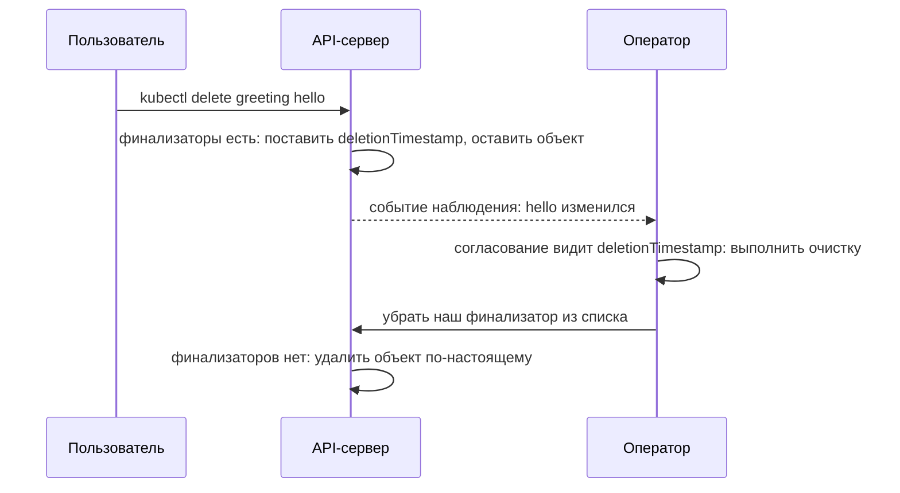

<!-- nav:top -->
[🏠 Начало](../START-HERE.md) · [← 22.27 Трек cloud native: оператор на kube-rs](27-cloud-native-track-an-operator-with-kube-rs.md) · [📋 Этап 22](README.md) · [22.29 Трек cloud native: проект и следующие шаги →](29-cloud-native-track-project-and-next-steps.md) · [📖 Глоссарий](../GLOSSARY.md) · [🇬🇧 English](../../en/22-specializations/28-cloud-native-track-testing-and-running-operators.md) <!-- nav -->

# Урок 22.28 — Трек cloud native: тестирование и запуск операторов

> **Этап 22 — Специализации** · Урок 28 из 30 · ⏱ около 3 часов (2 занятия)

## Что вы узнаете

- Что такое финализатор, когда ссылок на владельца недостаточно и как помощник `finalizer` из kube-runtime выполняет
  ваш код очистки до того, как объект исчезнет.
- Как тестировать оператор на двух уровнях: быстрые модульные тесты чистых функций и сквозные тесты на кластере kind.
- Как упаковать оператор в маленький образ контейнера и загрузить его в kind.
- Как RBAC (Role-Based Access Control, управление доступом на основе ролей) даёт оператору ровно те права, которые
  ему нужны, и как выглядит недостающее право.
- Как запустить оператор как Deployment и читать его логи.

## Перед началом

- Вы прошли [Урок 22.27 — Трек cloud native: оператор на kube-rs](27-cloud-native-track-an-operator-with-kube-rs.md),
  включая Упражнение 2 (модульные тесты в `src/lib.rs`). Этот урок продолжается в `code/p22-greeter-operator`.
- Кластер kind `course-22-operators` работает, сгенерированный CRD применён.
- Вы знаете многоэтапные Dockerfile ([Урок 11.13 — Dockerfile для программ на Rust](../11-linux-shell-and-containers/13-dockerfiles-for-rust.md)),
  Deployment ([Урок 21.4](../21-cloud-native-infrastructure/04-deploying-a-rust-service-to-kubernetes.md)) и
  интеграционные тесты в `tests/` ([Урок 05.6](../05-rust-intermediate/06-testing-in-depth.md)).

## Новые слова

| Слово | Значение |
|---|---|
| **финализатор** (finalizer) | Строка в списке `metadata.finalizers` объекта. Пока список не пуст, API-сервер не удаляет объект: он только помечает его на удаление и ждёт. |
| **`deletionTimestamp`** | Поле, которое API-сервер ставит, когда кто-то удаляет объект, у которого ещё есть финализаторы. С этого момента объект *завершается* (terminating): он существует, но уже на выходе. |
| **очистка** (cleanup) | Работа, которую оператор выполняет для завершающегося объекта перед тем, как снять финализатор, например удаление чего-то за пределами пространства имён объекта. |
| **e2e-тест** (end-to-end test, сквозной тест) | Тест, который проверяет всю систему так, как ею пользуется пользователь: здесь — создать Greeting в настоящем кластере и проверить, что сделал работающий оператор. |
| **RBAC** (Role-Based Access Control, управление доступом на основе ролей) | Система прав Kubernetes: *роли* перечисляют разрешённые действия, *привязки* выдают роль пользователю или программе. |
| **ServiceAccount** | Учётная запись для программ, работающих в подах. Под оператора работает от имени ServiceAccount `greeter-operator`. |
| **ClusterRole / ClusterRoleBinding** | Роль, правила которой действуют во всех пространствах имён / объект, который выдаёт такую роль субъекту (здесь — ServiceAccount). `Role` и `RoleBinding` — то же самое для одного пространства имён. |
| **глагол** (verb) | Действие в правиле RBAC: `get`, `list`, `watch`, `create`, `patch`, `update`, `delete`. |
| **distroless-образ** (distroless image) | Образ контейнера только с теми файлами, которые нужны программе для работы (без оболочки, без менеджера пакетов). Меньше файлов — меньше того, что можно атаковать. |
| **CRD** (CustomResourceDefinition, определение пользовательского ресурса) | Объект, который добавляет тип `Greeting` в API (Урок 22.26). |

## 1. Когда ссылок на владельца недостаточно

Ссылки на владельца (Урок 22.27) убирают дочерние объекты в **том же пространстве имён**. Настоящие операторы трогают
и то, до чего ссылка на владельца не дотянется: запись DNS (Domain Name System, система доменных имён) у провайдера,
пользователя базы данных, бакет или объект в другом пространстве имён. У нашего оператора появится такая вещь: общая
**гостевая книга** (guestbook) — одна ConfigMap в пространстве имён `greeter-system`, с одной записью на каждый Greeting:

```text
ConfigMap greeter-system/guestbook
  data:
    default.hello: Hello from a custom resource     ← записывается, когда появляется Greeting
    demo.hi:       Hi                              ← должна исчезнуть, когда этот Greeting удалят
```

Гостевой книгой никто не владеет, и она в другом пространстве имён, поэтому сборщик мусора никогда не удалит запись.
Это должен сделать оператор, причём **до того**, как Greeting исчезнет, потому что потом он уже не знает, что
Greeting существовал. Это и есть работа финализатора.

Создайте пространство имён и пустую гостевую книгу. Сохраните как `k8s/guestbook.yaml`:

```yaml
apiVersion: v1
kind: Namespace
metadata:
  name: greeter-system
---
apiVersion: v1
kind: ConfigMap
metadata:
  name: guestbook
  namespace: greeter-system
data: {}
```

```bash
kubectl apply -f k8s/guestbook.yaml
```

```text
namespace/greeter-system created
configmap/guestbook created
```

## 2. Финализаторы

Финализатор превращает удаление в процесс из двух шагов:



Ещё до всего этого, когда оператор впервые увидел Greeting, он **добавил** к объекту свой финализатор
`course.example.com/guestbook`. Удаление в два шага получает только объект, на котором этот финализатор есть.

Делать это вручную непросто (что, если очистка упадёт на полпути? что, если финализатор ещё не добавлен?), поэтому в
kube-runtime есть помощник `kube::runtime::finalizer`. Вы даёте ему две ветки: `Event::Apply` («объект существует,
приведи мир в соответствие») и `Event::Cleanup` («объект завершается, отмени свои побочные эффекты»). Помощник сам
добавляет и снимает финализатор и снимает его только после того, как ваша очистка вернула `Ok`.

Добавьте в `src/lib.rs`, прямо над `config_map_name`, константы гостевой книги и функцию ключа:

```rust
/// The finalizer this operator puts on every Greeting.
pub const FINALIZER: &str = "course.example.com/guestbook";
/// Where the shared guestbook ConfigMap lives.
pub const GUESTBOOK_NAMESPACE: &str = "greeter-system";
pub const GUESTBOOK: &str = "guestbook";

/// The key of a Greeting in the guestbook, for example `default.hello`.
pub fn guestbook_key(greeting: &Greeting) -> String {
    let ns = greeting.namespace().unwrap_or_default();
    format!("{ns}.{}", greeting.name_any())
}
```

Теперь `src/main.rs`. Меняются импорты, тип ошибки и `reconcile`:

```rust
use std::sync::Arc;
use std::time::Duration;

use futures::StreamExt;
use k8s_openapi::api::core::v1::ConfigMap;
use kube::api::{Patch, PatchParams};
use kube::runtime::controller::Action;
use kube::runtime::finalizer::{Event, finalizer};
use kube::runtime::{Controller, watcher};
use kube::{Api, Client, ResourceExt};
use p22_greeter_operator::{
    FINALIZER, GUESTBOOK, GUESTBOOK_NAMESPACE, Greeting, GreetingStatus, desired_config_map,
    guestbook_key,
};
use serde_json::json;

/// The name we sign our changes with (the "field manager").
const MANAGER: &str = "greeter-operator";

#[derive(Debug, thiserror::Error)]
enum Error {
    #[error("Kubernetes API error: {0}")]
    Kube(#[from] kube::Error),
    #[error("finalizer error: {0}")]
    Finalizer(#[source] Box<kube::runtime::finalizer::Error<Error>>),
}

/// Things every reconcile call needs.
struct Context {
    client: Client,
}

async fn reconcile(greeting: Arc<Greeting>, ctx: Arc<Context>) -> Result<Action, Error> {
    let ns = greeting
        .namespace()
        .unwrap_or_else(|| "default".to_string());
    let greetings: Api<Greeting> = Api::namespaced(ctx.client.clone(), &ns);
    finalizer(&greetings, FINALIZER, greeting, |event| async {
        match event {
            Event::Apply(greeting) => apply(&greeting, &ctx).await,
            Event::Cleanup(greeting) => cleanup(&greeting, &ctx).await,
        }
    })
    .await
    .map_err(|error| Error::Finalizer(Box::new(error)))
}
```

**Что происходит:**

1. `reconcile` теперь тонкая обёртка. Она вызывает `finalizer(&api, name, object, closure)`. Замыкание получает
   `Event` и отправляет `Apply` в `apply`, а `Cleanup` — в `cleanup`.
2. Помощник может упасть по своим причинам (например, на патче, который добавляет финализатор), поэтому он возвращает
   `finalizer::Error<Error>`, который оборачивает *нашу* ошибку. Мы храним её в новом варианте `Error::Finalizer`.
   Она лежит в `Box`, потому что перечисление не может содержать само себя напрямую: без `Box` размер типа был бы
   бесконечным.
3. `#[source]` (вместо `#[from]`) говорит `thiserror`, что это причина ошибки, но не генерирует преобразование `From`;
   мы преобразуем явно через `map_err`.

Старое тело `reconcile` переезжает в `apply`, плюс один новый шаг, а `cleanup` — новая функция:

```rust
/// The Greeting exists: make the world match it.
async fn apply(greeting: &Greeting, ctx: &Context) -> Result<Action, Error> {
    let ns = greeting
        .namespace()
        .unwrap_or_else(|| "default".to_string());
    let name = greeting.name_any();
    println!("apply {ns}/{name}");

    let cm = desired_config_map(greeting);
    let cm_name = cm.name_any();
    let config_maps: Api<ConfigMap> = Api::namespaced(ctx.client.clone(), &ns);
    let params = PatchParams::apply(MANAGER).force();
    config_maps
        .patch(&cm_name, &params, &Patch::Apply(&cm))
        .await?;

    let book: Api<ConfigMap> = Api::namespaced(ctx.client.clone(), GUESTBOOK_NAMESPACE);
    let entry = json!({ "data": { guestbook_key(greeting): greeting.spec.message } });
    book.patch(GUESTBOOK, &PatchParams::default(), &Patch::Merge(&entry))
        .await?;

    let greetings: Api<Greeting> = Api::namespaced(ctx.client.clone(), &ns);
    let status = GreetingStatus {
        config_map: Some(cm_name),
    };
    let patch = json!({ "status": status });
    greetings
        .patch_status(&name, &PatchParams::default(), &Patch::Merge(&patch))
        .await?;

    Ok(Action::requeue(Duration::from_secs(300)))
}

/// The Greeting is being deleted: undo what owner references cannot undo.
async fn cleanup(greeting: &Greeting, ctx: &Context) -> Result<Action, Error> {
    println!("cleanup {}", guestbook_key(greeting));
    let book: Api<ConfigMap> = Api::namespaced(ctx.client.clone(), GUESTBOOK_NAMESPACE);
    let remove = json!({ "data": { guestbook_key(greeting): null } });
    book.patch(GUESTBOOK, &PatchParams::default(), &Patch::Merge(&remove))
        .await?;
    Ok(Action::await_change())
}
```

**Что происходит:**

1. `apply` делает то же, что `reconcile` в Уроке 22.27, и ещё записывает запись в гостевую книгу через merge patch:
   `{"data": {"default.hello": "Hello from a custom resource"}}`. Merge patch трогает только названные ключи, поэтому
   записи других Greeting остаются.
2. `cleanup` отправляет `{"data": {"default.hello": null}}`. В merge patch `null` означает «удалить этот ключ».
3. `cleanup` возвращает `Action::await_change()`: ставить в очередь нечего, объект вот-вот исчезнет.
4. Если патч гостевой книги не удался, `cleanup` возвращает `Err`, помощник оставляет финализатор, `error_policy`
   просит повторить через пять секунд, и Greeting остаётся завершающимся, пока очистка не пройдёт. Ничего не теряется.

`Context`, `error_policy` и `main` остаются точно такими же, как в Уроке 22.27.

> 🔒 **Безопасность:** очистка тоже должна быть идемпотентной. Если оператор упадёт после очистки, но до снятия
> финализатора, очистка выполнится снова. Удалить уже отсутствующий ключ — нормально; «упасть, если не найдено»
> навсегда заблокировало бы удаление.

## 3. Финализатор в работе

Запустите оператор (`cargo run`) и примените Greeting:

```bash
kubectl apply -f k8s/hello.yaml
kubectl get configmap guestbook -n greeter-system -o jsonpath='{.data}'; echo
kubectl get greeting hello -o jsonpath='{.metadata.finalizers}'; echo
```

```text
greeting.course.example.com/hello created
{"default.hello":"Hello from a custom resource"}
["course.example.com/guestbook"]
```

Запись есть в гостевой книге, финализатор — на Greeting. Теперь **остановите оператор** (Ctrl+C) и удалите Greeting.
`--wait=false` говорит kubectl не ждать завершения удаления:

```bash
kubectl delete greeting hello --wait=false
kubectl get greetings
kubectl get greeting hello -o jsonpath='{.metadata.deletionTimestamp}'; echo
```

```text
greeting.course.example.com "hello" deleted from default namespace
NAME    MESSAGE
hello   Hello from a custom resource
2026-11-18T08:10:55Z
```

kubectl пишет «deleted», но Greeting всё ещё на месте, с `deletionTimestamp`: он завершается и ждёт своего
финализатора. Снова запустите оператор и посмотрите ещё раз:

```bash
kubectl get greetings
kubectl get configmap guestbook -n greeter-system -o jsonpath='{.data}'; echo
```

```text
No resources found in default namespace.

```

Greeting исчез, а гостевая книга пуста (пустая строка). Логи двух запусков:

```text
greeter-operator started
done: hello
apply default/hello
done: hello
apply default/hello
done: hello
greeter-operator stopped
```

```text
greeter-operator started
cleanup default.hello
done: hello
controller error: tried to reconcile object Greeting.v1.course.example.com/hello.default that was not found in local store
greeter-operator stopped
```

**Что происходит:**

1. В первом запуске у самого первого `done: hello` нет строки `apply`: в этом согласовании помощник только **добавил
   финализатор** и остановился. Добавление изменило Greeting, это запустило следующее согласование, и уже оно
   выполнило `apply`.
2. Во втором запуске оператор при старте нашёл завершающийся Greeting, выполнил `cleanup`, и помощник снял
   финализатор. Это работает, потому что согласование срабатывает по уровню: оператор не видел *события* удаления (он
   не работал), он видел только *состояние*.
3. Последняя строка `controller error` — та самая безвредная из Урока 22.27.

## 4. Тестирование оператора

Используйте пирамиду тестов из [Урока 09.1](../09-testing-debugging-benchmarking/01-the-test-pyramid.md):

| Уровень | Что проверяет | Что нужно | Скорость |
|---|---|---|---|
| модульные тесты в `src/lib.rs` | `desired_config_map`, `guestbook_key`: чистую логику «что должно существовать» | ничего | миллисекунды |
| e2e-тесты в `tests/` | весь оператор против настоящего API-сервера | кластер kind с CRD, гостевой книгой и работающим оператором | секунды |

Модульные тесты вы написали в Уроке 22.27. Есть и средний уровень: kube-rs может тестировать `reconcile` против
поддельного API-сервера, построенного на крейте `tower-test`, где каждый тест расписывает запросы и ответы. Это точно,
но долго писать; такой подход показан в руководстве kube.rs по тестированию (см. «Источники»).

E2e-тест — обычный интеграционный тест, который общается с кластером через ваш kubeconfig. Поскольку ему нужен
кластер, он помечен `#[ignore]`, и обычный `cargo test` (и ваш CI, непрерывная интеграция, из Урока 09.12) его
пропускает. Создайте `tests/e2e.rs`:

```rust
//! End-to-end test: needs a cluster with the CRD, the guestbook and a running operator.
//! Run it with `cargo test --test e2e -- --ignored`.
use std::time::Duration;

use k8s_openapi::api::core::v1::ConfigMap;
use kube::api::{DeleteParams, PostParams};
use kube::runtime::wait::{await_condition, conditions};
use kube::{Api, Client, ResourceExt};
use p22_greeter_operator::{Greeting, GreetingSpec};
use tokio::time::timeout;

const WAIT: Duration = Duration::from_secs(20);

#[tokio::test]
#[ignore = "needs a kind cluster with the operator running"]
async fn greeting_gets_a_config_map_and_is_cleaned_up() {
    let client = Client::try_default().await.expect("a kubeconfig");
    let greetings: Api<Greeting> = Api::namespaced(client.clone(), "default");
    let config_maps: Api<ConfigMap> = Api::namespaced(client.clone(), "default");

    // 1. Create a Greeting, as a user would.
    let spec = GreetingSpec {
        message: "testing".to_string(),
        shout: true,
    };
    let greeting = Greeting::new("e2e-test", spec);
    let created = greetings
        .create(&PostParams::default(), &greeting)
        .await
        .expect("create the Greeting");

    // 2. Wait until the operator made the ConfigMap.
    let has_cm = |cm: Option<&ConfigMap>| cm.is_some();
    let cm = timeout(
        WAIT,
        await_condition(config_maps, "e2e-test-greeting", has_cm),
    )
    .await
    .expect("the ConfigMap appears in time")
    .expect("the watch works")
    .expect("the ConfigMap exists");
    assert_eq!(cm.data.unwrap()["message"], "TESTING");

    // 3. Delete the Greeting and wait until it is really gone (finalizer done).
    greetings
        .delete("e2e-test", &DeleteParams::default())
        .await
        .expect("delete the Greeting");
    let uid = created.uid().expect("the API server set a uid");
    timeout(
        WAIT,
        await_condition(greetings, "e2e-test", conditions::is_deleted(&uid)),
    )
    .await
    .expect("the Greeting is deleted in time")
    .expect("the watch works");
}
```

**Что происходит:**

1. Тест создаёт Greeting через `Api::create` — ровно как это сделал бы `kubectl apply` пользователя.
2. `await_condition(api, name, condition)` из `kube::runtime::wait` наблюдает за одним объектом, пока условие не станет
   истинным. Наше условие — замыкание «ConfigMap существует». Возвращается `Result<Option<ConfigMap>, _>`, отсюда три
   вызова `expect`: успели вовремя, наблюдение сработало, объект есть.
3. `tokio::time::timeout` сдаётся через 20 секунд, поэтому сломанный оператор приводит к падению теста, а не к зависанию.
4. После удаления `conditions::is_deleted(&uid)` ждёт, пока исчезнет именно этот объект. Это доказывает, что
   финализатор снят, а значит, очистка выполнилась.
5. Имя `e2e-test` фиксировано. Если тест упадёт посередине, удалите оставшийся Greeting вручную перед следующим запуском.

Для `#[tokio::test]` нужна фича `macros` у `tokio`; она у вас уже есть. Запустите обычные тесты, затем (при
работающем операторе) e2e-тест:

```bash
cargo test
cargo test --test e2e -- --ignored
```

```text
running 1 test
test greeting_gets_a_config_map_and_is_cleaned_up ... ignored, needs a kind cluster with the operator running

test result: ok. 0 passed; 0 failed; 1 ignored; 0 measured; 0 filtered out; finished in 0.00s
```

```text
running 1 test
test greeting_gets_a_config_map_and_is_cleaned_up ... ok

test result: ok. 1 passed; 0 failed; 0 ignored; 0 measured; 0 filtered out; finished in 0.08s
```

(Первая команда печатает ещё результаты модульных тестов и пустых тестовых целей; показана только e2e-часть.)

> 🧪 **Тестирование:** в CI e2e-задание создаёт кластер kind, применяет CRD, запускает оператор и выполняет
> `cargo test -- --ignored`, а затем удаляет кластер. kind создан как раз для этого.

## 5. Запуск внутри кластера

На Mac оператор использовал *ваш* kubeconfig с вашими полными правами администратора. В кластере он работает в поде,
от имени ServiceAccount, только с теми правами, которые вы ему дадите. Нужны четыре части.

**1. Образ.** Создайте `Dockerfile` (многоэтапный шаблон из Урока 11.13) и `.dockerignore` со строками `target/` и
`*.log`, чтобы контекст сборки оставался маленьким:

```dockerfile
# Stage 1: build the operator with the full Rust toolchain.
FROM rust:1.100 AS build
WORKDIR /src
COPY . .
RUN cargo build --release --bin p22-greeter-operator

# Stage 2: a tiny runtime image with only the binary, running as a non-root user.
FROM gcr.io/distroless/cc-debian13:nonroot
COPY --from=build /src/target/release/p22-greeter-operator /greeter-operator
ENTRYPOINT ["/greeter-operator"]
```

```bash
docker build -t course-greeter-operator:0.1.0 .
docker image ls course-greeter-operator
```

```text
IMAGE                           ID             DISK USAGE   CONTENT SIZE   EXTRA
course-greeter-operator:0.1.0   012ebd452cc1       69.5MB         15.2MB
```

При скачивании образ занимает 15,2 МБ: бинарник плюс минимальная база Debian. Первая сборка занимает несколько минут.

**2. Загрузите его в kind.** Узел kind не видит ваши образы Docker; скопируйте образ в него:

```bash
kind load docker-image course-greeter-operator:0.1.0 --name course-22-operators
```

```text
Image: "course-greeter-operator:0.1.0" with ID "sha256:012ebd452cc1354e883f1f982c54006bb5ed3bf9d9a213cfea8fafbd2fa43af4" not yet present on node "course-22-operators-control-plane", loading...
```

**3. RBAC и 4. Deployment.** Напишите `k8s/operator.yaml`:

```yaml
apiVersion: v1
kind: ServiceAccount
metadata:
  name: greeter-operator
  namespace: greeter-system
---
apiVersion: rbac.authorization.k8s.io/v1
kind: ClusterRole
metadata:
  name: greeter-operator
rules:
  - apiGroups: ["course.example.com"]
    resources: ["greetings"]
    verbs: ["get", "list", "watch", "patch"]
  - apiGroups: ["course.example.com"]
    resources: ["greetings/status"]
    verbs: ["get", "patch"]
  - apiGroups: [""]
    resources: ["configmaps"]
    verbs: ["get", "list", "watch", "create", "patch"]
---
apiVersion: rbac.authorization.k8s.io/v1
kind: ClusterRoleBinding
metadata:
  name: greeter-operator
roleRef:
  apiGroup: rbac.authorization.k8s.io
  kind: ClusterRole
  name: greeter-operator
subjects:
  - kind: ServiceAccount
    name: greeter-operator
    namespace: greeter-system
---
apiVersion: apps/v1
kind: Deployment
metadata:
  name: greeter-operator
  namespace: greeter-system
spec:
  replicas: 1
  selector:
    matchLabels:
      app: greeter-operator
  template:
    metadata:
      labels:
        app: greeter-operator
    spec:
      serviceAccountName: greeter-operator
      containers:
        - name: operator
          image: course-greeter-operator:0.1.0
          imagePullPolicy: IfNotPresent
          resources:
            requests:
              cpu: 10m
              memory: 32Mi
            limits:
              memory: 128Mi
          securityContext:
            allowPrivilegeEscalation: false
            readOnlyRootFilesystem: true
            runAsNonRoot: true
            capabilities:
              drop: ["ALL"]
```

**Что происходит:**

1. `ServiceAccount` — учётная запись оператора. Под использует её через `serviceAccountName`, а
   `Client::try_default()` внутри пода находит её токен автоматически.
2. `ClusterRole` перечисляет то, что делает код: наблюдать и патчить Greeting (патчем добавляется и снимается
   финализатор), патчить их статус, читать, создавать и патчить ConfigMap. Больше ничего: ни `delete`, ни Secret.
3. `ClusterRoleBinding` выдаёт эту роль ServiceAccount во всех пространствах имён (наш оператор наблюдает за всеми).
4. Deployment запускает одну реплику. `imagePullPolicy: IfNotPresent` использует загруженный вами образ вместо попытки
   его скачать. `securityContext` укрепляет контейнер: без root, без повышения привилегий, файловая система только
   для чтения, без capabilities Linux.

> 🔒 **Безопасность:** принцип наименьших привилегий. Оператор часто месяцами работает с токеном, который может менять
> кластер. Давайте ему только те глаголы, которые он использует. Оператор, ограниченный одним пространством имён
> (Упражнение 3 Урока 22.27), может использовать вместо этого `Role` и `RoleBinding` и вообще не иметь прав за пределами
> своего пространства имён.

Примените, дождитесь развёртывания и попробуйте:

```bash
kubectl apply -f k8s/operator.yaml
kubectl rollout status deployment/greeter-operator -n greeter-system
kubectl apply -f k8s/hello.yaml
kubectl get configmaps
kubectl logs deployment/greeter-operator -n greeter-system
```

```text
serviceaccount/greeter-operator created
clusterrole.rbac.authorization.k8s.io/greeter-operator created
clusterrolebinding.rbac.authorization.k8s.io/greeter-operator created
deployment.apps/greeter-operator created
Waiting for deployment "greeter-operator" rollout to finish: 0 of 1 updated replicas are available...
deployment "greeter-operator" successfully rolled out
greeting.course.example.com/hello created
NAME               DATA   AGE
hello-greeting     1      3s
kube-root-ca.crt   1      39m
greeter-operator started
done: hello
apply default/hello
done: hello
apply default/hello
done: hello
```

Теперь оператор живёт в кластере. E2e-тест из раздела 4 проходит и против него; `cargo run` не нужен.

⚡ **Производительность:** под запрашивает 10 милли-ядер (1/100 ядра) CPU (Central Processing Unit, центральный
процессор) и 32 МиБ (MiB, мебибайта, 1 МиБ = 1024 × 1024 байт) памяти, с лимитом 128 МиБ. Маленький оператор на Rust в покое
потребляет гораздо меньше; измерьте это через Prometheus из Урока 21.9, прежде чем менять числа.

## Частые ошибки

> ⚠️ **Частая ошибка: недостающий глагол RBAC.** Если ClusterRole разрешает для ConfigMap только
> `["get", "list", "watch", "create"]`, server-side apply (это *patch*) отклоняется. Лог (сокращён) точно говорит,
> чего не хватает:
>
> ```text
> reconcile of hello failed: finalizer error: failed to apply object: Kubernetes API error: ApiError: configmaps "hello-greeting" is forbidden: User "system:serviceaccount:greeter-system:greeter-operator" cannot patch resource "configmaps" in API group "" in the namespace "default": Forbidden
> ```
>
> Проверяйте права, а не гадайте: `kubectl auth can-i patch configmaps --as=system:serviceaccount:greeter-system:greeter-operator -n default`
> выводит `no` или `yes`. Когда вы исправите роль, политика ошибок повторит попытку, и она пройдёт сама.

> ⚠️ **Частая ошибка: удалить оператор, пока остались финализаторы.** Если оператор масштабирован до нуля, удаление
> Greeting никогда не завершается:
>
> ```text
> greeting.course.example.com "hello" deleted from default namespace
> error: timed out waiting for the condition on greetings/hello
> ```
>
> (это была команда `kubectl delete greeting hello --timeout=5s`). Снова запустите оператор, и удаление завершится.
> Когда удаляете оператор насовсем, **сначала** удалите его пользовательские ресурсы, пока он ещё работает.

> ⚠️ **Частая ошибка: «чинить» зависший объект, удаляя его финализатор вручную.**
> `kubectl patch greeting hello --type merge -p '{"metadata":{"finalizers":null}}'` заставляет объект исчезнуть, но
> очистка так и не выполняется: запись в гостевой книге (или настоящий облачный ресурс) остаётся. Делайте так, только
> если прибрались сами.

## Попробуйте сами

Повторите раздел 3 с оператором, работающим **в кластере**: масштабируйте его до нуля
(`kubectl scale deployment greeter-operator -n greeter-system --replicas=0`), удалите Greeting с `--wait=false`,
найдите `deletionTimestamp` и `finalizers` в `kubectl get greeting hello -o yaml`, верните одну реплику и выполните
`kubectl wait --for=delete greeting/hello --timeout=60s`. Команда выведет `greeting.course.example.com/hello condition met`,
когда очистка закончится. Проверьте, что гостевая книга снова пуста.

## Упражнения

### Упражнение 1 — Тест без своего оператора (легко)

Остановите оператор (`kubectl scale deployment greeter-operator -n greeter-system --replicas=0`) и выполните
`cargo test --test e2e -- --ignored`. Что произойдёт, через сколько времени и что останется в кластере?

<details>
<summary>Подсказка</summary>

Посмотрите, какое сообщение `expect` появится в панике. Тест создаёт Greeting до того, как начинает ждать.

</details>

<details>
<summary>Ответ</summary>

```text
thread 'greeting_gets_a_config_map_and_is_cleaned_up' (6174086) panicked at tests/e2e.rs:39:6:
the ConfigMap appears in time: Elapsed(())
…
test result: FAILED. 0 passed; 1 failed; 0 ignored; 0 measured; 0 filtered out; finished in 20.08s
```

Через 20 секунд `timeout` возвращает `Elapsed`, и первый `expect` паникует со своим сообщением. Greeting `e2e-test`
остаётся в кластере; удалите его командой `kubectl delete greeting e2e-test`. Он удаляется сразу, потому что ни один
оператор не добавлял ему финализатор. (Число после имени потока — идентификатор потока; у вас он другой.)

Почему это работает: тайм-аут превращает «оператор ничего не делает» в понятное падение с читаемым сообщением вместо
теста, который висит вечно.

</details>

### Упражнение 2 — Тест ключа гостевой книги (средне)

Добавьте в модуль `tests` в `src/lib.rs` модульный тест `guestbook_key_is_namespace_dot_name`: для Greeting `hello` в
пространстве имён `default` ключ должен быть `default.hello`. Запустите `cargo test --lib`.

<details>
<summary>Подсказка</summary>

Используйте вспомогательную функцию `greeting(message, shout)` из Упражнения 2 Урока 22.27: она уже задаёт
пространство имён.

</details>

<details>
<summary>Ответ</summary>

```rust
    #[test]
    fn guestbook_key_is_namespace_dot_name() {
        assert_eq!(guestbook_key(&greeting("Hi", false)), "default.hello");
    }
```

Теперь `cargo test --lib` сообщает `test result: ok. 4 passed`.

Почему это работает: ключ — это контракт между `apply` и `cleanup`. Если бы он когда-нибудь изменился между
версиями, очистка удаляла бы не тот ключ. Однострочный тест его закрепляет.

</details>

### Упражнение 3 — Наименьшие привилегии (сложно)

ClusterRole в `k8s/operator.yaml` всё ещё разрешает несколько глаголов, которые код никогда не использует. Найдите их,
читая `src/main.rs`, уберите, примените роль, перезапустите оператор командой
`kubectl rollout restart deployment/greeter-operator -n greeter-system` и докажите обоими e2e-тестами и
`kubectl logs … | grep -i forbidden`, что ничего не сломалось. Затем уберите `create` у ConfigMap и объясните ошибку.

<details>
<summary>Подсказка</summary>

Перечислите все обращения к API в коде: наблюдения (`list` + `watch`), server-side apply и merge patch (`patch`),
помощник финализатора (JSON-патч на Greeting; JSON — JavaScript Object Notation), `patch_status`. Есть ли хоть одна строка с отдельным `get`?

</details>

<details>
<summary>Ответ</summary>

Ни одна строка нашего кода не вызывает `get`, поэтому все три глагола `get` можно убрать:

```yaml
rules:
  - apiGroups: ["course.example.com"]
    resources: ["greetings"]
    verbs: ["list", "watch", "patch"]
  - apiGroups: ["course.example.com"]
    resources: ["greetings/status"]
    verbs: ["patch"]
  - apiGroups: [""]
    resources: ["configmaps"]
    verbs: ["list", "watch", "create", "patch"]
```

С этой ролью оба e2e-теста проходят, а в логах нет `forbidden`. Без `create` новый Greeting падает (лог
сокращён):

```text
reconcile of hello failed: finalizer error: failed to apply object: Kubernetes API error: ApiError: configmaps "hello-greeting" is forbidden: User "system:serviceaccount:greeter-system:greeter-operator" cannot create resource "configmaps" in API group "" in the namespace "default": Forbidden
```

Почему это работает: server-side apply — это один запрос `patch`, но если объекта ещё нет, API-сервер его создаёт и
для этого проверяет глагол `create`. RBAC проверяет, что запрос *делает*, а не только какой у него метод. Верните
`create`, и политика ошибок исправит Greeting за несколько секунд.

</details>

## Вопросы для самопроверки

1. Почему записи в гостевой книге нужен финализатор, а `hello-greeting` — нет?

<details>
<summary>Ответ</summary>

У `hello-greeting` есть ссылка на владельца в том же пространстве имён, поэтому её удаляет сборщик мусора. Запись в
гостевой книге — часть общего объекта в другом пространстве имён, которым никто не владеет; удалить её может только
оператор, и только пока он ещё знает о Greeting.

</details>

2. Пользователь выполнил `kubectl delete greeting hello`, но Greeting всё ещё в списке. Что происходит?

<details>
<summary>Ответ</summary>

У него есть финализатор. API-сервер поставил `deletionTimestamp` и ждёт, пока список `metadata.finalizers` опустеет.
Обычно оператор не запущен или его очистка всё время падает; его логи скажут, что именно.

</details>

3. На Mac оператор работал, а в кластере пишет в лог `forbidden`. Откуда разница?

<details>
<summary>Ответ</summary>

На Mac он использовал ваш kubeconfig с правами администратора. В кластере он работает от имени своего ServiceAccount,
у которого только права его роли RBAC. Сообщение `forbidden` называет недостающий глагол и ресурс.

</details>

4. Почему `cleanup` должна быть идемпотентной?

<details>
<summary>Ответ</summary>

Она может выполниться больше одного раза: оператор может упасть после очистки, но до снятия финализатора, или патч,
снимающий его, может не пройти. Второй запуск должен завершиться успешно, иначе объект останется завершающимся навсегда.

</details>

## Итоги

- **Финализаторы** откладывают удаление: API-сервер ставит `deletionTimestamp` и ждёт, пока все финализаторы не будут
  сняты. Используйте их для очистки, которую не могут сделать ссылки на владельца (другие пространства имён, внешние системы).
- Помощник `finalizer()` из kube-runtime добавляет и снимает финализатор и вызывает вашу ветку `Event::Apply` или
  `Event::Cleanup`; финализатор снимается только после успешной очистки. Очистка должна быть идемпотентной.
- Чистую логику тестируйте модульными тестами; работающий оператор — e2e-тестами с `#[ignore]`, которые используют
  `Api`, `await_condition` и тайм-аут на kind.
- В кластере оператор работает из маленького distroless-образа, от имени **ServiceAccount** с **ClusterRole** (или Role)
  по принципу наименьших привилегий; `kind load docker-image` помещает локальный образ в kind.
- Внимательно читайте ошибки `forbidden`: они называют недостающий глагол. `kubectl auth can-i … --as=system:serviceaccount:…`
  проверяет права напрямую.
- Удаляйте пользовательские ресурсы до того, как удаляете их оператор.

## Источники и что почитать

- [Kubernetes — Finalizers](https://kubernetes.io/docs/concepts/overview/working-with-objects/finalizers/) — как работает удаление с финализаторами.
- [docs.rs — kube::runtime::finalizer](https://docs.rs/kube/5.1.0/kube/runtime/finalizer/fn.finalizer.html) — помощник из этого урока и его гарантии.
- [kube.rs — Testing](https://kube.rs/controllers/testing/) — модульные, мок- и e2e-тесты для контроллеров на kube-rs.
- [kube.rs — Security](https://kube.rs/controllers/security/) — RBAC и укрепление контейнера для операторов.
- [Kubernetes — Using RBAC Authorization](https://kubernetes.io/docs/reference/access-authn-authz/rbac/) — роли, привязки и глаголы.
- [kind — Quick Start](https://kind.sigs.k8s.io/docs/user/quick-start/) — часть «Loading an Image Into Your Cluster» объясняет `kind load`.

---

[🏠 Начало](../START-HERE.md) · [← 22.27 Трек cloud native: оператор на kube-rs](27-cloud-native-track-an-operator-with-kube-rs.md) · [📋 Этап 22](README.md) · [22.29 Трек cloud native: проект и следующие шаги →](29-cloud-native-track-project-and-next-steps.md) · [📖 Глоссарий](../GLOSSARY.md) <!-- nav -->
<!-- nav:bottom -->
