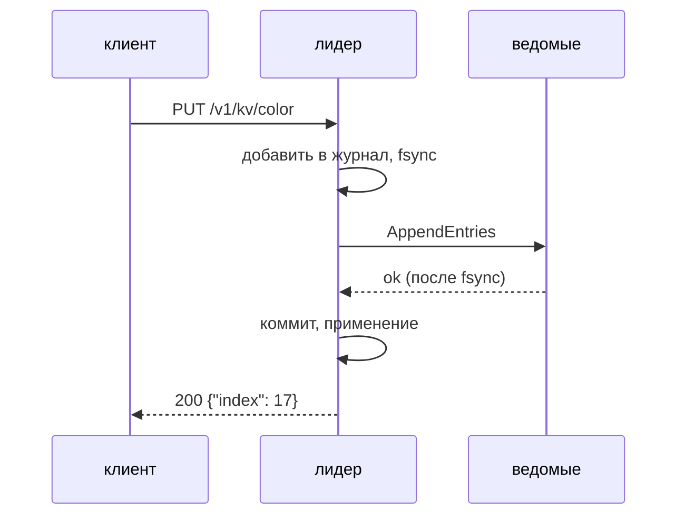

<!-- nav:top -->
[🏠 Начало](../START-HERE.md) · [← 23.8 Тестирование, бенчмарки и укрепление итогового проекта](08-testing-benchmarking-and-hardening-capstones.md) · [📋 Этап 23](README.md) · [23.10 Контрольная точка: проверка итоговых проектов →](10-checkpoint-capstone-review.md) · [📖 Глоссарий](../GLOSSARY.md) · [🇬🇧 English](../../en/23-capstone-projects/09-presenting-your-work.md) <!-- nav -->

# Урок 23.9 — Как представить свою работу

> **Этап 23 — Итоговые проекты** · Урок 9 из 10 · ⏱ около 90 минут

## Что вы узнаете

- Кто смотрит на итоговый проект, в каком порядке и как долго и что каждый из них должен найти.
- Как написать README, который работает за 30 секунд и за 5 минут: со схемой, быстрым стартом, гарантиями, матрицей тестов и результатами.
- Как держать примеры в README правдивыми, запуская их как документационные тесты.
- Как написать о проекте (статью в блоге или подробное описание), провести двухминутную демонстрацию и десятиминутный доклад и отвечать на трудные вопросы.
- Как опубликовать итоговый проект: лицензия, финальная проверка на секреты и релиз с тегом.

## Перед началом

- Хотя бы один итоговый проект закончен или почти закончен: его вехи отмечены тегами, а `docs/design.md`, `docs/adr/` и `docs/results.md` существуют (Уроки [23.2](02-writing-a-design-document.md) и [23.8](08-testing-benchmarking-and-hardening-capstones.md)).
- Вы знаете документационные тесты по [Уроку 05.7 — Документация](../05-rust-intermediate/07-documentation.md), а удалённые репозитории — по [Уроку 01.8 — Удалённые репозитории: GitHub и GitLab](../01-git-and-version-control/08-remotes-github-and-gitlab.md).
- Ваш журнал работы (`docs/log.md`, Урок 23.1) — лучший источник для истории: держите его открытым.

## Новые слова

| Слово | Значение |
|---|---|
| **воронка читателей** (reader funnel) | Порядок, в котором люди смотрят на проект: большинство читает только начало README, меньше людей — весь README, немногие — проект и код. |
| **быстрый старт** (quick start) | Самый короткий список команд, который ведёт незнакомого человека от `git clone` до работающей системы. |
| **утверждение** (claim) | Предложение, которое что-то говорит о вашей системе («переживает потерю 1 из 3 узлов»). Каждое утверждение должно указывать на тест или число. |
| **подробное описание** (write-up) | Длинный текст о проекте — статья в блоге или на сайте, — который рассказывает историю: задача, ключевое решение, самая трудная ошибка, числа. |
| **демонстрация** (demo) | Короткий живой (или записанный) показ того, как система делает свою работу, обычно на две минуты. |
| **лицензия** (licence) | Юридический текст, который говорит, что другие могут делать с вашим кодом. Без него никто не может законно его переиспользовать. |
| **релиз** (release) | Названная версия проекта, отмеченная тегом (например, `v1.0.0`), на которую могут ссылаться другие. |
| **SemVer** (Semantic Versioning, семантическое версионирование) | Правило для номеров версий `MAJOR.MINOR.PATCH`: несовместимые изменения повышают MAJOR, новые возможности — MINOR, исправления — PATCH. |
| **ВМ** (виртуальная машина, VM — Virtual Machine) | Целый компьютер, имитируемый программой; Linux-ВМ курса называется `dev` (Урок 11.1). |
| **ADR** (Architecture Decision Record, запись об архитектурном решении) | Короткий файл с одним важным решением: контекст, решение, последствия (Урок 23.2). |
| **HTTP** (HyperText Transfer Protocol, протокол передачи гипертекста) | Протокол запросов и ответов веба; HTTPS — это HTTP поверх зашифрованного соединения. |
| **API** (Application Programming Interface, программный интерфейс) | Функции и типы, которые крейт или сервис предлагает другому коду. |

## 1. Кто смотрит и что им нужно

Итоговый проект читают люди с очень разным количеством времени. Планируйте для всех:

```text
 30 seconds   most visitors   README top: what is it, one diagram, is it serious?
  5 minutes   interested      whole README: quick start, guarantees, tests, results
 30 minutes   reviewers       design document, ADRs, a few source files, CI
 60 minutes   interviewers    a conversation: "why this way?", "what if X fails?"
```

Каждый уровень должен работать **без** следующего. Посетитель, который прочитал только первый экран, всё равно должен понять, что вы построили и что это настоящая работа. Интервьюер, который ничего не читал, всё равно должен понять ваше десятиминутное объяснение.

> 💡 **Совет:** дайте свой README человеку, который не видел проект, и через 30 секунд спросите: «что он делает и откуда известно, что это работает?». Если он не может ответить на оба вопроса, начало README нужно доработать.

## 2. README

README — это первая страница. Используйте фиксированную структуру в таком порядке:

```markdown
# kvd — a Raft-replicated key-value store

A key-value store on three nodes that keeps every acknowledged write when any
one node crashes or is cut off. Linearizable reads with read index, idempotent
writes, snapshots. Built in Rust as a learning capstone.

(diagram: the architecture from docs/design.md, 10-15 lines)

## Quick start
    docker compose up -d
    cargo run -p kv -- put color blue
    cargo run -p kv -- get color

## Guarantees and non-goals
- Linearizable reads and writes; tolerates the failure of 1 of 3 nodes.
- Not: transactions over several keys, sharding, authentication.

## How it works          (one paragraph per part, links to docs/design.md and ADRs)
## How it is tested      (the test matrix of Lesson 23.8, with links to the tests)
## Results               (the main table of docs/results.md, with the setup in one line)
## Limits and next steps (what is missing, what you would do with two more months)
## Licence
```

Правила, которые решают всё:

1. **Первый абзац говорит, что это, что оно гарантирует и что это учебный проект.** Честно указанный контекст — это сила: рецензент тогда оценивает инженерную работу, а не отсутствующий маркетинг.
2. **Быстрый старт действительно работает** из свежего клона на машине, которая не ваша. Проверьте его в чистом контейнере или в ВМ `dev`.
3. **Каждое утверждение указывает на доказательство.** «Переживает отказ 1 из 3 узлов» ссылается на тест симуляцией и говорит, для скольких начальных значений (seed) он прошёл. Утверждение без доказательства удаляется.
4. **Числа идут со своими условиями** (Урок 23.8): частота, оборудование и ссылка на полный `docs/results.md`.
5. **Ограничения называете вы сами,** раньше, чем их найдёт рецензент.

Схемы, которые меняются, пока вы работаете, проще держать правильными в виде текста. GitHub и GitLab рисуют диаграммы Mermaid в Markdown, поэтому диаграмма последовательности самой важной операции может жить в README:



## 3. Примеры, которые не могут врать

Пример в README, который больше не компилируется, хуже, чем отсутствие примера: он говорит читателю, что всему остальному в README тоже нельзя доверять. Rust умеет запускать блоки кода из README как **документационные тесты**. Попробуйте на маленькой библиотеке:

```bash
cd ~/projects/rust
cargo new --lib code/p23-present
cd code/p23-present
```

`README.md`:

````markdown
# p23-present

`split_pair` splits a `key=value` pair into its two halves.

```rust
use p23_present::split_pair;

assert_eq!(split_pair("level=info"), Some(("level", "info")));
assert_eq!(split_pair("no pair here"), None);
```
````

`src/lib.rs`:

```rust
#![doc = include_str!("../README.md")]

/// Splits `key=value` at the first `=`.
pub fn split_pair(text: &str) -> Option<(&str, &str)> {
    text.split_once('=')
}
```

**Что происходит:**

1. `include_str!("../README.md")` вставляет текст README в программу во время компиляции как строку. Путь — относительно `src/lib.rs`.
2. `#![doc = …]` (с `!`, поэтому относится ко всему крейту) делает этот текст документацией крейта. README становится первой страницей `cargo doc`.
3. Каждый блок кода `rust` в документации — документационный тест (Урок 05.7). Поэтому `cargo test` теперь компилирует и запускает пример из README на настоящем крейте.

```bash
cargo test --doc
```

```text
   Doc-tests p23_present

running 1 test
test src/../README.md - (line 5) ... ok

test result: ok. 1 passed; 0 failed; 0 ignored; 0 measured; 0 filtered out; finished in 0.00s
```

Теперь переименуйте `split_pair` в `parse_pair` в `src/lib.rs` и забудьте про README — та самая ошибка, из-за которой README врут. Тест её ловит:

```text
---- src/../README.md - (line 5) stdout ----
error[E0432]: unresolved import `p23_present::split_pair`
 --> src/../README.md:7:5
  |
7 | use p23_present::split_pair;
  |     ^^^^^^^^^^^^^----------
  |                  |
  |                  no `split_pair` in the root
```

Верните имя. В рабочем пространстве поместите строку `#![doc = include_str!(…)]` в тот крейт, API которого показывает README (например, клиентскую библиотеку), а для примеров, которым нужен работающий сервер, используйте ` ```rust,no_run `: они компилируются, поэтому остаются правильными, но не выполняются.

> ⚠️ **Частая ошибка:** блок кода без языка (просто три обратных апострофа) rustdoc считает кодом на **Rust**. Быстрый старт с командами оболочки в таком блоке становится падающим документационным тестом — `expected one of '!' or '::', found 'run'` для `cargo run --release`. Всегда указывайте язык блока: ` ```bash `, ` ```text `, ` ```toml `.

## 4. Как писать о проекте

Подробное описание (статья в блоге, статья на вашем сайте или длинный `docs/story.md`) доходит до людей, до которых не доходит README. Это ещё и лучшая подготовка к собеседованиям, потому что письмо заставляет выстроить историю. Проверенная форма, 1 500–2 500 слов:

1. **Задача** (один абзац): что делает система и почему это трудно.
2. **Архитектура на одной картинке** с двумя-тремя решениями, которые определили всё остальное (из ваших ADR).
3. **Самое интересное решение**, объяснённое с альтернативами и компромиссами.
4. **Самая трудная ошибка**: как она проявилась, как вы её нашли (начальное значение симуляции, флеймграф, падение фаззера), чему она научила. Она есть в вашем журнале работы.
5. **Числа** с условиями и тем, что их ограничивает.
6. **Что бы вы сделали дальше** и чему научились.

Пишите для читателя, который умеет программировать, но не знает вашего проекта. Показывайте маленькие фрагменты кода, только когда они несут идею. И оставайтесь честными: «я понял, как работает read index, сначала сделав его неправильно» интереснее — и вызывает больше доверия, — чем «я реализовал слой консенсуса уровня продакшена».

## 5. Демонстрация и доклад

**Двухминутная демонстрация** показывает, как система делает свою работу и переживает сбой. Для хранилища «ключ-значение»: запустить три узла, записать значение, убить лидера, показать нового лидера, прочитать значение. Для прокси: запустить нагрузочный тест, поменять во время него конфигурацию, показать ноль ошибок. Напишите сценарий (буквально список команд), отрепетируйте его трижды и держите запись на запасной случай; программа записи терминала вроде asciinema создаёт маленький файл, на который можно сослаться из README.

**Десятиминутный доклад** имеет фиксированную форму:

| Минуты | Содержание |
|---|---|
| 0–1 | Задача и почему она трудная (один слайд или одна схема) |
| 1–3 | Архитектура: части и путь одного запроса |
| 3–5 | Одно ключевое решение: альтернативы, компромисс, почему выбрано это |
| 5–7 | Откуда вы знаете, что это работает: матрица тестов, один тест на сбой, одна ошибка, найденная тестом |
| 7–9 | Числа, ограничения и самое узкое место |
| 9–10 | Чему вы научились и что дальше; затем вопросы |

**Вопросы** решают, каким доклад запомнится. Большинство из них — одного из трёх видов, и ответы уже есть в ваших документах:

- **«Что будет, если X откажет?»** — ваша таблица режимов отказов (Урок 23.2).
- **«Почему вы не использовали Y?»** — ваши ADR и раздел «Alternatives».
- **«Откуда вы знаете?»** — ваша матрица тестов и `docs/results.md`.

Если вы не знаете, скажите об этом и скажите, как бы узнали: «Я этого не измерял; я бы запустил нагрузочный тест с открытой моделью на вдвое большей частоте и посмотрел на p99». (p99 — 99-й перцентиль задержки, Урок 19.1.) Это сильный ответ.

## 6. Публикация

Прежде чем репозиторий станет открытым, четыре коротких шага:

1. **Лицензия.** Большинство проектов на Rust используют двойную лицензию «MIT OR Apache-2.0», ту же, что и сам проект Rust: пользователь может выбрать короткую лицензию MIT (названа по Massachusetts Institute of Technology, Массачусетскому технологическому институту, где её написали) или Apache License 2.0, которая покрывает ещё и патенты. Добавьте два файла лицензий и `license = "MIT OR Apache-2.0"` в `[workspace.package]`.
2. **Проверка на секреты во всей истории,** а не только в текущих файлах: запустите сканер вроде `gitleaks` по репозиторию (Урок 10.8). Токен в старом коммите всё равно публичен.
3. **Последний запуск быстрого старта** из свежего клона в чистом контейнере или в ВМ `dev`.
4. **Релиз:** аннотированный тег с версией SemVer и отправка ветки вместе с тегами.

Шаг Git этого урока — релиз. Сначала создайте пустой репозиторий на GitHub или GitLab (Урок 01.8), затем:

```bash
git remote add origin git@github.com:<your-account>/p23-kv.git
git tag -a v1.0.0 -m "p23-kv 1.0.0: all milestones done"
git push --follow-tags origin main
```

`--follow-tags` отправляет ветку и каждый аннотированный тег, который указывает внутрь неё, поэтому теги вех `m0` … `m6` тоже публикуются. Пример вывода, полученный при отправке в локальный тестовый удалённый репозиторий (GitHub печатает ещё несколько строк):

```text
To ../remote.git
 * [new branch]      main -> main
 * [new tag]         v1.0.0 -> v1.0.0
```

На GitHub или GitLab превратите тег в страницу релиза и вставьте в её описание первый абзац README и таблицу результатов.

> 🔒 **Безопасность:** посмотрите, что открытый репозиторий раскрывает помимо кода: настоящие имена хостов и IP-адреса (IP, Internet Protocol, межсетевой протокол) в примерах конфигурации, внутренние URL (Uniform Resource Locator, веб-адреса) в журнале работы, ваш адрес электронной почты в каждом коммите. Используйте в примерах имена `example.test` и осознанно решите, какой адрес почты несут ваши коммиты (Урок 01.2).

## Частые ошибки

**1. README, который начинается с инструкций по сборке.** Посетитель уходит, не узнав, что это за проект. Исправление: сначала что это, гарантии и схема; быстрый старт — вторым.

**2. Утверждения без доказательств.** «Молниеносный», «готов к продакшену», «отказоустойчивый». Исправление: замените каждое измеренным или протестированным предложением или удалите.

**3. Быстрый старт, который работает только на вашей машине.** Он использует незакоммиченный файл или инструмент, установленный несколько месяцев назад. Исправление: запустите его из свежего клона в чистом контейнере.

**4. Скрывать ограничения.** Рецензент всё равно их найдёт, а потом будет сомневаться во всём остальном. Исправление: раздел «Limits and next steps», который вы пишете сами.

**5. Доклад как экскурсия по коду.** Десять минут файлов и функций, никакой истории. Исправление: таблица из раздела 5 — задача, архитектура, одно решение, доказательства, числа.

**6. Публикация без лицензии.** Без лицензии другие могут смотреть, но не могут законно переиспользовать ваш код. Исправление: «MIT OR Apache-2.0», как в большинстве проектов на Rust.

## Попробуйте сами

1. Создайте `code/p23-present` из раздела 3 и запустите `cargo test --doc`.
2. Переименуйте функцию, снова запустите документационный тест и прочитайте ошибку; верните имя.
3. Добавьте в README блок с командой оболочки без языка, посмотрите, как документационный тест падает, и исправьте его через ` ```bash `.
4. Напишите начало README своего итогового проекта: первый абзац, схему и быстрый старт. Дайте его кому-нибудь для 30-секундной проверки из раздела 1.
5. Напишите список команд для своей двухминутной демонстрации и один раз отрепетируйте её.

## Упражнения

### Упражнение 1 — Сделайте утверждения честными (легко)

Перепишите эти предложения README так, чтобы каждое стало проверяемым, или удалите, если это невозможно: (a) «Молниеносный обратный прокси». (b) «Отказоустойчивый и готовый к продакшену». (c) «Обрабатывает миллионы сообщений».

<details>
<summary>Подсказка</summary>

Для каждого спросите: какой тест или измерение это доказали бы? Затем напишите предложение, которое подтверждают доказательства, с его условиями.

</details>

<details>
<summary>Ответ</summary>

(a) «Добавляет 0,3 мс на p99 по сравнению с прямым обращением к бэкенду при 5 000 запросов в секунду на Apple M4 (см. docs/results.md)». (b) «Готов к продакшену» учебный проект доказать не может — удалите. «Отказоустойчивый» становится: «Продолжает обслуживать при недоступности любого 1 из 3 бэкендов; проверено тестом `m3_backend_crash_causes_no_client_errors`». (c) «В приёмочном тесте M2 произвёл и потребил 1 000 000 сообщений по 1 КиБ по порядку и без потерь; держал 85 МБ/с (мегабайт в секунду) с `acks=1` (docs/results.md)».

</details>

### Упражнение 2 — Напишите тест: второй пример в README (средне)

Добавьте в README `code/p23-present` второй пример, который документирует два граничных случая `split_pair`: делит только первый `=` (`"query=a=b"` даёт `("query", "a=b")`), а пустой ключ допустим (`"=empty-key"` даёт `("", "empty-key")`). Запустите `cargo test --doc`.

<details>
<summary>Подсказка</summary>

Каждый блок `rust` — отдельный документационный тест со своей строкой `use`. Поставьте перед блоком одно предложение объяснения; README по-прежнему документация.

</details>

<details>
<summary>Ответ</summary>

Добавьте в конец `README.md`:

````markdown
Only the first `=` splits; the value may contain more:

```rust
use p23_present::split_pair;

assert_eq!(split_pair("query=a=b"), Some(("query", "a=b")));
assert_eq!(split_pair("=empty-key"), Some(("", "empty-key")));
```
````

```text
test src/../README.md - (line 14) ... ok
test src/../README.md - (line 5) ... ok
test result: ok. 2 passed; 0 failed; 0 ignored; 0 measured; 0 filtered out; finished in 0.01s
```

Почему это работает: новый блок — второй документационный тест, названный по своей строке в README. Граничные случаи в README — одновременно документация и тесты: если кто-то поменяет `split_once` на `rsplit_once`, README упадёт.

</details>

### Упражнение 3 — Спланируйте десятиминутный доклад (средне)

Напишите план десятиминутного доклада о своём итоговом проекте (или о варианте 1, если вы ещё не закончили) по таблице из раздела 5: одно-два предложения на строку и один слайд или схема, которую вы бы показали.

<details>
<summary>Подсказка</summary>

Самая трудная строка — «одно ключевое решение». Выберите из своих ADR решение с самым интересным компромиссом, а не то, которое заняло больше всего кода.

</details>

<details>
<summary>Ответ</summary>

План для варианта 1:

| Минуты | Содержание | На экране |
|---|---|---|
| 0–1 | Три машины должны договориться о каждой записи, даже когда одна падает; подтверждённые записи никогда не должны теряться. | одно предложение + три прямоугольника |
| 1–3 | HTTP API → драйвер → ядро Raft → журнал и конечный автомат; путь одного `PUT`. | диаграмма последовательности из раздела 2 |
| 3–5 | Чтения: через журнал (просто, медленно), read index (быстро, нужен раунд heartbeat), аренды (быстрее всего, нужен ограниченный дрейф часов). Я выбрал read index; ADR 0004. | таблица из трёх столбцов |
| 5–7 | Матрица тестов; тест симуляцией, который отрезает старого лидера; ошибка, которую он нашёл (старый лидер ответил на чтение до коммита своей no-op-записи). | лог прогона с упавшим начальным значением, пять строк |
| 7–9 | Записи в секунду до и после пакетной записи, p99; предел — `fsync`. | таблица результатов и флеймграф |
| 9–10 | Чему я научился об отказах; дальше — изменения состава. Вопросы. | — |

</details>

### Упражнение 4 — Подготовьтесь к трудным вопросам (сложно)

Напишите короткие ответы (по три-пять предложений) на эти вопросы о вашем итоговом проекте, пользуясь проектным документом и ADR: (a) «Что будет, если диск одного узла заполнится?» (b) «Почему вы не использовали готовую библиотеку для ядра?» (c) «Какая самая большая слабость вашего проекта?»

<details>
<summary>Подсказка</summary>

(a) — вопрос о режиме отказа: обнаружение, влияние на пользователя, реакция, тест. (b) — вопрос об альтернативах: назовите библиотеку, компромисс и что вы выбрали бы на настоящей работе. (c) — вопрос о честности: лучший ответ называет настоящую слабость и то, что бы её исправило.

</details>

<details>
<summary>Ответ</summary>

Примеры ответов для варианта 1:

(a) «Узел больше не может дописывать в журнал, поэтому `fsync` падает. Он перестаёт подтверждать `AppendEntries`; если он лидер, он уходит с поста, потому что больше не может коммитить. Два других узла сохраняют большинство и продолжают работу. Метрика заполнения диска даёт оповещение на 80%, а тест внедрения сбоя `f4_follower_disk_full` проверяет, что записи продолжаются».

(b) «Поскольку смысл проекта был в том, чтобы понять консенсус, я написал ядро Raft сам, по статье и Проекту 18.14. На настоящей работе я бы начал с `openraft` или `raft-rs`, за которыми годы тестирования. Мой ADR 0001 записывает этот выбор, и README об этом говорит».

(c) «Все данные живут в одной группе Raft, поэтому каждую запись обрабатывает один лидер: пропускная способность ограничена диском одной машины. Исправление — шардирование на диапазоны с отдельной группой Raft для каждого (multi-Raft, как в TiKV); я указал это как дополнительную цель. Вторая слабость — моя проверка линеаризуемости справляется только с маленькими историями».

</details>

## Вопросы для самопроверки

1. Что посетитель должен понять за 30 секунд на вашем README?

<details>
<summary>Ответ</summary>

Что это за проект, что он гарантирует и что это серьёзная, протестированная работа — по первому абзацу и схеме.

</details>

2. Что делает `#![doc = include_str!("../README.md")]` и чем это полезно?

<details>
<summary>Ответ</summary>

Во время компиляции делает README документацией крейта, поэтому каждый блок кода `rust` в README становится документационным тестом. Тогда `cargo test` падает, когда пример в README перестаёт соответствовать коду.

</details>

3. Почему у каждого блока кода в README, который включён как документация, должен быть указан язык?

<details>
<summary>Ответ</summary>

Потому что rustdoc считает блок без языка кодом на Rust и пытается его скомпилировать. Блок с командами оболочки или текстом без метки становится падающим документационным тестом.

</details>

4. Какие три вида вопросов звучат после большинства докладов об итоговых проектах и где на них ответы?

<details>
<summary>Ответ</summary>

«Что будет, если X откажет?» (таблица режимов отказов), «Почему не Y?» (ADR и альтернативы) и «Откуда вы знаете?» (матрица тестов и результаты).

</details>

5. Почему перед публикацией нужно проверить на секреты всю историю Git, а не только текущие файлы?

<details>
<summary>Ответ</summary>

Потому что публикуется и каждый старый коммит. Токен, который однажды закоммитили, а потом удалили, всё ещё есть в истории, и его может прочитать кто угодно.

</details>

6. Что публикует `git push --follow-tags origin main`?

<details>
<summary>Ответ</summary>

Ветку `main` и каждый аннотированный тег, который указывает на коммит в ней, — тег релиза `v1.0.0` и теги вех.

</details>

## Итоги

- Планируйте под воронку читателей: 30 секунд (начало README), 5 минут (весь README), 30 минут (проект, ADR, код), 60 минут (разговор).
- У README фиксированный порядок: что это и гарантии, схема, быстрый старт, гарантии и не-цели, как это работает, как это протестировано, результаты, ограничения, лицензия. Каждое утверждение указывает на тест или число.
- `#![doc = include_str!("../README.md")]` превращает примеры из README в документационные тесты; указывайте язык у каждого блока кода.
- Подробное описание рассказывает историю: задача, архитектура, одно ключевое решение, самая трудная ошибка, числа, следующие шаги.
- Двухминутная демонстрация показывает, как система переживает сбой; десятиминутный доклад идёт по схеме задача → архитектура → решение → доказательства → числа → уроки, а ответы на трудные вопросы берутся из таблицы отказов, ADR и результатов.
- Публикуйте с лицензией, проверкой истории на секреты, проверкой быстрого старта из свежего клона и аннотированным тегом SemVer, отправленным с `--follow-tags`.

## Источники и что почитать

- [The rustdoc book — Documentation tests](https://doc.rust-lang.org/rustdoc/write-documentation/documentation-tests.html) — атрибуты блоков кода, такие как `no_run`, `ignore` и `should_panic`.
- [The rustdoc book — The `#[doc]` attribute](https://doc.rust-lang.org/rustdoc/write-documentation/the-doc-attribute.html) — в том числе включение документации из файла.
- [GitHub Docs — Creating diagrams](https://docs.github.com/en/get-started/writing-on-github/working-with-advanced-formatting/creating-diagrams) и [диаграммы последовательности Mermaid](https://mermaid.js.org/syntax/sequenceDiagram.html) — схемы в виде текста в Markdown.
- [Make a README](https://www.makeareadme.com/) — короткое руководство о том, что нужно README.
- [Choose a License](https://choosealicense.com/) — что разрешают распространённые открытые лицензии.
- [Rust API Guidelines — Necessities](https://rust-lang.github.io/api-guidelines/necessities.html) — почему крейты Rust используют «MIT OR Apache-2.0».
- [asciinema](https://asciinema.org/) — запись демонстраций в терминале в виде маленьких текстовых файлов.

---

[🏠 Начало](../START-HERE.md) · [← 23.8 Тестирование, бенчмарки и укрепление итогового проекта](08-testing-benchmarking-and-hardening-capstones.md) · [📋 Этап 23](README.md) · [23.10 Контрольная точка: проверка итоговых проектов →](10-checkpoint-capstone-review.md) · [📖 Глоссарий](../GLOSSARY.md) <!-- nav -->
<!-- nav:bottom -->
